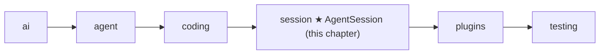

# 13 Part 4 · Sessions

**Goal:** Keep a conversation across turns and save it.

**Builds on:** [12 Evals](12-evals.md) · **Next:** [14 Plugins](14-plugins.md)

## Where we are



This chapter starts the `session` layer.

Big picture of Part 4: [part-4-session](part-4-session.md).

Code in this chapter (commit `2fc2776`):

- `packages/simp_agent/src/simp_agent/session/__init__.py` — `SessionStore`, `AgentSession`
- `apps/cli/src/simp_cli/__init__.py` — `JsonlStore`, `session_dir`
- `packages/simp_agent/tests/test_session.py` — `ListStore`, the store test and `test_context_file_in_system_prompt`

## Problem

At the end of Part 3 we have an `Agent` ([06](06-events-abort.md)) with coding tools ([10](10-coding-tools.md)) and a system prompt ([11](11-system-prompt.md)). It can write `fizzbuzz.py`. But:

- When the program stops, the conversation is gone. You cannot say "now add tests" tomorrow.
- Every app (CLI, server) would have to wire the agent, the tools, the prompt and the saving by itself, again and again.
- A crash in the middle of a run loses everything since the last save.

We need one object that owns the agent for a whole conversation and saves each message as soon as it is final. That object is the **[session](glossary.md#session)**.

## Naive version

The simplest idea: run the agent, then dump all messages to a file at the end.

```text
FUNCTION run(task, path):
    IF the file at path exists:
        old = each line of the file, read back as a message
    ELSE:
        old = empty list
    agent = a new Agent with the coding tools and messages = old
    WAIT for agent.prompt(task)
    REWRITE the file: one JSON line per message    // save everything at the end
```

It works for one happy run of the fizzbuzz task. It breaks when:

1. **The process dies mid-run.** The model wrote `fizzbuzz.py` (a real side effect) but the file of messages never got saved. On resume, the model does not know it already wrote the file.
2. **You want to save somewhere else.** The server wants a database ([22](22-store-auth.md)), tests want a list in memory. The file path is fixed inside the code.
3. **Each app repeats this.** The CLI and the server both need the same wiring.

## Step by step: from naive to real

We fix the naive version one problem at a time. Each step is small.

**Step 1 — save each message when it ends.** The naive code saves only at the end, so a crash loses the whole run. The agent already sends a `message_end` event for every finished message ([06](06-events-abort.md)). So we listen to it and save right there:

```text
ON each agent event e:
    IF e is "message_end": save(e.message)    // save right away, not at the end
```
Real code: [session/\_\_init\_\_.py](../../packages/simp_agent/src/simp_agent/session/__init__.py) — `AgentSession._on_agent_event`

Now a crash loses at most the message that was still streaming.

**Step 2 — append, do not rewrite.** A finished message never changes. So we do not need to write the whole list again. We only add one line at the end of the file (mode `"a"`). This is cheap and safe.

**Step 3 — hide the storage behind two methods.** The file path is fixed inside the code. The server wants a database, tests want a list. So the session only knows `append(entry)` and `load()`. This is the `SessionStore` protocol. A list in memory is now a full store:

```text
CLASS ListStore:
    items = a list (empty, or the given items)
    FUNCTION append(entry): add entry to the end of items
    FUNCTION load(): RETURN a copy of items
```
Real code: [tests/test_session.py](../../packages/simp_agent/tests/test_session.py) — `ListStore`

**Step 4 — allow an async store.** A database store needs `await`. So the session calls `await _maybe_await(self.store.append(...))`. A sync store returns `None` and works too.

**Step 5 — let the app load.** The app knows which session to resume (an id, the latest one). So the library does not load by itself. The app passes the list in: `AgentSession(..., messages=store.load())`.

**Step 6 — one class that owns the agent.** The CLI and the server must not repeat the wiring. So `AgentSession` builds the `Agent` with good defaults (tools, env, prompt), connects the store, and gives apps one place to `subscribe`, `prompt` and `continue_`.

**Step 7 — build the prompt from parts, and finish setup in `start()`.** Plugins ([14](14-plugins.md)) will want to add text to the system prompt. So the prompt is a table of ordered sections, and `_build_prompt` joins them before every model call. Reading `AGENTS.md` needs `await`, and `__init__` cannot await. So that work goes into `start()`, which `prompt` and `continue_` call first, only once.

The result is the real code below.

## Real design

### SessionStore: a tiny protocol

`packages/simp_agent/src/simp_agent/session/__init__.py`:

```python
class SessionStore(Protocol):
    # a message, CompactionEntry or CustomEntry, called right away (crash safe). May be async (awaited).
    def append(self, entry) -> Any: ...

    def load(self) -> list: ...  # used by the app: AgentSession(messages=store.load())
```

A **[SessionStore](glossary.md#sessionstore)** has only two methods. `append` gets one entry; `load` gives back the list. That is all the session needs. The library does not know about files or databases: that keeps the `session` layer free of IO choices (see the layer rule in [00](00-overview.md)).

Why `append` and not `save(all_messages)`? Because history is **[append-only](glossary.md#append-only-history)**. A finished message never changes, so we write it once, right away. If the process dies, every finished message is already stored. `append` may also be `async`: the session awaits it with [`_maybe_await`](glossary.md#_maybe_await) (from `agent/__init__.py`, [08](08-hooks-approval.md)), so a database store can do real async IO.

### AgentSession: owns an Agent

Real code: [session/__init__.py](../../packages/simp_agent/src/simp_agent/session/__init__.py) — `AgentSession.__init__`

```text
CLASS AgentSession:
    FUNCTION __init__(model, tools, store, env, cwd, get_api_key, system_prompt, stream_fn,
                      auto_compact, max_retries, retry_base_delay, approve, messages,
                      plugins, plugin_config):
        ...
        self.agent = NEW Agent(
            prompt   = self._build_prompt,          // a function, rebuilt every turn
            tools    = TOOLS if tools is None, else tools,
            env      = env or LocalEnv(),  cwd = cwd or the current folder,
            messages = messages,                    // the app passes loaded history
            prepare_next_turn = self._prepare,      // compaction goes here
            before_tool_call  = self._before_tool_call,
            after_tool_call   = self._after_tool_call)
```

Key idea: the session owns one Agent and plugs into its hooks; it does not copy the loop.

**[AgentSession](glossary.md#agentsession)** does not copy the loop. It *owns* one `Agent` and plugs into its sockets:

- `prepare_next_turn=self._prepare` — runs before each model call. Compaction lives here ([16](16-compaction.md)).
- `before_tool_call` / `after_tool_call` — the hooks from [08](08-hooks-approval.md). The session uses them for approval and plugins ([14](14-plugins.md)).
- `self._build_prompt` is passed where a string prompt would go. The system prompt is rebuilt every turn from **prompt sections** ([below](#prompt-sections-the-system-prompt-rebuilt-every-turn)).

Good defaults keep the call short. `tools=None` means the coding tools (`TOOLS`), `env=None` means `LocalEnv()` ([09](09-exec-env.md)), `system_prompt=None` means the coding prompt from [11](11-system-prompt.md). The other arguments (`max_retries`, `auto_compact`, `plugins`) belong to the next chapters.

### Prompt sections: the system prompt, rebuilt every turn

In [11](11-system-prompt.md) we saw that the loop can take the system prompt as a **function**. The session passes `self._build_prompt` there. Here is how it works.

The session keeps a small table of **[prompt sections](glossary.md#prompt-section)**. In `__init__`:

Real code: [session/__init__.py](../../packages/simp_agent/src/simp_agent/session/__init__.py) — `AgentSession.__init__`

```text
self._sections = empty table     // id -> (order, seq, text or fn(ctx))
self._seq = a counter
IF system_prompt is given:
    add_prompt_section("base", system_prompt, 0)
ELSE:                             // context file is added later, in start() (needs env IO)
    add_prompt_section("coding", fn(ctx) -> system_prompt_for(ctx.tools, ctx.cwd), 0)
self._default_prompt = (system_prompt is None)
```

Two methods use the table:

Real code: [session/__init__.py](../../packages/simp_agent/src/simp_agent/session/__init__.py) — `add_prompt_section`, `_build_prompt`

```text
FUNCTION add_prompt_section(id, value, order = 100):
    seq = old seq IF id is already there, ELSE next counter value   // keep first place
    self._sections[id] = (order, seq, value)

FUNCTION _build_prompt():
    ctx = {tools, cwd, model, messages} of the agent
    parts = []
    FOR EACH section, sorted by (order, seq):
        text = WAIT for value(ctx) IF value is a function, ELSE value
        IF text is not empty:
            ADD text to parts
    RETURN parts joined with a blank line
```

- **A section has an id, a value and an order.** The value is a string, or a function of `ctx` (sync or async). Sections are sorted by `order`, then by when they were first added (`seq`). Adding the same id again replaces the value but keeps its first place, so the order is stable.
- **The coding prompt is a function.** `system_prompt_for` is `coding.system_prompt` from [11](11-system-prompt.md). It is called with the **current** tools and cwd, so if the tools change, the prompt changes on the next turn.
- **Empty sections are skipped.** A function can return `""` to switch itself off. `remove_prompt_section(id)` removes a whole section. The plan-mode plugin ([18](18-profiles-plugins.md)) adds a `PLAN MODE` section at order 1000 and removes it when plan mode ends.
- **The caller can replace it.** If the app passes its own `system_prompt` string, it becomes the `"base"` section. Then the coding prompt and the context file are not added. Our tests do this with `system_prompt="s"`.

`_build_prompt` runs before **every** model call, so plugins ([14](14-plugins.md)) can change the prompt between turns.

### start(): runs once, before the first prompt

Real code: [session/__init__.py](../../packages/simp_agent/src/simp_agent/session/__init__.py) — `start`

```text
FUNCTION start():
    IF already started: RETURN           // runs only once
    mark as started
    IF default prompt AND (cf = WAIT for load_context_file(env, cwd)) is found:
        add_prompt_section("context_file", "# Project Context ## <path> <text>", 10)
    ...                                  // plugin setup, see ch 14
```

Reading the [context file](glossary.md#context-file) (`AGENTS.md`, [11](11-system-prompt.md)) needs async env IO, and `__init__` cannot `await`. So the session reads it in `start()`, which `prompt` and `continue_` call first. The `_started` flag makes it run only once. Order 10 puts the context file right after the coding text (order 0) and before plugin sections (default 100). It is read **once per session**: if you edit `AGENTS.md` mid-session, it has no effect until a new session. The rest of `start()` sets up plugins ([14](14-plugins.md)).

The `context` argument of `system_prompt` is not used by the session. The session adds the same `# Project Context` text as its own section instead, so it can come and go by itself.

`test_session.py::test_context_file_in_system_prompt` checks this: it writes `AGENTS.md` with `use tabs` and checks that the first system prompt contains it.

### Saving: one listener

Real code: [session/__init__.py](../../packages/simp_agent/src/simp_agent/session/__init__.py) — `_on_agent_event`

```text
self.agent.subscribe(self._on_agent_event)
...
FUNCTION _on_agent_event(e):
    IF e is message_end AND there is a store:
        WAIT for store.append(e.message)   // save right away: crash safe
    WAIT for self._emit(e)                 // pass it on to the session's subscribers
```

The session subscribes to the agent's events ([06](06-events-abort.md)). On every `message_end` it appends the message to the store. `message_end` fires once per finished message: the user message, each assistant reply, each tool result. Streaming deltas are not saved; only final messages are.

Then it forwards the event to its own subscribers with `_emit`. Apps subscribe to the **session**, not to the agent:

Real code: [session/__init__.py](../../packages/simp_agent/src/simp_agent/session/__init__.py) — `subscribe`

```text
FUNCTION subscribe(fn):
    ADD fn to self._subs
    RETURN a function that removes fn    // call it to unsubscribe
```

### Resume: load, then pass `messages=`

The session does not load by itself. The app does it:

```python
AgentSession(model, store=store, messages=store.load())
```

Why not load inside? Because the app decides *which* session to resume (a session id, the latest one, a new one). The library just takes a list.

### prompt and continue_

Real code: [session/__init__.py](../../packages/simp_agent/src/simp_agent/session/__init__.py) — `prompt`, `continue_`

```text
FUNCTION prompt(text):
    WAIT for start()
    ...
    RETURN WAIT for _run(agent.prompt with text)    // _run adds retry + overflow recovery

FUNCTION continue_():
    WAIT for start()
    RETURN WAIT for _run(agent.continue_)            // run again, no new message
```

`prompt(text)` adds a user message and runs. `continue_()` runs again without a new message: for example after a resume where the last message was a tool result. Both go through `_run`, which adds retry ([15](15-retry.md)) and overflow recovery ([17](17-overflow.md)). Both call `start()` first ([see above](#start-runs-once-before-the-first-prompt)).

The session also passes through `steer`, `follow_up` ([07](07-steering.md)) and `abort` ([06](06-events-abort.md)). `messages` is a property that returns `self.agent.messages`, so there is one list, not two copies.

### CustomEntry: data that is saved but not sent

Real code: [session/__init__.py](../../packages/simp_agent/src/simp_agent/session/__init__.py) — `append_entry`

```text
FUNCTION append_entry(type, data):        // saved + replayed on resume, never sent to the LLM
    entry = NEW CustomEntry(type, data)
    ADD entry to agent.messages
    IF there is a store:
        WAIT for store.append(entry)
    WAIT for _emit(message_end event with entry)
    RETURN entry
```

A **[CustomEntry](glossary.md#custom-entry)** (in `ai/__init__.py`) is app or plugin data kept in history: `type`, `data`, `role="custom"`. It is saved and comes back on resume, but it is never sent to the model. Plan mode uses it to remember "on/off" across resume ([18](18-profiles-plugins.md)).

### JsonlStore: the real store in the CLI

The library has no file store. The CLI has one, in `apps/cli/src/simp_cli/__init__.py`:

Real code: [simp_cli/__init__.py](../../apps/cli/src/simp_cli/__init__.py) — `JsonlStore`

```text
CLASS JsonlStore:                         // one finished message per line
    FUNCTION append(entry):
        make the parent folder
        OPEN the file in "a" mode, WRITE json of to_dict(entry) + newline, CLOSE
                                          // close = flush: on disk right away
    FUNCTION load():
        IF no file: RETURN []
        RETURN from_dict(json of line) FOR EACH non-empty line
```

Key idea: append one line per message. Limit: a crash can lose only the line being written.

**[JSONL](glossary.md#jsonl)** means one JSON object per line. Appending a line is cheap and safe: open in `"a"` mode, write, close. A crash can lose at most the line being written. `to_dict` / `from_dict` (from [01](01-messages.md)) turn messages into plain dicts and back. Files live at `~/.simp-agent/sessions/<cwd-slug>/<id>.jsonl` (see `session_dir`). The server has its own store on a database ([22](22-store-auth.md)); both follow the same two-method protocol.

## Test

`packages/simp_agent/tests/test_session.py::test_store_gets_every_message_in_order`:

```python
class ListStore:
    def __init__(self, items=()):
        self.items = list(items)

    def append(self, entry):
        self.items.append(entry)

    def load(self):
        return list(self.items)
...
async def test_store_gets_every_message_in_order():
    stream = FakeProvider(AssistantMessage([ToolCall("c1", "nope", {})], stop_reason="tool_use"), DONE)
    store = ListStore()
    s = session(stream, store=store)
    await s.prompt("hi")
    assert store.items == s.messages and [m.role for m in store.items] == ["user", "assistant", "tool_result", "assistant"]
    assert AgentSession(Model(), [], store=store, messages=store.load()).messages == store.items  # app restores
```

What it checks:

- `ListStore` is a full `SessionStore` in 8 lines. No file needed.
- `FakeProvider` ([02](02-fake-provider.md)) answers with a tool call to an unknown tool `nope`, then `ok`. The unknown tool still makes a tool result (an error), so the run has four messages.
- The store got **every** message, **in order**, and equals the session history.
- The last line is a resume: a new session built from `store.load()` has the same history.

Run it:

```sh
uv run pytest packages/simp_agent/tests/test_session.py::test_store_gets_every_message_in_order -q
```

## Why this way

> **Own the agent, save on every message.** `AgentSession` wraps `Agent` instead of growing it. The loop stays small and testable ([05](05-agent-loop.md)); the session adds the "long-lived" features on top through the agent's sockets. Saving on each `message_end` with a two-method `SessionStore` makes history crash safe and lets each app pick its own storage. The cost: the app must call `store.load()` and pass `messages=` itself.

## Exercises

1. Write a `PrintStore` whose `append` prints `entry.role` and keeps the entry in a list. Run a session with `FakeProvider` (copy `session(...)` from `test_session.py`) and check the printed order is `user, assistant, tool_result, assistant`. Hint: reuse the `FakeProvider(...)` call from the test above.
2. Make an async store: `async def append(self, entry)`. Does the session still save every message? Hint: look at `_maybe_await` in `agent/__init__.py`.

## Recap

- `AgentSession` owns one `Agent` and connects to its hooks and events.
- `SessionStore` is `append` + `load`. The session appends each finished message right away.
- Resume = `AgentSession(..., messages=store.load())`.
- `CustomEntry` is saved and resumed but never sent to the model.
- The system prompt is a table of prompt sections; `_build_prompt` joins them every turn, and `start()` adds the context file once.
- `JsonlStore` in the CLI is the real file store: one JSON line per entry.

**Builds on:** [12 Evals](12-evals.md) · **Next:** [14 Plugins](14-plugins.md)
