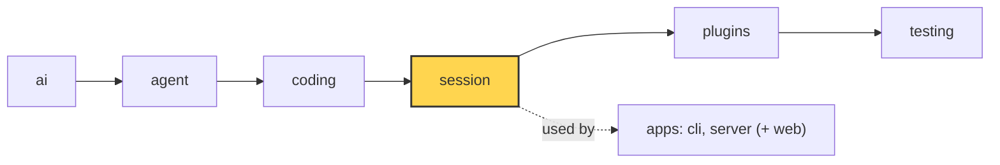

# 13 Part 4 · Sessions

**Goal:** Keep a conversation across turns and save it.

**Builds on:** [12 Evals](12-evals.md) · **Next:** [14 Plugins](14-plugins.md)

## Where we are



*This chapter starts the `session` layer (marked).*

Code in this chapter (commit `2fc2776`):

- `packages/simp_agent/src/simp_agent/session/__init__.py` — `SessionStore`, `AgentSession`
- `apps/cli/src/simp_cli/__init__.py` — `JsonlStore`, `session_dir`
- `packages/simp_agent/tests/test_session.py` — `ListStore` and the store test

## Problem

At the end of Part 3 we have an `Agent` ([05](05-agent-loop.md)) with coding tools ([10](10-coding-tools.md)) and a system prompt ([11](11-system-prompt.md)). It can write `fizzbuzz.py`. But:

- When the program stops, the conversation is gone. You cannot say "now add tests" tomorrow.
- Every app (CLI, server) would have to wire the agent, the tools, the prompt and the saving by itself, again and again.
- A crash in the middle of a run loses everything since the last save.

We need one object that owns the agent for a whole conversation and saves each message as soon as it is final. That object is the **[session](glossary.md#session)**.

## Naive version

The simplest idea: run the agent, then dump all messages to a file at the end.

```python
import json
from simp_agent.agent import Agent
from simp_agent.ai import Model, to_dict, from_dict
from simp_agent.coding import TOOLS

async def run(task: str, path: str):
    try:
        old = [from_dict(json.loads(l)) for l in open(path)]
    except FileNotFoundError:
        old = []
    agent = Agent("You are a coding agent.", Model(), list(TOOLS), messages=old)
    await agent.prompt(task)
    with open(path, "w") as f:            # save everything at the end
        for m in agent.messages:
            f.write(json.dumps(to_dict(m)) + "\n")
```

It works for one happy run of the fizzbuzz task. It breaks when:

1. **The process dies mid-run.** The model wrote `fizzbuzz.py` (a real side effect) but the file of messages never got saved. On resume, the model does not know it already wrote the file.
2. **You want to save somewhere else.** The server wants a database ([22](22-store-auth.md)), tests want a list in memory. The file path is baked in.
3. **Each app repeats this.** The CLI and the server both need the same wiring.

## Step by step: from naive to real

We fix the naive version one problem at a time. Each step is small.

**Step 1: save each message when it ends.** The naive code saves only at the end, so a crash loses the whole run. The agent already sends a `message_end` event for every finished message ([06](06-events-abort.md)). So we listen to it and save right there:

```python
agent.subscribe(lambda e: e["type"] == "message_end" and save(e["message"]))
```

Now a crash loses at most the message that was still streaming.

**Step 2: append, do not rewrite.** A finished message never changes. So we do not need to write the whole list again. We only add one line at the end of the file (mode `"a"`). This is cheap and safe.

**Step 3: hide the storage behind two methods.** The file path is baked in. The server wants a database, tests want a list. So the session only knows `append(entry)` and `load()`. This is the `SessionStore` protocol. A list in memory is now a full store:

```python
class ListStore:
    def __init__(self, items=()):
        self.items = list(items)
    def append(self, entry):
        self.items.append(entry)
    def load(self):
        return list(self.items)
```

**Step 4: allow an async store.** A database store needs `await`. So the session calls `await _maybe_await(self.store.append(...))`. A sync store returns `None` and works too.

**Step 5: let the app load.** The app knows which session to resume (an id, the latest one). So the library does not load by itself. The app passes the list in: `AgentSession(..., messages=store.load())`.

**Step 6: one class that owns the agent.** The CLI and the server must not repeat the wiring. So `AgentSession` builds the `Agent` with good defaults (tools, env, prompt), connects the store, and gives apps one place to `subscribe`, `prompt` and `continue_`.

The result is the real code below.

## Real design

### SessionStore: a tiny protocol

`packages/simp_agent/src/simp_agent/session/__init__.py`:

```python
class SessionStore(Protocol):
    # a message, CompactionEntry or CustomEntry, called right away (crash safe). May be async (awaited).
    def append(self, entry) -> Any: ...

    def load(self) -> list: ...  # used by the app: AgentSession(messages=store.load())
```

A **[SessionStore](glossary.md#sessionstore)** has only two methods. `append` gets one entry; `load` gives back the list. That is all the session needs. The library does not know about files or databases: that keeps the `session` layer free of IO choices (see the layer rule in [00](00-overview.md)).

Why `append` and not `save(all_messages)`? Because history is **[append-only](glossary.md#append-only-history)**. A finished message never changes, so we write it once, right away. If the process dies, every finished message is already stored. `append` may also be `async`: the session awaits it with [`_maybe_await`](glossary.md#_maybe_await) (from `agent/__init__.py`, [08](08-hooks-approval.md)), so a database store can do real async IO.

### AgentSession: owns an Agent

```python
class AgentSession:
    def __init__(self, model: Model, tools: list | None = None, store: SessionStore | None = None,
                 env: ExecutionEnv | None = None, cwd: str | None = None, get_api_key: Callable[[str], Any] | None = None,
                 system_prompt: str | None = None, stream_fn: Callable = ai.stream, auto_compact: bool = True,
                 max_retries: int = 3, retry_base_delay: float = 2.0, approve: Callable[[ai.ToolCall], Any] | None = None,
                 messages: list | None = None, plugins: list = (), plugin_config: dict | None = None):
        ...
        self.agent = Agent(self._build_prompt, model, list(TOOLS if tools is None else tools), stream_fn,
                           get_api_key=get_api_key, env=env or LocalEnv(), cwd=cwd or os.getcwd(), messages=messages,
                           prepare_next_turn=self._prepare, before_tool_call=self._before_tool_call,
                           after_tool_call=self._after_tool_call)
```

**[AgentSession](glossary.md#agentsession)** does not copy the loop. It *owns* one `Agent` and plugs into its sockets:

- `prepare_next_turn=self._prepare` — runs before each model call. Compaction lives here ([16](16-compaction.md)).
- `before_tool_call` / `after_tool_call` — the hooks from [08](08-hooks-approval.md). The session uses them for approval and plugins ([14](14-plugins.md)).
- `self._build_prompt` is passed where a string prompt would go. The system prompt is rebuilt every turn from **prompt sections** ([14](14-plugins.md)).

Good defaults keep the call short. `tools=None` means the coding tools (`TOOLS`), `env=None` means `LocalEnv()` ([09](09-exec-env.md)), `system_prompt=None` means the coding prompt from [11](11-system-prompt.md). The other arguments (`max_retries`, `auto_compact`, `plugins`) belong to the next chapters.

### Saving: one listener

```python
        self.agent.subscribe(self._on_agent_event)
...
    async def _on_agent_event(self, e: dict) -> None:
        if e["type"] == "message_end" and self.store:
            await _maybe_await(self.store.append(e["message"]))
        await self._emit(e)
```

The session subscribes to the agent's events ([06](06-events-abort.md)). On every `message_end` it appends the message to the store. `message_end` fires once per finished message: the user message, each assistant reply, each tool result. Streaming deltas are not saved; only final messages are.

Then it forwards the event to its own subscribers with `_emit`. Apps subscribe to the **session**, not to the agent:

```python
    def subscribe(self, fn: Callable[[dict], Any]) -> Callable[[], None]:
        self._subs.append(fn)
        return lambda: self._subs.remove(fn)
```

### Resume: load, then pass `messages=`

The session does not load by itself. The app does it:

```python
AgentSession(model, store=store, messages=store.load())
```

Why not load inside? Because the app decides *which* session to resume (a session id, the latest one, a new one). The library just takes a list.

### prompt and continue_

```python
    async def prompt(self, text: str) -> list:
        await self.start()
        ...
        return await self._run(functools.partial(self.agent.prompt, text, extra))

    async def continue_(self) -> list:
        await self.start()
        return await self._run(self.agent.continue_)
```

`prompt(text)` adds a user message and runs. `continue_()` runs again without a new message: for example after a resume where the last message was a tool result. Both go through `_run`, which adds retry ([15](15-retry.md)) and overflow recovery ([17](17-overflow.md)). `start()` runs once, on the first call: it loads the project context file (`AGENTS.md`, [11](11-system-prompt.md)) and sets up plugins ([14](14-plugins.md)).

The session also passes through `steer`, `follow_up` ([07](07-steering.md)) and `abort` ([06](06-events-abort.md)). `messages` is a property that returns `self.agent.messages`, so there is one list, not two copies.

### CustomEntry: data that is saved but not sent

```python
    async def append_entry(self, type: str, data: dict) -> CustomEntry:
        """Persisted + replayed on resume, never sent to the LLM."""
        entry = CustomEntry(type, data)
        self.agent.messages.append(entry)
        if self.store:
            await _maybe_await(self.store.append(entry))
        await self._emit({"type": "message_end", "message": entry})
        return entry
```

A **[CustomEntry](glossary.md#custom-entry)** (in `ai/__init__.py`) is app or plugin data kept in history: `type`, `data`, `role="custom"`. It is saved and comes back on resume, but it is never sent to the model. Plan mode uses it to remember "on/off" across resume ([18](18-profiles-plugins.md)).

### JsonlStore: the real store in the CLI

The library has no file store. The CLI has one, in `apps/cli/src/simp_cli/__init__.py`:

```python
class JsonlStore:
    """SessionStore on a JSONL file: one finished message (or CompactionEntry) per line."""

    def __init__(self, path: Path):
        self.path = path

    def append(self, entry) -> None:
        self.path.parent.mkdir(parents=True, exist_ok=True)
        with self.path.open("a") as f:  # close = flush, so every entry is on disk right away
            f.write(json.dumps(to_dict(entry)) + "\n")

    def load(self) -> list:
        if not self.path.exists():
            return []
        return [from_dict(json.loads(line)) for line in self.path.read_text().splitlines() if line.strip()]
```

**[JSONL](glossary.md#jsonl)** means one JSON object per line. Appending a line is cheap and safe: open in `"a"` mode, write, close. A crash can lose at most the line being written. `to_dict` / `from_dict` (from [01](01-messages.md)) turn messages into plain dicts and back. Files live at `~/.simp-agent/sessions/<cwd-slug>/<id>.jsonl` (see `session_dir`). The server has its own store on a database ([22](22-store-auth.md)); both follow the same two-method protocol.

## Test

`packages/simp_agent/tests/test_session.py::test_store_gets_every_message_in_order`:

```python
class ListStore:
    def __init__(self, items=()):
        self.items = list(items)

    def append(self, entry):
        self.items.append(entry)

    def load(self):
        return list(self.items)
...
async def test_store_gets_every_message_in_order():
    stream = FakeProvider(AssistantMessage([ToolCall("c1", "nope", {})], stop_reason="tool_use"), DONE)
    store = ListStore()
    s = session(stream, store=store)
    await s.prompt("hi")
    assert store.items == s.messages and [m.role for m in store.items] == ["user", "assistant", "tool_result", "assistant"]
    assert AgentSession(Model(), [], store=store, messages=store.load()).messages == store.items  # app restores
```

What it checks:

- `ListStore` is a full `SessionStore` in 8 lines. No file needed.
- `FakeProvider` ([02](02-fake-provider.md)) answers with a tool call to an unknown tool `nope`, then `ok`. The unknown tool still makes a tool result (an error), so the run has four messages.
- The store got **every** message, **in order**, and equals the session history.
- The last line is a resume: a new session built from `store.load()` has the same history.

Run it:

```sh
uv run pytest packages/simp_agent/tests/test_session.py::test_store_gets_every_message_in_order -q
```

## Why this way

> **Own the agent, save on every message.** `AgentSession` wraps `Agent` instead of growing it. The loop stays small and testable ([05](05-agent-loop.md)); the session adds the "long-lived" features on top through the agent's sockets. Saving on each `message_end` with a two-method `SessionStore` makes history crash safe and lets each app pick its own storage. The cost: the app must call `store.load()` and pass `messages=` itself.

## Exercises

1. Write a `PrintStore` whose `append` prints `entry.role` and keeps the entry in a list. Run a session with `FakeProvider` (copy `session(...)` from `test_session.py`) and check the printed order is `user, assistant, tool_result, assistant`. Hint: reuse the `FakeProvider(...)` call from the test above.
2. Make an async store: `async def append(self, entry)`. Does the session still save every message? Hint: look at `_maybe_await` in `agent/__init__.py`.

## Recap

- `AgentSession` owns one `Agent` and connects to its hooks and events.
- `SessionStore` is `append` + `load`. The session appends each finished message right away.
- Resume = `AgentSession(..., messages=store.load())`.
- `CustomEntry` is saved and resumed but never sent to the model.
- `JsonlStore` in the CLI is the real file store: one JSON line per entry.

**Builds on:** [12 Evals](12-evals.md) · **Next:** [14 Plugins](14-plugins.md)
