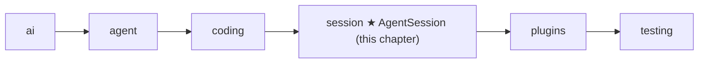

# 13 Part 4 · Sessions

**Goal:** Keep a conversation across turns and save it.

**Builds on:** [12 Evals](12-evals.md) · **Next:** [14 Plugins](14-plugins.md)

## Where we are



This chapter starts the `session` layer.

**Builds:** blocks 2, 5, 7 · **IN:** a `Model`, a store, old messages · **OUT:** one saved line per finished message

Big picture of Part 4: [part-4-session](part-4-session.md).

Code in this chapter (commit `2fc2776`):

- `packages/simp_agent/src/simp_agent/session/__init__.py` — `SessionStore`, `AgentSession`
- `apps/cli/src/simp_cli/__init__.py` — `JsonlStore`, `session_dir`
- `packages/simp_agent/tests/test_session.py` — `ListStore`, the store test and `test_context_file_in_system_prompt`

## Problem

At the end of Part 3 we have an `Agent` ([06](06-events-abort.md)) with coding tools ([10](10-coding-tools.md)) and a system prompt ([11](11-system-prompt.md)). It can write `fizzbuzz.py`. But:

- When the program stops, the conversation is gone. You cannot say "now add tests" tomorrow.
- Every app (CLI, server) would have to wire the agent, the tools, the prompt and the saving by itself, again and again.
- A crash in the middle of a run loses everything since the last save.

We need one object that owns the agent for a whole conversation and saves each message as soon as it is final. That object is the **[session](glossary.md#session)**.

### The goal: what is saved

Here is the OUT first. The user says `hi`. The model calls a tool `nope` that does not exist, gets an error back, then answers `ok`. The session saves exactly these 4 lines, one per finished message:

```text
{"content": "hi", "role": "user"}
{"content": [{"id": "c1", "name": "nope", "arguments": {}, "type": "tool_call"}], "stop_reason": "tool_use", "usage": {"input": 0, "output": 0}, "error": null, "error_kind": null, "api": "", "provider": "", "model": "", "role": "assistant"}
{"tool_call_id": "c1", "tool_name": "nope", "content": "Tool nope not found", "is_error": true, "role": "tool_result"}
{"content": [{"text": "ok", "signature": null, "type": "text"}], "stop_reason": "stop", "usage": {"input": 0, "output": 0}, "error": null, "error_kind": null, "api": "", "provider": "", "model": "", "role": "assistant"}
```

This is a **[JSONL](glossary.md#jsonl)** file: one JSON object per line. (Real output of the test run below, with the fake model, so `usage` and `model` are empty.) Each line is written the moment its message ends. To resume, we read the lines back into messages.

## Naive version

The simplest idea: run the agent, then dump all messages to a file at the end.

```text
FUNCTION run(task, path):
    IF the file at path exists:
        old = each line of the file, read back as a message
    ELSE:
        old = empty list
    agent = a new Agent with the coding tools and messages = old
    WAIT for agent.prompt(task)
    REWRITE the file: one JSON line per message    // save everything at the end
```

It works for one happy run of the fizzbuzz task. It breaks when:

1. **The process dies mid-run.** The model wrote `fizzbuzz.py` (a real side effect) but the file of messages never got saved. On resume, the model does not know it already wrote the file.
2. **You want to save somewhere else.** The server wants a database ([22](22-store-auth.md)), tests want a list in memory. The file path is fixed inside the code.
3. **Each app repeats this.** The CLI and the server both need the same wiring.

We fix these one at a time below. Each part says the problem, what we do and why, then the code.

## Real design

### Save each message when it ends

Problem 1: saving only at the end loses the whole run on a crash. The agent already sends a `message_end` event for every finished message ([06](06-events-abort.md)): the user message, each assistant reply, each tool result. So the session listens to the agent's events and saves right there.

Real code: [session/\_\_init\_\_.py](../../packages/simp_agent/src/simp_agent/session/__init__.py) — `_on_agent_event`

```text
self.agent.subscribe(self._on_agent_event)       // in __init__
...
FUNCTION _on_agent_event(e):
    IF e is message_end AND there is a store:
        WAIT for store.append(e.message)   // save right away: crash safe
    WAIT for self._emit(e)                 // pass it on to the session's subscribers
```

Now a crash loses at most the message that was still streaming. Streaming deltas are not saved; only final messages are.

Why `append` and not "rewrite the whole list"? Because history is **[append-only](glossary.md#append-only-history)**: a finished message never changes. So we write it once and never touch it again. Adding one line is cheap; rewriting the file every time is not.

After saving, the session forwards the event with `_emit`. Apps subscribe to the **session**, not to the agent:

Real code: [session/\_\_init\_\_.py](../../packages/simp_agent/src/simp_agent/session/__init__.py) — `subscribe`

```text
FUNCTION subscribe(fn):
    ADD fn to self._subs
    RETURN a function that removes fn    // call it to unsubscribe
```

### Hide the storage behind two methods

Problem 2: the file path is fixed in the code. The server wants a database; tests want a list. So the session only knows two methods. That is the `SessionStore` protocol:

```python
class SessionStore(Protocol):
    # a message, CompactionEntry or CustomEntry, called right away (crash safe). May be async (awaited).
    def append(self, entry) -> Any: ...

    def load(self) -> list: ...  # used by the app: AgentSession(messages=store.load())
```

A **[SessionStore](glossary.md#sessionstore)** has only `append` (save one entry) and `load` (give back the list). The library does not know about files or databases. That keeps the `session` layer free of IO choices (see the layer rule in [00](00-overview.md)).

A list in memory is now a full store. The tests use this one:

```python
class ListStore:
    def __init__(self, items=()):
        self.items = list(items)

    def append(self, entry):
        self.items.append(entry)

    def load(self):
        return list(self.items)
```

A database store needs `await`. So the session does not call `store.append(...)` alone; it wraps it: `await _maybe_await(self.store.append(...))`. **[`_maybe_await`](glossary.md#_maybe_await)** (from `agent/__init__.py`, [08](08-hooks-approval.md)) awaits the result only if it is awaitable. A sync store returns `None`, and that is fine too.

### Let the app load

The session does not load by itself. The app does it and passes the list in:

```python
AgentSession(model, store=store, messages=store.load())
```

Why? The app decides *which* session to resume: a session id, the latest one, or a new one. The library just takes a list.

### One class that owns the agent

Problem 3: the CLI and the server must not repeat the wiring. So **[AgentSession](glossary.md#agentsession)** builds the `Agent` with good defaults, connects the store, and gives apps one place to `subscribe`, `prompt` and `continue_`. It does not copy the loop. It *owns* one `Agent` and plugs into its hooks.

Real code: [session/\_\_init\_\_.py](../../packages/simp_agent/src/simp_agent/session/__init__.py) — `AgentSession.__init__`

```text
CLASS AgentSession:
    FUNCTION __init__(model, tools, store, env, cwd, system_prompt, messages):
                                     // other arguments arrive in later chapters
        self.agent = NEW Agent(
            prompt   = self._build_prompt,          // a function, rebuilt every turn (prompt sections, below)
            tools    = TOOLS if tools is None, else tools,
            env      = env or LocalEnv(),  cwd = cwd or the current folder,
            messages = messages,                    // the app passes loaded history
            prepare_next_turn = self._prepare,
            before_tool_call  = self._before_tool_call,
            after_tool_call   = self._after_tool_call)
        self.agent.subscribe(self._on_agent_event)  // saving, above
```

- `prepare_next_turn`, `before_tool_call` and `after_tool_call` are the agent's hooks ([08](08-hooks-approval.md)). The session fills them, so later chapters can add features without changing the loop.
- Good defaults keep the call short: `tools=None` means the coding tools (`TOOLS`), `env=None` means `LocalEnv()` ([09](09-exec-env.md)), `system_prompt=None` means the coding prompt from [11](11-system-prompt.md).
- `messages` is a property that returns `self.agent.messages`, so there is one list, not two copies.

The session also passes through `steer`, `follow_up` ([07](07-steering.md)) and `abort` ([06](06-events-abort.md)).

### prompt, continue_ and start()

Real code: [session/\_\_init\_\_.py](../../packages/simp_agent/src/simp_agent/session/__init__.py) — `prompt`, `continue_`, `start`

```text
FUNCTION prompt(text):
    WAIT for start()
    RETURN WAIT for _run(agent.prompt with text)

FUNCTION continue_():
    WAIT for start()
    RETURN WAIT for _run(agent.continue_)       // run again, no new message

FUNCTION start():
    IF already started: RETURN                  // runs only once
    mark as started
    IF default prompt AND (cf = WAIT for load_context_file(env, cwd)) is found:
        add_prompt_section("context_file", "# Project Context\n\n## <path>\n\n<text>", 10)
    ...                                         // more setup in later chapters
```

- `prompt(text)` adds a user message and runs. `continue_()` runs again without a new message, for example after a resume where the last message was a tool result.
- `_run` is where later chapters add more steps around the run. For now, think of it as "run the agent".
- **Why `start()`?** Reading the [context file](glossary.md#context-file) (`AGENTS.md`, [11](11-system-prompt.md)) needs async env IO, and `__init__` cannot `await`. So the work goes into `start()`, which `prompt` and `continue_` call first. The `_started` flag makes it run only once.
- So `AGENTS.md` is read **once per session**. If you edit it mid-session, it has no effect until a new session.

`start()` adds the file with `add_prompt_section`. The next part explains what that is.

### Prompt sections: the system prompt, rebuilt every turn

**The goal.** With the default prompt and an `AGENTS.md` that says `use tabs`, the model gets one system prompt made of 2 sections, joined by a blank line:

```text
You are an expert coding assistant. ... <- section "coding", order 0
                                       
# Project Context                      <- section "context_file", order 10

## AGENTS.md

use tabs
```

Later, plugins add their own sections (default order 100) after these.

**The table.** The session keeps a small table of **[prompt sections](glossary.md#prompt-section)**. Each section has an id, an order and a value.

Real code: [session/\_\_init\_\_.py](../../packages/simp_agent/src/simp_agent/session/__init__.py) — `AgentSession.__init__`, `add_prompt_section`, `_build_prompt`

```text
// in __init__
IF system_prompt is given:
    add_prompt_section("base", system_prompt, 0)
ELSE:
    add_prompt_section("coding", fn(ctx) -> system_prompt_for(ctx.tools, ctx.cwd), 0)

FUNCTION add_prompt_section(id, value, order = 100):
    seq = old seq IF id is already there, ELSE next counter value
    self._sections[id] = (order, seq, value)

FUNCTION _build_prompt():
    ctx = {tools, cwd, model, messages} of the agent
    parts = []
    FOR EACH section, sorted by (order, seq):
        text = WAIT for value(ctx) IF value is a function, ELSE value
        IF text is not empty: ADD text to parts
    RETURN parts joined with a blank line
```

The rules, one at a time:

- **Sort by order, then by `seq`.** `seq` is when the id was first added. Why: two sections with the same order still come out in a fixed order.
- **Adding the same id again replaces the value but keeps its place.** Why: a plugin can update its text without moving around.
- **A value can be a function of `ctx`.** The coding section is one: it calls `system_prompt_for` ([11](11-system-prompt.md)) with the **current** tools and cwd. Why: if the tools change, the prompt follows on the next turn.
- **Empty text is skipped.** Why: a function can return `""` to switch itself off. `remove_prompt_section(id)` removes a section for good.
- **The app can replace the default.** If the app passes its own `system_prompt` string, it becomes the `"base"` section, and no coding text or context file is added. Our tests do this with `system_prompt="s"`.
- **`AGENTS.md` is its own section.** Why: it can be added or removed alone, without touching the coding text.

The session passes `self._build_prompt` to the `Agent` as the prompt. The loop calls it before **every** model call ([11](11-system-prompt.md) showed that the prompt can be a function). So any section change shows up on the next turn.

`test_session.py::test_context_file_in_system_prompt` checks this: it writes `AGENTS.md` with `use tabs` and checks that the first system prompt contains it.

### JsonlStore: the real store in the CLI

The library has no file store. The CLI has one, in `apps/cli/src/simp_cli/__init__.py`. It makes the 4 lines from [the goal](#the-goal-what-is-saved):

Real code: [simp_cli/\_\_init\_\_.py](../../apps/cli/src/simp_cli/__init__.py) — `JsonlStore`

```text
CLASS JsonlStore:                         // one finished entry per line
    FUNCTION append(entry):
        make the parent folder
        OPEN the file in "a" mode, WRITE json of to_dict(entry) + newline, CLOSE
                                          // close = flush: on disk right away
    FUNCTION load():
        IF no file: RETURN []
        RETURN from_dict(json of line) FOR EACH non-empty line
```

- Mode `"a"` adds at the end and never rewrites. A crash can lose at most the line being written.
- `to_dict` / `from_dict` ([ref-objects](ref-objects.md#going-to-json-and-back)) turn messages into plain dicts and back. The `role` field picks the class.
- Files live at `~/.simp-agent/sessions/<cwd-slug>/<id>.jsonl` (see `session_dir`).
- The server has its own store on a database ([22](22-store-auth.md)). Both follow the same two-method protocol.

Besides messages, a store can also get two other entry types: a compaction entry ([16](16-compaction.md)) and a plugin's custom entry. Both are saved but never sent to the model. Fields: [ref-objects](ref-objects.md#two-history-entries-that-are-not-messages).

## Test

`packages/simp_agent/tests/test_session.py::test_store_gets_every_message_in_order`:

```python
async def test_store_gets_every_message_in_order():
    stream = FakeProvider(AssistantMessage([ToolCall("c1", "nope", {})], stop_reason="tool_use"), DONE)
    store = ListStore()
    s = session(stream, store=store)
    await s.prompt("hi")
    assert store.items == s.messages and [m.role for m in store.items] == ["user", "assistant", "tool_result", "assistant"]
    assert AgentSession(Model(), [], store=store, messages=store.load()).messages == store.items  # app restores
```

What it checks:

- `FakeProvider` ([04](04-label-test.md)) answers with a call to an unknown tool `nope`, then `ok`. The unknown tool still makes a tool result (an error), so the run has four messages: the 4 lines of [the goal](#the-goal-what-is-saved).
- The store got **every** message, **in order**, and equals the session history.
- The last line is a resume: a new session built from `store.load()` has the same history.

Run it:

```sh
uv run pytest packages/simp_agent/tests/test_session.py::test_store_gets_every_message_in_order -q
```

## Why this way

> **Own the agent, save on every message.** `AgentSession` wraps `Agent` instead of growing it. The loop stays small and testable ([05](05-agent-loop.md)); the session adds the "long-lived" features on top through the agent's hooks. Saving on each `message_end` with a two-method `SessionStore` makes history crash safe and lets each app pick its own storage. The cost: the app must call `store.load()` and pass `messages=` itself.

## Exercises

1. Write a `PrintStore` whose `append` prints `entry.role` and keeps the entry in a list. Run a session with `FakeProvider` (copy `session(...)` from `test_session.py`) and check the printed order is `user, assistant, tool_result, assistant`. Hint: reuse the `FakeProvider(...)` call from the test above.
2. Make an async store: `async def append(self, entry)`. Does the session still save every message? Hint: look at `_maybe_await` in `agent/__init__.py`.

## Recap

- `AgentSession` owns one `Agent` and connects to its hooks and events.
- `SessionStore` is `append` + `load`. The session appends each finished message right away.
- Resume = `AgentSession(..., messages=store.load())`.
- `start()` runs once before the first run and adds the context file.
- The system prompt is a table of prompt sections; `_build_prompt` joins them every turn.
- `JsonlStore` in the CLI is the real file store: one JSON line per entry.

**Builds on:** [12 Evals](12-evals.md) · **Next:** [14 Plugins](14-plugins.md) — plugins use the session's hooks and prompt sections.
