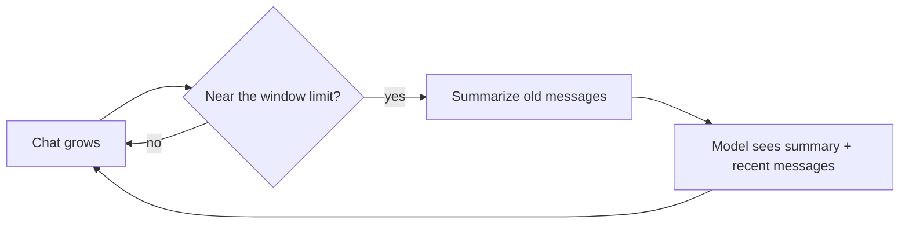

# 13 Working well with the agent

**For:** Users who already chat with the agent and want better results.
**You need first:** [10 The CLI](10-cli.md) and/or [11 The web UI](11-web.md); the terms [system prompt](glossary.md#system-prompt), [compaction](glossary.md#compaction) and [history](glossary.md#history).
**You will learn:** how to give the agent standing rules with `AGENTS.md`, how to write a good request, and how to keep long sessions healthy.
**Code covered:** `packages/simp_agent/src/simp_agent/coding/__init__.py` (context files, system prompt), `.../session/__init__.py` (`start()`), `.../agent/compaction.py`.
Verified at commit `a8615b1`.

Each tip is tagged **[CLI]**, **[web]** or **[both]**. For a side-by-side of the apps, see [12](12-cli-vs-web.md).

## 1. Give standing rules with AGENTS.md  [both]

The agent knows nothing about your project at the start. A [context file](glossary.md#context-file) fixes that: a plain Markdown file whose text is added to the [system prompt](glossary.md#system-prompt) under "Project Context".

How it works (from the code):

- The agent looks in the **working folder only** (no parent folders, no home folder).
- It tries these names in order and uses the **first one it finds**: `AGENTS.override.md`, `AGENTS.md`, `AGENTS.MD`, `CLAUDE.md`, `CLAUDE.MD`. Files are not merged.
- It reads the file **once**, when the first message of the session is sent. If you edit the file later, start a new session.
- If there is no file, nothing is added. There is no error.

Where the working folder is:

- **[CLI]** the folder where you started `simp-agent`. Put `AGENTS.md` there.
- **[web]** the session's sandbox folder, not your computer ([chapter 11, Files](11-web.md#7-files)). Use **Upload** to put an `AGENTS.md` in the root of the folder *before* your first message.

Why use one? You write a rule once, and every session obeys it. Without it you repeat yourself in every chat.

What to put in it — short and concrete:

```markdown
# Project rules
- Python 3.12. Run tests with `uv run pytest -q`.
- Code is in `src/`. Do not edit files in `generated/`.
- Keep changes small. Do not add new dependencies without asking.
```

Good content: how to build and test, where things are, what not to touch. Bad content: long essays. The whole file is sent on **every** turn, so a big file uses up room in the model's context window.

Note: `CLAUDE.md` is read too, so a project that already has one works unchanged. If several exist, the first in the list wins: `AGENTS.override.md` beats `AGENTS.md`, which beats `CLAUDE.md`.

## 2. Write good requests  [both]

The agent is a [loop](glossary.md#agent-loop) of model calls and [tool](glossary.md#tool) calls. It cannot see your screen or your mind. Help it:

1. **Say the goal and the "done" test.** Weak: "fix the bug". Better: "`test_parse` fails with KeyError. Fix it so `uv run pytest tests/test_parse.py` passes."
2. **Name files and places.** "Look at `src/parse.py`, function `read_row`" saves many tool calls.
3. **One task per request.** Several small turns beat one huge one, and are easier to check.
4. **Give limits.** "Do not change the public function names." "Only touch `src/`."
5. **Ask it to check its work.** "Run the tests after the change."
6. **Put lasting rules in AGENTS.md**, not in chat (section 1).

Fixing a request in the middle of a run:

- **[CLI]** plain text is a [steer](glossary.md#steer) (read before the next step); `>> text` is a [follow-up](glossary.md#follow-up) (after the run). Ctrl-C stops the run. See [chapter 10](10-cli.md#3-the-repl).
- **[web]** the chat box sends a steer by default; **Queue as follow-up** waits. **Stop** or Esc stops the run. See [chapter 11](11-web.md#3-chat).

Use a steer to correct a wrong direction early. It is cheaper than letting the agent finish the wrong job.

**[web]** To explore before changing anything, turn on [plan mode](glossary.md#plan-mode): the agent can read and plan, but cannot edit or run commands. The CLI has no plan mode; there, say "do not change anything yet, only explain your plan".

## 3. Long sessions and compaction  [both]

The model can only read so much at once (its [context window](glossary.md#context-window)). A long chat, with big file reads and command output, fills it. [Compaction](glossary.md#compaction) is the fix; its home is chapter 31 (How one turn flows). What you need to know here:

- It is **automatic.** The session compacts when the history is within 16,384 tokens of the window, and after a "context too long" error.
- It **summarizes old messages** with one extra model call and keeps about the latest 20,000 tokens as they are. The [history](glossary.md#history) is not deleted; only what the model sees changes.
- A summary is shorter than the original. **Details can be lost.** Exact error text, long code, or a rule you said once may be gone.

Tips:

- **Start a new session for a new task.** This is the best habit. Old context only distracts.
- **Compact between tasks, not in the middle of one.** **[CLI]** `/compact` (not while a run is active). **[web]** the **Compact** button (greyed out while running). The web shows "Context compacted (N → M tokens)".
- **Watch the size.** **[CLI]** the status line shows a token estimate. **[web]** has no context-size view (the [spend display](11-web.md#9-spend-display) shows money, not tokens), so compact by habit between tasks.
- **Repeat key facts after a compaction.** Or better, put them in `AGENTS.md`: the context file is part of the system prompt, so it is *not* summarized away.
- **One very big turn cannot be compacted.** The cut is made only between messages, so a single huge turn stays whole. Keep tool output small ("show only the first 50 lines").



## 4. Quick checklist

| Do | Tag |
|---|---|
| Add `AGENTS.md` with build/test commands | both (web: upload it first) |
| State the goal and how to check it | both |
| Steer early when the agent goes wrong | both |
| New session per task; compact between tasks | both |
| Plan mode for "look first" | web only |

**Next:** [20 Operator tutorial](20-operator-tutorial.md) (Part 2). **Back:** [12 CLI vs web](12-cli-vs-web.md).
**Built on by:** 31 How one turn flows (the home of compaction and the system prompt).
