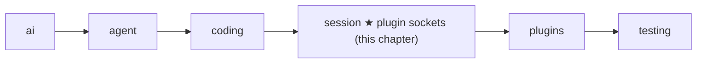

# 14 Part 4 · Plugins

**Goal:** Add behaviour without changing the core.

**Builds on:** [13 Sessions](13-session.md) · **Next:** [15 Retry](15-retry.md)

## Where we are



This chapter adds plugin support inside the `session` layer. The `plugins` folder, with two real plugins, comes in [18](18-profiles-plugins.md).

**Builds:** blocks 3 and 6, and the plugin parts of blocks 2, 4 and 7 · **IN:** a list of plugin objects, `plugin_config` · **OUT:** changed text, view, tool calls, tool results and events

Big picture of Part 4: [part-4-session](13-0-part-4-session.md).

Code in this chapter (commit `2fc2776`):

- `packages/simp_agent/src/simp_agent/session/__init__.py` — `plugin_name`, `PluginAPI`, and in `AgentSession`: `start`, `_hook`, `prompt`, `_context`, `_before_tool_call`, `_after_tool_call`, `_emit`
- `apps/cli/tests/test_sockets.py` — `Rec` and the `test_plugin_*` tests

## Problem

In [13](13-session.md) the user came back the next day and typed "now add tests". The session loaded yesterday's history and the agent went to work. Now two teams want small extras on top of that same session. One team wants a "no bash" mode: the agent may read and edit files, but never run a shell command. Another team wants to hide API keys: if the agent runs `cat .env`, the key must not reach the screen, the log or the model.

We could put an `if` for each extra inside `AgentSession`. But the list of extras never ends (plan mode, an extra tool, a line in the system prompt, a log of every event), so the session would grow without end, and every app would carry every extra.

We want a **[plugin](glossary.md#plugin)** instead: a plain object that the session calls at fixed moments. The core stays the same; you add an object to `AgentSession(plugins=[...])`. A method that the session calls on a plugin is a **[plugin hook](glossary.md#plugin-hook)**. Do not mix it up with the two [tool hooks](glossary.md#tool-hook) of [08](08-hooks-approval.md) (`before_tool_call` and `after_tool_call`). Those belong to the loop. As [13](13-session.md) said, the session fills them with its own methods. In this chapter, those methods call the plugins.

## Naive version

In [13](13-session.md#one-class-that-owns-the-agent), `AgentSession` gave the agent its own `_before_tool_call`, `_after_tool_call` and `_prepare` hooks. Plugins go inside those methods, so the loop does not change. A first try for "no bash": the session's `_before_tool_call` asks every plugin.

Naive sketch (not in the repo):

```text
CLASS AgentSession:
    FUNCTION _before_tool_call(call, ctx):   // the ch 08 before_tool_call hook
        FOR EACH plugin p:
            r = p.tool_call(call)            // every plugin MUST have tool_call
            IF r has "block":
                RETURN r["block"]            // the loop makes it "User denied: ..."

CLASS NoBash:
    FUNCTION tool_call(call):
        IF call.name is "bash": RETURN {block: "no bash"}
        RETURN nothing
```

It works for `NoBash`: the model asks for `bash`, gets the result `User denied: no bash`, and picks another way. Now add the second plugin, the key hider. It only wants to see tool output, so it has no `tool_call` method. The call `p.tool_call(call)` raises `AttributeError`. The loop does not catch errors from `before_tool_call` ([08](08-hooks-approval.md)), so the error escapes and the whole run stops at the first tool call. Four things are wrong:

1. Every plugin must have every method.
2. One plugin with a bug breaks the run for everyone.
3. There is only one moment to hook in. The key hider needs a different moment: when tool output arrives.
4. A plugin cannot do anything to the session, such as add a tool or a line to the system prompt.

## Step by step: from naive to real

**Step 1: look the method up first.** Use `getattr(p, "tool_call", None)`. If the plugin has no such method, skip it. Now the key hider needs only the methods it wants. This fixes problem 1.

**Step 2: allow plain and `async` methods.** A web plugin may need to `await`. We call the method and pass the result through `_maybe_await` from [08](08-hooks-approval.md), which awaits only when it must.

**Step 3: catch errors in one place.** Put steps 1 and 2 inside one helper, `_hook`, with a `try`. On error it sends a **[`plugin_error`](glossary.md#plugin_error)** event that names the plugin and the method, and returns `None`, as if the plugin did nothing. The run goes on. This fixes problem 2.

**Step 4: but a broken safety check must say "no".** For `tool_call`, "skip on error" is wrong. If `NoBash` crashes and we skip it, `bash` runs, and that is exactly what it was meant to stop. So `_hook` gets a flag `isolate=False` that lets the error out, and the caller turns the error into a block.

**Step 5: more moments.** Call `_hook` at more fixed places in the session: when the user types, before each model call, after each tool, on each event. This fixes problem 3.

**Step 6: give each plugin a handle.** Once, at start, each plugin gets a small object with the actions it may take. This fixes problem 4.

The rest of the chapter is the real code for these six steps.

## Real design

All code is in `packages/simp_agent/src/simp_agent/session/__init__.py`.

### A plugin is any object

There is no base class. Any object can be a plugin. Its name is its `name` field, or the class name if it has none:

```python
def plugin_name(p) -> str:
    return getattr(p, "name", type(p).__name__)
```

The name shows up in `plugin_error` events, in block messages, and as the key into `plugin_config`.

### `_hook`: one place for every call

Every plugin call in the session goes through this helper (steps 1 to 4):

Real code: [session/\_\_init\_\_.py](../../packages/simp_agent/src/simp_agent/session/__init__.py) — `AgentSession._hook`

```text
FUNCTION _hook(p, hook, args, isolate = true):
    fn = the method named hook on p, or nothing
    IF fn is nothing:
        RETURN nothing                         // step 1: missing method, skip
    TRY:
        RETURN WAIT for _maybe_await(fn(args)) // step 2: plain or async
    IF it raised error:
        IF not isolate:
            raise it again                     // step 4: the caller decides
        SEND {type: "plugin_error", plugin, hook, error} to subscribers only
        RETURN nothing                         // step 3: as if the plugin did nothing
```

This rule, "an error in a hook becomes an event, and the run goes on", is called **[hook isolation](glossary.md#hook-isolation)**. Note where the `plugin_error` event goes: only to the subscribers of [13](13-session.md) (the app), not to the plugins' own `on_event`. Why? If a plugin's `on_event` were broken, it would raise on the `plugin_error` event too, which would make another `plugin_error`, and so on forever.

### The hooks, in the order they run

Here are all the hooks (step 5). Each row says where the session calls it.

| Hook | When | What it can return |
|---|---|---|
| `setup(api, config)` | once, in `start()` | — |
| `session_start()` | once, after all `setup` calls | — |
| `input(text)` | start of `prompt()` | `{"handled": True}` to stop, or `{"text": ...}` to change the text |
| `before_agent_start(info)` | in `prompt()`, before the run; `info` is `{"prompt", "messages"}` | `{"messages": [...]}` to add messages to this run |
| `context(messages)` | before each model call | a new message list |
| `tool_call(call)` | before a tool runs | `{"block": reason}`, or `{"args": {...}}` to change the arguments |
| `tool_result(call, result)` | after a tool runs, or after it is blocked or denied | a dict of fields to replace |
| `tool_update(call, text)` | on each piece of streamed tool output (for example from `bash`, [10](10-coding-tools.md)) | new text |
| `on_event(e)` | on every session event | — |
| `session_shutdown()` | in `shutdown()` | — |

Now we follow one "now add tests" run through these rows.

**Start.** The first `prompt()` calls `start()` ([13](13-session.md#prompt-continue_-and-start)). After it adds the context file, it runs this (step 6):

```text
FOR EACH plugin p:
    WAIT for _hook(p, "setup", new PluginAPI(session, name of p), plugin_config[name of p] or {})
FOR EACH plugin p:
    WAIT for _hook(p, "session_start")      // only after ALL setups are done
```

`plugin_config` is a dict keyed by plugin name, so each plugin sees only its own settings. `session_start` waits for all `setup` calls, so a plugin can count on the others being ready. The `PluginAPI` is shown [below](#pluginapi-what-a-plugin-may-do).

**The user types.** In `prompt()`, each plugin's `input` sees the text. If one returns `{"handled": True}`, `prompt()` returns `[]` and the model is never called. This is how a plugin can handle its own slash command, such as `/plan`. If it returns `{"text": ...}`, the next plugin and the model get the new text. Then `before_agent_start` may add extra messages; a plain string becomes a `UserMessage`.

**Before each model call.** The session builds the message list to send, the **[view](glossary.md#view-llm-view)**, and passes it through the plugins as a chain:

Real code: [session/\_\_init\_\_.py](../../packages/simp_agent/src/simp_agent/session/__init__.py) — `AgentSession._context`

```python
async def _context(self, view: list) -> list:
    for p in self.plugins:  # chained: each gets the previous output
        view = await self._hook(p, "context", list(view)) or view
    return view
```

Each plugin gets the output of the one before. It gets a copy (`list(view)`), so it cannot change the saved history by mistake: a plugin changes what the model sees this turn, never what is saved. If a plugin fails, or returns `None` or an empty list, `or view` keeps the old view. The key hider uses this hook to remove keys that are already in the history.

**Before a tool runs.** The model asks for `bash`. The loop calls `before_tool_call` ([08](08-hooks-approval.md)), which the session filled with `_before_tool_call`:

Real code: [session/\_\_init\_\_.py](../../packages/simp_agent/src/simp_agent/session/__init__.py) — `AgentSession._before_tool_call`

```text
FUNCTION _before_tool_call(call, ctx):
    FOR EACH plugin p:                  // first block wins
        TRY:
            r = WAIT for _hook(p, "tool_call", call, isolate = false), or {}
        IF it raised error e:
            RETURN "blocked by plugin <name> (<error type>: <e>)"
        IF r has "block":
            RETURN "blocked by plugin <name>: <reason>"
        IF r has "args":
            call.arguments = r["args"]  // the next plugin sees the new arguments
    ...                                 // then the approval check of ch 08
```

This is the only hook with `isolate=False`. A `tool_call` hook is often a safety check, and if the check crashes, running the tool anyway would be unsafe. So here an error means "no". This rule is called **[fail closed](glossary.md#fail-closed)**.

Here is a worked example. `NoBash` has a bug: its `tool_call` raises `KeyError('name')`. The model asks for `bash`. `_hook` lets the error out, and `_before_tool_call` returns `blocked by plugin NoBash (KeyError: 'name')`. The loop turns that into the tool result `User denied: blocked by plugin NoBash (KeyError: 'name')`. The `bash` tool never runs. With a working `NoBash`, the result is `User denied: blocked by plugin NoBash: no bash`.

The first plugin that blocks wins; later plugins are not asked. Plugins also run before the approval question of [08](08-hooks-approval.md), so a blocked call never asks the human. The cost: a plugin cannot see whether the human would have said yes.

**After a tool runs.** The loop calls `after_tool_call`, which the session filled with `_after_tool_call`:

```text
FUNCTION _after_tool_call(call, result, ctx):
    FOR EACH plugin p:                  // in order
        r = WAIT for _hook(p, "tool_result", call, result)
        IF r is not empty:
            result = copy of result with the fields in r replaced   // dataclasses.replace
    RETURN result
```

A plugin returns only the fields it wants to change, for example `{"content": "<hidden>"}`, and the other fields stay. As in [08](08-hooks-approval.md), this also runs after a block or a deny.

**Every event.** Last, the session's `_emit` from [13](13-session.md) also feeds plugins:

Real code: [session/\_\_init\_\_.py](../../packages/simp_agent/src/simp_agent/session/__init__.py) — `AgentSession._emit`

```text
FUNCTION _emit(e):
    IF e.type is "tool_execution_update":
        FOR EACH plugin p:
            r = WAIT for _hook(p, "tool_update", e.call, e.text)
            IF r is not nothing:
                e = copy of e with text = r
    SEND e to all subscribers
    FOR EACH plugin p:
        WAIT for _hook(p, "on_event", e)
```

The order matters for the key hider. While `cat .env` runs, its output streams as `tool_execution_update` events ([06](06-events-abort.md)). `tool_update` changes the text **before** the subscribers see it, so the key never reaches the screen or a log. `tool_result` then hides it in the final result that is saved and sent to the model. `on_event` comes last, so a plugin that logs events sees the cleaned text too.

### PluginAPI: what a plugin may do

In `setup`, a plugin gets a **[PluginAPI](glossary.md#pluginapi)**, not the whole session. It is a small class with named actions:

Real code: [session/\_\_init\_\_.py](../../packages/simp_agent/src/simp_agent/session/__init__.py) — `PluginAPI`

```text
CLASS PluginAPI:
    FUNCTION init(session, name): save both

    FUNCTION register_tool(tool):
        unregister_tool(tool.name)       // same name: replace the old one
        ADD tool to the agent's tools
    FUNCTION add_prompt_section(id, value, order = 100):
        session.add_prompt_section(id, value, order)
    FUNCTION append_entry(type, data):
        RETURN WAIT for session.append_entry(type, data)
    ...                                  // send_message, set_model, abort, emit, ...
```

`add_prompt_section` uses the [prompt sections](glossary.md#prompt-section) of [13](13-session.md#prompt-sections-how-the-system-prompt-is-built). The default order 100 puts a plugin's section after `coding` (0) and `context_file` (10). `append_entry` saves a [custom entry](glossary.md#custom-entry): plugin data that is saved and replayed on resume, but never sent to the model. `emit` sends an event with the plugin's name in it. The full list is in [Reference · objects](ref-objects.md#pluginapi-methods).

Why a small API and not the session itself? Plugins then depend only on these names. The session can change inside without breaking them.

## Test

`apps/cli/tests/test_sockets.py` has one test per group of hooks. Here is the one for the `context` chain and isolation:

```python
class Rec:
    def __init__(self, name, **hooks):
        self.name, self.log = name, []
        for k, v in hooks.items():
            setattr(self, k, v)
...
async def test_plugin_context_chain_and_error_isolated():
    seen, events = [], []

    def boom(msgs):
        raise RuntimeError("bad")

    p1 = Rec("p1", context=lambda m: m + [UserMessage("A")])
    p2 = Rec("p2", context=boom)
    p3 = Rec("p3", context=lambda m: m + [UserMessage(m[-1].content + "B")])
    s = session(DONE, seen=seen, plugins=[p1, p2, p3])
    s.subscribe(events.append)
    await s.prompt("hi")
    assert [m.content for m in seen[0].messages] == ["hi", "A", "AB"]
    assert [(e["plugin"], e["hook"]) for e in events if e["type"] == "plugin_error"] == [("p2", "context")]
```

`Rec` builds a plugin from keyword arguments, which shows that no base class is needed. `session(...)` is a helper in the same file that makes an `AgentSession` with a `FakeProvider` ([04](04-label-test.md)) that answers `DONE`, and `seen` keeps each request the model got. `p1` adds `"A"`. `p2` raises, so the chain keeps `p1`'s view and one `plugin_error` names `p2` and `context`. `p3` sees `"A"` and adds `"AB"`. So the model got `["hi", "A", "AB"]`, and the run went on.

The next test, `test_plugin_tool_call_first_block_exception_and_result_merge`, checks the tool hooks. `p1` changes the arguments of tool `t` to `{"v": 2}`; `p2` blocks tool `u` with `"no"`; `p3` raises on tool `w`. The test checks that only `t` ran, with `{"v": 2}`, that `u` was blocked by `p2` (first block wins, `p3`'s later block is never asked), and that `w` was blocked with `ValueError` in the reason (fail closed). It also checks that `t`'s result went through both `tool_result` hooks in order: `"r-p1-p2"`.

Run all plugin tests:

```sh
uv run pytest apps/cli/tests/test_sockets.py -k plugin -q
```

## Why this way

> **Optional hooks, isolated errors, except where safety needs "no".** A plugin is any object with some of the hook methods. An error in most hooks becomes a `plugin_error` event, so one bad plugin cannot break a run. But `tool_call` fails closed, because it often guards something. Plugins get a small `PluginAPI`, not the whole session, so the core can change inside without breaking them. The cost: hook names are plain strings, so a typo like `tool_calls` is never called, and nothing tells you.

## Exercises

1. Write a plugin `class Upper: name = "upper"` with one hook `input(self, text)` that returns `{"text": text.upper()}`. Run a session with a `FakeProvider` and check that the first user message is in upper case. Hint: copy `session(...)` and `DONE` from `apps/cli/tests/test_sockets.py`.
2. Write a plugin whose `tool_call` raises for the tool `bash`. Check that the tool result says `User denied: blocked by plugin ...` and the tool never ran. Then change the hook name to `tool_calls` (a typo). What happens now, and why? Hint: look at `getattr(p, hook, None)` in `_hook`.

## Recap

A plugin is any object, and the session calls a method on it only if the method exists. Every call goes through `_hook`, which handles plain and `async` methods and turns an error into a `plugin_error` event, so the run goes on. `tool_call` is the one exception: there an error blocks the tool (fail closed), and the first block wins. The hooks sit at fixed moments of a run: `setup` at start, `input` when the user types, `context` before each model call (a chain that changes only the view), `tool_call` and `tool_result` inside the tool hooks of [08](08-hooks-approval.md), and `tool_update` and `on_event` in `_emit`. Through its `PluginAPI` a plugin can add tools, prompt sections and saved entries. [18](18-profiles-plugins.md) uses all of this to build the real key hider (`RedactSecrets`) and plan mode (`PlanMode`).

**Builds on:** [13 Sessions](13-session.md) · **Next:** [15 Retry](15-retry.md)
