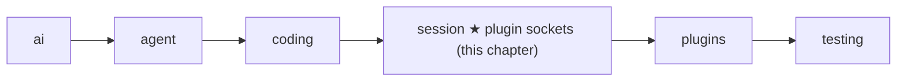
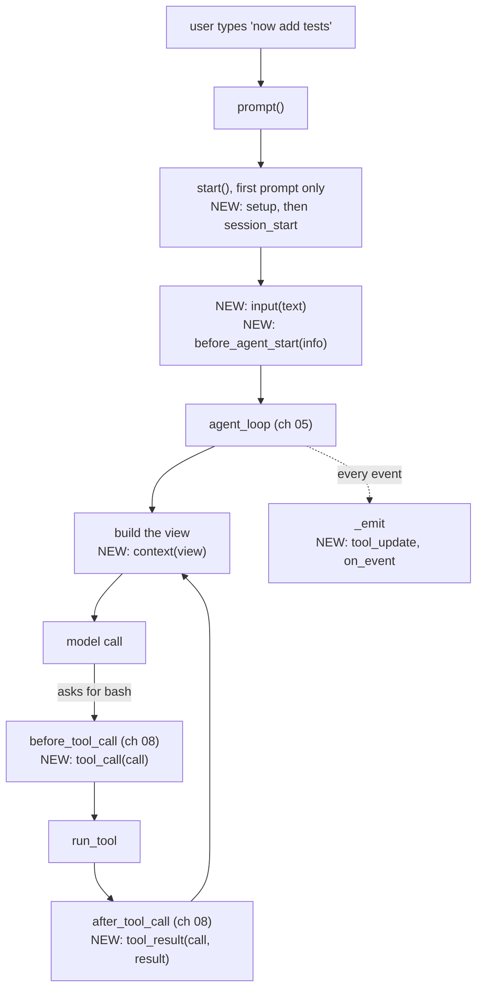

# 14 Part 4 · Plugins

**Goal:** Add behaviour without changing the core.

**Builds on:** [13 Sessions](13-session.md) · **Next:** [15 Retry](15-retry.md)

## Where we are

This chapter adds plugin support inside the `session` layer. The `plugins` folder, with two real plugins, comes in [18](18-profiles-plugins.md). Big picture of Part 4: [part-4-session](13-0-part-4-session.md).

All code here is in [session/\_\_init\_\_.py](../../packages/simp_agent/src/simp_agent/session/__init__.py).

## Why plugins?

In [13](13-session.md) the user came back the next day and typed "now add tests". Now two teams want small extras on top of that same session. One team wants a "no bash" mode: the agent may read and edit files, but never run a shell command. Another team wants to hide API keys: if the agent runs `cat .env`, the key must not reach the screen, the log or the model.

We could put an `if` for each extra inside `AgentSession`. But the list of extras never ends (plan mode, an extra tool, a line in the system prompt, ...), so the session would grow without end, and every app would carry every extra.

So we use a **[plugin](glossary.md#plugin)**: a plain object that the session calls at set moments. There is no base class. You pass a list to `AgentSession(plugins=[...])`, and the core does not change. A method that the session calls on a plugin is a **[plugin hook](glossary.md#plugin-hook)**. It is not the same as the two [tool hooks](glossary.md#tool-hook) of [08](08-hooks-approval.md) (`before_tool_call`, `after_tool_call`): those belong to the loop, the session fills them with its own methods ([13](13-session.md)), and those methods call the plugins.

## Where in a run does the session call plugins?

Plugins add no new path. They hook into the steps of the [13](13-session.md) run you already know. Here is the "now add tests" run, with the plugin moments marked NEW:

Each NEW moment calls one method on each plugin, in list order. What each one is for:

- `setup` and `session_start`: get ready, once, at the start (see the last section).
- `input`: see what the user typed. Return `{"text": ...}` to change it, or `{"handled": True}` to answer it yourself (a slash command like `/plan`); then the model is never called.
- `before_agent_start`: add messages to this run.
- `context`: change what the model sees this turn (the **[view](glossary.md#view-llm-view)**), not the saved history.
- `tool_call`: check a tool call before it runs. Return `{"block": reason}` to stop it, or `{"args": ...}` to change its arguments.
- `tool_result`: change a tool's result after it runs.
- `tool_update`: change tool output while it streams, before anyone sees it.
- `on_event`: watch every event, for example to write a log.
- `session_shutdown`: clean up, once, in `shutdown()`.

## What if a plugin lacks a method or crashes?

The key hider has no `tool_call`, and `NoBash` has no `tool_result`. So the session looks each method up by name and skips the plugin if it is missing. One helper, `AgentSession._hook`, does this for every moment. It also accepts plain and `async` methods, and catches errors. On an error it sends a `plugin_error` event to the app and acts as if the plugin did nothing, so the run goes on. This rule is **[hook isolation](glossary.md#hook-isolation)**. The cost: a typo in a method name, like `tool_calls`, just looks like a missing method, so nothing warns you.

Real code: [session/\_\_init\_\_.py](../../packages/simp_agent/src/simp_agent/session/__init__.py) — `AgentSession._hook`

There is one exception: `tool_call`. It is often a safety check. Say `NoBash` has a bug and its `tool_call` raises `KeyError('name')`. If we skip it, `bash` runs, which is exactly what `NoBash` was meant to stop. So for `tool_call` an error means "no", and the tool is blocked. This rule is **[fail closed](glossary.md#fail-closed)**. The model gets the result `User denied: blocked by plugin NoBash (KeyError: 'name')`. With a working `NoBash`, it gets `User denied: blocked by plugin NoBash: no bash`, and picks another way.

Real code: [session/\_\_init\_\_.py](../../packages/simp_agent/src/simp_agent/session/__init__.py) — `AgentSession._before_tool_call`

The first block wins: later plugins are not asked. Plugins also run before the approval question of [08](08-hooks-approval.md), so a blocked call never asks the human.

## How does the key hider keep a key off the screen, the log and the model?

Follow `cat .env` from start to end. The key can leak in three places, and the key hider ([18](18-profiles-plugins.md)) uses one hook for each.

1. **While the command runs**, its output streams as `tool_execution_update` events ([06](06-events-abort.md)). The session's `_emit` passes the text through each plugin's `tool_update` **before** it sends the event to the app. So the key never reaches the screen, and `on_event` (which runs last) logs only the hidden text.
2. **When the tool is done**, `after_tool_call` passes the result through each plugin's `tool_result`. A plugin returns only the fields it wants to change, such as `{"content": "<hidden>"}`; the other fields stay. This hidden result is what gets saved and sent to the model.
3. **Before each model call**, `context` gets a copy of the view. A key may already be in the history from before, for example if the user pasted it. The key hider hides it in the copy, so the model never sees it, but the saved history is not changed.

Real code: [session/\_\_init\_\_.py](../../packages/simp_agent/src/simp_agent/session/__init__.py) — `AgentSession._emit`, `AgentSession._after_tool_call`, `AgentSession._context` · [plugins/redact_secrets.py](../../packages/simp_agent/src/simp_agent/plugins/redact_secrets.py) — `RedactSecrets`

## How does a plugin change the session?

Some plugins must act, not only react: add a tool, add a line to the system prompt, or save their own data. At start, each plugin's `setup(api, config)` gets a **[PluginAPI](glossary.md#pluginapi)**: a small handle with named actions, not the whole session. `config` is the plugin's own part of `plugin_config`, a dict keyed by plugin name (its `name` field, or its class name).

The main actions are `register_tool` (a tool with the same name replaces the old one), `add_prompt_section` (a [prompt section](glossary.md#prompt-section) of [13](13-session.md#prompt-sections)), and `append_entry` (save plugin data in the history, which comes back on resume but is never sent to the model). The full list is in [Reference · objects](ref-objects.md#pluginapi-methods). Plugins depend only on these names, so the session can change inside without breaking them.

Real code: [session/\_\_init\_\_.py](../../packages/simp_agent/src/simp_agent/session/__init__.py) — `PluginAPI`, `AgentSession.start`

`setup` runs for every plugin first; `session_start` runs only after all of them are done, so there a plugin can count on the others being ready.

**Builds on:** [13 Sessions](13-session.md) · **Next:** [15 Retry](15-retry.md)
