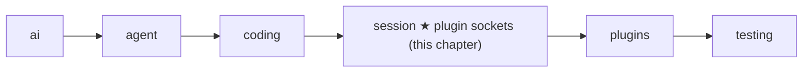
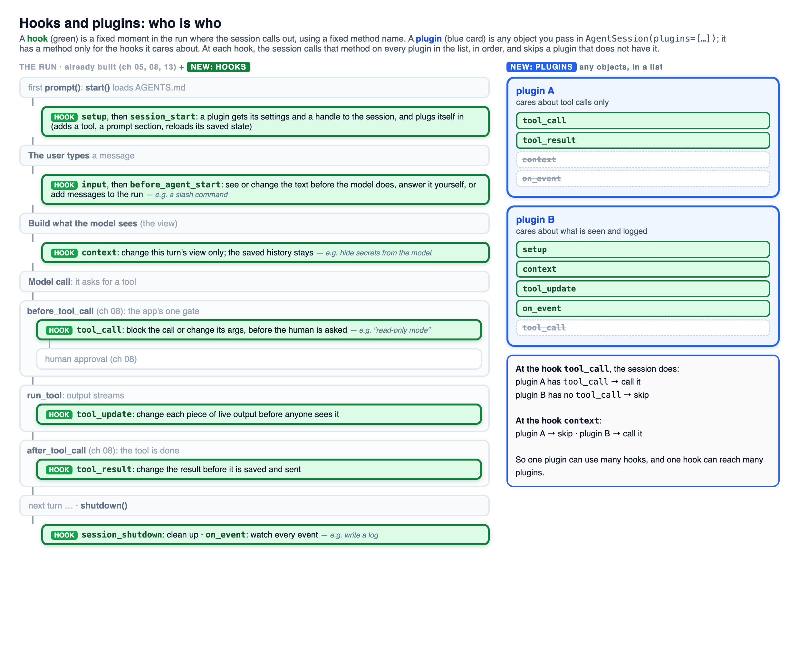

# 14 Part 4 · Plugins

**Goal:** Add behaviour without changing the core.

**Builds on:** [13 Sessions](13-session.md) · **Next:** [15 Retry](15-retry.md)

## Where we are



This chapter adds plugin support inside the `session` layer. The `plugins` folder, with two real plugins, comes in [18](18-profiles-plugins.md). Big picture of Part 4: [part-4-session](13-0-part-4-session.md).

All code here is in [session/\_\_init\_\_.py](../../packages/simp_agent/src/simp_agent/session/__init__.py).

## Why plugins?

In [13](13-session.md) the user came back the next day and typed "now add tests". Now people want small extras on that same session:

- You want **no bash** in one project: the agent may read and edit files, but never run a shell command.
- The server wants to **hide API keys**: if the agent runs `cat .env`, the key must not reach the screen, the log or the model.

The first idea is to add a flag and an `if` for each:

```python
class AgentSession:
    def __init__(self, ..., no_bash=False, hide_keys=False):
        ...

    async def _before_tool_call(self, call, ctx):
        if self.no_bash and call.name == "bash":
            return "bash is off"
        ...

    async def _after_tool_call(self, call, result, ctx):
        if self.hide_keys:
            result = mask_keys(result)
        ...
```

That works for two extras. Then come plan mode, a company rule like "never touch `prod/`", an extra tool, a line in the prompt... Every extra adds a flag and an `if` to the same class. Worse, you installed `simp_agent` with `pip`. You cannot add your company's rule to it without forking the library.

Look at where the `if`s went: always into the same few moments, before a tool runs and after a tool returns. So the session can call outside code at those moments instead:

```python
class NoBash:
    def tool_call(self, call):
        if call.name == "bash":
            return {"block": "bash is off"}

session = AgentSession(model, plugins=[NoBash()])
```

That is a **[plugin](glossary.md#plugin)**: a plain object whose methods are named after the moments it cares about. The session's code stays the same. Each app passes only the plugins it wants, and anyone can write one without touching the library.

So two words now go together. A **[plugin hook](glossary.md#plugin-hook)** is a fixed moment in the run, like "before a tool runs", with a fixed method name, like `tool_call`. A **plugin** is the object that may have a method with that name. In the example above, `NoBash` is the plugin, and its method `tool_call` is a hook: the name says *when* the session calls it.

It is the same idea as the [tool hooks](glossary.md#tool-hook) of [08](08-hooks-approval.md), one level up. There, the app hands the loop one function per moment. Here, the session looks for the hook's name on every plugin in the list. The two levels meet: the session fills the loop's tool hooks with its own methods ([13](13-session.md#why-does-the-session-own-the-agent)), and those methods call the plugin hooks.

## Where in a run does the session call plugins?

Plugins add no new path. They hook into the steps of the [13](13-session.md) run you already know. In the picture, the pale grey steps are that run; the green boxes are the hooks, placed exactly where they run; the blue cards are plugins, each with only the hooks it needs. At each hook, the session calls that method on every plugin in the list, in order, and skips a plugin that does not have it. So one plugin can use many hooks, and one hook can reach many plugins.



**Once, at the start: `setup`, then `session_start`.** The user types a message, and the app calls `prompt(text)`; `text` is still a plain string. The first time only, `prompt()` begins with `start()`, which loads `AGENTS.md`. Then each plugin gets one turn to get ready, before the agent does any work. This turn is `setup`: the plugin gets its own settings and a handle to the session (the PluginAPI, below), so it can also add a tool or a line to the system prompt. Two plugins show the two ways it is used.

The first way is to **read its settings**. The user has keys in their environment and does not want any of them to reach the model or the log. So in `setup` the key hider (`RedactSecrets`, [18](18-profiles-plugins.md)) builds its list of secret values: the ones named in its settings, plus the values of environment variables whose names contain `KEY`, `TOKEN`, `SECRET` or `PASSWORD`. Nothing is hidden yet; this step only makes the list. Later, `tool_update`, `tool_result` and `context` use the list to replace each value with `[REDACTED]`.

The second way is to **remember where it was**. The user turns plan mode on, closes the app, and resumes the session the next day. Without this step plan mode would start off, and the agent could change files the user only wanted to plan. So in `setup` `PlanMode` reads its last on/off note from the history (each switch saves one) and, if it was on, turns itself back on.

`session_start` is a second round. It runs only after every plugin has finished `setup`, so a plugin can count on the others being ready, for example to see a tool another plugin added. Neither example needs it.

**The user's text arrives: `input`, then `before_agent_start`.** Still inside `prompt()`, before the text becomes a message, `input` sees exactly what the user typed. A plugin can use it in two ways. It can **change the text**: for example, turn a short alias like `/tests` into the full request "run pytest and fix what fails" (it returns `{"text": …}`), and the model then sees the full request. Or it can **handle the text by itself, without the model**: some text is an order for the app, not a question for the model, such as a *slash command* like `/cost`. The plugin does the work and returns `{"handled": True}`; then `prompt()` stops right there, so no message is saved, no model call is made, and no tokens are paid. Next comes `before_agent_start`. `setup` runs once, before any question exists; `before_agent_start` runs **before every user message** and sees that message and the history. So it is the place for decisions that depend on *this* request, and it has two uses. It can **add notes for this request**: it returns `{"messages": […]}`, and the notes go into the history next to the user's message, for example "tests live in `tests/`; run them with `pytest -q`" when the user asks to add tests. Or it can **prepare the session for this request**. The plugin still holds the handle to the session that it got in `setup`, so it can change the session here: for example, switch to a stronger model when the user asks for a big refactor, or turn on an extra tool that only this kind of task needs. Two things it cannot do: change what the user typed (that is the job of `input`), or stop the run. And one cost to keep in mind: the notes it adds stay in the history, so they are sent again with every later model call. Add only what the model really needs. No shipped plugin uses `input` or `before_agent_start` yet.

When both hooks are done, the text finally becomes a message: `agent.prompt()` wraps it into a `UserMessage`, puts it and any extra notes into the history, and starts the loop ([05](05-agent-loop.md)). That is why these two hooks can still change what the user's message will be.

**Before each model call: `context`.** Every turn, just before the model is called, the session builds the [view](glossary.md#view-llm-view): a copy of the messages it is about to send. `context` lets a plugin change **this copy only**. The saved history is never touched: the file on disk keeps every message exactly as it happened, and next turn the view is built again from that history, so the plugin changes it again. In short, `context` changes what the model *reads*, not what the session *remembers*. Two examples. The key hider (`RedactSecrets`) uses it for keys that are already in the history, for example one the user pasted yesterday: in every copy it replaces the key with `[REDACTED]`, so the key never reaches the model provider, while the history still holds the original. A plugin could also use it to save tokens: an old `pytest` run left 5,000 lines in the history, and they are sent again with every call; the plugin can replace old, very long tool outputs with "[old output removed]" in the copy, and the full output stays in the history for anyone who reads it later. Compare the hooks around it: `before_agent_start` adds messages to the history for good, and `tool_result` changes a result before it is saved; `context` is the only one that changes what is sent and leaves the history as it is. (Compaction, [16](16-compaction.md), also passes its input through `context`, so the summary never sees the key either.)

**Around one tool call: `tool_call`, `tool_update`, `tool_result`.** Three hooks follow the call in order. `tool_call` decides whether the call may run: a plugin can block it with a reason the model reads, or change its arguments (`{"block": reason}` or `{"args": …}`). It runs inside the app's one gate, [08](08-hooks-approval.md)'s `before_tool_call`, and before the human is asked, because there is no point asking the user about a call a plugin will block anyway. For example, plan mode blocks `write`, `edit` and `bash` with "plan mode is on (read-only)", so the model plans instead. While the tool runs, `tool_update` sees each piece of output before the screen and the log do. When the tool is done, `tool_result` may change the result before it is saved and sent; a plugin returns only the fields it wants to change, such as `{"content": …}`. The key hider uses both: `cat .env` never shows a key on the screen or in the log, and the saved result does not hold it either.

**All the time: `on_event`.** It sees every event of the run, only to watch, for example to write a log. It runs after `tool_update`, so it logs the changed text.

**Once, at the end: `session_shutdown`.** `shutdown()` calls it, so a plugin can clean up.

## What if a plugin lacks a method or crashes?

The key hider has no `tool_call`, and `NoBash` has no `tool_result`. So the session looks each method up by name and skips the plugin if it is missing. One helper, `AgentSession._hook`, does this for every moment. It also accepts plain and `async` methods, and catches errors. On an error it sends a `plugin_error` event to the app and acts as if the plugin did nothing, so the run goes on. This rule is **[hook isolation](glossary.md#hook-isolation)**. The cost: a typo in a method name, like `tool_calls`, just looks like a missing method, so nothing warns you.

Real code: [session/\_\_init\_\_.py](../../packages/simp_agent/src/simp_agent/session/__init__.py) — `AgentSession._hook`, `prompt`, `_context`, `_emit`, `_before_tool_call`, `_after_tool_call` · [plugins/](../../packages/simp_agent/src/simp_agent/plugins/) — `plan_mode.py`, `redact_secrets.py`

There is one exception: `tool_call`. It is often a safety check. Say `NoBash` has a bug and its `tool_call` raises `KeyError('name')`. If we skip it, `bash` runs, which is exactly what `NoBash` was meant to stop. So for `tool_call` an error means "no", and the tool is blocked. This rule is **[fail closed](glossary.md#fail-closed)**. The model gets the result `User denied: blocked by plugin NoBash (KeyError: 'name')`. With a working `NoBash`, it gets `User denied: blocked by plugin NoBash: no bash`, and picks another way.

Real code: [session/\_\_init\_\_.py](../../packages/simp_agent/src/simp_agent/session/__init__.py) — `AgentSession._before_tool_call`

The first block wins: later plugins are not asked.

## How does a plugin change the session?

Some plugins must act, not only react: add a tool, add a line to the system prompt, or save their own data. At start, each plugin's `setup(api, config)` gets a **[PluginAPI](glossary.md#pluginapi)**: a small handle with named actions, not the whole session. A plugin that needs it later keeps it (`self.api = api`), so its other hooks can use it too, as `before_agent_start` does above. `config` is the plugin's own part of `plugin_config`, a dict keyed by plugin name (its `name` field, or its class name).

The main actions are `register_tool` (a tool with the same name replaces the old one), `add_prompt_section` (a [prompt section](glossary.md#prompt-section) of [13](13-session.md#prompt-sections)), and `append_entry` (save plugin data in the history, which comes back on resume but is never sent to the model). The full list is in [Reference · objects](ref-objects.md#pluginapi-methods). Plugins depend only on these names, so the session can change inside without breaking them.

Real code: [session/\_\_init\_\_.py](../../packages/simp_agent/src/simp_agent/session/__init__.py) — `PluginAPI`, `AgentSession.start`


**Builds on:** [13 Sessions](13-session.md) · **Next:** [15 Retry](15-retry.md)
