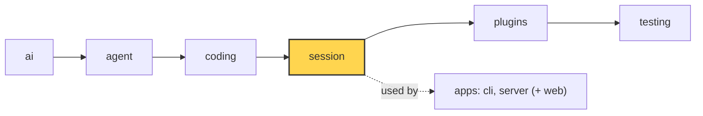

# 14 Part 4 · Plugins

**Goal:** Add behaviour without changing the core.

**Builds on:** [13 Sessions](13-session.md) · **Next:** [15 Retry](15-retry.md)



*This chapter adds plugin support to the `session` layer (marked). The `plugins` layer itself is filled in [18](18-profiles-plugins.md).*

## Problem

People want many small extras: hide API keys in tool output, a read-only "plan mode", an extra tool, a line in the system prompt, a log of every event. If each extra is an `if` inside `AgentSession`, the session grows without end, and every app gets every extra.

We want a **[plugin](glossary.md#plugin)**: a plain object that the session calls at fixed points. The core stays the same; you add a plugin to a list.

## Naive version

A first try: a list of callbacks, one per tool call.

```python
class Session:
    def __init__(self, agent, plugins=()):
        self.agent, self.plugins = agent, list(plugins)
        agent.before_tool_call = self.before

    async def before(self, call, ctx):
        for p in self.plugins:
            r = p.tool_call(call)          # every plugin must have tool_call
            if r and "block" in r:
                return r["block"]

class NoBash:
    def tool_call(self, call):
        return {"block": "no bash"} if call.name == "bash" else None
```

It blocks `bash` for the fizzbuzz task. Problems:

1. **Every plugin must define every method.** A plugin that only wants events crashes with `AttributeError`.
2. **One bad plugin breaks the run.** If a plugin's code raises, the whole agent run fails.
3. **Only one hook point.** No way to change the user's text, the messages sent to the model, the system prompt or the tool list.
4. **No access to the session.** A plugin cannot add a tool or save state.

## Real design

The code is in `packages/simp_agent/src/simp_agent/session/__init__.py`.

### A plugin is any object; hooks are optional methods

There is no base class. A plugin is any object. Its name is `p.name` or its class name:

```python
def plugin_name(p) -> str:
    return getattr(p, "name", type(p).__name__)
```

The session calls a **[hook](glossary.md#plugin-hook)** only if the plugin has a method with that name. All calls go through one helper, `_hook`:

```python
    async def _hook(self, p, hook: str, *args, isolate: bool = True):
        fn = getattr(p, hook, None)
        if fn is None:
            return None
        try:
            return await _maybe_await(fn(*args))
        except Exception as e:
            if not isolate:
                raise
            await _emit_all(self._subs, {"type": "plugin_error", "plugin": plugin_name(p), "hook": hook,
                                         "error": f"{type(e).__name__}: {e}"})
            return None
```

Three things in a few lines:

- **Missing hook → skip.** No need to define every method.
- **Sync or async.** `_maybe_await` awaits only if the result is awaitable.
- **[Hook isolation](glossary.md#hook-isolation).** If the hook raises, the session emits a `plugin_error` event and returns `None`, as if the plugin did nothing. One broken plugin does not stop the run. Note the event goes to `_emit_all(self._subs, ...)` directly, not to other plugins, so a broken `on_event` cannot loop.

### The hook list

| Hook | When | What it can return |
|---|---|---|
| `setup(api, config)` | once, in `start()` | — |
| `session_start()` | once, after all setups | — |
| `input(text)` | start of `prompt()` | `{"handled": True}` to stop, or `{"text": ...}` to rewrite |
| `before_agent_start(info)` | before the run | `{"messages": [...]}` to add messages |
| `context(messages)` | before each model call | a new message list (chained) |
| `tool_call(call)` | before a tool runs | `{"block": reason}` or `{"args": {...}}` |
| `tool_result(call, result)` | after a tool runs | a dict of fields to replace |
| `tool_update(call, text)` | on streamed tool output | new text |
| `on_event(e)` | every session event | — |
| `session_shutdown()` | in `shutdown()` | — |

Let us look at the important ones.

**`setup` gets a `PluginAPI` and its config.** In `start()`:

```python
        for p in self.plugins:
            await self._hook(p, "setup", PluginAPI(self, plugin_name(p)), self.plugin_config.get(plugin_name(p), {}))
        for p in self.plugins:
            await self._hook(p, "session_start")
```

`plugin_config` is a dict keyed by plugin name. Each plugin sees only its own part.

**`context` is a chain.** Before each model call:

```python
    async def _context(self, view: list) -> list:
        for p in self.plugins:  # chained: each gets the previous output
            view = await self._hook(p, "context", list(view)) or view
        return view
```

Each plugin gets the output of the one before. It gets a *copy* of the list (`list(view)`), and the result is only the **view** sent to the model. The saved history does not change. If a plugin fails or returns `None`, the chain keeps the previous view.

**`tool_call` fails closed.** This one is different:

```python
    async def _before_tool_call(self, call, ctx) -> str | None:
        for p in self.plugins:  # first block wins; a raising hook blocks (fail closed)
            try:
                r = await self._hook(p, "tool_call", call, isolate=False) or {}
            except Exception as e:
                return f"blocked by plugin {plugin_name(p)} ({type(e).__name__}: {e})"
            if "block" in r:
                return f"blocked by plugin {plugin_name(p)}: {r['block']}"
            if "args" in r:
                call.arguments = r["args"]
        ...  # then the approval check from ch 08
```

Here `isolate=False`. If a plugin's `tool_call` raises, the tool is **blocked**. Why? A `tool_call` hook is often a safety check. If the check crashes, running the tool anyway would be unsafe. So for this one hook, an error means "no". This is called **fail closed**. The first plugin that blocks wins. Plugins run before the user approval from [08](08-hooks-approval.md), so a blocked call never asks the user.

**`tool_result` merges.** Each plugin can return a few fields, and they are merged with `dataclasses.replace`:

```python
    async def _after_tool_call(self, call, result, ctx):
        for p in self.plugins:  # partial overrides, merged in order
            if r := await self._hook(p, "tool_result", call, result):
                result = dataclasses.replace(result, **r)
        return result
```

**`input` can handle a command.** In `prompt()`, if a plugin returns `{"handled": True}`, the session returns `[]` and the model is never called. This is how a plugin can own a slash command like `/plan`.

### PluginAPI: what a plugin may do

A plugin does not get the whole session. It gets a **[PluginAPI](glossary.md#pluginapi)**:

```python
class PluginAPI:
    """What a plugin can do with its session (pi ExtensionAPI)."""

    def __init__(self, session: "AgentSession", name: str):
        self._s, self.name = session, name

    def register_tool(self, tool) -> None:
        self.unregister_tool(tool.name)
        self._s.agent.tools.append(tool)
    ...
    def add_prompt_section(self, id: str, value, order: int = 100) -> None:
        self._s.add_prompt_section(id, value, order)
    ...
    async def append_entry(self, type: str, data: dict) -> CustomEntry:
        return await self._s.append_entry(type, data)
```

The full list: `register_tool`, `unregister_tool`, `add_prompt_section`, `remove_prompt_section`, `append_entry` ([CustomEntry](13-session.md)), `send_message` (steer, follow-up or a new prompt), `set_model`, `abort`, `get_messages`, `env`, `cwd`, and `emit` (send a custom event tagged with the plugin name). A small, named surface is easier to keep stable than "here is the whole session".

### Prompt sections

The system prompt is not one string. It is a dict of **[prompt sections](glossary.md#prompt-section)**:

```python
    def add_prompt_section(self, id: str, value, order: int = 100) -> None:
        """value: str or fn(ctx) -> str (sync or async), rebuilt every turn. Sorted by (order, first add): stable."""
        seq = self._sections[id][1] if id in self._sections else next(self._seq)
        self._sections[id] = (order, seq, value)

    async def _build_prompt(self) -> str:
        a = self.agent
        ctx = {"tools": a.tools, "cwd": a.cwd, "model": a.model, "messages": a.messages}
        parts = list()
        for _, _, v in sorted(self._sections.values(), key=lambda x: x[:2]):
            text = await _maybe_await(v(ctx)) if callable(v) else v
            if text:
                parts.append(text)
        return "\n\n".join(parts)
```

- Each section has an `id`, an `order` and a value (a string or a function of `ctx`).
- They are sorted by `order`, then by when they were first added. Re-adding the same `id` keeps its place.
- `_build_prompt` runs every turn (the session passes it to `Agent` as the prompt, [13](13-session.md)). So a function section sees the current tools: if a plugin adds a tool, the coding prompt lists it next turn.

The built-in sections: `coding` (order 0, the prompt from [11](11-system-prompt.md)) or `base` (order 0, when you pass `system_prompt=`), and `context_file` (order 10, `AGENTS.md`). Plan mode adds its section at order 1000, so it comes last ([18](18-profiles-plugins.md)).

### Plugin events

`_emit` also feeds plugins:

```python
    async def _emit(self, e: dict) -> None:
        if e["type"] == "tool_execution_update":
            for p in self.plugins:  # e.g. mask secrets before the UI and logs see them
                if (r := await self._hook(p, "tool_update", e["call"], e["text"])) is not None:
                    e = {**e, "text": r}
        await _emit_all(self._subs, e)
        for p in self.plugins:
            await self._hook(p, "on_event", e)
```

Streamed tool output goes through `tool_update` **before** the app sees it. So a redact plugin can hide a key before it reaches the screen or a log.

## Test

`apps/cli/tests/test_sockets.py::test_plugin_context_chain_and_error_isolated`:

```python
class Rec:
    def __init__(self, name, **hooks):
        self.name, self.log = name, []
        for k, v in hooks.items():
            setattr(self, k, v)
...
async def test_plugin_context_chain_and_error_isolated():
    seen, events = [], []

    def boom(msgs):
        raise RuntimeError("bad")

    p1 = Rec("p1", context=lambda m: m + [UserMessage("A")])
    p2 = Rec("p2", context=boom)
    p3 = Rec("p3", context=lambda m: m + [UserMessage(m[-1].content + "B")])
    s = session(DONE, seen=seen, plugins=[p1, p2, p3])
    s.subscribe(events.append)
    await s.prompt("hi")
    assert [m.content for m in seen[0].messages] == ["hi", "A", "AB"]
    assert [(e["plugin"], e["hook"]) for e in events if e["type"] == "plugin_error"] == [("p2", "context")]
```

What it checks:

- `Rec` builds a plugin from keyword hooks. No base class needed.
- The chain: `p1` adds `"A"`, `p3` sees `"A"` and adds `"AB"`. The model (a `FakeProvider`, [02](02-fake-provider.md)) got `["hi", "A", "AB"]`.
- Isolation: `p2` raised, but the run went on, and one `plugin_error` event names `p2` and `context`.

The sibling test `test_plugin_tool_call_first_block_exception_and_result_merge` in the same file checks the fail-closed rule for `tool_call`.

Run it:

```sh
uv run pytest apps/cli/tests/test_sockets.py::test_plugin_context_chain_and_error_isolated -q
```

## Why this way

> **Optional hooks, isolated errors, except where safety needs "no".** A plugin is any object with some of the hook methods. Errors in most hooks become a `plugin_error` event, so one bad plugin cannot break a run. But `tool_call` fails closed, because it often guards something. Plugins get a small `PluginAPI`, not the whole session, so the core can change inside without breaking them. The cost: hook names are plain strings; a typo like `tool_calls` is silently never called.

## Recap

- A plugin is any object; the session calls a hook only if the method exists.
- `_hook` awaits sync or async hooks and turns errors into `plugin_error` events.
- `tool_call` is the exception: an error blocks the tool (fail closed). First block wins.
- `context` is a chain that changes only the model's view, not history.
- `PluginAPI` is the plugin's handle: tools, prompt sections, custom entries, messages, events.
- The system prompt is built every turn from ordered prompt sections.

**Builds on:** [13 Sessions](13-session.md) · **Next:** [15 Retry](15-retry.md)

## Terms to add to glossary

- **plugin** — any object passed in `AgentSession(plugins=[...])`; the session calls its hook methods.
- **plugin hook** — a method name the session calls on a plugin at a fixed point (`setup`, `input`, `context`, `tool_call`, `tool_result`, `on_event`, ...).
- **hook isolation** — an error in a plugin hook becomes a `plugin_error` event instead of breaking the run.
- **fail closed** — when a safety check itself fails, treat it as "no" (block the tool).
- **PluginAPI** — the object a plugin gets in `setup`; the actions it may take on its session.
- **prompt section** — one part of the system prompt, with an id and an order; rebuilt every turn.
