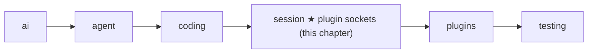

# 14 Part 4 · Plugins

**Goal:** Add behaviour without changing the core.

**Builds on:** [13 Sessions](13-session.md) · **Next:** [15 Retry](15-retry.md)

## Where we are



This chapter adds plugin support inside the `session` layer. The `plugins` folder, with two real plugins, comes in [18](18-profiles-plugins.md). Big picture of Part 4: [part-4-session](13-0-part-4-session.md).

All code here is in [session/\_\_init\_\_.py](../../packages/simp_agent/src/simp_agent/session/__init__.py).

## Why plugins?

In [13](13-session.md) the user came back the next day and typed "now add tests". Now people want small extras on that same session:

- You want **no bash** in one project: the agent may read and edit files, but never run a shell command.
- The server wants to **hide API keys**: if the agent runs `cat .env`, the key must not reach the screen, the log or the model.

The first idea is to add a flag and an `if` for each:

```python
class AgentSession:
    def __init__(self, ..., no_bash=False, hide_keys=False):
        ...

    async def _before_tool_call(self, call, ctx):
        if self.no_bash and call.name == "bash":
            return "bash is off"
        ...

    async def _after_tool_call(self, call, result, ctx):
        if self.hide_keys:
            result = mask_keys(result)
        ...
```

That works for two extras. Then come plan mode, a company rule like "never touch `prod/`", an extra tool, a line in the prompt... Every extra adds a flag and an `if` to the same class. Worse, you installed `simp_agent` with `pip`. You cannot add your company's rule to it without forking the library.

Look at where the `if`s went: always into the same few moments, before a tool runs and after a tool returns. So the session can call outside code at those moments instead:

```python
class NoBash:
    def tool_call(self, call):
        if call.name == "bash":
            return {"block": "bash is off"}

session = AgentSession(model, plugins=[NoBash()])
```

That is a **[plugin](glossary.md#plugin)**: a plain object whose methods are named after the moments it cares about. The session's code stays the same. Each app passes only the plugins it wants, and anyone can write one without touching the library.

A method that the session calls on a plugin, like `tool_call` above, is a **[plugin hook](glossary.md#plugin-hook)**. Do not mix it up with the two [tool hooks](glossary.md#tool-hook) of [08](08-hooks-approval.md): those belong to the loop. The session fills them with its own methods ([13](13-session.md#why-does-the-session-own-the-agent)), and those methods call the plugin hooks.

## Where in a run does the session call plugins?

Plugins add no new path. They hook into the steps of the [13](13-session.md) run you already know. In the picture, the grey steps are that run, unchanged; the green boxes are the plugin hooks, placed exactly where they run. At each green box the session calls that method on every plugin, in list order, and skips a plugin that does not have it.


**Once, at the start.** The first `prompt()` calls `start()`, which loads `AGENTS.md`. Right after that, the session calls `setup` and then `session_start` on each plugin. This is the moment to get ready: read the plugin's settings, and pick up any state it saved last time. Plan mode needs exactly this. When the user turned it on yesterday, it wrote that into the history as a saved entry; in `setup` it looks for its last entry, so after a resume plan mode is still on. The key hider (`RedactSecrets`, [18](18-profiles-plugins.md)) uses `setup` to collect the key values it must mask.

**The user's text arrives.** Before the model sees anything, `input` gets the text the user typed. This is the first and only place to act on the raw text: a plugin can rewrite it, or answer it by itself, for example a slash command, and then the model is not called at all (`{"handled": True}`). Next, `before_agent_start` can add messages to this run, such as a reminder that the model should read. No shipped plugin uses these two yet; they are there for your own.

**Before each model call.** The session has just built the [view](glossary.md#view-llm-view): the messages this turn will send. `context` may change this view, and only this view; the saved history keeps the original. That is why the key hider masks keys here: whatever the model is about to read, including old messages, goes out with `[REDACTED]` instead of the key. This catches keys that are already in the history, for example one the user pasted. The key never reaches the model provider, and nothing on disk is rewritten.

**Around one tool call.** The model asks for `bash`, and three hooks follow the call in order. First `tool_call`, inside the one gate the app gives the loop ([08](08-hooks-approval.md)'s `before_tool_call`). That gate belongs to the app, and there is only one; `tool_call` is a method that every plugin may have, and the session calls them one by one inside the gate, before it asks the human. The order matters: if a plugin will block the call anyway, there is no point asking the user. Plan mode blocks `write`, `edit` and `bash` here, with a reason the model reads ("plan mode is on (read-only)"), so the model knows why and plans instead. A plugin can also change the arguments instead of blocking (`{"block": reason}` or `{"args": …}`). Then, while the tool runs and its output streams, `tool_update` sees each piece before the screen and the log do; the key hider masks it, so `cat .env` never shows the key, and `on_event` (which runs after it) logs only the masked text. Last, when the tool is done, `tool_result` may change the result before it is saved and sent; the key hider masks it again, so the saved history does not hold the key either. A plugin returns only the fields it wants to change, such as `{"content": …}`; the others stay.

**All the time.** `on_event` sees every event of the run, only to watch, for example to write a log.

**Once, at the end.** `shutdown()` calls `session_shutdown`, so a plugin can clean up.

## What if a plugin lacks a method or crashes?

The key hider has no `tool_call`, and `NoBash` has no `tool_result`. So the session looks each method up by name and skips the plugin if it is missing. One helper, `AgentSession._hook`, does this for every moment. It also accepts plain and `async` methods, and catches errors. On an error it sends a `plugin_error` event to the app and acts as if the plugin did nothing, so the run goes on. This rule is **[hook isolation](glossary.md#hook-isolation)**. The cost: a typo in a method name, like `tool_calls`, just looks like a missing method, so nothing warns you.

Real code: [session/\_\_init\_\_.py](../../packages/simp_agent/src/simp_agent/session/__init__.py) — `AgentSession._hook`, `prompt`, `_context`, `_emit`, `_before_tool_call`, `_after_tool_call` · [plugins/](../../packages/simp_agent/src/simp_agent/plugins/) — `plan_mode.py`, `redact_secrets.py`

There is one exception: `tool_call`. It is often a safety check. Say `NoBash` has a bug and its `tool_call` raises `KeyError('name')`. If we skip it, `bash` runs, which is exactly what `NoBash` was meant to stop. So for `tool_call` an error means "no", and the tool is blocked. This rule is **[fail closed](glossary.md#fail-closed)**. The model gets the result `User denied: blocked by plugin NoBash (KeyError: 'name')`. With a working `NoBash`, it gets `User denied: blocked by plugin NoBash: no bash`, and picks another way.

Real code: [session/\_\_init\_\_.py](../../packages/simp_agent/src/simp_agent/session/__init__.py) — `AgentSession._before_tool_call`

The first block wins: later plugins are not asked.

## How does a plugin change the session?

Some plugins must act, not only react: add a tool, add a line to the system prompt, or save their own data. At start, each plugin's `setup(api, config)` gets a **[PluginAPI](glossary.md#pluginapi)**: a small handle with named actions, not the whole session. `config` is the plugin's own part of `plugin_config`, a dict keyed by plugin name (its `name` field, or its class name).

The main actions are `register_tool` (a tool with the same name replaces the old one), `add_prompt_section` (a [prompt section](glossary.md#prompt-section) of [13](13-session.md#prompt-sections)), and `append_entry` (save plugin data in the history, which comes back on resume but is never sent to the model). The full list is in [Reference · objects](ref-objects.md#pluginapi-methods). Plugins depend only on these names, so the session can change inside without breaking them.

Real code: [session/\_\_init\_\_.py](../../packages/simp_agent/src/simp_agent/session/__init__.py) — `PluginAPI`, `AgentSession.start`

`setup` runs for every plugin first; `session_start` runs only after all of them are done, so there a plugin can count on the others being ready.

**Builds on:** [13 Sessions](13-session.md) · **Next:** [15 Retry](15-retry.md)
