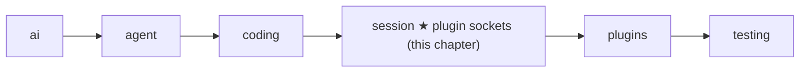

# 14 Part 4 · Plugins

**Goal:** Add behaviour without changing the core.

**Builds on:** [13 Sessions](13-session.md) · **Next:** [15 Retry](15-retry.md)

## Where we are



This chapter adds plugin support inside the `session` layer. The `plugins` folder, with two real plugins, comes in [18](18-profiles-plugins.md). Big picture of Part 4: [part-4-session](13-0-part-4-session.md).

All code here is in [session/\_\_init\_\_.py](../../packages/simp_agent/src/simp_agent/session/__init__.py).

## Why plugins?

In [13](13-session.md) the user came back the next day and typed "now add tests". Now people want small extras on that same session:

- You want **no bash** in one project: the agent may read and edit files, but never run a shell command.
- The server wants to **hide API keys**: if the agent runs `cat .env`, the key must not reach the screen, the log or the model.

The first idea is to add a flag and an `if` for each:

```python
class AgentSession:
    def __init__(self, ..., no_bash=False, hide_keys=False):
        ...

    async def _before_tool_call(self, call, ctx):
        if self.no_bash and call.name == "bash":
            return "bash is off"
        ...

    async def _after_tool_call(self, call, result, ctx):
        if self.hide_keys:
            result = mask_keys(result)
        ...
```

That works for two extras. Then come plan mode, a company rule like "never touch `prod/`", an extra tool, a line in the prompt... Every extra adds a flag and an `if` to the same class. Worse, you installed `simp_agent` with `pip`. You cannot add your company's rule to it without forking the library.

Look at where the `if`s went: always into the same few moments, before a tool runs and after a tool returns. So the session can call outside code at those moments instead:

```python
class NoBash:
    def tool_call(self, call):
        if call.name == "bash":
            return {"block": "bash is off"}

session = AgentSession(model, plugins=[NoBash()])
```

That is a **[plugin](glossary.md#plugin)**: a plain object whose methods are named after the moments it cares about. The session's code stays the same. Each app passes only the plugins it wants, and anyone can write one without touching the library.

So two words now go together. A **[plugin hook](glossary.md#plugin-hook)** is a fixed moment in the run, like "before a tool runs", with a fixed method name, like `tool_call`. A **plugin** is the object that may have a method with that name. In the example above, `NoBash` is the plugin, and its method `tool_call` is a hook: the name says *when* the session calls it.

It is the same idea as the [tool hooks](glossary.md#tool-hook) of [08](08-hooks-approval.md), one level up. There, the app hands the loop one function per moment. Here, the session looks for the hook's name on every plugin in the list. The two levels meet: the session fills the loop's tool hooks with its own methods ([13](13-session.md#why-does-the-session-own-the-agent)), and those methods call the plugin hooks.

## Where in a run does the session call plugins?

Plugins add no new path. They hook into the steps of the [13](13-session.md) run you already know. In the picture, the pale grey steps are that run; the green boxes are the hooks, placed exactly where they run; the blue cards are plugins, each with only the hooks it needs. At each hook, the session calls that method on every plugin in the list, in order, and skips a plugin that does not have it. So one plugin can use many hooks, and one hook can reach many plugins.


**Once, at the start: `setup`, then `session_start`.** The user types a message, and the app calls `prompt(text)`; `text` is still a plain string. The first time only, `prompt()` begins with `start()`, which loads `AGENTS.md`. Then each plugin gets one turn to get ready, before the agent does any work. This turn is `setup`: the plugin gets its own settings and the PluginAPI object, `api` (see the last section), so it can also add a tool or a line to the system prompt. Two plugins show the two ways it is used.

The first way is to **read its settings**. The user has keys in their environment and does not want any of them to reach the model or the log. So in `setup` the key hider (`RedactSecrets`, [18](18-profiles-plugins.md)) builds its list of secret values: the ones named in its settings, plus the values of environment variables whose names contain `KEY`, `TOKEN`, `SECRET` or `PASSWORD`. Nothing is hidden yet; this step only makes the list. Later, `tool_update`, `tool_result` and `context` use the list to replace each value with `[REDACTED]`.

The second way is to **remember where it was**. The user turns plan mode on, closes the app, and resumes the session the next day. Without this step plan mode would start off, and the agent could change files the user only wanted to plan. So in `setup` `PlanMode` reads its last on/off note from the history (each switch saves one) and, if it was on, turns itself back on.

`session_start` is a second round. It runs only after every plugin has finished `setup`, so a plugin can count on the others being ready, for example to see a tool another plugin added. Neither example needs it.

**The user's text arrives: `input`, then `before_agent_start`.** Still inside `prompt()`, before the text becomes a message, `input` sees exactly what the user typed. A plugin can use it in two ways. It can **change the text**: for example, turn a short alias like `/tests` into the full request "run pytest and fix what fails" (it returns `{"text": …}`), and the model then sees the full request. Or it can **handle the text by itself, without the model**: some text is an order for the app, not a question for the model, such as a *slash command* like `/cost`. The plugin does the work and returns `{"handled": True}`; then `prompt()` stops right there, so no message is saved, no model call is made, and no tokens are paid. Next comes `before_agent_start`. `setup` runs once, before any question exists; `before_agent_start` runs **before every user message** and sees that message and the history. So it is the place for decisions that depend on *this* request, and it has two uses. It can **add notes for this request**: it returns `{"messages": […]}`, and the notes go into the history next to the user's message, for example "tests live in `tests/`; run them with `pytest -q`" when the user asks to add tests. Or it can **prepare the session for this request**. If the plugin kept the PluginAPI object (`api`) that it got in `setup`, it can change the session here: for example, switch to a stronger model when the user asks for a big refactor, or turn on an extra tool that only this kind of task needs. Two things it cannot do: change what the user typed (that is the job of `input`), or stop the run. And one cost to keep in mind: the notes it adds stay in the history, so they are sent again with every later model call. Add only what the model really needs. No shipped plugin uses `input` or `before_agent_start` yet.

When both hooks are done, the text finally becomes a message: `agent.prompt()` wraps it into a `UserMessage`, puts it and any extra notes into the history, and starts the loop ([05](05-agent-loop.md)). That is why these two hooks can still change what the user's message will be.

**Before each model call: `context`.** Every turn, just before the model is called, the session builds the [view](glossary.md#view-llm-view): a copy of the messages it is about to send. `context` lets a plugin change **this copy only**. The saved history is never touched: the file on disk keeps every message exactly as it happened, and next turn the view is built again from that history, so the plugin changes it again. In short, `context` changes what the model *reads*, not what the session *remembers*. Two examples. The key hider (`RedactSecrets`) uses it for keys that are already in the history, for example one the user pasted yesterday: in every copy it replaces the key with `[REDACTED]`, so the key never reaches the model provider, while the history still holds the original. A plugin could also use it to save tokens: an old `pytest` run left 5,000 lines in the history, and they are sent again with every call; the plugin can replace old, very long tool outputs with "[old output removed]" in the copy, and the full output stays in the history for anyone who reads it later. Compare the hooks around it: `before_agent_start` adds messages to the history for good, and `tool_result` changes a result before it is saved; `context` is the only one that changes what is sent and leaves the history as it is. (Compaction, [16](16-compaction.md), also passes its input through `context`, so the summary never sees the key either.)

**Around one tool call: `tool_call`, `tool_update`, `tool_result`.** Three hooks follow the call in order. `tool_call` decides whether the call may run: a plugin can block it with a reason the model reads, or change its arguments (`{"block": reason}` or `{"args": …}`). It runs inside the app's one gate, [08](08-hooks-approval.md)'s `before_tool_call`, and before the human is asked, because there is no point asking the user about a call a plugin will block anyway. While the tool runs, `tool_update` sees each piece of output before the screen and the log do. When the tool is done, `tool_result` may change the result before it is saved and sent; a plugin returns only the fields it wants to change, such as `{"content": …}`.

> **Examples along one call.** The model asks to run `bash` with `cat .env`. *(shipped)* marks a plugin that comes with simp-agent; the others are ideas for your own.
>
> **`tool_call` — may it run?** Nothing has run yet, and nothing is saved.
> - *(shipped)* Plan mode is on, so it blocks `write`, `edit` and `bash` with "plan mode is on (read-only)"; the model reads the reason and plans instead.
> - A path rule: the model wants to `edit` a file in `prod/`; the plugin blocks it with "never touch prod/".
> - A small fix to the arguments: the model calls `bash` with `pytest`; the plugin changes it to `pytest -q` so the output is shorter.
>
> **`tool_update` — what shows while it runs.** It changes only what the user sees live and what the log records; the history is not touched.
> - *(shipped)* The key hider: `cat .env` prints `OPENAI_API_KEY=sk-abc…`, and that piece reaches the screen and the log as `OPENAI_API_KEY=[REDACTED]`.
> - Clean output for the web page: remove terminal color codes (like `\x1b[32m`), which a browser would show as junk.
>
> **`tool_result` — what is saved and sent.** This change is for good: the history stores the changed result, and the model reads it.
> - *(shipped)* The key hider masks the key again in the final result, so neither the saved history nor the model holds it.
> - Cut a huge output once: `pytest` printed 5,000 lines; keep only the last 200 before saving. Unlike `context`, the full text is then gone from the history.
> - Add a hint to a failure: when tests fail, append "tip: rerun only the failing test with `-x`", so the model fixes it faster.

**All the time: `on_event`.** It sees every event of the run, only to watch, for example to write a log. It runs after `tool_update`, so it logs the changed text.

**Once, at the end: `session_shutdown`.** `shutdown()` calls it, so a plugin can clean up.

## What if a plugin lacks a method or crashes?

Anyone can write a plugin, so one incomplete or buggy plugin must not break the user's run. The session treats every hook the same way.

**The plugin does not have the method.** That is normal: a plugin writes only the hooks it needs. So at each hook the session looks for the method by name on each plugin, and simply skips the plugins that do not have it. The cost: a typo in a name, like `tool_calls`, looks exactly like a missing method, so nothing warns you.

**The method crashes.** The session catches the error, tells the app about it (a `plugin_error` event, so the app can show or log it), and goes on as if that plugin had done nothing. A broken logging plugin, for example, must not stop the user's work. This rule is called **[hook isolation](glossary.md#hook-isolation)**.

**One exception: `tool_call`.** This hook is usually a safety check, such as "never run bash in this project". If that check crashes and the session goes on as if nothing happened, the dangerous call runs, which is exactly what the plugin was there to stop. So for `tool_call` a crash counts as "no": the call is blocked, and the model is told why, for example `User denied: blocked by plugin NoBash (KeyError: 'name')`. This rule is called **[fail closed](glossary.md#fail-closed)**: when in doubt, block. If several plugins have `tool_call`, the first one that blocks wins, and the later ones are not asked.

The three rules fit in a few lines. At every hook, the session does this for each plugin, in list order:

```text
FOR EACH plugin:
    IF plugin has no method with the hook's name: skip it
    TRY: call the method
    IF it crashes:
        IF the hook is tool_call: BLOCK the tool call   // fail closed
        ELSE: tell the app "plugin_error", then go on    // hook isolation
```

For example, a logging plugin whose `on_event` always crashes (say, its log folder is missing) only produces `plugin_error` events; the agent still reads `README.md` and answers.

Real code: [session/\_\_init\_\_.py](../../packages/simp_agent/src/simp_agent/session/__init__.py) — `AgentSession._hook`, `AgentSession._before_tool_call` · [plugins/](../../packages/simp_agent/src/simp_agent/plugins/) — `plan_mode.py`, `redact_secrets.py`

## How does a plugin change the session?

Hooks let a plugin *react* to the run. Some plugins also need to *add* something to the session: a new tool, a line in the system prompt, or their own data to remember. For that, `setup` gives each plugin a **[PluginAPI](glossary.md#pluginapi)** object, `api`. Think of it as a remote control: a small object with a few buttons, such as "add a tool", "add a line to the system prompt" and "save my data", instead of the whole session with all its insides. This has two reasons. A plugin can only do what the buttons allow, so it cannot, for example, delete the session's history. And plugins depend only on these buttons, so the session can change inside without breaking them.

`api` arrives only once, as an argument of `setup`; the other hooks do not get it. In Python an argument is gone when the function ends, so a plugin that wants to use `api` later must keep it on itself:

```text
setup(api, config):
    self.api = api              // keep it

before_agent_start(info):       // later: this hook gets no api
    self.api.set_model(...)     // but the kept one still works
```

Plan mode does exactly this: it keeps `api` in `setup`, and much later, when the user turns plan mode on in the web page, it uses the same `api` to add its "PLAN MODE is on" line to the prompt and to save "on" in the history.

The main actions, in plain words: **add a tool** (`register_tool`; a tool with the same name replaces the old one), **add a section to the system prompt** (`add_prompt_section`, see [13](13-session.md#prompt-sections)), and **save its own data in the history** (`append_entry`). Saved data comes back when the session is reopened but is never sent to the model; this is how plan mode remembers whether it was on. The full list is in [Reference · objects](ref-objects.md#pluginapi-methods).

Each plugin also gets its own settings in `setup`. The session keeps one settings table for all plugins (`plugin_config`), and each plugin receives only the part under its own name (its `name` field, or its class name).

Real code: [session/\_\_init\_\_.py](../../packages/simp_agent/src/simp_agent/session/__init__.py) — `PluginAPI`, `AgentSession.start`

**Builds on:** [13 Sessions](13-session.md) · **Next:** [15 Retry](15-retry.md)
