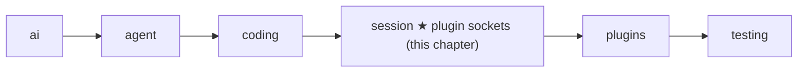
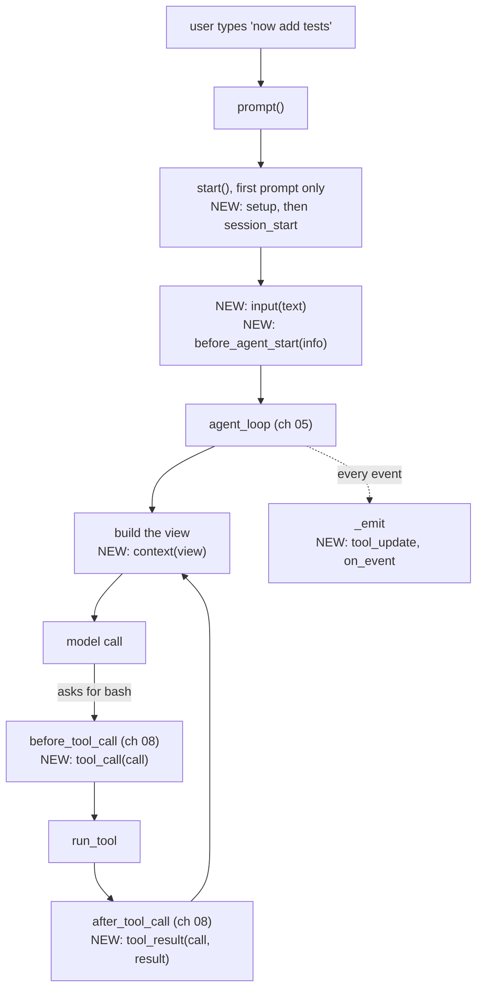

# 14 Part 4 · Plugins

**Goal:** Add behaviour without changing the core.

**Builds on:** [13 Sessions](13-session.md) · **Next:** [15 Retry](15-retry.md)

## Where we are



This chapter adds plugin support inside the `session` layer. The `plugins` folder, with two real plugins, comes in [18](18-profiles-plugins.md).

**Builds:** blocks 3 and 6, and the plugin parts of blocks 2, 4 and 7 · **IN:** a list of plugin objects, `plugin_config` · **OUT:** changed text, view, tool calls, tool results and events

Big picture of Part 4: [part-4-session](13-0-part-4-session.md).

## Problem

In [13](13-session.md) the user came back the next day and typed "now add tests". The session loaded yesterday's history and the agent went to work. Now two teams want small extras on top of that same session. One team wants a "no bash" mode: the agent may read and edit files, but never run a shell command. Another team wants to hide API keys: if the agent runs `cat .env`, the key must not reach the screen, the log or the model.

We could put an `if` for each extra inside `AgentSession`. But the list of extras never ends (plan mode, an extra tool, a line in the system prompt, a log of every event), so the session would grow without end, and every app would carry every extra.

We want a **[plugin](glossary.md#plugin)** instead: a plain object that the session calls at fixed moments. The core stays the same; you add an object to `AgentSession(plugins=[...])`. A method that the session calls on a plugin is a **[plugin hook](glossary.md#plugin-hook)**. Do not mix it up with the two [tool hooks](glossary.md#tool-hook) of [08](08-hooks-approval.md) (`before_tool_call` and `after_tool_call`). Those belong to the loop. As [13](13-session.md) said, the session fills them with its own methods. In this chapter, those methods call the plugins.

## Naive version

In [13](13-session.md#one-class-that-owns-the-agent), `AgentSession` gave the agent its own `_before_tool_call`, `_after_tool_call` and `_prepare` hooks. Plugins go inside those methods, so the loop does not change. A first try for "no bash": the session's `_before_tool_call` asks every plugin.

Naive sketch (not in the repo):

```text
CLASS AgentSession:
    FUNCTION _before_tool_call(call, ctx):   // the ch 08 before_tool_call hook
        FOR EACH plugin p:
            r = p.tool_call(call)            // every plugin MUST have tool_call
            IF r has "block":
                RETURN r["block"]            // the loop makes it "User denied: ..."

CLASS NoBash:
    FUNCTION tool_call(call):
        IF call.name is "bash": RETURN {block: "no bash"}
        RETURN nothing
```

It works for `NoBash`: the model asks for `bash`, gets the result `User denied: no bash`, and picks another way. Now add the key hider. It only wants to see tool output, so it has no `tool_call` method, and `p.tool_call(call)` raises `AttributeError`. The loop does not catch errors from `before_tool_call` ([08](08-hooks-approval.md)), so the whole run stops at the first tool call. The sketch has four faults. **Every plugin must have every method**, even the ones it does not need. **One bad plugin stops the run** for everyone. **There is only one moment to hook in**, but the key hider needs another one: when tool output arrives. **A plugin cannot act on the session**, for example to add a tool or a line to the system prompt.

## Step by step: from naive to real

**Look the method up first.** Use `getattr(p, "tool_call", None)` and skip the plugin if the method is missing. Now the key hider needs only the methods it wants. The cost: a typo in a hook name, like `tool_calls`, is just a missing method, so it is never called and nothing warns you.

**Allow plain and `async` methods.** A web plugin may need to `await`. We pass the result through `_maybe_await` from [08](08-hooks-approval.md), which awaits only when it must.

**Catch errors in one place.** Put the two steps above in one helper with a `try`. On error it tells the app and returns nothing, as if the plugin did nothing. The run goes on.

**But a broken safety check must say "no".** For `tool_call`, "skip on error" is wrong: if `NoBash` crashes and we skip it, `bash` runs, which is exactly what it was meant to stop. So here the error must block the tool.

**More moments.** Call plugins at more fixed places in a run: when the user types, before each model call, after each tool, on each event.

**Give each plugin a handle.** Once, at start, each plugin gets a small object with the actions it may take on the session.

## Real design

All code is in `packages/simp_agent/src/simp_agent/session/__init__.py`.

### Where plugins plug into one run

Recall the run of [13](13-session.md): the user types, `prompt()` calls `start()` the first time, then the `agent_loop` of [05](05-agent-loop.md) asks the model, runs tools through the two tool hooks of [08](08-hooks-approval.md), and every event goes out through the session's `_emit`. Plugins do not add a new path. They hook into the steps the reader already knows. Here is the "now add tests" run, with the plugin moments marked NEW:



`session_shutdown` runs once, in `shutdown()`. Every arrow marked NEW calls one method on each plugin, in list order, through one helper. That helper comes first, because every NEW moment uses it.

### `_hook`: one place for every call

Real code: [session/\_\_init\_\_.py](../../packages/simp_agent/src/simp_agent/session/__init__.py) — `AgentSession._hook`

```text
FUNCTION _hook(p, hook, args, isolate = true):
    fn = the method named hook on p, or nothing
    IF fn is nothing:
        RETURN nothing                         // missing method: skip
    TRY:
        RETURN WAIT for _maybe_await(fn(args)) // plain or async
    IF it raised error:
        IF not isolate:
            raise it again                     // the caller decides
        SEND {type: "plugin_error", plugin, hook, error} to subscribers only
        RETURN nothing                         // as if the plugin did nothing
```

The rule "an error in a hook becomes an event, and the run goes on" is called **[hook isolation](glossary.md#hook-isolation)**. The `plugin_error` event goes only to the subscribers of [13](13-session.md) (the app), not to the plugins' own `on_event`. If a plugin's `on_event` were broken, it would raise on the `plugin_error` too, which would make another `plugin_error`, and so on forever.

The event names the plugin. A plugin's name is its `name` field, or its class name if it has none; there is no base class, so any object can be a plugin:

```python
def plugin_name(p) -> str:
    return getattr(p, "name", type(p).__name__)
```

The same name shows up in block messages and is the key into `plugin_config`. Now we follow the run, moment by moment.

### Start: setup and the PluginAPI

The first `prompt()` calls `start()` ([13](13-session.md#prompt-continue_-and-start)). After it adds the context file, it runs:

```text
FOR EACH plugin p:
    WAIT for _hook(p, "setup", new PluginAPI(session, name of p), plugin_config[name of p] or {})
FOR EACH plugin p:
    WAIT for _hook(p, "session_start")      // only after ALL setups are done
```

`plugin_config` is a dict keyed by plugin name, so each plugin sees only its own settings. `session_start` waits for all `setup` calls, so a plugin can count on the others being ready.

What is the first argument to `setup`? It is the handle from the step "give each plugin a handle": a **[PluginAPI](glossary.md#pluginapi)**, a small class with named actions, not the whole session.

Real code: [session/\_\_init\_\_.py](../../packages/simp_agent/src/simp_agent/session/__init__.py) — `PluginAPI`

```text
CLASS PluginAPI:
    FUNCTION init(session, name): save both

    FUNCTION register_tool(tool):
        unregister_tool(tool.name)       // same name: replace the old one
        ADD tool to the agent's tools
    FUNCTION add_prompt_section(id, value, order = 100):
        session.add_prompt_section(id, value, order)
    FUNCTION append_entry(type, data):
        RETURN WAIT for session.append_entry(type, data)
    ...                                  // send_message, set_model, abort, emit, ...
```

`add_prompt_section` uses the [prompt sections](glossary.md#prompt-section) of [13](13-session.md#prompt-sections-how-the-system-prompt-is-built). The default order 100 puts a plugin's section after `coding` (0) and `context_file` (10). `append_entry` saves a [custom entry](glossary.md#custom-entry): plugin data that is saved and replayed on resume, but never sent to the model. `emit` sends an event with the plugin's name in it. The full list is in [Reference · objects](ref-objects.md#pluginapi-methods). Plugins depend only on these names, so the session can change inside without breaking them.

### The user types: input and before_agent_start

In `prompt()`, each plugin's `input(text)` sees the text. If one returns `{"handled": True}`, `prompt()` returns `[]` and the model is never called; this is how a plugin handles its own slash command, such as `/plan`. If it returns `{"text": ...}`, the next plugin and the model get the new text. Then `before_agent_start(info)`, with `info` = `{"prompt", "messages"}`, may return `{"messages": [...]}` to add messages to this run; a plain string becomes a `UserMessage`.

### Before each model call: context

Now the loop is about to call the model. The session builds the message list to send, the **[view](glossary.md#view-llm-view)**, and passes it through the plugins as a chain:

Real code: [session/\_\_init\_\_.py](../../packages/simp_agent/src/simp_agent/session/__init__.py) — `AgentSession._context`

```python
async def _context(self, view: list) -> list:
    for p in self.plugins:  # chained: each gets the previous output
        view = await self._hook(p, "context", list(view)) or view
    return view
```

Each plugin gets a copy (`list(view)`) of the output of the one before, so it changes what the model sees this turn, never the saved history. If a plugin fails, or returns `None` or an empty list, `or view` keeps the old view. The key hider uses this hook to remove keys that are already in the history.

### The model asks for bash: tool_call

The loop calls `before_tool_call` ([08](08-hooks-approval.md)), which the session filled with `_before_tool_call`:

Real code: [session/\_\_init\_\_.py](../../packages/simp_agent/src/simp_agent/session/__init__.py) — `AgentSession._before_tool_call`

```text
FUNCTION _before_tool_call(call, ctx):
    FOR EACH plugin p:                  // first block wins
        TRY:
            r = WAIT for _hook(p, "tool_call", call, isolate = false), or {}
        IF it raised error e:
            RETURN "blocked by plugin <name> (<error type>: <e>)"
        IF r has "block":
            RETURN "blocked by plugin <name>: <reason>"
        IF r has "args":
            call.arguments = r["args"]  // the next plugin sees the new arguments
    ...                                 // then the approval check of ch 08
```

This is the only call with `isolate=False`. A `tool_call` hook is often a safety check, and running the tool after the check crashed would be unsafe, so here an error means "no". This rule is called **[fail closed](glossary.md#fail-closed)**.

A worked example: `NoBash` has a bug, and its `tool_call` raises `KeyError('name')`. `_hook` lets the error out, and `_before_tool_call` returns `blocked by plugin NoBash (KeyError: 'name')`. The loop turns that into the tool result `User denied: blocked by plugin NoBash (KeyError: 'name')`, and `bash` never runs. With a working `NoBash`, the result is `User denied: blocked by plugin NoBash: no bash`.

Later plugins are not asked once one blocks. Plugins also run before the approval question of [08](08-hooks-approval.md), so a blocked call never asks the human. The cost: a plugin cannot see whether the human would have said yes.

### The tool is done: tool_result

The loop calls `after_tool_call`, which the session filled with `_after_tool_call`:

```text
FUNCTION _after_tool_call(call, result, ctx):
    FOR EACH plugin p:                  // in order
        r = WAIT for _hook(p, "tool_result", call, result)
        IF r is not empty:
            result = copy of result with the fields in r replaced   // dataclasses.replace
    RETURN result
```

A plugin returns only the fields it wants to change, for example `{"content": "<hidden>"}`, and the other fields stay. As in [08](08-hooks-approval.md), this also runs after a block or a deny.

### Every event: tool_update and on_event

All through the run, events go out through the session's `_emit` from [13](13-session.md), which also feeds plugins:

Real code: [session/\_\_init\_\_.py](../../packages/simp_agent/src/simp_agent/session/__init__.py) — `AgentSession._emit`

```text
FUNCTION _emit(e):
    IF e.type is "tool_execution_update":
        FOR EACH plugin p:
            r = WAIT for _hook(p, "tool_update", e.call, e.text)
            IF r is not nothing:
                e = copy of e with text = r
    SEND e to all subscribers
    FOR EACH plugin p:
        WAIT for _hook(p, "on_event", e)
```

The order matters for the key hider. While `cat .env` runs, its output streams as `tool_execution_update` events ([06](06-events-abort.md)). `tool_update` changes the text **before** the subscribers see it, so the key never reaches the screen or a log. `tool_result` then hides it in the final result that is saved and sent to the model. `on_event` comes last, so a plugin that logs events sees the cleaned text too.

**Builds on:** [13 Sessions](13-session.md) · **Next:** [15 Retry](15-retry.md)
