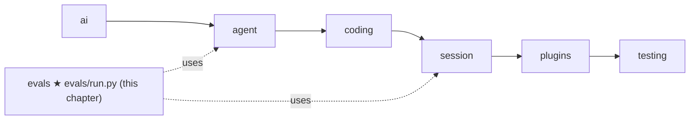

# 15 Part 3 · Evals

**Goal:** Measure the agent on real tasks; when you add a capability later, you can add a case for it.

**Builds on:** [07 Agent loop](07-agent-loop.md) · [08 Events and abort](08-events-abort.md) (we count by listening) · [12 Execution environment](12-exec-env.md) · [13 Coding tools](13-coding-tools.md) · [14 The system prompt](14-system-prompt.md) · **Next:** [16 Part 4 big picture](16-part-4-session.md)

## Where we are



Take the running example again. The user asks "What is in README.md?". After [14](14-system-prompt.md) the model has a `read` tool and a system prompt that says when to use it, so it should answer well. But *should* is not proof. Our unit tests use the [FakeProvider](05-label-test.md): they prove our code does what we wrote, but the fake model always says what we tell it to say. They cannot tell us if a **real** model, with our tools and our prompt, finds the file and gives the right answer.

To know that, we must run the real agent with a real model on a fixed job and let a program check the result. That is an [eval](glossary.md#eval). Our first eval task, `read_answer`, is a small cousin of the running example: "read `config.ini` and tell me the server port". The check is one command: is `8473` in the answer?

Why now, before [17 Sessions](17-session.md)? Because from here on, every chapter changes how the agent behaves (retry, compaction, plugins). With an eval in place, each change can be measured, not only guessed.

Big picture of Part 3: [part-3-coding](11-part-3-coding.md).

## What is an eval task?

An [eval task](glossary.md#eval-task) is one TOML file in `evals/tasks/`; the file name is the task name. It has a `prompt` (what we ask the agent), an optional `[setup]` table (file path → file text, written into the empty folder before the agent starts), and a `check`: a shell command where exit code 0 means pass. Adding a task needs no Python.

Here is `evals/tasks/fix_bug.toml` (shortened):

```toml
prompt = "The tests in test_calc.py fail. Fix the bug in calc.py (do not change the tests). Run them with: python -m pytest -q"
check = '"$PYTHON" -m pytest -q -p no:cacheprovider test_calc.py && grep -q "assert average(\[2, 4\]) == 3" test_calc.py'

[setup]
"calc.py" = """
def average(xs):
    if not xs:
        return 0
    return sum(xs) / (len(xs) + 1)
...
"""
"test_calc.py" = """..."""
```

The check does two things. pytest tests the goal, and the `grep` makes sure the agent did not "fix" the test by changing the test file (`\[` means a plain `[`, because `[` is special in a `grep` pattern). A good check tests the goal *and* blocks the easy cheat.

The four tasks grow in difficulty:

| Task | What the agent must do | How the check works |
|---|---|---|
| `read_answer` | Read `config.ini`, say the server port | `grep -q 8473 _answer.txt` |
| `fizzbuzz` | Write a new file from a spec | Import it and assert outputs |
| `fix_bug` | Find and fix an off-by-one | Run pytest; test file unchanged |
| `refactor_rename` | Rename `get_usr` to `get_user` in all files | No `get_usr` left in `*.py`; pytest passes |

## What happens when one task runs?

The runner does not change the agent; it sets up a clean place, runs it, listens, and checks. In time order:

1. It makes a fresh temp folder and writes the `[setup]` files into it, so each task starts clean and nothing leaks between tasks.
2. It runs the real agent there. The agent is an `AgentSession`, which [17](17-session.md) builds; here we only need `prompt` (run until done), `subscribe` (get every event) and `abort` (stop now). It uses `LocalEnv` ([12](12-exec-env.md)), so these are the real [coding tools](13-coding-tools.md), not a copy.
3. It counts by listening to [events](glossary.md#event) ([08](08-events-abort.md)). Each assistant `message_end` is one [turn](glossary.md#turn); its [usage](glossary.md#usage) adds to the tokens, and its text becomes the answer so far, so the last text is the answer.
4. It stops a runaway agent: at 25 turns, or after 300 seconds, it calls [abort](glossary.md#abort).
5. It writes the answer to `_answer.txt`, so a check can test what the agent *said* (`read_answer` does this). Then it runs the check in the folder, with `$PYTHON` set to the project's Python (so pytest is the right one) and a 120-second limit.
6. The result is one row: pass or fail, turns, tokens, dollars (cost = tokens × the profile's prices), seconds.

A task that hits a limit is not a crash: the row gets an error, like `hit 25 turns`, and the check still runs (it will usually fail).

Real code: [evals/run.py](../../evals/run.py) — `run_task`

## How do you run it and read the result?

One command runs every task, one by one, and prints one line per task, then a total:

```bash
uv run python evals/run.py --profile sol
uv run python evals/run.py --profile sol --tasks fix_bug,refactor_rename
```

```text
read_answer     PASS     2 turns       300/30       $0.0004  1.2s
total           1/1      2 turns       300/30       $0.0004  1.2s
wrote /path/to/simp-agent/evals/results/20261013-101500-sol.json
```

(Shown with one task to keep it short; the real run has four lines plus the total.) The columns are: pass or fail, number of turns, input/output tokens, dollars, seconds. Every run is saved as `evals/results/<date>-<profile>.json`, so next week you can compare.

`sol` is a [profile](glossary.md#profile) (one model plus its prices), read from the same `settings.toml` the server uses ([22](22-profiles-plugins.md), [27](27-store-auth.md)), so you eval exactly what you serve. A wrong task name stops with the list of real names, before any money is spent.

Real code: [evals/run.py](../../evals/run.py) — `run_all`, `main`

## Adding a task

Add one file to [evals/tasks/](../../evals/tasks/). A good task:

1. **Is small and fixed:** every file it needs is in `[setup]`; no network.
2. **Has a check a program can run**, exit 0 for pass.
3. **Blocks the cheat**, like `fix_bug`'s `grep`.
4. **Uses `"$PYTHON"`**, not `python`, and `-p no:cacheprovider`.
5. **Tests one skill**, so a fail tells you why.

The runner itself is tested too: `evals/test_run.py` runs the whole path with a [FakeProvider](05-label-test.md), so it needs no key.

## Host-shell warning

> ⚠️ **Evals run on your own machine, with no sandbox.** `LocalEnv` runs the agent's `bash` tool on your host, as you ([12](12-exec-env.md)). The temp folder is only the *starting* folder; a command like `rm -rf ~` or `curl ... | sh` is not blocked. The `check` also runs with `shell=True` on your host. Only run tasks you trust, with models you trust, ideally in a spare VM you can delete, or container. The [Docker sandbox](29-docker-sandbox.md) is not used here.

One thing protects you a little: `take_keys` reads the keys from `<data_dir>/.env` and from the environment, and removes the known key variables (each profile's `api_key_env`, `OPENAI_API_KEY`, `ANTHROPIC_API_KEY`) from `os.environ` before the agent runs. Commands the agent starts do not see those keys. Other secrets in your environment are still visible.


**Builds on:** [07 Agent loop](07-agent-loop.md) · [08 Events and abort](08-events-abort.md) · [13 Coding tools](13-coding-tools.md) · [14 The system prompt](14-system-prompt.md) · **Next:** [16 Part 4 big picture](16-part-4-session.md) — we have been using `AgentSession`; now we build it. Later, [19 Retry](19-retry.md) and [20 Compaction](20-compaction.md) change how the agent behaves; run these evals after each change.
