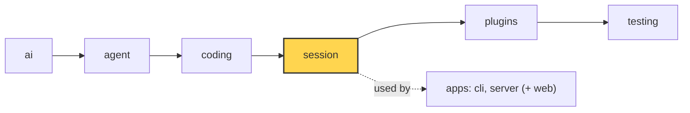

# 15 Part 4 · Retry

**Goal:** Retry failed model calls with backoff.

**Builds on:** [14 Plugins](14-plugins.md) · **Next:** [16 Compaction](16-compaction.md)



*This chapter adds retry to the `session` layer (marked). The error checks it uses live in `ai`.*

## Problem

Real model APIs fail often and for a short time: `429 rate limit`, `529 overloaded`, `503 service unavailable`, a dropped connection. In [03](03-stream-parser.md) we saw that the stream does not raise in this case. It ends with an `AssistantMessage` whose `stop_reason` is `"error"` and whose `error` holds the text. The loop ([05](05-agent-loop.md)) then stops.

So in the middle of the fizzbuzz task, one `429` ends the whole run. The user must type "continue" by hand. Most of these errors go away if you just wait a few seconds and try again.

But not every error should be retried. A missing API key or a spent budget will fail again and again. And retrying too fast makes a rate limit worse.

## Naive version

```python
import asyncio

async def prompt_with_retry(agent, text, tries=3):
    await agent.prompt(text)
    for _ in range(tries):
        last = agent.messages[-1]
        if last.role != "assistant" or last.stop_reason != "error":
            return
        await asyncio.sleep(2)            # wait, then try again
        await agent.continue_()
```

It helps with one `429`. It breaks when:

1. **It retries everything.** "no API key" is retried three times for nothing.
2. **Fixed wait.** A server that is overloaded gets hit again every 2 seconds.
3. **Abort does not work.** If the user presses Ctrl-C during `asyncio.sleep(2)`, nothing happens until the sleep ends, and then it retries anyway.
4. **Nobody sees it.** The UI shows nothing while waiting.
5. **The error message is sent back to the model** on the next call, unless something removes it.

## Real design

### Which errors are retryable

In `packages/simp_agent/src/simp_agent/ai/__init__.py`:

```python
_RETRYABLE = re.compile(
    r"\b(429|5\d\d)\b|overloaded|rate.?limit|bad gateway|too many requests|service unavailable|internal server error"
    r"|connection|network|timed? ?out|econnreset|stream ended",
    re.I,
)
...
NON_RETRYABLE = {"fatal", "budget", "policy"}


def is_retryable(error: str, kind: str | None = None) -> bool:
    if kind in NON_RETRYABLE:
        return False
    return not is_context_overflow(error) and bool(_RETRYABLE.search(error or ""))
```

Two inputs decide:

- **The error text.** Providers do not agree on error types, but the text almost always has `429`, a `5xx` code, "overloaded" or "timed out". A regex over the text works for all providers ([04](04-providers.md)) with no per-provider code.
- **The error kind.** `AssistantMessage.error_kind` can be `"fatal"`, `"budget"` or `"policy"`. These are **never** retried, even if the text looks retryable. For example, `stream()` sets `error_kind="fatal"` when there is no API key. The server sets `"budget"` when a user is over their limit ([23](23-limits.md)). The text alone cannot tell "the provider rate-limits you" from "our own budget stops you".

A context overflow is also not retryable here: the same too-big request would fail again. It has its own path ([17](17-overflow.md)).

### The retry loop in `_run`

In `packages/simp_agent/src/simp_agent/session/__init__.py`, `prompt()` and `continue_()` both call `_run` ([13](13-session.md)):

```python
    async def _run(self, start) -> list:
        a = self.agent
        self._abort = asyncio.Event()
        new = await start()
        overflowed, attempt = False, 0
        while (last := a.messages[-1]).role == "assistant" and last.stop_reason == "error":
            if self.auto_compact and not overflowed and ai.is_context_overflow(last.error):
                ...  # chapter 17
            elif ai.is_retryable(last.error, last.error_kind) and attempt < self.max_retries:
                attempt += 1
                delay = self.retry_base_delay * 2 ** (attempt - 1)
                await self._emit({"type": "auto_retry_start", "attempt": attempt, "max_attempts": self.max_retries,
                                  "delay": delay, "error": last.error})
                try:
                    await asyncio.wait_for(self._abort.wait(), delay)
                    break  # aborted during backoff
                except TimeoutError:
                    pass
            else:
                break
            new += await a.continue_()
        if attempt:
            ok = not (a.messages[-1].role == "assistant" and a.messages[-1].stop_reason == "error")
            await self._emit({"type": "auto_retry_end", "success": ok, "attempt": attempt})
        return new
```

Step by step:

1. Run once (`start()`).
2. While the last message is an assistant error: if it is retryable and we have tries left, wait, then call `a.continue_()`. Otherwise stop.
3. At the end, if we retried at all, send `auto_retry_end` with `success`.

**Exponential [backoff](glossary.md#backoff).** `delay = retry_base_delay * 2 ** (attempt - 1)`. With the defaults (`retry_base_delay=2.0`, `max_retries=3`) the waits are 2, 4 and 8 seconds. Each wait doubles, so a busy server gets more and more room.

**Retry is `continue_()`, not a new prompt.** The error message stays in history (history is append-only, [13](13-session.md)). We do not resend the user text. `continue_()` asks the model again with the same history. Before the call, `transform_messages` in `ai` drops assistant turns with `stop_reason` `"error"` or `"aborted"` from what is sent ([03](03-stream-parser.md)). So the model never sees its own failed reply.

**Events.** `auto_retry_start` carries `attempt`, `max_attempts`, `delay` and the `error`, so the CLI can show "retry 1/3 in 2s: 429 ...". `auto_retry_end` says if it worked in the end.

### Abort during backoff

The wait is not `asyncio.sleep`. It is:

```python
                try:
                    await asyncio.wait_for(self._abort.wait(), delay)
                    break  # aborted during backoff
                except TimeoutError:
                    pass
```

`self._abort` is an `asyncio.Event`. `wait_for` waits for it, but at most `delay` seconds:

- If the time runs out, `wait_for` raises `TimeoutError`. That is the normal case: go on and retry.
- If the user aborts first, the event is set, `wait()` returns, and we `break`. No retry.

The session's `abort()` sets this event and also aborts the agent ([06](06-events-abort.md)):

```python
    def abort(self) -> None:
        self._abort.set()
        self.agent.abort()
```

Why a separate event? During backoff the agent is **not** running. There is no model call to cancel, so `agent.abort()` alone would do nothing. The session needs its own flag for its own wait. `_run` makes a fresh `asyncio.Event()` at the start of each run, so an old abort does not stop the next prompt.

## Test

`packages/simp_agent/tests/test_session.py::test_retry_429_twice_then_ok`:

```python
def err429():
    return AssistantMessage(stop_reason="error", error="Error code: 429 rate_limit_error")
...
async def test_retry_429_twice_then_ok():
    stream = FakeProvider(err429(), err429(), DONE)
    seen = stream.messages
    s = session(stream, retry_base_delay=0.001)
    events = []
    s.subscribe(lambda e: e["type"].startswith("auto_retry") and events.append(e))
    await s.prompt("hi")
    assert len(seen) == 3 and s.messages[-1] is DONE
    assert [e["type"] for e in events] == ["auto_retry_start", "auto_retry_start", "auto_retry_end"]
    assert events[1]["delay"] == 0.002 and events[-1]["success"]
    assert all(m.role != "assistant" or m.stop_reason != "error" for m in seen[2])  # LLM view drops the errors
```

What it checks:

- `FakeProvider` ([02](02-fake-provider.md)) fails twice with a `429`, then answers `ok`. The model was called 3 times and the run ends with `DONE`.
- Two `auto_retry_start` events, then one `auto_retry_end`.
- Backoff doubles: the second delay is `0.002` (base `0.001` × 2). A tiny base keeps the test fast.
- The third call did not include the two error messages.

The next test in the file, `test_abort_during_backoff_stops`, sets `retry_base_delay=60` and calls `s.abort()` on `auto_retry_start`. The prompt returns at once, the model was called only once, and the last message is still the error.

Run both:

```sh
uv run pytest packages/simp_agent/tests/test_session.py -k "retry_429 or abort_during_backoff" -q
```

## Why this way

> **Retry in the session, decided by text plus kind.** The loop ([05](05-agent-loop.md)) stays simple: an error ends the turn. The session, which lives across turns, decides whether to try again. A regex on the error text works for every provider; `error_kind` lets our own code say "never retry this". Backoff waits on the abort event, so Ctrl-C works even while nothing is running. The cost: a new provider error text that the regex does not know is not retried until someone adds it.

## Recap

- A failed model call ends as an `AssistantMessage` with `stop_reason="error"`.
- `is_retryable(error, kind)`: a regex on the text, but never for `fatal`, `budget`, `policy` or an overflow.
- `_run` retries with `continue_()` up to `max_retries` times, waiting `base × 2^(n-1)`.
- The wait is `wait_for(self._abort.wait(), delay)`, so abort stops it right away.
- `auto_retry_start` / `auto_retry_end` events let the UI show what is going on.

**Builds on:** [14 Plugins](14-plugins.md) · **Next:** [16 Compaction](16-compaction.md)

## Terms to add to glossary

- **retry** — calling the model again after a short-lived error, with `continue_()`.
- **backoff** — waiting longer between each retry; here the wait doubles each time.
- **error_kind** — a field on `AssistantMessage`; `fatal`, `budget` or `policy` mean "never retry".
- **retryable error** — an error whose text matches `_RETRYABLE` (429, 5xx, overloaded, network...) and whose kind allows retry.
