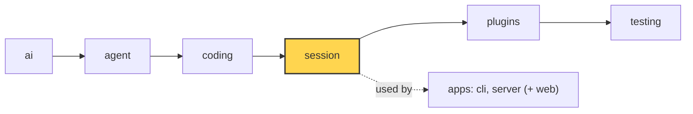

# 15 Part 4 · Retry

**Goal:** Retry failed model calls with backoff.

**Builds on:** [14 Plugins](14-plugins.md) · **Next:** [16 Compaction](16-compaction.md)

## Where we are



*This chapter adds retry to the `session` layer (marked). The error checks it uses live in `ai`.*

Big picture of Part 4: [part-4-session](part-4-session.md).

Code in this chapter (commit `2fc2776`):

- `packages/simp_agent/src/simp_agent/ai/__init__.py` — `is_retryable`, `NON_RETRYABLE`
- `packages/simp_agent/src/simp_agent/session/__init__.py` — `AgentSession._run` (the retry loop)
- `packages/simp_agent/tests/test_session.py` — `test_retry_429_twice_then_ok`, `test_abort_during_backoff_stops`

## Problem

Real model APIs fail often and for a short time: `429 rate limit`, `529 overloaded`, `503 service unavailable`, a dropped connection. In [03](03-stream-parser.md) we saw that the stream does not raise in this case. It ends with an `AssistantMessage` whose `stop_reason` is `"error"` and whose `error` holds the text. The loop ([05](05-agent-loop.md)) then stops.

So in the middle of the fizzbuzz task, one `429` ends the whole run. The user must type "continue" by hand. Most of these errors go away if you just wait a few seconds and try again.

But not every error should be retried. A missing API key or a spent budget will fail again and again. And retrying too fast makes a rate limit worse.

## Naive version

```text
FUNCTION prompt_with_retry(agent, text, tries=3):
    RUN agent.prompt(text)
    REPEAT tries times:
        last = the last message
        IF last is not an assistant error: RETURN
        SLEEP 2 seconds                  // wait, then try again
        RUN agent.continue_()
```

It helps with one `429`. It breaks when:

1. **It retries everything.** "no API key" is retried three times for nothing.
2. **Fixed wait.** A server that is overloaded gets hit again every 2 seconds.
3. **Abort does not work.** If the user presses Ctrl-C during `asyncio.sleep(2)`, nothing happens until the sleep ends, and then it retries anyway.
4. **Nobody sees it.** The UI shows nothing while waiting.

## Step by step: from naive to real

We fix the naive version one problem at a time.

**Step 1 — only retry errors that can go away.** We add `is_retryable(error, kind)` in `ai`. It checks the error text with a regex, and it says "no" for some error kinds:

Real code: [session/__init__.py](../../packages/simp_agent/src/simp_agent/session/__init__.py) — `_run`

```text
ELSE IF ai.is_retryable(last.error, last.error_kind) AND attempt < max_retries:
    // retry this one
```

Key idea: only retry errors that can go away.

Why: "no API key" will fail every time. A retry only wastes time.

**Step 2 — wait longer each time.** The fixed 2 seconds becomes a doubling wait:

Real code: [session/__init__.py](../../packages/simp_agent/src/simp_agent/session/__init__.py) — `_run`

```text
delay = retry_base_delay * 2 ^ (attempt - 1)     // 2, 4, 8 ...
```

Key idea: each wait is double the last one.

Why: a busy server needs more room each time, not the same hit every 2 seconds.

**Step 3 — let abort stop the wait.** `asyncio.sleep` is replaced by a wait on an event, with a time limit:

Real code: [session/__init__.py](../../packages/simp_agent/src/simp_agent/session/__init__.py) — `_run`

```text
WAIT for the abort event, but at most delay seconds
```

Key idea: abort ends the wait at once.

Why: Ctrl-C must work at once, even when no model call is running.

**Step 4 — tell the UI.** We emit `auto_retry_start` before each wait and `auto_retry_end` at the end.

Why: the user should see "retrying", not a frozen screen.

**Note — failed replies are already hidden.** We need nothing new for this. `transform_messages` in `ai` already drops assistant messages with `stop_reason` `"error"` or `"aborted"` ([04](04-providers.md)). The error stays in history (for the user and the store), but the model never sees it.

**Step 5 — move it into the session.** The loop lives in `AgentSession._run`, so `prompt()` and `continue_()` both get it for free.

The result is the real code below.

## Real design

### Which errors are retryable

Real code: [ai/__init__.py](../../packages/simp_agent/src/simp_agent/ai/__init__.py) — `_RETRYABLE`, `NON_RETRYABLE`, `is_retryable`

```text
_RETRYABLE = a regex, case-insensitive, that matches any of:
    429 or 5xx codes, overloaded, rate limit, bad gateway, too many requests,
    service unavailable, internal server error, connection, network,
    timed out, econnreset, stream ended

NON_RETRYABLE = {"fatal", "budget", "policy"}

FUNCTION is_retryable(error, kind):
    IF kind is in NON_RETRYABLE: RETURN no     // our own code said "never"
    IF is_context_overflow(error): RETURN no   // same big request fails again
    RETURN yes IF _RETRYABLE matches the error text
```

Two inputs decide:

- **The error text.** Providers do not agree on error types, but the text almost always has `429`, a `5xx` code, "overloaded" or "timed out". A regex over the text works for all providers ([04](04-providers.md)) with no per-provider code.
- **The error kind.** `AssistantMessage.error_kind` can be `"fatal"`, `"budget"` or `"policy"`. These are **never** retried, even if the text looks retryable. For example, `stream()` sets `error_kind="fatal"` when there is no API key. The server sets `"budget"` when a user is over their limit ([23](23-limits.md)). The text alone cannot tell "the provider rate-limits you" from "our own budget stops you".

A context overflow is also not retryable here: the same too-big request would fail again. It has its own path ([17](17-overflow.md)).

### The retry loop in `_run`

`prompt()` and `continue_()` both call `_run` ([13](13-session.md)).

Real code: [session/__init__.py](../../packages/simp_agent/src/simp_agent/session/__init__.py) — `AgentSession._run`

```text
FUNCTION _run(start):
    a = the agent
    self._abort = a NEW event            // fresh each run: an old abort does not stop this one
    new = RUN start()                    // prompt() or continue_()
    overflowed = false, attempt = 0
    WHILE the last message is an assistant message with stop_reason "error":
        IF auto_compact AND not overflowed AND is_context_overflow(error):
            ...                          // chapter 17
        ELSE IF is_retryable(error, error_kind) AND attempt < max_retries:
            attempt = attempt + 1
            delay = retry_base_delay * 2 ** (attempt - 1)   // 2, 4, 8 seconds
            SEND event auto_retry_start {attempt, max_attempts, delay, error}
            WAIT for self._abort, but at most `delay` seconds
            IF abort came first: STOP the loop              // aborted during backoff
            // else the time ran out: go on
        ELSE:
            STOP the loop
        ADD to new: RUN a.continue_()    // ask again with the same history
    IF attempt > 0:
        ok = the last message is NOT an assistant error
        SEND event auto_retry_end {success: ok, attempt}
    RETURN new
```

Step by step:

1. Run once (`start()`).
2. While the last message is an assistant error: if it is retryable and we have tries left, wait, then call `a.continue_()`. Otherwise stop.
3. At the end, if we retried at all, send `auto_retry_end` with `success`.

**Exponential [backoff](glossary.md#backoff).** `delay = retry_base_delay * 2 ** (attempt - 1)`. With the defaults (`retry_base_delay=2.0`, `max_retries=3`) the waits are 2, 4 and 8 seconds. Each wait doubles, so a busy server gets more and more room.

**Retry is `continue_()`, not a new prompt.** The error message stays in history (history is append-only, [13](13-session.md)). We do not resend the user text. `continue_()` asks the model again with the same history. Before the call, `transform_messages` in `ai` drops assistant turns with `stop_reason` `"error"` or `"aborted"` from what is sent ([04](04-providers.md)). So the model never sees its own failed reply.

**Events.** `auto_retry_start` carries `attempt`, `max_attempts`, `delay` and the `error`. `auto_retry_end` carries `success` and `attempt`. Two apps use them:

- The CLI (`apps/cli/src/simp_cli/repl.py`) sets its state to `"retrying"` on `auto_retry_start`.
- The server (`apps/server/src/simp_server/server.py`) turns them into notices ([20](20-server-run.md)):

Real code: [server.py](../../apps/server/src/simp_server/server.py) — `on_event`

```text
IF event type is auto_retry_start:
    SAVE notice (warning): "retry {attempt}/{max_attempts}: {error}"
ELSE IF event type is auto_retry_end:
    SAVE notice: "retry succeeded" or "retry failed"
```

Key idea: retry events become durable notices for the web UI.

### Abort during backoff

The wait is not `asyncio.sleep`. It is:

Real code: [session/__init__.py](../../packages/simp_agent/src/simp_agent/session/__init__.py) — `_run`

```text
WAIT for abort event, at most delay seconds
IF abort came first:
    STOP loop                              // aborted during backoff
IF time ran out (TimeoutError):
    go on                                  // normal case: retry
```

Key idea: the wait is a timed wait on the abort event, not a sleep.

`self._abort` is an `asyncio.Event`. `wait_for` waits for it, but at most `delay` seconds:

- If the time runs out, `wait_for` raises `TimeoutError`. That is the normal case: go on and retry.
- If the user aborts first, the event is set, `wait()` returns, and we `break`. No retry.

The session's `abort()` sets this event and also aborts the agent ([06](06-events-abort.md)):

```text
FUNCTION abort():
    SET the session's own abort event     // stops the backoff wait
    TELL the agent to abort               // stops a running model call
```
Real code: [session/__init__.py](../../packages/simp_agent/src/simp_agent/session/__init__.py) — `Session.abort`

Why a separate event? During backoff the agent is **not** running. There is no model call to cancel, so `agent.abort()` alone would do nothing. The session needs its own flag for its own wait. `_run` makes a fresh `asyncio.Event()` at the start of each run, so an old abort does not stop the next prompt.

### Order of checks and edge cases

Each time round the `while`, `_run` asks these questions, in this order:

1. **Is the last message an assistant error?** If not, stop. A normal reply ends the loop. An abort during a model call gives `stop_reason="aborted"`, not `"error"`, so it also ends the loop with no retry.
2. **Is it a context overflow, and is `auto_compact` on, and have we not compacted yet?** Then compact once and continue ([17](17-overflow.md)). This check comes **first**. `is_retryable` also says "no" for an overflow, so an overflow is never retried by the backoff path.
3. **Is it retryable, and is `attempt < max_retries`?** Then wait and continue.
4. **Otherwise** stop. The error stays as the last message.

Some edge cases that follow from this code:

- **`error_kind` wins over the text.** `AssistantMessage(stop_reason="error", error="429", error_kind="budget")` is not retried. The server's budget check (`apps/server/src/simp_server/budget.py`) uses exactly this. `"policy"` is in `NON_RETRYABLE`, but no code at `2fc2776` sets it yet; it is room for later.
- **`max_retries=0`** turns retry off. `attempt < 0` is never true.
- **The counter is per run.** `attempt` starts at 0 in each `_run`. The next `prompt()` gets the full 3 tries again.
- **Overflow and retry share one loop.** After a compaction, the next call can fail with `429`. Then the retry branch runs, with its own `attempt` counter.
- **The regex is wide.** Any text with `connection`, `network` or a 3-digit number from 500 to 599 matches. For example an error that says "connection refused" is retried. This is on purpose: retry is cheap, and the try count is small.
- **No retry events if nothing was retried.** `auto_retry_end` is sent only `if attempt:`. A fatal error alone sends neither event.
- **`success` is checked at the end.** If all 3 tries fail, `auto_retry_end` has `success=False`, and the last message is the last error.
- **The wait has no random part (no "[jitter](glossary.md#jitter)").** All clients wait the same 2, 4, 8 seconds. That is a known limit.

## Test

`packages/simp_agent/tests/test_session.py::test_retry_429_twice_then_ok`:

Real code: [session/__init__.py](../../packages/simp_agent/src/simp_agent/session/__init__.py) — `AgentSession.abort`

```text
FUNCTION abort():
    SET self._abort                        // stops a backoff wait
    self.agent.abort()                     // stops a running model call
```

Key idea: two flags, because during backoff no model call is running.

What it checks:

- `FakeProvider` ([02](02-fake-provider.md)) fails twice with a `429`, then answers `ok`. The model was called 3 times and the run ends with `DONE`.
- Two `auto_retry_start` events, then one `auto_retry_end`.
- Backoff doubles: the second delay is `0.002` (base `0.001` × 2). A tiny base keeps the test fast.
- The third call did not include the two error messages.

The next test in the file, `test_abort_during_backoff_stops`, sets `retry_base_delay=60` and calls `s.abort()` on `auto_retry_start`. The prompt returns at once, the model was called only once, and the last message is still the error.

Run both:

```sh
uv run pytest packages/simp_agent/tests/test_session.py -k "retry_429 or abort_during_backoff" -q
```

## Why this way

> **Retry in the session, decided by text plus kind.** The loop ([05](05-agent-loop.md)) stays simple: an error ends the turn. The session, which lives across turns, decides whether to try again. A regex on the error text works for every provider; `error_kind` lets our own code say "never retry this". Backoff waits on the abort event, so Ctrl-C works even while nothing is running. The cost: a new provider error text that the regex does not know is not retried until someone adds it.

## Exercises

1. Write a test where `FakeProvider` returns `err429()` four times, with `retry_base_delay=0.001`. Check that the model was called 4 times (1 + 3 retries) and that `auto_retry_end` has `success=False`. Hint: copy `test_retry_429_twice_then_ok` and change the asserts.
2. Make the first reply `AssistantMessage(stop_reason="error", error="429", error_kind="fatal")`. Predict: how many model calls, and how many `auto_retry` events? Hint: look at the first line of `is_retryable` and at `if attempt:`.

## Recap

- A failed model call ends as an `AssistantMessage` with `stop_reason="error"`.
- `is_retryable(error, kind)`: a regex on the text, but never for `fatal`, `budget`, `policy` or an overflow.
- `_run` retries with `continue_()` up to `max_retries` times, waiting `base × 2^(n-1)`.
- The wait is `wait_for(self._abort.wait(), delay)`, so abort stops it right away.
- `auto_retry_start` / `auto_retry_end` events let the UI show what is going on.

**Builds on:** [14 Plugins](14-plugins.md) · **Next:** [16 Compaction](16-compaction.md)
