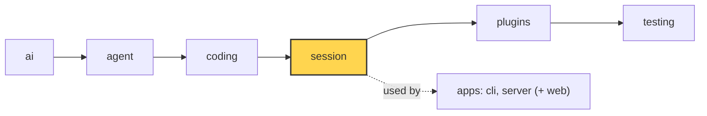

# 15 Part 4 · Retry

**Goal:** Retry failed model calls with backoff.

**Builds on:** [04 Errors are plain text](04-label-test.md#errors-are-plain-text) · [06 Abort](06-events-abort.md) · [13 Sessions](13-session.md) · [14 Plugins](14-plugins.md) · **Next:** [16 Compaction](16-compaction.md)

## Where we are



*This chapter adds retry to the `session` layer (marked). The error check it uses lives in `ai`.*

Big picture of Part 4: [part-4-session](13-0-part-4-session.md).

Code in this chapter (commit `2fc2776`):

- `packages/simp_agent/src/simp_agent/ai/__init__.py` — `_RETRYABLE`, `NON_RETRYABLE`, `is_retryable`
- `packages/simp_agent/src/simp_agent/session/__init__.py` — `AgentSession._run` (the retry loop), `AgentSession.abort`
- `packages/simp_agent/tests/test_session.py` — `test_retry_429_twice_then_ok`, `test_abort_during_backoff_stops`

## Problem

In [13](13-session.md) the user came back the next day and typed "now add tests". The agent is in the middle of the work when the model API answers `429 rate limit` ("too many requests, wait a moment"). Other short failures look the same: `529 overloaded`, `503 service unavailable`, a dropped connection.

As [04](04-label-test.md#errors-are-plain-text) showed, the stream does not raise for these. The run ends with an `AssistantMessage` whose `stop_reason` is `"error"` and whose `error` holds the text. The loop ([05](05-agent-loop.md)) sees that and stops. So one `429` ends the whole run, and the user must type "continue" by hand, even though the error would go away after a few seconds.

We want the session to try again by itself. But not every error should be tried again. A missing API key or a spent budget fails every time. And trying again too fast makes a rate limit worse.

## Naive version

Where retry plugs in: not inside the model call (`_llm_turn` of [05](05-agent-loop.md#_llm_turn-one-model-call)). The loop already turns a failed call into an error message and ends the run. Retry sits one level up, in the session ([13](13-session.md)): after the run ends, it looks at the last message and, if needed, starts the same loop again with `agent.continue_()`.

Naive sketch (not in the repo):

```text
FUNCTION prompt_with_retry(agent, text, tries=3):
    RUN agent.prompt(text)
    REPEAT tries times:
        IF the last message is not an assistant error: RETURN
        SLEEP 2 seconds
        RUN agent.continue_()
```

It helps with one `429`, but it has four problems. It retries everything, so "no API key" is tried three times for nothing. The wait is fixed, so an overloaded server is hit again every 2 seconds. Abort does not work: if the user presses Ctrl-C during the sleep, no model call is running, so the agent's abort ([06](06-events-abort.md)) has nothing to stop; the sleep ends and the retry runs anyway. And the UI shows nothing while it waits, so the screen looks frozen.

## Step by step: from naive to real

The real loop lives in `AgentSession._run`. Both `prompt()` and `continue_()` of the session call it ([13](13-session.md)), so both get retry. We fix the four problems one by one inside it.

**Step 1 — only retry errors that can go away.** A new function in `ai`, `is_retryable(error, kind)`, looks at the error text and at a second field, the [`error_kind`](glossary.md#error_kind). It is shown in full [below](#which-errors-are-retryable).

**Step 2 — wait longer each time.** The fixed 2 seconds becomes `retry_base_delay * 2 ** (attempt - 1)`. With the default base of 2 seconds the waits are 2, 4 and 8 seconds. This is exponential [backoff](glossary.md#backoff): a busy server gets more room each time.

**Step 3 — let abort stop the wait.** The sleep becomes a wait on the session's own abort event, with a time limit of `delay` seconds. Abort sets the event, and the wait ends at once.

**Step 4 — tell the UI.** The session sends an `auto_retry_start` event before each wait and one `auto_retry_end` at the end, so the user sees "retrying".

We need nothing new to hide the failed replies from the model. That is already done by `transform_messages`, as the [retry loop](#the-retry-loop-in-_run) section explains.

## Real design

### Which errors are retryable

Real code: [ai/__init__.py](../../packages/simp_agent/src/simp_agent/ai/__init__.py) — `_RETRYABLE`, `NON_RETRYABLE`, `is_retryable`

```text
_RETRYABLE = a regex, case-insensitive, that matches any of:
    429 or 5xx codes, overloaded, rate limit, bad gateway, too many requests,
    service unavailable, internal server error, connection, network,
    timed out, econnreset, stream ended

NON_RETRYABLE = {"fatal", "budget", "policy"}

FUNCTION is_retryable(error, kind):
    IF kind is in NON_RETRYABLE: RETURN no     // our own code said "never"
    IF is_context_overflow(error): RETURN no   // the same big request fails again
    RETURN yes IF _RETRYABLE matches the error text
```

Two inputs decide. The first is the **error text**. Providers do not share error types, but their text almost always contains `429`, a `5xx` code, "overloaded" or "timed out". One regex over the text works for every provider, with no code per provider.

The second is the **error kind**. When `AssistantMessage.error_kind` is `"fatal"`, `"budget"` or `"policy"`, the error is never retried, even if the text looks retryable. `stream()` sets `"fatal"` when there is no API key. The server sets `"budget"` when a user is over their limit ([23](23-limits.md)). The text alone cannot tell "the provider rate-limits you" from "our own budget stops you", so our code marks its own errors with a kind. `"policy"` is in the set, but no code at `2fc2776` sets it yet; it is room for later.

A context overflow ("prompt is too long") is not retryable either: the same too-big request would fail again. It has its own path, compaction ([16](16-compaction.md), [17](17-overflow.md)).

### The retry loop in `_run`

Real code: [session/__init__.py](../../packages/simp_agent/src/simp_agent/session/__init__.py) — `AgentSession._run`

```text
FUNCTION _run(start):
    a = the agent
    self._abort = a NEW event            // fresh each run: an old abort does not stop this one
    new = RUN start()                    // the agent's prompt() or continue_()
    overflowed = false, attempt = 0
    WHILE the last message is an assistant message with stop_reason "error":
        IF auto_compact AND not overflowed AND is_context_overflow(error):
            compact once; IF that fails: STOP the loop      // chapter 17, skip for now
        ELSE IF is_retryable(error, error_kind) AND attempt < max_retries:
            attempt = attempt + 1
            delay = retry_base_delay * 2 ** (attempt - 1)   // 2, 4, 8 seconds
            SEND event auto_retry_start {attempt, max_attempts, delay, error}
            WAIT for self._abort, but at most `delay` seconds
            IF abort came first: STOP the loop              // see "Abort during backoff"
        ELSE:
            STOP the loop
        ADD to new: RUN a.continue_()    // ask again with the same history
    IF attempt > 0:
        ok = the last message is NOT an assistant error
        SEND event auto_retry_end {success: ok, attempt}
    RETURN new
```

The defaults are `retry_base_delay=2.0` and `max_retries=3`. The compaction branch belongs to [17](17-overflow.md); for now, read it as "a different fix for a different error".

**A retry is `continue_()`, not a new prompt.** The failed reply stays in history, because history is append-only ([13](13-session.md)). We do not send the user's text again. `continue_()` asks the model again with the same history. Before each call, `transform_messages` in `ai` drops assistant turns with `stop_reason` `"error"` or `"aborted"` from what is sent ([01](01-pick-clean.md#2-clean-transform_messages)). So the user and the store still see the error, but the model never sees its own failed reply.

**Events.** `auto_retry_start` carries `attempt`, `max_attempts`, `delay` and `error`. `auto_retry_end` carries `success` and `attempt`. The CLI (`apps/cli/src/simp_cli/repl.py`) only needs to show that it is waiting, so it uses just `auto_retry_start` to set its state to `"retrying"`. The server (`apps/server/src/simp_server/server.py`, `on_event`) turns both into saved notices for the web UI ([20](20-server-run.md)): a warning "retry {attempt}/{max_attempts}: {error}", then "retry succeeded" or "retry failed".

### Abort during backoff

The wait in Step 3 is this line:

```python
await asyncio.wait_for(self._abort.wait(), delay)
```

`self._abort` is an `asyncio.Event`. `wait_for` waits for it, but at most `delay` seconds. If the time runs out, `wait_for` raises `TimeoutError`; that is the normal case, so `_run` catches it and goes on to retry. If the user aborts first, the event is set, the wait returns, and `_run` breaks out of the loop with no retry.

The session's `abort()` does two things:

Real code: [session/__init__.py](../../packages/simp_agent/src/simp_agent/session/__init__.py) — `AgentSession.abort`

```text
FUNCTION abort():
    SET the session's own abort event     // stops the backoff wait
    TELL the agent to abort               // stops a running model call
```

Why a separate event? During backoff the agent is **not** running. There is no model call to cancel, so the agent's abort from [06](06-events-abort.md) alone would do nothing. The session needs its own event for its own wait. `_run` makes a fresh one at the start of each run, so an old abort does not stop the next prompt.

### Order of checks and edge cases

Each time round the `while`, `_run` asks these questions, in this order:

1. **Is the last message an assistant error?** If not, stop. A normal reply ends the loop. An abort during a model call gives `stop_reason="aborted"`, not `"error"`, so it also ends the loop with no retry.
2. **Is it a context overflow, is `auto_compact` on, and have we not compacted yet?** Then compact once and continue ([17](17-overflow.md)). If the compaction fails, stop. `is_retryable` also says "no" for an overflow, so the backoff path never retries one.
3. **Is it retryable, and is `attempt < max_retries`?** Then wait and continue.
4. **Otherwise** stop. The error stays as the last message.

A few edge cases follow from this code. `error_kind` wins over the text: `AssistantMessage(stop_reason="error", error="429", error_kind="budget")` is not retried, and the server's budget check (`apps/server/src/simp_server/budget.py`) relies on exactly this. `max_retries=0` turns retry off, because `attempt < 0` is never true. The counter is per run: `attempt` starts at 0 in each `_run`, so the next prompt gets 3 full tries again. Overflow and retry share one loop, so after a compaction the next call can still fail with `429` and get retried. Events are sent only if something was retried (`if attempt:`), so a fatal error alone sends neither. If all 3 tries fail, `auto_retry_end` has `success=False` and the last message is the last error.

Two limits are known. The regex is wide: any text with `connection`, `network` or a number from 500 to 599 matches, so "connection refused" is retried too. That is fine because a retry is cheap and there are only 3 of them. And the wait has no random part (no [jitter](glossary.md#jitter)): if many clients hit a rate limit at the same moment, they all retry at the same moment again, 2, 4 and 8 seconds later.

## Test

Real code: [test_session.py](../../packages/simp_agent/tests/test_session.py) — `test_retry_429_twice_then_ok`

`err429()` is a small helper in the test file. It returns `AssistantMessage(stop_reason="error", error="Error code: 429 rate_limit_error")`.

```text
stream = FakeProvider(err429(), err429(), DONE)   // fails twice, then ok
s = session(stream, retry_base_delay=0.001)
COLLECT every "auto_retry_*" event
AWAIT s.prompt("hi")
CHECK model called 3 times AND last message is DONE
CHECK events = start, start, end
CHECK second delay is 0.002 AND end.success
CHECK the 3rd call saw no error messages
```

`FakeProvider` ([04](04-label-test.md)) plays a script of replies, so we can test retry with no network. The tiny base delay keeps the test fast; the second delay `0.002` (base × 2) proves the wait doubles. The last check proves `transform_messages` hid the two failed replies. With the real base of 2 seconds, the same run looks like this:

```text
t=0s   call 1 → 429 error     → auto_retry_start(attempt 1, delay 2s)
t=2s   call 2 → 429 error     → auto_retry_start(attempt 2, delay 4s)
t=6s   call 3 → "ok"          → auto_retry_end(success=True)
```

The next test, `test_abort_during_backoff_stops`, sets `retry_base_delay=60` and calls `s.abort()` on `auto_retry_start`. The prompt returns at once, the model was called only once, and the last message is still the error.

Run both:

```sh
uv run pytest packages/simp_agent/tests/test_session.py -k "retry_429 or abort_during_backoff" -q
```

## Why this way

> **Retry in the session, decided by text plus kind.** The loop ([05](05-agent-loop.md)) stays simple: an error ends the turn. The session, which lives across turns, decides whether to try again. A regex on the error text works for every provider; `error_kind` lets our own code say "never retry this". Backoff waits on the abort event, so Ctrl-C works even while nothing is running. The cost: a new provider error text that the regex does not know is not retried until someone adds it.

## Exercises

1. Write a test where `FakeProvider` returns `err429()` four times, with `retry_base_delay=0.001`. Check that the model was called 4 times (1 + 3 retries) and that `auto_retry_end` has `success=False`. Hint: copy `test_retry_429_twice_then_ok` and change the asserts.
2. Make the first reply `AssistantMessage(stop_reason="error", error="429", error_kind="fatal")`. Predict: how many model calls, and how many `auto_retry` events? Hint: look at the first line of `is_retryable` and at `if attempt:`.

## Recap

- A failed model call ends as an `AssistantMessage` with `stop_reason="error"`.
- `is_retryable(error, kind)`: a regex on the text, but never for `fatal`, `budget`, `policy` or an overflow.
- `_run` retries with `continue_()` up to `max_retries` times, waiting `base × 2^(n-1)`.
- The wait is `wait_for(self._abort.wait(), delay)`, so abort stops it right away.
- `auto_retry_start` / `auto_retry_end` events let the UI show what is going on.

**Builds on:** [14 Plugins](14-plugins.md) · **Next:** [16 Compaction](16-compaction.md)
