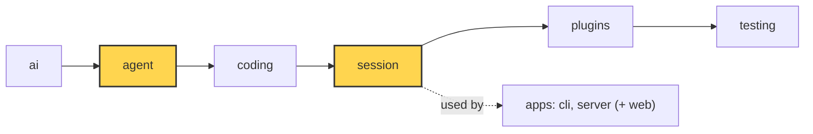

# 16 Part 4 · Compaction

**Goal:** Keep long conversations inside the context window.

**Builds on:** [13 Session](13-session.md) · [14 Plugins](14-plugins.md) · [15 Retry](15-retry.md) · **Next:** [17 Context overflow](17-overflow.md)

## Where we are



*This chapter adds `agent/compaction.py` (helpers in `agent` that never change history) and wires it into the `session` layer (both marked).*

Big picture of Part 4: [part-4-session](13-0-part-4-session.md).

Code in this chapter (commit `2fc2776`):

- `packages/simp_agent/src/simp_agent/agent/compaction.py` — `CompactionSettings`, `should_compact`, `find_cut`, `serialize_conversation`, `summarize`, `file_lists`, `compact`, `build_view`
- `packages/simp_agent/src/simp_agent/ai/__init__.py` — `CompactionEntry`
- `packages/simp_agent/src/simp_agent/session/__init__.py` — `AgentSession._prepare`, `compact`
- `packages/simp_agent/tests/test_compaction_serialize.py`, `test_queues_compaction.py` — the compaction tests

## Problem

We use the same story as the rest of Part 4 ([13-0](13-0-part-4-session.md)). The fizzbuzz project is done, and the user keeps going in the same session: "add tests", "add a CLI", "refactor the output". Every turn sends the **whole** history to the model ([05](05-agent-loop.md)), and a coding session is full of big tool results. One `pytest` run can print 20 000 characters. One `read` of a file can be longer.

Every model has a **[context window](glossary.md#context-window)**: the most tokens it can read in one call. In simp-agent it is `Model.context_window`. Say it is 200 000 tokens. After an hour the history is 190 000 tokens, and one more file read would push the next call over the limit. The provider then refuses the call.

So we must make the history smaller **before** that happens. And we must do it without losing two things: what the user asked for (their first request, "write fizzbuzz.py that prints 1 to 15", is the oldest message), and which files the agent has already changed.

## Naive version

Drop old messages:

```python
def trim(messages, keep=20):
    return messages[-keep:]

# before each model call:
view = trim(agent.messages)
```

It keeps the call small, but it breaks in four ways:

1. **The model forgets the task.** The first user message is the first thing dropped.
2. **Broken pairs.** If the cut lands on a tool result, its tool call is gone. Providers reject a tool result without its call.
3. **Counting messages is not counting tokens.** 20 short messages are fine; 20 file reads are not.
4. **History is lost.** If we cut `agent.messages` itself, the saved session ([13](13-session.md)) loses data too.

## Real design

The idea: when the history is near the limit, ask the model to **summarize** the old part. Keep that summary and the recent messages word for word. This is **[compaction](glossary.md#compaction)**.

Each naive problem gets one fix. The sections below follow the order in which the work happens, which is also the order of this table:

| Problem | Fix | Section |
|---|---|---|
| 3. counting messages | count tokens, and act a bit before the limit | [When: estimate_tokens and should_compact](#when-estimate_tokens-and-should_compact) |
| 2. broken pairs | cut only on a user or assistant message | [Where: find_cut](#where-find_cut) |
| 1. forgets the task | summarize the old part; the first section lists every user request; code adds the file lists | [What: serialize, summarize, file lists](#what-the-summarizer-reads-serialize_conversation) |
| 4. history lost | append a marker; change only the view | [The marker: CompactionEntry and build_view](#the-marker-compactionentry-and-build_view) |

All this logic lives in `packages/simp_agent/src/simp_agent/agent/compaction.py`. It knows nothing about sessions, so it can be tested alone (the layer rule, [00](00-overview.md)). Two of its functions, `summarize` and `compact`, do call the model, so they are not "pure" in the strict sense. But no function in the file ever changes the `messages` list it gets. Only the session adds to history.

### The whole thing on one example

First the result, so you know where we are going. Our fizzbuzz session has 10 messages. Token counts use the rough rule "4 characters = 1 token" (next section). To keep the numbers small, this example keeps about 5000 recent tokens; the real default is 20 000.

| index | message | tokens |
|---|---|---|
| 0 | User: "write fizzbuzz.py that prints 1 to 15" | 10 |
| 1 | Assistant: tool call `write(path="fizzbuzz.py", ...)` | 60 |
| 2 | Tool result: "Wrote fizzbuzz.py" | 5 |
| 3 | User: "add tests and run them" | 6 |
| 4 | Assistant: tool call `write(path="test_fizzbuzz.py", ...)` | 800 |
| 5 | Tool result: "Wrote test_fizzbuzz.py" | 5 |
| 6 | Assistant: tool call `bash(command="pytest")` | 15 |
| 7 | Tool result: pytest output (19 960 characters) | 4990 |
| 8 | Assistant: "Test 15 failed. I must fix the FizzBuzz case." | 15 |
| 9 | User: "go ahead" | 3 |

**1. Find the cut.** Walk back from the end and add up tokens until we have 5000:

```text
i=9  total=3
i=8  total=18
i=7  total=5008   >= 5000, stop. i=7 is a tool result.
```

The kept part must not start with a tool result, because its call (index 6) would be cut away. So the cut moves back to the nearest user or assistant message at or before 7. That is index 6. **cut = 6.**

**2. Summarize the old part.** Messages 0..5 go to the model as one text. The model answers with a summary in a fixed format. Then code adds the file lists, taken from the `write` calls:

```text
## User Requests (chronological)
1. Write fizzbuzz.py that prints 1 to 15.
2. Add tests and run them.

## Goal
fizzbuzz.py works and its tests pass.
...

<modified-files>
fizzbuzz.py
test_fizzbuzz.py
</modified-files>
```

(The real summary has more sections: Progress, Key Decisions, Next Steps and others.)

**3. Append a marker.** History gets one new item at index 10:

```text
CompactionEntry(summary="## User Requests ...", first_kept_index=6,
                read_files=[], modified_files=["fizzbuzz.py", "test_fizzbuzz.py"])
```

Messages 0..9 stay in history and on disk.

**4. What the model sees** on the next call:

```text
[0] User: "The conversation history before this point was compacted into the following summary:
          <summary> ## User Requests ... </summary>"
[1] message 6   (bash call)
[2] message 7   (its result)
[3] message 8
[4] message 9
```

5 messages instead of 10, and about 5000 tokens plus the summary instead of about 5900. In a real one-hour session the old part is far bigger, so the saving is far bigger too. The next sections build each step.

### When: estimate_tokens and should_compact

First we need the size of the next call in tokens, not in messages. There are two ways to get it. The provider tells us the exact count after each reply: the `usage` numbers that the parser fills in ([03](03-parse.md)). `usage.input` and `usage.output` are what the provider's JSON calls `prompt_tokens` and `completion_tokens`. But messages added after the last reply have no count yet, so for those we guess: 4 characters is about 1 token.

Real code: [agent/compaction.py](../../packages/simp_agent/src/simp_agent/agent/compaction.py) — `estimate`, `estimate_tokens`, `should_compact`

```text
FUNCTION estimate(m):
    n = number of characters in m           // text, thinking, tool name + args, or summary
    RETURN n // 4                           // rough guess: 4 chars ~ 1 token

FUNCTION estimate_tokens(messages):
    k = _last_entry(messages)               // index of the last CompactionEntry, or none
    FOR EACH message m from the end back to just after k:
        IF m is an AssistantMessage AND not error/aborted AND usage is not all zero:
            RETURN usage.input + usage.output + estimate of each message after m
    // no good usage found
    RETURN estimate of each message in build_view(messages)

FUNCTION should_compact(tokens, model, settings):
    RETURN settings.enabled AND tokens > model.context_window - settings.reserve_tokens
```

Why is `usage.input + usage.output` the size of the next call? `input` was everything that call sent. `output` is the reply, and the reply is now part of history, so next time it is sent as input too. Only the messages after that reply (tool results, a new user message) are guessed. A small example: the last good reply had `input=180000, output=500`, and after it came a tool result of 8000 characters. The estimate is 180000 + 500 + 2000 = 182 500.

The loop looks only at messages **after** the last `CompactionEntry`, because usage from before it was measured on the old, bigger view. It skips error and aborted replies because their usage is often zero or incomplete. If no good reply is found, everything is guessed from the view.

`should_compact` is true when the tokens pass `context_window - reserve_tokens`. We act before the limit, not at it, because we need room for two more things: the model's reply, and the summary call itself (its reply size is taken from this reserve, see [summarize](#summarize-incremental)). The settings live in `CompactionSettings`, which has three fields: `enabled=True`, `reserve_tokens=16384` (the room we keep free) and `keep_recent_tokens=20000` (how much recent history stays word for word).

The guess can be wrong. A file full of short symbols has more tokens than its characters / 4. Then a call may still be too big, and the provider says "prompt is too long". That case is the topic of [17](17-overflow.md).

### Where: find_cut

Now we know we must compact. Next we pick the first message we keep.

Real code: [agent/compaction.py](../../packages/simp_agent/src/simp_agent/agent/compaction.py) — `find_cut`

```text
FUNCTION find_cut(messages, start, keep_tokens):
    total = 0, i = end of list
    WHILE i > start AND total < keep_tokens:   // walk back from the end
        i = i - 1
        ADD estimate(messages[i]) to total
    ok = indexes from start + 1 to the end that hold a UserMessage or AssistantMessage
    before = indexes in ok that are <= i
    IF before is not empty: RETURN last of before
    IF ok is not empty: RETURN first of ok
    RETURN none                                // nothing safe to cut
```

The walk stops at `i`, once about `keep_tokens` are kept. Then the cut moves back to a user or assistant message at or before `i`. A cut **never** lands on a tool result, so a tool call and its result always stay together; in the example, `i=7` became `cut=6`. If there is no such message at or before `i`, the first good one after it is used.

`start` is the `first_kept_index` of the last compaction (0 if there was none). The cut is always **after** `start`, never `start` itself, so a new compaction always moves forward. One limit is known: if one turn alone is bigger than `keep_tokens` or even the window, the cut cannot go inside it. [17](17-overflow.md) shows what happens then.

### What the summarizer reads: serialize_conversation

The old part, `messages[start:cut]`, must now go to the model. If we send it as a normal chat, the model tends to **continue** it ("Sure, I will add tests now") instead of summarizing it. So we turn it into one block of plain text.

Real code: [agent/compaction.py](../../packages/simp_agent/src/simp_agent/agent/compaction.py) — `serialize_conversation`

```text
FUNCTION serialize_conversation(messages):
    parts = empty list
    FOR EACH m in transform_messages(messages):
        IF m is a UserMessage with content:
            ADD "[User]: " + content
        ELSE IF m is an AssistantMessage:      // thinking skipped
            IF it has text: ADD "[Assistant]: " + text
            IF it has tool calls:
                ADD "[Assistant tool calls]: " + each call as name(arg=value), each value cut to ARG_MAX
        ELSE IF m is a ToolResultMessage with content:
            ADD "[Tool result]: " + content cut to TOOL_RESULT_MAX
    RETURN parts joined with blank lines
```

It first runs `transform_messages`, the "Clean" step from [01](01-pick-clean.md#2-clean-transform_messages). It drops error and aborted replies and adds a "No result provided" result for a tool call that has none, so the text is the same clean history a provider would get.

Tool results are cut to `TOOL_RESULT_MAX = 2000` characters and each tool argument to `ARG_MAX = 500`, because the summary needs to know what happened, not every byte of a file. Thinking is skipped: it is big, and the text and tool calls already show what came of it. The text is then sent inside `<conversation>` tags, with a system prompt that says "Do NOT continue the conversation".

### summarize: incremental

Real code: [agent/compaction.py](../../packages/simp_agent/src/simp_agent/agent/compaction.py) — `summarize`

```text
FUNCTION summarize(stream_fn, model, old, previous, reserve_tokens):
    text = "<conversation>" + serialize_conversation(old) + "</conversation>"
    IF previous summary exists:
        ADD "<previous-summary>" + previous + "</previous-summary>" + UPDATE_SUMMARIZATION_PROMPT
    ELSE:
        ADD SUMMARIZATION_PROMPT
    model.max_tokens = min(80% of reserve_tokens, model.max_tokens)
    msg = last "done" or "error" event of stream_fn(model, SYSTEM_PROMPT, [UserMessage(text)])
    IF no msg OR stop_reason is error, length or aborted:
        RAISE "summary failed"
    RETURN msg text
```

The first time, the prompt is `SUMMARIZATION_PROMPT`: a fixed format with `## User Requests (chronological)`, `## Goal`, `## Progress`, `## Next Steps` and more. Its first section says "EVERY request the user made ... Never drop one". This is the fix for "the model forgets the task".

The next time, there is already a summary. We send only the messages that are new to the old part, plus the previous summary, with `UPDATE_SUMMARIZATION_PROMPT` ("PRESERVE all existing information"). This is an **[incremental summary](glossary.md#incremental-summary)**: what was summarized once is never read again, so the summary call stays small even in a very long session.

The reply size is capped at 80% of `reserve_tokens`, so the summary always fits in the room `should_compact` kept free. If the reply was cut off (`"length"`), failed or was aborted, `summarize` raises. A half summary is worse than none: it would hide part of the history and the model could not know.

### File tracking: file_lists

The summary is written by a model, and a model can miss things. But one fact must never be lost: which files the agent has read and changed. That is exact data, so code collects it, not the model.

Real code: [agent/compaction.py](../../packages/simp_agent/src/simp_agent/agent/compaction.py) — `file_lists`, `format_files`

```text
FUNCTION file_lists(messages, prev):
    read, mod = file sets from prev (empty if no prev)
    FOR EACH tool call in assistant messages with a string "path" argument:
        IF name is "read": ADD path to read
        IF name is "write" or "edit": ADD path to mod
    RETURN sorted(read minus mod), sorted(mod)   // a changed file is not listed as read-only
```

The code looks at the `path` argument of the `read`, `write` and `edit` tools ([10](10-coding-tools.md)). It starts from the lists of the previous entry, so old files are not forgotten after a second compaction. Then `format_files` adds the two lists to the end of the summary as `<read-files>` and `<modified-files>` blocks, as in the example above. So even if the summary text is weak, the model still knows that `fizzbuzz.py` was changed.

### compact: putting it together

Real code: [agent/compaction.py](../../packages/simp_agent/src/simp_agent/agent/compaction.py) — `compact`

```text
FUNCTION compact(messages, model, stream_fn, settings, redact):
    prev = last CompactionEntry (or none)
    start, previous = prev.first_kept_index, prev.summary   // or 0, none
    cut = find_cut(messages, start, settings.keep_recent_tokens)
    IF cut is none: RAISE "nothing to compact"
    old = messages[start:cut] without CompactionEntry and CustomEntry
    read, mod = file_lists(old, prev)
    IF redact: old = WAIT for redact(old)
    summary = WAIT for summarize(stream_fn, model, old, previous, settings.reserve_tokens)
    RETURN CompactionEntry(summary + format_files(read, mod), cut, read, mod)
```

`compact` runs the steps of the example in order and returns a new entry. It does not add the entry to `messages`; the session does that.

The `redact` argument is the session's plugin `context` chain ([14](14-plugins.md#the-hooks-in-the-order-they-run)). A plugin that hides a secret from the model must also hide it from the summary model, so `old` goes through the same chain. `file_lists` runs **before** `redact` on purpose: a plugin may change message text, but the file paths must come from the real tool calls.

### The marker: CompactionEntry and build_view

We now have a summary. We do not replace the old messages with it. We append a marker to history. In `ai/__init__.py`:

```python
@dataclass
class CompactionEntry:
    """Marker appended to history. History stays append-only; build_view() turns it into the LLM view."""

    summary: str
    first_kept_index: int
    read_files: list = field(default_factory=list)
    modified_files: list = field(default_factory=list)
    role: Literal["compaction"] = "compaction"
```

A **[CompactionEntry](glossary.md#compaction-entry)** says: "from now on, the model sees this summary, then the messages from `first_kept_index` on". History stays append-only, the Part 4 rule ([13-0](13-0-part-4-session.md#the-core-idea)). Only the **view**, the list sent to the model, changes:

Real code: [agent/compaction.py](../../packages/simp_agent/src/simp_agent/agent/compaction.py) — `build_view`

```text
FUNCTION build_view(messages):
    k = _last_entry(messages)                // index of the last CompactionEntry
    IF k is none:
        RETURN messages without CustomEntry items
    e = messages[k]
    kept = messages from e.first_kept_index on, without CompactionEntry and CustomEntry
    RETURN [UserMessage(SUMMARY_PREFIX + e.summary + "\n</summary>")] + kept
```

Only the last entry counts, because each new summary already contains the older one. The summary becomes one `UserMessage` that starts with `SUMMARY_PREFIX` ("The conversation history before this point was compacted into the following summary: <summary>"). `CustomEntry` items ([13](13-session.md)) are never part of the view.

Why append-only? The saved file is never rewritten, so a crash in the middle of compaction cannot corrupt it. And a UI can still show the full history to the user.

### In the session

All the pieces are ready. The session only decides **when** to use them. It does this in `_prepare`, the function it gives to the agent's `prepare_next_turn` hook ([13](13-session.md)). The agent calls that hook before **every** model call, to build the view ([05](05-agent-loop.md#_llm_turn-one-model-call)):

Real code: [session/__init__.py](../../packages/simp_agent/src/simp_agent/session/__init__.py) — `AgentSession._prepare`, `AgentSession.compact`

```text
FUNCTION _prepare(messages):            // runs before every model call
    IF auto_compact AND should_compact(estimate_tokens(messages), model, settings):
        WAIT for compact()
    RETURN WAIT for _context(build_view(messages))

FUNCTION compact():
    before = estimate_tokens(messages)
    SEND event compaction_start(tokens_before)
    TRY:
        stream_fn = agent.stream_fn with the same API key
        entry = WAIT for compact(messages, model, stream_fn, settings, _context)
    ON ERROR e:
        SEND event compaction_end(error e, tokens_before, tokens_after = before)
        RETURN false                           // history stays as is
    ADD entry to messages
    IF store: WAIT for store.append(entry)
    SEND event message_end(entry)
    SEND event compaction_end(no error, tokens_before, tokens_after)
    RETURN true
```

The summary call uses the same model and the same API key as the chat. On success the entry is added to history and saved like any other message; the `message_end` event is what makes the store and the UI see it. On failure the session sends `compaction_end` with the error and returns `False`. History is not changed and the turn goes on. The next model call may then be too big, and that is handled in [17](17-overflow.md): `_run` sees the "too long" error and calls this same `compact()` once more.

Apps can also call `compact()` by hand. The CLI has a `/compact` command for that ([19](19-cli.md)).

Because compaction runs inside `prepare_next_turn`, it happens **inside** a turn, not only between prompts. A long tool loop gets compacted in the middle. And the summary call is slow, so the user may type a steer message during it. [07](07-steering.md#when-each-queue-is-read) set this up: steering is read right after `prepare_next_turn` returns, so that message still goes into the same turn (`test_steer_during_compaction_same_turn`).

### Replay a real compaction

`apps/cli/scripts/replay_compaction.py` takes a saved session file and a number N. It reads the first N lines as the old part and prints the summary that a real model gives:

```sh
uv run apps/cli/scripts/replay_compaction.py ~/.simp-agent/sessions/<cwd-slug>/<id>.jsonl 40
```

It calls `summarize`, `file_lists` and `format_files` directly, always as a first summary (no previous summary), so it cannot replay an incremental update. Use it to tune the prompts on real sessions instead of guessing.

## Test

Two tests. First, the pure request, `packages/simp_agent/tests/test_compaction_serialize.py::test_request_is_one_serialized_user_message`:

```python
async def test_request_is_one_serialized_user_message():
    stream, seen = capture()
    msgs = turn("a.html") + turn("b.html", "read") + [UserMessage("last" + "x" * 1000)]
    entry = await compact(msgs, Model(max_tokens=100000), stream, SETTINGS)
    model, ctx = seen[0]
    assert "Do NOT continue the conversation" in ctx.system_prompt
    assert len(ctx.messages) == 1 and ctx.messages[0].content.startswith("<conversation>\n[User]: make a.html")
    text = ctx.messages[0].content
    assert "C" * 501 not in text and "R" * 2001 not in text and "more characters truncated]" in text
    assert "## User Requests (chronological)" in text
    assert model.max_tokens == int(0.8 * SETTINGS.reserve_tokens)
    assert entry.modified_files == ["a.html"] and entry.read_files == ["b.html"]
    assert entry.summary.endswith("<read-files>\nb.html\n</read-files>\n\n<modified-files>\na.html\n</modified-files>")
```

It checks: one serialized user message, args cut at 500 and results at 2000, the summary format, the `max_tokens` cap, and the file lists.

Second, the session flow, `packages/simp_agent/tests/test_queues_compaction.py::test_compaction_appends_marker_and_view`:

```python
async def test_compaction_appends_marker_and_view():
    stream = FakeProvider(AssistantMessage([TextContent("SUM")]), DONE)
    seen = stream.messages
    a = compact_agent(stream)
    a.agent.messages = history()
    events = []
    a.subscribe(lambda e: events.append(e["type"]))
    await a.prompt("next")
    assert "compaction_start" in events and "compaction_end" in events
    summary_call = seen[0]
    assert len(summary_call) == 1 and summary_call[0].content.startswith("<conversation>\n[User]: old")
    assert "[Tool result]: yyy" in summary_call[0].content
    assert a.messages[0].content.startswith("old")  # full history still has the old messages
    entry = next(m for m in a.messages if isinstance(m, CompactionEntry))
    assert entry.summary == "SUM" and a.messages[entry.first_kept_index].content.startswith("new")
    assert seen[1][0].content == SUM_HEAD + "SUM\n</summary>" and seen[1][1].content.startswith("new")
```

`compact_agent` makes a session with a 10 000-token window and a small reserve, and `history()` is about 20 000 tokens. So the first `FakeProvider` reply is the summary `"SUM"`, the second is the real answer. It checks that history still starts with `"old"`, the entry points at `"new"`, and the model's view is the summary plus `"new"`.

Run them:

```sh
uv run pytest packages/simp_agent/tests/test_compaction_serialize.py packages/simp_agent/tests/test_queues_compaction.py -q
```

## Why this way

> **Summarize, append a marker, change only the view.** Compaction keeps the model inside its window without losing the user's requests or the list of changed files. The logic in `agent/compaction.py` is easy to test; the session only decides *when*. History stays append-only, so the store is never rewritten. The cost: the summary is one more model call (time and money), and a summary can still miss details. The fixed format, incremental updates and code-made file lists keep that loss small.

## Exercises

1. **Try `find_cut` by hand.** Build a list: `UserMessage("a"*4000)`, an `AssistantMessage` with a `ToolCall`, a `ToolResultMessage` with `"b"*4000`, then `UserMessage("c"*4000)`. Call `find_cut(msgs, 0, keep)` for many `keep` values. Check the result is never the tool result index. *Hint:* copy the loop in `test_cut_never_on_tool_result` in `test_queues_compaction.py`.

2. **Compaction starts only above the limit.** Write `run(n_chars)`:
   - Make an `AgentSession` with `Model(context_window=10000)` and set `s.compaction.reserve_tokens = 1000`. The limit is now 9000 tokens.
   - Set `s.agent.messages = [UserMessage("x" * n_chars), AssistantMessage([TextContent("y")])]`.
   - Use `FakeProvider(AssistantMessage([TextContent("SUM")]), DONE)`, subscribe to events, call `prompt("hi")`.
   - Return: was `compaction_start` sent, is a `CompactionEntry` in `messages`, how many model calls were made.

   `run(400)` (about 100 tokens) should give `(False, False, 1)`. `run(40000)` (about 10000 tokens) should give `(True, True, 2)`. Question: why would `Model(context_window=10000)` with the default settings always compact? *Hint:* the default `reserve_tokens` is 16384. See `compact_agent` and `test_below_threshold_no_compaction` in the same file.

## Recap

Before every model call, the session estimates the size of the next call, using the provider's real `usage` where it can. Above `context_window - reserve_tokens` it compacts: `find_cut` keeps about `keep_recent_tokens` of recent messages and never cuts on a tool result; the old part becomes one text and the model summarizes it, incrementally on top of the last summary; code adds the exact file lists. The result is a `CompactionEntry` appended to history, and `build_view` turns it into the model's view. History is never rewritten, and a failed compaction leaves it as it was.

The size check is only a guess. When it is wrong, the provider answers "prompt is too long", and the next chapter shows how the session recovers from that.

**Builds on:** [13 Session](13-session.md) · [14 Plugins](14-plugins.md) · [15 Retry](15-retry.md) · **Next:** [17 Context overflow](17-overflow.md)
