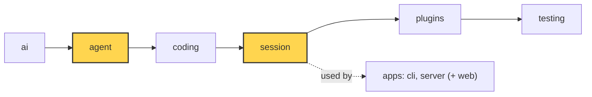

# 16 Part 4 · Compaction

**Goal:** Keep long conversations inside the context window.

**Builds on:** [15 Retry](15-retry.md) · **Next:** [17 Context overflow](17-overflow.md)

## Where we are



*This chapter adds `agent/compaction.py` (pure helpers, in `agent`) and wires it into the `session` layer (both marked).*

Code in this chapter (commit `2fc2776`):

- `packages/simp_agent/src/simp_agent/agent/compaction.py` — `CompactionSettings`, `should_compact`, `find_cut`, `serialize_conversation`, `summarize`, `file_lists`, `compact`, `build_view`
- `packages/simp_agent/src/simp_agent/ai/__init__.py` — `CompactionEntry`
- `packages/simp_agent/src/simp_agent/session/__init__.py` — `AgentSession._prepare`, `compact`
- `packages/simp_agent/tests/test_compaction_serialize.py`, `test_queues_compaction.py` — the compaction tests

## Problem

Every model has a **[context window](glossary.md#context-window)**: the most tokens it can read in one call. In simp-agent it is `Model.context_window`. Each turn we send the whole history. A coding session reads files and runs commands, and tool results are big. After a while the history does not fit any more.

Now the fizzbuzz task is done and the user keeps going: "add tests", "add a CLI", "refactor"... After an hour, the next call would be too big. We need to make the history smaller **before** that happens, but we must not lose what the user asked for or which files were changed.

## Naive version

Drop old messages:

```python
def trim(messages, keep=20):
    return messages[-keep:]

# before each model call:
view = trim(agent.messages)
```

It keeps the call small. It breaks badly:

1. **The model forgets the task.** The first user message ("write fizzbuzz.py ...") is the first thing dropped.
2. **Broken pairs.** If the cut lands on a tool result, its tool call is gone. Providers reject a tool result without its call.
3. **Counting messages is not counting tokens.** 20 small messages are fine; 20 file reads are not.
4. **History is lost.** If we cut `agent.messages` itself, the saved session loses data too.

## Step by step: from naive to real

We fix the four problems one at a time. Each step is small.

**Step 0: naive.** `messages[-keep:]`. Fast, but it forgets the task and can break pairs.

**Step 1: count tokens, not messages.** Fixes problem 3.

```text
FUNCTION estimate(message):
    n = number of characters in the message
    RETURN n / 4                          // about 4 characters per token
```
Real code: [agent/compaction.py](../../packages/simp_agent/src/simp_agent/agent/compaction.py) — `estimate`

A rough guess: 4 characters is about 1 token. Now "too big" means tokens, so 20 file reads count as big.

**Step 2: decide when, using the window.** Still problem 3.

```text
FUNCTION should_compact(tokens, model, settings):
    RETURN settings.enabled
       AND tokens > model.context_window - settings.reserve_tokens
```
Real code: [agent/compaction.py](../../packages/simp_agent/src/simp_agent/agent/compaction.py) — `should_compact`

We act before the limit, not at it. `reserve_tokens` leaves room for the reply and the summary.

**Step 3: cut only on a user or assistant message.** Fixes problem 2.

```text
ok = every index j after start WHERE messages[j] is a user or assistant message
before = the indexes in ok that are at or before i    // safe cut points
```
Real code: [agent/compaction.py](../../packages/simp_agent/src/simp_agent/agent/compaction.py) — `find_cut`

`start` is the `first_kept_index` of the last compaction (0 if there was none). `i` is where the walk back stopped: `find_cut` starts at the end and goes back until it has about `keep_recent_tokens`. Then it moves the cut to a safe message. A tool result is never the first kept message, so it never loses its call.

**Step 4: summarize the old part instead of dropping it.** Fixes problem 1.

```text
summary = WAIT for summarize(old messages, previous summary)   // a model call
```
Real code: [agent/compaction.py](../../packages/simp_agent/src/simp_agent/agent/compaction.py) — `summarize`

The model writes a summary in a fixed format. The first section lists every user request, so the task is not lost.

**Step 5: append a marker, do not cut history.** Fixes problem 4.

```text
RETURN CompactionEntry(summary + list of read and modified files, cut, read, mod)
```
Real code: [agent/compaction.py](../../packages/simp_agent/src/simp_agent/agent/compaction.py) — `compact`

`compact` returns a `CompactionEntry`. The session appends it. `build_view` uses it to make the smaller list for the model. Full history stays in memory and in the store.

**Step 6: be exact about files, and incremental.** The model can forget details, so code adds `<read-files>` and `<modified-files>`. Next time, `summarize` gets only the new old messages plus the `previous` summary, so we never re-read old text.

**Step 7: wire it in the session.** `_prepare` runs before every model call, checks `should_compact`, and returns `build_view(...)`. The sections below show the real code for each step.

## Real design

The idea: when the history is near the limit, ask the model to **summarize** the old part. Keep the summary and the recent messages. This is **[compaction](glossary.md#compaction)**.

All the pure logic is in `packages/simp_agent/src/simp_agent/agent/compaction.py`. It knows nothing about sessions, so it can be tested alone (layer rule, [00](00-overview.md)).

### CompactionEntry and build_view: history stays append-only

The summary is not a replacement. It is a marker appended to history. In `ai/__init__.py`:

```python
@dataclass
class CompactionEntry:
    """Marker appended to history. History stays append-only; build_view() turns it into the LLM view."""

    summary: str
    first_kept_index: int
    read_files: list = field(default_factory=list)
    modified_files: list = field(default_factory=list)
    role: Literal["compaction"] = "compaction"
```

A **[CompactionEntry](glossary.md#compaction-entry)** says: "from now on, the model sees this summary, then the messages from `first_kept_index` on". The old messages stay in history and in the store ([13](13-session.md)). Only the **view** sent to the model changes:

Real code: [agent/compaction.py](../../packages/simp_agent/src/simp_agent/agent/compaction.py) — `build_view`

```text
FUNCTION build_view(messages):
    k = _last_entry(messages)                // index of the last CompactionEntry
    IF k is none:
        RETURN messages without CustomEntry items
    e = messages[k]
    kept = messages from e.first_kept_index on, without CompactionEntry and CustomEntry
    RETURN [UserMessage(SUMMARY_PREFIX + e.summary + "</summary>")] + kept
```

Key idea: only the last entry counts; the model sees one summary message plus the recent messages.

The summary becomes one `UserMessage` that starts with `SUMMARY_PREFIX` ("The conversation history before this point was compacted into the following summary: ..."). `CustomEntry` items ([13](13-session.md)) are always dropped from the view.

Why append-only? The saved file is never rewritten, so a crash during compaction cannot corrupt it. And a UI can still show the full history.

### estimate_tokens and should_compact: when

Real code: [agent/compaction.py](../../packages/simp_agent/src/simp_agent/agent/compaction.py) — `estimate`, `estimate_tokens`, `should_compact`

```text
FUNCTION estimate(m):
    n = number of characters in m           // text, thinking, tool name + args, or summary
    RETURN n / 4                            // rough guess: 4 chars ~ 1 token

FUNCTION estimate_tokens(messages):
    k = _last_entry(messages)
    FOR EACH message m from the end back to just after k:
        IF m is an AssistantMessage AND not error/aborted AND usage is not all zero:
            RETURN usage.input + usage.output + estimate of each message after m
    // no good usage found
    RETURN estimate of each message in build_view(messages)

FUNCTION should_compact(tokens, model, settings):
    RETURN settings.enabled AND tokens > model.context_window - settings.reserve_tokens
```

Key idea: use the real token count from the provider when we have it; guess only the rest. Limit: chars/4 is only a rough guess.

- `estimate` is a rough guess: 4 characters ≈ 1 token.
- `estimate_tokens` prefers the real number. The last good assistant reply has `usage` from the provider ([04](04-providers.md)): input + output tokens of that call. Add the guess only for messages after it. It looks only **after** the last `CompactionEntry`, because usage from before was measured on the old, bigger view.
- `should_compact` is true when tokens pass `context_window - reserve_tokens`.

`CompactionSettings` has three fields: `enabled=True`, `reserve_tokens=16384` (room left for the reply and the summary), `keep_recent_tokens=20000` (how much recent history to keep word for word).

### find_cut: where

Real code: [agent/compaction.py](../../packages/simp_agent/src/simp_agent/agent/compaction.py) — `find_cut`

```text
FUNCTION find_cut(messages, start, keep_tokens):
    total = 0, i = end of list
    WHILE i > start AND total < keep_tokens:   // walk back from the end
        i = i - 1
        ADD estimate(messages[i]) to total
    ok = indexes after start that hold a UserMessage or AssistantMessage
    before = indexes in ok that are <= i
    IF before is not empty: RETURN last of before
    IF ok is not empty: RETURN first of ok
    RETURN none                                // nothing safe to cut
```

Key idea: the cut is always on a user or assistant message, so a tool call and its result stay together. Limit: one huge turn cannot be cut.

Walk back from the end until about `keep_tokens` are kept. Then move the cut to a user or assistant message at or before that point. A cut **never** lands on a tool result, so a tool call and its result stay together. `start` is the previous entry's `first_kept_index`, so a new cut is always after the old one. The `ponytail:` comment names a known limit: one single huge turn cannot be cut.

### serialize_conversation: what the summarizer reads

Real code: [agent/compaction.py](../../packages/simp_agent/src/simp_agent/agent/compaction.py) — `serialize_conversation`

```text
FUNCTION serialize_conversation(messages):
    parts = empty list
    FOR EACH m in transform_messages(messages):
        IF m is a UserMessage with content:
            ADD "[User]: " + content
        ELSE IF m is an AssistantMessage:      // thinking skipped: big, text + tool calls carry the result
            IF it has text: ADD "[Assistant]: " + text
            IF it has tool calls:
                ADD "[Assistant tool calls]: " + each call as name(arg=value), each value cut to ARG_MAX
        ELSE IF m is a ToolResultMessage with content:
            ADD "[Tool result]: " + content cut to TOOL_RESULT_MAX
    RETURN parts joined with blank lines
```

Key idea: one plain text block, not a chat, so the model summarizes instead of answering.

Why one text and not the real messages? If you send the chat as chat, the model tends to **continue** it ("Sure, I will add tests now"). As one block of text inside `<conversation>` tags, with a system prompt that says "Do NOT continue the conversation", it summarizes. Tool results are cut to `TOOL_RESULT_MAX = 2000` characters and tool arguments to `ARG_MAX = 500`: the summary needs what happened, not every byte of a file. Thinking is skipped.

### summarize: incremental

Real code: [agent/compaction.py](../../packages/simp_agent/src/simp_agent/agent/compaction.py) — `summarize`

```text
FUNCTION summarize(stream_fn, model, old, previous, reserve_tokens):
    text = "<conversation>" + serialize_conversation(old) + "</conversation>"
    IF previous summary exists:
        ADD "<previous-summary>" + previous + "</previous-summary>" + UPDATE_SUMMARIZATION_PROMPT
    ELSE:
        ADD SUMMARIZATION_PROMPT
    model.max_tokens = min(80% of reserve_tokens, model.max_tokens)   // summary must fit the room we kept
    msg = last "done" or "error" event of stream_fn(model, SYSTEM_PROMPT, [UserMessage(text)])
    IF no msg OR stop_reason is error, length or aborted:
        RAISE "summary failed"                 // a half summary is worse than none
    RETURN msg text
```

Key idea: first time a full summary, later only new messages plus the old summary.

- The first time, it uses `SUMMARIZATION_PROMPT`: a fixed format with `## User Requests (chronological)`, `## Goal`, `## Progress`, `## Next Steps` and more. The first section says "EVERY request the user made ... Never drop one". That fixes the "model forgets the task" problem.
- The next time, it sends only the **new** old messages plus the previous summary, with `UPDATE_SUMMARIZATION_PROMPT` ("PRESERVE all existing information"). This is an **[incremental summary](glossary.md#incremental-summary)**: we never re-read what was already summarized.
- `max_tokens` is capped at 80% of `reserve_tokens`, so the summary always fits in the room we kept.
- A cut-off (`"length"`) or failed reply raises. A half summary is worse than none.

### File tracking

Real code: [agent/compaction.py](../../packages/simp_agent/src/simp_agent/agent/compaction.py) — `file_lists`

```text
FUNCTION file_lists(messages, prev):
    read, mod = file sets from prev (empty if no prev)
    FOR EACH tool call in assistant messages with a string "path" argument:
        IF name is "read": ADD path to read
        IF name is "write" or "edit": ADD path to mod
    RETURN sorted(read minus mod), sorted(mod)   // a changed file is not listed as read-only
```

Key idea: file lists come from code, not from the model, so they are exact.

From the `path` argument of `read`, `write` and `edit` calls ([10](10-coding-tools.md)), the code builds two lists: files only read, and files changed. They merge with the previous entry's lists. `format_files` appends them to the summary as `<read-files>` and `<modified-files>` blocks. The model may lose details in a summary, but it will always know that `fizzbuzz.py` was modified. This is done in code, not by the model, so it is exact.

### compact: putting it together

Real code: [agent/compaction.py](../../packages/simp_agent/src/simp_agent/agent/compaction.py) — `compact`

```text
FUNCTION compact(messages, model, stream_fn, settings, redact):
    prev = last CompactionEntry (or none)
    start, previous = prev.first_kept_index, prev.summary   // or 0, none
    cut = find_cut(messages, start, settings.keep_recent_tokens)
    IF cut is none: RAISE "nothing to compact"
    old = messages[start:cut] without CompactionEntry and CustomEntry
    read, mod = file_lists(old, prev)
    IF redact: old = WAIT for redact(old)     // secrets must not reach the summary model
    summary = WAIT for summarize(stream_fn, model, old, previous, settings.reserve_tokens)
    RETURN CompactionEntry(summary + format_files(read, mod), cut, read, mod)
```

Key idea: pure function; it returns a new entry and never changes `messages`.

`compact` returns an entry; it does not change `messages`. The `redact` argument lets the session pass the plugin `context` chain ([14](14-plugins.md)), so a secret masked for the model is also masked for the summary model.

### In the session

In `session/__init__.py`, `_prepare` is the agent's `prepare_next_turn` socket ([13](13-session.md)). It runs before **every** model call:

Real code: [session/__init__.py](../../packages/simp_agent/src/simp_agent/session/__init__.py) — `AgentSession._prepare`

```text
FUNCTION _prepare(messages):            // runs before every model call
    IF auto_compact AND should_compact(estimate_tokens(messages), model, settings):
        WAIT for compact()
    RETURN WAIT for _context(build_view(messages))
```

Key idea: the session only decides *when*; the view is always built from full history.

And `compact()`:

Real code: [session/__init__.py](../../packages/simp_agent/src/simp_agent/session/__init__.py) — `AgentSession.compact`

```text
FUNCTION compact():
    before = estimate_tokens(messages)
    SEND event compaction_start(tokens_before)
    TRY:
        stream_fn = agent.stream_fn with the same API key
        entry = WAIT for compact(messages, model, stream_fn, settings, _context)
    ON ERROR e:
        SEND event compaction_end(error e, tokens_after = before)
        RETURN false                           // history stays as is
    ADD entry to messages
    IF store: WAIT for store.append(entry)
    SEND event message_end(entry)
    SEND event compaction_end(no error, tokens_after)
    RETURN true
```

Key idea: failure never breaks the turn; success appends and saves the entry like any message.

- It uses the same model and the same API key as the chat.
- On failure it emits `compaction_end` with the `error` and returns `False`. History is unchanged and the turn goes on. The model call may then overflow, and [17](17-overflow.md) handles that.
- On success the entry is appended and saved like any message.
- Apps can call `compact()` by hand too (a `/compact` command).

Because compaction runs inside `prepare_next_turn`, it happens **inside** a turn, not between prompts. A long tool loop gets compacted in the middle. And a steer message typed during the slow summary call still arrives in the same turn (`test_steer_during_compaction_same_turn`).

### Replay a real compaction

`apps/cli/scripts/replay_compaction.py` takes a saved session file and a cut, and prints the summary that a real model gives:

```sh
uv run apps/cli/scripts/replay_compaction.py ~/.simp-agent/sessions/<cwd-slug>/<id>.jsonl 40
```

It calls `summarize`, `file_lists` and `format_files` directly. Use it to tune the prompts on real sessions instead of guessing.

## Test

Two tests. First, the pure request, `packages/simp_agent/tests/test_compaction_serialize.py::test_request_is_one_serialized_user_message`:

```python
async def test_request_is_one_serialized_user_message():
    stream, seen = capture()
    msgs = turn("a.html") + turn("b.html", "read") + [UserMessage("last" + "x" * 1000)]
    entry = await compact(msgs, Model(max_tokens=100000), stream, SETTINGS)
    model, ctx = seen[0]
    assert "Do NOT continue the conversation" in ctx.system_prompt
    assert len(ctx.messages) == 1 and ctx.messages[0].content.startswith("<conversation>\n[User]: make a.html")
    text = ctx.messages[0].content
    assert "C" * 501 not in text and "R" * 2001 not in text and "more characters truncated]" in text
    assert "## User Requests (chronological)" in text
    assert model.max_tokens == int(0.8 * SETTINGS.reserve_tokens)
    assert entry.modified_files == ["a.html"] and entry.read_files == ["b.html"]
    assert entry.summary.endswith("<read-files>\nb.html\n</read-files>\n\n<modified-files>\na.html\n</modified-files>")
```

It checks: one serialized user message, args cut at 500 and results at 2000, the summary format, the `max_tokens` cap, and the file lists.

Second, the session flow, `packages/simp_agent/tests/test_queues_compaction.py::test_compaction_appends_marker_and_view`:

```python
async def test_compaction_appends_marker_and_view():
    stream = FakeProvider(AssistantMessage([TextContent("SUM")]), DONE)
    seen = stream.messages
    a = compact_agent(stream)
    a.agent.messages = history()
    events = []
    a.subscribe(lambda e: events.append(e["type"]))
    await a.prompt("next")
    assert "compaction_start" in events and "compaction_end" in events
    summary_call = seen[0]
    assert len(summary_call) == 1 and summary_call[0].content.startswith("<conversation>\n[User]: old")
    assert "[Tool result]: yyy" in summary_call[0].content
    assert a.messages[0].content.startswith("old")  # full history still has the old messages
    entry = next(m for m in a.messages if isinstance(m, CompactionEntry))
    assert entry.summary == "SUM" and a.messages[entry.first_kept_index].content.startswith("new")
    assert seen[1][0].content == SUM_HEAD + "SUM\n</summary>" and seen[1][1].content.startswith("new")
```

`compact_agent` makes a session with a 10 000-token window and a small reserve, and `history()` is about 20 000 tokens. So the first `FakeProvider` reply is the summary `"SUM"`, the second is the real answer. It checks that history still starts with `"old"`, the entry points at `"new"`, and the model's view is the summary plus `"new"`.

Run them:

```sh
uv run pytest packages/simp_agent/tests/test_compaction_serialize.py packages/simp_agent/tests/test_queues_compaction.py -q
```

## Why this way

> **Summarize, append a marker, change only the view.** Compaction keeps the model inside its window without losing the user's requests or the list of changed files. The pure logic in `agent/compaction.py` is easy to test; the session only decides *when*. History stays append-only, so the store is never rewritten. The cost: the summary is a model call (time and money), and a summary can still miss details; the fixed format, incremental updates and code-made file lists keep that small.

## Exercises

1. **Try `find_cut` by hand.** Build a list: `UserMessage("a"*4000)`, an `AssistantMessage` with a `ToolCall`, a `ToolResultMessage` with `"b"*4000`, then `UserMessage("c"*4000)`. Call `find_cut(msgs, 0, keep)` for many `keep` values. Check the result is never the tool result index. *Hint:* copy the loop in `test_cut_never_on_tool_result` in `test_queues_compaction.py`.

2. **Compaction starts only above the limit.** Write `run(n_chars)`. It makes an `AgentSession` with `Model(context_window=10000)` and sets `s.compaction.reserve_tokens = 1000`, so the limit is 9000 tokens. Set `s.agent.messages` to `[UserMessage("x" * n_chars), AssistantMessage([TextContent("y")])]`. Use `FakeProvider(AssistantMessage([TextContent("SUM")]), DONE)`, subscribe to events and call `prompt("hi")`. Return three things: was a `compaction_start` event sent, is a `CompactionEntry` in `messages`, and how many model calls were made. Try `run(400)` (about 100 tokens) and `run(40000)` (about 10000 tokens). You should get `(False, False, 1)` and `(True, True, 2)`. Why would `Model(context_window=10000)` with the default settings always compact? *Hint:* the default `reserve_tokens` is 16384. See `compact_agent` and `test_below_threshold_no_compaction` in the same file.

## Recap

- `should_compact`: tokens > `context_window - reserve_tokens`. Tokens come from real `usage` when possible.
- `find_cut` keeps about `keep_recent_tokens` and never cuts on a tool result.
- `serialize_conversation` turns old messages into one text so the model summarizes instead of chatting.
- `summarize` is incremental: new messages + previous summary.
- File lists are built by code and added to the summary.
- `CompactionEntry` is appended; `build_view` makes the model's view. History is never rewritten.
- The session compacts in `_prepare`, before every model call; failure keeps history as is.

**Builds on:** [15 Retry](15-retry.md) · **Next:** [17 Context overflow](17-overflow.md)
