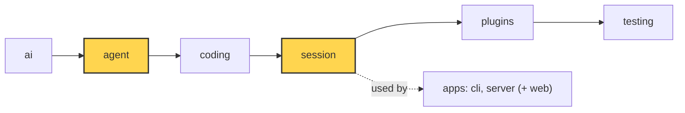

# 16 Part 4 · Compaction

**Goal:** Keep long conversations inside the context window.

**Builds on:** [13 Session](13-session.md) · [14 Plugins](14-plugins.md) · [15 Retry](15-retry.md) · **Next:** [17 Context overflow](17-overflow.md)

## Where we are



*This chapter adds `agent/compaction.py` (helpers in `agent` that never change history) and wires it into the `session` layer (both marked).*

Big picture of Part 4: [part-4-session](13-0-part-4-session.md).

Code in this chapter (commit `2fc2776`):

- `packages/simp_agent/src/simp_agent/agent/compaction.py` — `CompactionSettings`, `should_compact`, `find_cut`, `serialize_conversation`, `summarize`, `file_lists`, `compact`, `build_view`
- `packages/simp_agent/src/simp_agent/ai/__init__.py` — `CompactionEntry`
- `packages/simp_agent/src/simp_agent/session/__init__.py` — `AgentSession._prepare`, `compact`
- `packages/simp_agent/tests/test_compaction_serialize.py`, `test_queues_compaction.py` — the compaction tests

## Problem

We use the same story as the rest of Part 4 ([13-0](13-0-part-4-session.md)). The fizzbuzz project is done, and the user keeps going in the same session: "add tests", "add a CLI", "refactor the output". Every turn sends the **whole** history to the model ([05](05-agent-loop.md)), and a coding session is full of big tool results. One `pytest` run can print 20 000 characters. One `read` of a file can be longer.

Every model has a **[context window](glossary.md#context-window)**: the most tokens it can read in one call. In simp-agent it is `Model.context_window`. Say it is 200 000 tokens. After an hour the history is 190 000 tokens, and one more file read would push the next call over the limit. The provider then refuses the call.

So we must make the history smaller **before** that happens. And we must do it without losing two things: what the user asked for (their first request, "write fizzbuzz.py that prints 1 to 15", is the oldest message), and which files the agent has already changed.

## Naive version

Compaction plugs into a step the reader already knows: the [view](glossary.md#view-llm-view). Before every model call the loop asks the `prepare_next_turn` hook for the view ([05](05-agent-loop.md#_llm_turn-one-model-call)), and the session fills that hook with `_prepare` ([13](13-session.md#why-does-the-session-own-the-agent)). The simplest idea is to drop old messages there:

```python
def trim(messages, keep=20):
    return messages[-keep:]

view = trim(agent.messages)   # inside prepare_next_turn
```

This keeps the call small, but it breaks. The first user message is the first thing dropped, so the model forgets the task. If the cut lands on a tool result, its tool call is gone, and providers reject a result without its call. Twenty messages are not a size: twenty short messages are fine, twenty file reads are not. And if we cut `agent.messages` itself, the saved session ([13](13-session.md)) loses data too.

## Real design

The idea: when the history is near the limit, ask the model to **summarize** the old part, and keep that summary plus the recent messages word for word. This is **[compaction](glossary.md#compaction)**. We follow our fizzbuzz session through it, from the hook down to the next view, and meet each helper when the flow needs it.

The helpers live in `packages/simp_agent/src/simp_agent/agent/compaction.py`. That file knows nothing about sessions, so it can be tested alone (the layer rule, [00](00-overview.md)). Two of its functions, `summarize` and `compact`, call the model, but no function in it ever changes the `messages` list it gets. Only the session adds to history.

Here is the session at the moment it gets too big. To keep the numbers small, it keeps about 5000 recent tokens (the real default is 20 000):

| index | message | tokens |
|---|---|---|
| 0 | User: "write fizzbuzz.py that prints 1 to 15" | 10 |
| 1 | Assistant: tool call `write(path="fizzbuzz.py", ...)` | 60 |
| 2 | Tool result: "Wrote fizzbuzz.py" | 5 |
| 3 | User: "add tests and run them" | 6 |
| 4 | Assistant: tool call `write(path="test_fizzbuzz.py", ...)` | 800 |
| 5 | Tool result: "Wrote test_fizzbuzz.py" | 5 |
| 6 | Assistant: tool call `bash(command="pytest")` | 15 |
| 7 | Tool result: pytest output (19 960 characters) | 4990 |
| 8 | Assistant: "Test 15 failed. I must fix the FizzBuzz case." | 15 |
| 9 | User: "go ahead" | 3 |

### In the session

The user typed "go ahead". Before the model call, the agent calls `prepare_next_turn`, which is the session's `_prepare`.

Real code: [session/__init__.py](../../packages/simp_agent/src/simp_agent/session/__init__.py) — `AgentSession._prepare`, `AgentSession.compact`

```text
FUNCTION _prepare(messages):            // runs before every model call
    IF auto_compact AND should_compact(estimate_tokens(messages), model, settings):
        WAIT for compact()
    RETURN WAIT for _context(build_view(messages))

FUNCTION compact():
    before = estimate_tokens(messages)
    SEND event compaction_start(tokens_before)
    TRY:
        stream_fn = agent.stream_fn with the same API key
        entry = WAIT for compact(messages, model, stream_fn, settings, _context)
    ON ERROR e:
        SEND event compaction_end(error e, tokens_before, tokens_after = before)
        RETURN false                           // history stays as is
    ADD entry to messages
    IF store: WAIT for store.append(entry)
    SEND event message_end(entry)
    SEND event compaction_end(no error, tokens_before, tokens_after)
    RETURN true
```

`_prepare` asks one question (is it too big?), maybe compacts, and then builds the view as always.

### When: estimate_tokens and should_compact

First `_prepare` needs the size of the next call in tokens. The provider tells us the exact count after each reply: the `usage` numbers the parser fills in ([03](03-parse.md)), where `usage.input` and `usage.output` are the provider's `prompt_tokens` and `completion_tokens`. Messages added after the last reply have no count yet, so for those we guess: 4 characters is about 1 token.

Real code: [agent/compaction.py](../../packages/simp_agent/src/simp_agent/agent/compaction.py) — `estimate`, `estimate_tokens`, `should_compact`

```text
FUNCTION estimate(m):
    n = number of characters in m           // text, thinking, tool name + args, or summary
    RETURN n // 4                           // rough guess: 4 chars ~ 1 token

FUNCTION estimate_tokens(messages):
    k = _last_entry(messages)               // index of the last CompactionEntry, or none
    FOR EACH message m from the end back to just after k:
        IF m is an AssistantMessage AND not error/aborted AND usage is not all zero:
            RETURN usage.input + usage.output + estimate of each message after m
    // no good usage found
    RETURN estimate of each message in build_view(messages)

FUNCTION should_compact(tokens, model, settings):
    RETURN settings.enabled AND tokens > model.context_window - settings.reserve_tokens
```

Why is `usage.input + usage.output` the size of the next call? `input` was everything that call sent, and the reply (`output`) is now part of history, so it is sent next time too. Only what came after that reply is guessed. For example, the last good reply had `input=180000, output=500`, and after it came a tool result of 8000 characters: 180000 + 500 + 2000 = 182 500.

The loop stops at the last `CompactionEntry`, because usage from before it was measured on the old, bigger view. It skips error and aborted replies, whose usage is often zero or incomplete.

`should_compact` is true above `context_window - reserve_tokens`. We act before the limit because we need room for the model's reply and for the summary call itself. The settings live in `CompactionSettings`: `enabled=True`, `reserve_tokens=16384` (the room we keep free) and `keep_recent_tokens=20000` (how much recent history stays word for word).

### compact: putting it together

Our session is over the line, so the session's `compact()` calls the helper `compact`. It runs the whole job and returns a new entry.

Real code: [agent/compaction.py](../../packages/simp_agent/src/simp_agent/agent/compaction.py) — `compact`

```text
FUNCTION compact(messages, model, stream_fn, settings, redact):
    prev = last CompactionEntry (or none)
    start, previous = prev.first_kept_index, prev.summary   // or 0, none
    cut = find_cut(messages, start, settings.keep_recent_tokens)
    IF cut is none: RAISE "nothing to compact"
    old = messages[start:cut] without CompactionEntry and CustomEntry
    read, mod = file_lists(old, prev)
    IF redact: old = WAIT for redact(old)
    summary = WAIT for summarize(stream_fn, model, old, previous, settings.reserve_tokens)
    RETURN CompactionEntry(summary + format_files(read, mod), cut, read, mod)
```

It does not add the entry to `messages`; the session does that. The `redact` argument is the session's plugin `context` chain ([14](14-plugins.md#where-in-a-run-does-the-session-call-plugins)): a plugin that hides a secret from the model must also hide it from the summary model. `file_lists` runs **before** `redact` on purpose, so the file paths come from the real tool calls, not from text a plugin changed.

### Where: find_cut

`find_cut` picks the first message we keep.

Real code: [agent/compaction.py](../../packages/simp_agent/src/simp_agent/agent/compaction.py) — `find_cut`

```text
FUNCTION find_cut(messages, start, keep_tokens):
    total = 0, i = end of list
    WHILE i > start AND total < keep_tokens:   // walk back from the end
        i = i - 1
        ADD estimate(messages[i]) to total
    ok = indexes from start + 1 to the end that hold a UserMessage or AssistantMessage
    before = indexes in ok that are <= i
    IF before is not empty: RETURN last of before
    IF ok is not empty: RETURN first of ok
    RETURN none                                // nothing safe to cut
```

On our session, with 5000 tokens to keep:

```text
i=9  total=3
i=8  total=18
i=7  total=5008   >= 5000, stop. i=7 is a tool result.
```

Index 7 is a tool result; keeping it without its call (index 6) would break the pair. So the cut moves back to the nearest user or assistant message at or before 7: **cut = 6**. A cut never lands on a tool result, so a call and its result always stay together. If there is no such message at or before `i`, the first good one after it is used.

`start` is the `first_kept_index` of the last compaction (0 if none). The cut is always after `start`, so each compaction moves forward. One limit: if one turn alone is bigger than `keep_tokens` or even the window, the cut cannot go inside it ([17](17-overflow.md)).

### What the summarizer reads: serialize_conversation

Messages 0..5 are the old part. Before they go to the model, code collects one fact the model must never lose: which files the agent read and changed. That is exact data, so code collects it, not the model, before the summary call.

Real code: [agent/compaction.py](../../packages/simp_agent/src/simp_agent/agent/compaction.py) — `file_lists`, `format_files`

```text
FUNCTION file_lists(messages, prev):
    read, mod = file sets from prev (empty if no prev)
    FOR EACH tool call in assistant messages with a string "path" argument:
        IF name is "read": ADD path to read
        IF name is "write" or "edit": ADD path to mod
    RETURN sorted(read minus mod), sorted(mod)   // a changed file is not listed as read-only
```

It looks at the `path` argument of the `read`, `write` and `edit` tools ([10](10-coding-tools.md)) and starts from the previous entry's lists, so old files survive a second compaction. For our session it gives `modified = [fizzbuzz.py, test_fizzbuzz.py]`.

Then the old part goes to the model. Sent as a normal chat, the model tends to **continue** it ("Sure, I will add tests now") instead of summarizing it. So it becomes one block of plain text.

Real code: [agent/compaction.py](../../packages/simp_agent/src/simp_agent/agent/compaction.py) — `serialize_conversation`

```text
FUNCTION serialize_conversation(messages):
    parts = empty list
    FOR EACH m in transform_messages(messages):
        IF m is a UserMessage with content:
            ADD "[User]: " + content
        ELSE IF m is an AssistantMessage:      // thinking skipped
            IF it has text: ADD "[Assistant]: " + text
            IF it has tool calls:
                ADD "[Assistant tool calls]: " + each call as name(arg=value), each value cut to ARG_MAX
        ELSE IF m is a ToolResultMessage with content:
            ADD "[Tool result]: " + content cut to TOOL_RESULT_MAX
    RETURN parts joined with blank lines
```

`transform_messages` is the "Clean" step from [01](01-pick-clean.md#2-clean-transform_messages), so the text is the same clean history a provider would get. Tool results are cut to `TOOL_RESULT_MAX = 2000` characters and each argument to `ARG_MAX = 500`: the summary needs to know what happened, not every byte. Thinking is skipped, because the text and tool calls already show what came of it.

### summarize: incremental

`summarize` wraps that text and makes the call.

Real code: [agent/compaction.py](../../packages/simp_agent/src/simp_agent/agent/compaction.py) — `summarize`

```text
FUNCTION summarize(stream_fn, model, old, previous, reserve_tokens):
    text = "<conversation>" + serialize_conversation(old) + "</conversation>"
    IF previous summary exists:
        ADD "<previous-summary>" + previous + "</previous-summary>" + UPDATE_SUMMARIZATION_PROMPT
    ELSE:
        ADD SUMMARIZATION_PROMPT
    model.max_tokens = min(80% of reserve_tokens, model.max_tokens)
    msg = last "done" or "error" event of stream_fn(model, SYSTEM_PROMPT, [UserMessage(text)])
    IF no msg OR stop_reason is error, length or aborted:
        RAISE "summary failed"
    RETURN msg text
```

The system prompt says "Do NOT continue the conversation". The first time, the prompt is `SUMMARIZATION_PROMPT`, a fixed format whose first section, `## User Requests (chronological)`, says "EVERY request the user made ... Never drop one". That is how the first request survives. For our session the model answers, and `compact` adds the file lists:

```text
## User Requests (chronological)
1. Write fizzbuzz.py that prints 1 to 15.
2. Add tests and run them.

## Goal
fizzbuzz.py works and its tests pass.
...

<modified-files>
fizzbuzz.py
test_fizzbuzz.py
</modified-files>
```

(The real format has more sections: Progress, Key Decisions, Next Steps and others.)

Next time there is already a summary. We send only the messages that are new to the old part, plus the previous summary, with `UPDATE_SUMMARIZATION_PROMPT` ("PRESERVE all existing information"). This is an **[incremental summary](glossary.md#incremental-summary)**: what was summarized once is never read again, so the call stays small even in a very long session.

The reply is capped at 80% of `reserve_tokens`, so it fits in the room `should_compact` kept free. If it was cut off (`"length"`), failed or was aborted, `summarize` raises: a half summary would hide part of the history without the model knowing.

### The marker: CompactionEntry and build_view

Back in the session's `compact()`. We do not replace messages 0..5 with the summary; we append a marker. In `ai/__init__.py`:

```python
@dataclass
class CompactionEntry:
    """Marker appended to history. History stays append-only; build_view() turns it into the LLM view."""

    summary: str
    first_kept_index: int
    read_files: list = field(default_factory=list)
    modified_files: list = field(default_factory=list)
    role: Literal["compaction"] = "compaction"
```

Our history gets index 10: `CompactionEntry(summary="## User Requests ...", first_kept_index=6, read_files=[], modified_files=["fizzbuzz.py", "test_fizzbuzz.py"])`. Messages 0..9 stay in history and on disk; the session saves the entry to the store like any other message and sends `message_end` so the UI sees it. History stays append-only, the Part 4 rule ([13-0](13-0-part-4-session.md#the-core-idea)). A **[CompactionEntry](glossary.md#compaction-entry)** only says: "from now on, the model sees this summary, then the messages from `first_kept_index` on". The cost: each compaction is one more model call (time and money), and a summary can still miss details; the fixed format, incremental updates and code-made file lists keep that loss small.

`_prepare` now goes on to its last line, `build_view`:

Real code: [agent/compaction.py](../../packages/simp_agent/src/simp_agent/agent/compaction.py) — `build_view`

```text
FUNCTION build_view(messages):
    k = _last_entry(messages)                // index of the last CompactionEntry
    IF k is none:
        RETURN messages without CustomEntry items
    e = messages[k]
    kept = messages from e.first_kept_index on, without CompactionEntry and CustomEntry
    RETURN [UserMessage(SUMMARY_PREFIX + e.summary + "\n</summary>")] + kept
```

Only the last entry counts, because each summary already contains the one before. `CustomEntry` items ([13](13-session.md)) are never in the view. So the model's next call sees:

```text
[0] User: "The conversation history before this point was compacted into the following summary:
          <summary> ## User Requests ... </summary>"
[1] message 6   (bash call)
[2] message 7   (its result)
[3] message 8
[4] message 9
```

Five messages instead of ten. In a real one-hour session the old part is far bigger, so the saving is too.

If anything fails, the session's `compact()` sends `compaction_end` with the error and returns `False`; history is not changed and the turn goes on. The next call may then be too big, and [17](17-overflow.md) shows how `_run` catches the "too long" error and calls this same `compact()` once more. Apps can also call `compact()` by hand, as the CLI's `/compact` command does ([19](19-cli.md)).

Because compaction runs inside `prepare_next_turn`, it can happen in the middle of a long tool loop, not only between prompts. The summary call is slow, so the user may type a steer message during it; steering is read right after `prepare_next_turn` returns ([07](07-steering.md#the-loop-from-05-with-two-new-places)), so that message still joins the same turn (`test_steer_during_compaction_same_turn`).

### Replay a real compaction

`apps/cli/scripts/replay_compaction.py` takes a saved session file and a number N. It reads the first N lines as the old part and prints the summary that a real model gives:

```sh
uv run apps/cli/scripts/replay_compaction.py ~/.simp-agent/sessions/<cwd-slug>/<id>.jsonl 40
```

It calls `summarize`, `file_lists` and `format_files` directly, always as a first summary (no previous summary), so it cannot replay an incremental update. Use it to tune the prompts on real sessions instead of guessing.

**Builds on:** [13 Session](13-session.md) · [14 Plugins](14-plugins.md) · [15 Retry](15-retry.md) · **Next:** [17 Context overflow](17-overflow.md)
