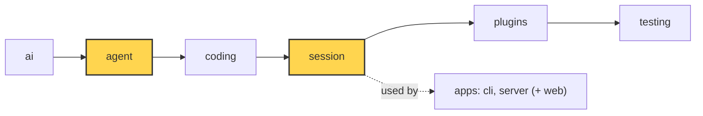

# 16 Part 4 · Compaction

**Goal:** Keep long conversations inside the context window.

**Builds on:** [13 Session](13-session.md) · [14 Plugins](14-plugins.md) · [15 Retry](15-retry.md) · **Next:** [17 Context overflow](17-overflow.md)

## Where we are



*This chapter adds `agent/compaction.py` (helpers in `agent` that never change history) and wires it into the `session` layer (both marked).*

Big picture of Part 4: [part-4-session](13-0-part-4-session.md).

## Why compress?

We use the same story as the rest of Part 4 ([13-0](13-0-part-4-session.md)). The fizzbuzz project is done, and the user keeps going in the same session: "add tests", "add a CLI", "refactor the output". Every turn sends the **whole** history to the model ([05](05-agent-loop.md)), and a coding session is full of big tool results: one `pytest` run can print 20 000 characters.

Every model has a **[context window](glossary.md#context-window)**: the most tokens it can read in one call (`Model.context_window`, say 200 000 tokens). After an hour the history is close to that, one more file read pushes the next call over, and the provider refuses it. So we must make what we send smaller **before** that happens, without losing two things: the user's first request ("write fizzbuzz.py that prints 1 to 15", the oldest message) and the list of files the agent has changed.

Just dropping the oldest messages does not work. The first request is the first thing lost. A cut can split a tool call from its result, and providers reject a result without its call. A message count is not a size: twenty short messages are fine, twenty file reads are not. And cutting the history itself would also cut the saved session ([13](13-session.md)).

## The idea, before and after

When the history is near the limit, we ask the model to **summarize** the old part, and we keep the recent part word for word. This is **[compaction](glossary.md#compaction)**. Here is our session at the moment it gets too big. To keep the numbers small, this example keeps about 5 000 recent tokens (the real default is 20 000):

| index | message | tokens |
|---|---|---|
| 0 | User: "write fizzbuzz.py that prints 1 to 15" | 10 |
| 1 | Assistant: tool call `write(path="fizzbuzz.py", ...)` | 60 |
| 2 | Tool result: "Wrote fizzbuzz.py" | 5 |
| 3 | User: "add tests and run them" | 6 |
| 4 | Assistant: tool call `write(path="test_fizzbuzz.py", ...)` | 800 |
| 5 | Tool result: "Wrote test_fizzbuzz.py" | 5 |
| 6 | Assistant: tool call `bash(command="pytest")` | 15 |
| 7 | Tool result: pytest output (19 960 characters) | 4 990 |
| 8 | Assistant: "Test 15 failed. I must fix the FizzBuzz case." | 15 |
| 9 | User: "go ahead" | 3 |

After compaction, the model will see one summary of messages 0..5, then messages 6..9 as they are.

The history itself is **not** changed. Messages 0..9 stay in memory and on disk, because history is append-only (the Part 4 rule, [13-0](13-0-part-4-session.md#the-core-idea)). The session only appends a marker, a **[CompactionEntry](glossary.md#compaction-entry)**. It holds the summary, the index where the kept part starts (`first_kept_index`, here 6), and the lists of read and changed files. Every later [view](glossary.md#view-llm-view) is built from the last marker. This is the same principle as the plugins' `context` hook ([14](14-plugins.md#where-in-a-run-does-the-session-call-plugins)): change what the model reads, not what the session remembers.

The helpers live in `agent/compaction.py`. That file knows nothing about sessions, so it can be tested alone (the layer rule, [00](00-overview.md)); it calls the model, but it never changes the list it gets. Only the session adds the marker.

## The whole flow, in one walk

Before the details, let us follow one turn from start to end. In our table, the user has just typed "go ahead" (index 9), and say the next call would now be too big. The session starts the run ([13](13-session.md)), and the agent loop begins. Before **each** model call, the loop asks the `prepare_next_turn` hook for the messages to send ([05](05-agent-loop.md#_llm_turn-one-model-call)). The session fills that hook with its own function, `_prepare` ([13](13-session.md#why-does-the-session-own-the-agent)).

`_prepare` first asks one question: is the next call too big ([next section](#when-do-we-compact))? If yes, and the app has not turned auto compaction off (the `auto_compact` switch), it compacts first. After that, it builds the view with `build_view`: one summary message, then the messages from `first_kept_index` on. With no marker yet, the view is the whole history, minus the [custom entries](glossary.md#custom-entry) (plugin data saved in the history but never sent, [14](14-plugins.md)). Last, each plugin gets one chance to change this view before it is sent, for example to hide an API key. This is the `context` hook from [14](14-plugins.md) (`_context` runs it): it changes only what the model reads, never the history. Then the loop sends the view to the model.

```text
_prepare(messages):
    IF auto_compact AND the next call is too big:
        compact()                      # may add a marker to messages
    RETURN WAIT FOR _context(build_view(messages))

_context(view):
    FOR each plugin: view = plugin.context(view) OR view
    RETURN view
```

What does `compact()` do inside? First it estimates the size before, and sends a `compaction_start` event with it (`tokens_before`) so the UI can show "compacting…". Then the helper `compact` in `agent/compaction.py` does the real work: it finds the cut (`find_cut`, [where do we cut?](#where-do-we-cut)), lists the files the agent read and changed (`file_lists`, from its read / write / edit calls), so the summary cannot forget them, runs the old part through the same `context` chain to hide secrets, turns it into one text, and asks the model for the summary (`summarize`, [what goes into the summary?](#what-goes-into-the-summary); an incremental one if there was a marker before). If any step fails, the session sends `compaction_end` with the error and leaves the history as it was. If it works, the session appends the CompactionEntry marker, saves it to the store, sends `message_end`, and then `compaction_end` with the new size (`tokens_after`). Because the marker is now in the history, the `build_view` call right after already uses it.

```text
session.compact():
    before = estimate tokens of messages
    SEND event compaction_start(before)
    TRY:
        // helper compact() in agent/compaction.py
        start, previous = first_kept_index and summary of the last marker (or 0, none)
        cut = find_cut(messages, start)          // IF none: fail "nothing to compact"
        old = messages[start:cut], without markers and custom entries
        files = file_lists(old)                  // read / modified, from real tool calls
        old = WAIT FOR _context(old)             // same plugin chain: hide secrets
        summary = WAIT FOR summarize(old, previous)   // one model call; incremental if previous
        entry = CompactionEntry(summary + files, cut)
    IF it failed:
        SEND event compaction_end(error, before, before)
        RETURN False                             // history unchanged
    ADD entry to messages, save it to the store
    SEND event message_end(entry)
    SEND event compaction_end(no error, before, tokens now)
    RETURN True
```

The next sections explain each step: when the call is too big, where the cut goes, what goes into the summary, what the next call sees, and what happens on failure.

Real code: [session/__init__.py](../../packages/simp_agent/src/simp_agent/session/__init__.py) — `AgentSession._prepare`, `_context`, `compact`; [agent/compaction.py](../../packages/simp_agent/src/simp_agent/agent/compaction.py) — `compact`

## When do we compact?

"Too big" needs a number. To know the size, it starts from the last real reply. The provider tells us its exact token counts (the `usage` the parser fills in, [03](03-parse.md)): what that call read, plus the reply it wrote. Both will be sent again next time. Messages that came after that reply have no count yet, so for them we guess 4 characters per token. For example, the last good reply read 180 000 tokens and wrote 500, and after it came a tool result of 8 000 characters: 180 000 + 500 + 2 000 = 182 500.

Not every count can be trusted, so we take the last reply whose count is complete and was measured on the view we send now. A reply that failed or was stopped is skipped, and so is any reply whose counts are all zero: a failed call is often refused before anything is counted, and a stopped stream is cut before the counts arrive at its end. Its count is zero or partial, so the session would look smaller than it is, and we would never compact. And we never look back past the last marker: counts from before it still include the old messages that the summary replaced, so the session would look bigger than it is. If there is no good reply after the last marker (right after a compaction, in a new session before the model has answered, or when every reply since then failed), every message of the view is guessed at 4 characters per token.

We compact when the size passes `context_window - reserve`, not the window itself (and only if the `enabled` setting is on). The reserve (16 384 tokens by default) is room for the model's reply and for the summary call. With a 200 000-token window, the line is 183 616 tokens: a session at 182 500 goes on, one more big tool result sends it over. (Our small table is far below a real line; it only shows where we cut.)

Real code: [agent/compaction.py](../../packages/simp_agent/src/simp_agent/agent/compaction.py) — `estimate_tokens`, `should_compact`; [session/__init__.py](../../packages/simp_agent/src/simp_agent/session/__init__.py) — `AgentSession._prepare`

## Where do we cut?

We keep about N recent tokens word for word (N is 20 000 by default, 5 000 in our table). To find the cut, walk back from the end and add up sizes until we pass N:

```text
i=9  total=3
i=8  total=18
i=7  total=5008   past 5000, stop
```

Index 7 is a tool result. Keeping it without its call (index 6) would break the pair, so a cut never lands on a tool result: it moves back to the nearest user or assistant message, here **cut = 6**. (If there is none at or before index 7, the first one after it is used.) Messages 0..5 become the old part.

The walk stops at the last marker's `first_kept_index` (0 the first time), and the cut is always after it, so each compaction only moves forward. One limit: if one turn alone is bigger than N, or even the window, the cut cannot go inside it ([17](17-overflow.md)).

Real code: [agent/compaction.py](../../packages/simp_agent/src/simp_agent/agent/compaction.py) — `find_cut`

## What goes into the summary?

The summary has two parts. The first is a text the model writes in a fixed format. It starts with **every user request, in order, never dropping one**; that is how the first request survives. The second is the file lists, which code adds at the end. For our session it looks like this:

```text
## User Requests (chronological)
1. Write fizzbuzz.py that prints 1 to 15.
2. Add tests and run them.

## Goal
fizzbuzz.py works and its tests pass.
...

<modified-files>
fizzbuzz.py
test_fizzbuzz.py
</modified-files>
```

(The real format has more sections: Progress, Key Decisions, Next Steps and others.)

Why do the file lists come from code (not the model)? After compaction the old tool calls are no longer sent, so this list is the only way the model still knows which files it touched; a model-written summary could forget one, code cannot. It takes the `path` of every `read`, `write` and `edit` call ([10](10-coding-tools.md)) in the old part, adds the lists from the previous marker, and puts a file that was both read and changed only under changed. Here: changed = `fizzbuzz.py`, `test_fizzbuzz.py`.

To get the text part, we ask the model in three steps. First, secrets are hidden: the old part goes through the same plugin `context` chain as a normal call ([14](14-plugins.md#where-in-a-run-does-the-session-call-plugins)), so a key hidden from the model is also hidden from the summary. Second, the old part becomes **one plain text**, one line per message (`[User]: …`, `[Assistant tool calls]: …`, `[Tool result]: …`). Why? Sent as a normal chat, the model would continue it ("Sure, I will add tests now") instead of summarizing it. Tool results and long arguments are cut to about 2 000 characters, and thinking is left out. Third, the next compaction sends only the new messages plus the previous summary. This is an **[incremental summary](glossary.md#incremental-summary)**: nothing is summarized twice, so the call stays small even in a long session.

The reply is capped so it fits in the reserve (80% of it, or less if the model's own limit is lower). A summary that was cut off, failed or was stopped is thrown away, never half-used, because half a summary would hide part of the history without the model knowing.

Real code: [agent/compaction.py](../../packages/simp_agent/src/simp_agent/agent/compaction.py) — `file_lists`, `serialize_conversation`, `summarize`, `compact`; [session/__init__.py](../../packages/simp_agent/src/simp_agent/session/__init__.py) — `AgentSession.compact`

## What does the next call see?

The marker becomes index 10 (saved and announced with `message_end`, [06](06-events-abort.md), as in the walk). The view now starts with the summary as one user message. Other markers and custom entries are left out. Only the last marker counts, because each summary already contains the one before.

```text
[0] User: "The conversation history before this point was compacted into the following summary:
          <summary> ## User Requests ... </summary>"
[1] message 6   (bash call)
[2] message 7   (its result)
[3] message 8
[4] message 9
```

Five messages instead of ten; in a real one-hour session the old part is far bigger, so the saving is too. The history on disk still has all ten, plus the marker.

Real code: [agent/compaction.py](../../packages/simp_agent/src/simp_agent/agent/compaction.py) — `build_view`

## If it fails, and when it runs

If it fails ("nothing to compact", a failed summary), `compact()` returns `False`, the history is not changed (see [the walk](#the-whole-flow-in-one-walk)), and the turn goes on with the old view. The same `auto_compact` switch from above also turns off the repair in [17](17-overflow.md). The next call may then be too big; [17](17-overflow.md) catches the "too long" error and runs this same compaction once more.

Because it runs inside `prepare_next_turn`, compaction can happen in the middle of a long tool loop, not only between prompts. The summary call is slow, but a steer typed during it still joins the same turn, because steering is read right after `prepare_next_turn` returns ([07](07-steering.md#the-loop-from-05-with-two-new-places)). Apps can also compact by hand, as the CLI's `/compact` command does ([19](19-cli.md)). To tune the prompts on real sessions, `apps/cli/scripts/replay_compaction.py` prints the first summary a real model gives for the start of a saved session.

**Builds on:** [13 Session](13-session.md) · [14 Plugins](14-plugins.md) · [15 Retry](15-retry.md) · **Next:** [17 Context overflow](17-overflow.md)
