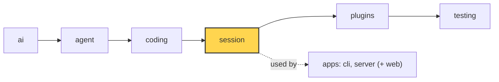

# 17 Part 4 · Context overflow

**Goal:** Recover when the model says the context is too big.

**Builds on:** [16 Compaction](16-compaction.md) · **Next:** [18 Profiles and built-in plugins](18-profiles-plugins.md)

## Where we are



*This chapter adds overflow recovery to the `session` layer (marked). The detection lives in `ai`.*

Code in this chapter (commit `2fc2776`):

- `packages/simp_agent/src/simp_agent/ai/__init__.py` — `is_context_overflow`, `_OVERFLOW`, `is_retryable`
- `packages/simp_agent/src/simp_agent/session/__init__.py` — `AgentSession._run` (the overflow branch), `compact`
- `packages/simp_agent/tests/test_queues_compaction.py` — `test_overflow_compacts_and_retries_once`, `test_second_overflow_stops`

## Problem

[16](16-compaction.md) compacts **before** the history gets too big. But that check is a guess:

- `estimate_tokens` uses "4 characters ≈ 1 token" for messages after the last real `usage`. Code and JSON can have more tokens per character.
- `Model.context_window` may be set wrong in a profile ([18](18-profiles-plugins.md)).
- One tool result can be huge and arrive in the same turn.

So sometimes the provider answers: "prompt is too long: 210000 tokens > 200000 maximum". The stream ends with an assistant error ([03](03-stream-parser.md)). The retry from [15](15-retry.md) does not help: the same request fails again. Without a fix, the session is stuck: every new prompt makes the history even bigger.

This is a **[context overflow](glossary.md#context-overflow)**.

## Naive version

```python
async def run(session, text):
    await session.prompt(text)
    while session.messages[-1].stop_reason == "error":
        if "too long" in session.messages[-1].error:
            await session.compact()
            await session.agent.continue_()
        else:
            break
```

It fixes one overflow for one provider. It breaks when:

1. **Each provider says it differently.** Anthropic says "prompt is too long", OpenAI says "maximum context length" or "context_length_exceeded".
2. **Endless loop.** If compaction cannot make it small enough (one huge turn, see the `find_cut` limit in [16](16-compaction.md)), it compacts and fails forever, paying for a summary each time.
3. **Compaction fails.** If `compact()` fails, it still continues and fails again.
4. **Retry and overflow may mix.** Today the retry pattern (`_RETRYABLE`, [15](15-retry.md)) does not match "too many tokens". But a future pattern, or a number like `529` inside an overflow text, could match. Then an overflow would be retried with backoff for nothing.

## Step by step: from naive to real

We start from the naive loop and fix one problem per step.

### Step 1: one detector for all providers

Replace `"too long" in ...` with one regex in `ai`:

```python
def is_context_overflow(error: str) -> bool:
    return bool(_OVERFLOW.search(error or ""))
```

**Why:** each provider has its own wording. One function in `ai` hides that. The session does not need to know which provider it talks to. `error or ""` handles a missing error text.

### Step 2: keep overflow out of retry

```python
    return not is_context_overflow(error) and bool(_RETRYABLE.search(error or ""))
```

**Why:** this is a safety guard, not a fix for a real clash: today `_RETRYABLE` does not match any overflow text. But retry with backoff ([15](15-retry.md)) sends the same big request again, so it can never work. With this check an overflow is never retryable, even if the patterns change. Each error has exactly one fix.

### Step 3: try only once

```python
        overflowed, attempt = False, 0
        ...
            if self.auto_compact and not overflowed and ai.is_context_overflow(last.error):
                overflowed = True
```

**Why:** if one compaction is not enough, a second one with the same settings will not help. The flag stops the endless loop and the repeated cost of summary calls.

### Step 4: stop if compaction fails

```python
                if not await self.compact():
                    break
```

**Why:** `compact()` returns `False` on any failure. Calling the model again with the same view would only give the same overflow.

### Step 5: share the loop with retry

Put the overflow branch first inside the same `while` as retry, with one `continue_()` at the end. That is the real `_run` below.

**Why:** one loop handles "the last message is an error". Overflow and retry can then follow each other in one run, and every exit path is a plain `break`.

## Real design

### Detecting overflow

In `packages/simp_agent/src/simp_agent/ai/__init__.py`:

Real code: [ai/__init__.py](../../packages/simp_agent/src/simp_agent/ai/__init__.py) — `_OVERFLOW`, `is_context_overflow`

```text
_OVERFLOW = one regex, ignore case, any of:
    "prompt (is) too long", "request_too_large", "exceeds the context window",
    "maximum context length", "context_length_exceeded", "too many tokens",
    "token limit exceeded"

FUNCTION is_context_overflow(error):
    RETURN true IF _OVERFLOW is found in (error or "")   // no text -> false
```

Key idea: one regex hides each provider's wording. Limit: a new wording from a provider needs a new pattern.

Same idea as `is_retryable` in [15](15-retry.md): one regex over the error text covers the known wordings of all providers. `error or ""` makes it safe when there is no text.

And `is_retryable` excludes it on purpose:

Real code: [ai/__init__.py](../../packages/simp_agent/src/simp_agent/ai/__init__.py) — `is_retryable`

```text
FUNCTION is_retryable(error, kind):
    ...
    IF is_context_overflow(error): RETURN false   // overflow has its own fix
    RETURN true IF _RETRYABLE is found in (error or "")
```

Key idea: an error is overflow or retryable, never both.

So an error is either an overflow or a retryable error, never both. Each has its own fix.

### Compact and retry, once

In `packages/simp_agent/src/simp_agent/session/__init__.py`, the first branch of the loop in `_run` (we saw the retry branch in [15](15-retry.md)):

Real code: [session/__init__.py](../../packages/simp_agent/src/simp_agent/session/__init__.py) — `_run`

```text
FUNCTION _run(start):
    a = self.agent
    self._abort = new abort event
    new = WAIT for start()
    overflowed = false, attempt = 0
    WHILE last message is an assistant error:
        IF self.auto_compact AND NOT overflowed AND is_context_overflow(last.error):
            // overflow: compact once and continue
            // (error stays in history; the LLM view drops it)
            overflowed = true
            IF NOT (WAIT for self.compact()): STOP loop
        ELSE IF is_retryable(last.error, last.error_kind) AND attempt < self.max_retries:
            ...   // retry with backoff, chapter 15
        ELSE:
            STOP loop
        ADD (WAIT for a.continue_()) to new
    ...
```

Key idea: one loop handles every error turn; overflow gets one compaction only. Limit: compaction uses normal settings, so if the recent part alone is too big, the run stops with the error.

Read it line by line:

- **`self.auto_compact`** — if the app turned off auto compaction, it also gets no overflow recovery. One switch for both.
- **`not overflowed`** — only **once** per run. If the call after compaction overflows again, the next pass skips this branch. The error is not retryable either, so it falls to `else: break`. The run stops with the error. No endless loop, no repeated summary cost.
- **`if not await self.compact(): break`** — if compaction fails (for example "nothing to compact", or the summary call fails), stop. Do not call the model again with the same big view.
- **`a.continue_()`** — same as retry: no new user text, just call the model again.

Why does `continue_()` now work? Two things:

1. `compact()` appended a `CompactionEntry` ([16](16-compaction.md)). `build_view` now sends the summary plus recent messages, not the full history.
2. The overflow error message stays in history (append-only), but `transform_messages` drops error turns from what is sent ([04](04-providers.md)). So the model does not see "prompt is too long" either.

Note that `compact()` here runs with the session's normal settings. It does not try to cut harder. If the recent part alone (`keep_recent_tokens`) is still too big, the second call overflows and the run stops. That is a clear error for the user, better than a loop.

### Exact order of checks

Each pass of the `while` loop does this:

1. **Is the last message an assistant error?** If not (success, or the last message is a user/tool message), the loop ends.
2. **Overflow branch.** All three must be true: `self.auto_compact`, `not overflowed`, `ai.is_context_overflow(last.error)`. Then set the flag, call `compact()`, and `break` if it returns `False`.
3. **Retry branch.** `ai.is_retryable(last.error, last.error_kind)` and `attempt < self.max_retries`. Note: `error_kind` in `NON_RETRYABLE` (`"fatal"`, `"budget"`, `"policy"`) is checked first inside `is_retryable`.
4. **Else:** `break`.
5. If no `break` happened: `new += await a.continue_()`, and loop again.

Edge cases that follow from this order:

- **Second overflow.** `overflowed` is `True`, so step 2 is skipped. Step 3 is false (overflow is never retryable). Step 4 breaks. The run ends with the overflow error as the last message.
- **`auto_compact=False`.** Step 2 is skipped. Step 3 is false. So an overflow ends the run at once. No retry is wasted on it.
- **Abort.** `self._abort` is a new `asyncio.Event` for each run. An abort during retry backoff breaks the loop. The overflow branch has no wait, so abort there is handled by the next model call ([06](06-events-abort.md)).
- **Error text missing.** `last.error` may be `None`. Both functions use `error or ""`, so they return `False` and the loop breaks.

### What `compact()` does here

`AgentSession.compact()` is the same method used by the `/compact` command and by auto compaction:

Real code: [session/__init__.py](../../packages/simp_agent/src/simp_agent/session/__init__.py) — `compact`

```text
FUNCTION compact():
    ...
    TRY:
        stream_fn = a.stream_fn with the API key options
        entry = WAIT for compact(a.messages, a.model, stream_fn, self.compaction, self._context)
    IF any error:
        SEND event compaction_end with the error (tokens_after = tokens_before)
        RETURN false            // caller stops, no new model call
    ADD entry to a.messages
```

Key idea: every failure becomes `False`, so the overflow branch has one simple exit.

The pure `compact` in `packages/simp_agent/src/simp_agent/agent/compaction.py` raises `RuntimeError("nothing to compact")` when `find_cut` returns `None`. The method turns any exception into `False`. So "nothing to cut" and "summary call failed" both end the overflow branch with `break`.

Clients see `compaction_start` and `compaction_end` events, just like in [16](16-compaction.md). An overflow recovery looks the same as auto compaction in the UI. The only difference is the error turn before it.

### Overflow and retry in one run

The two counters are separate: `overflowed` is a flag, `attempt` counts retries. A run can do both: overflow → compact → a `429` on the next call → retry with backoff → done. `auto_retry_end` is only sent if a retry happened (`if attempt:`).

### How it fits with chapter 16

| | When | How it knows | What it does |
|---|---|---|---|
| Auto compaction ([16](16-compaction.md)) | before each model call, in `_prepare` | `should_compact` on an estimate | compact, then call |
| Overflow recovery (this chapter) | after a failed call, in `_run` | `is_context_overflow` on the provider error | compact once, then `continue_()` |

The first one is the normal path and avoids most errors. The second one is the safety net when the guess was wrong.

## Test

`packages/simp_agent/tests/test_queues_compaction.py::test_overflow_compacts_and_retries_once`:

```python
OVERFLOW = AssistantMessage(stop_reason="error", error="prompt is too long: 210000 tokens > 200000 maximum")
...
async def test_overflow_compacts_and_retries_once():
    stream = FakeProvider(OVERFLOW, AssistantMessage([TextContent("SUM")]), DONE)
    seen = stream.messages
    a = AgentSession(Model(), [], stream_fn=stream, system_prompt="s")  # big window: only the overflow forces compaction
    a.compaction.keep_recent_tokens = 5000
    a.agent.messages = history()
    await a.prompt("next")
    assert len(seen) == 3 and a.messages[-1] is DONE
    assert seen[2][0].content.startswith(SUM_HEAD) and OVERFLOW not in seen[2]
```

What it checks:

- The model has a big default window, so `should_compact` is false. Only the overflow can trigger compaction.
- `FakeProvider` ([02](02-fake-provider.md)) replies: first the overflow error, then `"SUM"` (the summary call), then `DONE`.
- 3 calls in total, and the run ends with `DONE`.
- The third call starts with the summary (`SUM_HEAD`) and does not contain the overflow error.

The next test, `test_second_overflow_stops`, gives `OVERFLOW, SUM, OVERFLOW`. It checks that there are still only 3 calls and the run ends with the error: the "only once" rule.

Run both:

```sh
uv run pytest packages/simp_agent/tests/test_queues_compaction.py -k overflow -q
```

## Why this way

> **Detect by text, compact once, then stop.** The provider is the only one who knows the real token count, so its error is the final word. A regex covers all providers. Compacting once and continuing fixes the common case (the estimate was a bit low). Stopping after one try avoids a loop that costs money and never ends. The cost: an unknown error wording is not seen as an overflow, and a session whose recent turns alone are too big still fails. The user then sees the error and can start a new session.

## Exercises

1. **Overflow, then a 429.** Write a test with `FakeProvider(OVERFLOW, AssistantMessage([TextContent("SUM")]), AssistantMessage(stop_reason="error", error="429 too many requests"), DONE)`. Set `retry_base_delay=0` and use `history()`. Check there are 4 calls and the last message is `DONE`.
   *Hint:* copy `test_overflow_compacts_and_retries_once`. Pass `retry_base_delay=0` to `AgentSession(...)`.
2. **Recovery off.** Same as the first test, but pass `auto_compact=False`. How many calls do you expect? (Answer: 1. Overflow is not retryable, so the loop breaks at once.)
   *Hint:* check `len(seen)` and `a.messages[-1].stop_reason == "error"`.

## Recap

- `is_context_overflow` matches the "too long" wordings of all providers.
- `is_retryable` is false for overflow, so the two paths never mix.
- In `_run`: on overflow, `compact()` once, then `continue_()`. If compaction fails, or it overflows again, stop.
- The error stays in history but is dropped from the view.
- Order: overflow branch, then retry branch, then `break`. A second overflow always ends the run.
- Auto compaction ([16](16-compaction.md)) prevents; overflow recovery repairs.

**Builds on:** [16 Compaction](16-compaction.md) · **Next:** [18 Profiles and built-in plugins](18-profiles-plugins.md)
