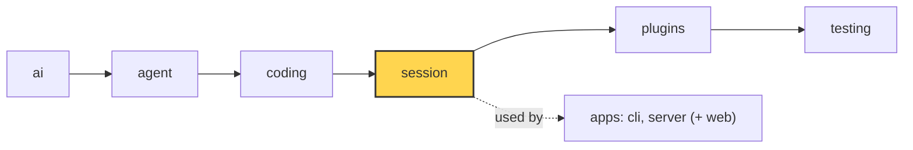

# 17 Part 4 · Context overflow

**Goal:** Recover when the model says the context is too big.

**Builds on:** [16 Compaction](16-compaction.md) · **Next:** [18 Profiles and built-in plugins](18-profiles-plugins.md)



*This chapter adds overflow recovery to the `session` layer (marked). The detection lives in `ai`.*

## Problem

[16](16-compaction.md) compacts **before** the history gets too big. But that check is a guess:

- `estimate_tokens` uses "4 characters ≈ 1 token" for messages after the last real `usage`. Code and JSON can have more tokens per character.
- `Model.context_window` may be set wrong in a profile ([18](18-profiles-plugins.md)).
- One tool result can be huge and arrive in the same turn.

So sometimes the provider answers: "prompt is too long: 210000 tokens > 200000 maximum". The stream ends with an assistant error ([03](03-stream-parser.md)). The retry from [15](15-retry.md) does not help: the same request fails again. Without a fix, the session is stuck: every new prompt makes the history even bigger.

This is a **[context overflow](glossary.md#context-overflow)**.

## Naive version

```python
async def run(session, text):
    await session.prompt(text)
    while session.messages[-1].stop_reason == "error":
        if "too long" in session.messages[-1].error:
            await session.compact()
            await session.agent.continue_()
        else:
            break
```

It fixes one overflow for one provider. It breaks when:

1. **Each provider says it differently.** Anthropic says "prompt is too long", OpenAI says "maximum context length" or "context_length_exceeded".
2. **Endless loop.** If compaction cannot make it small enough (one huge turn, see the `find_cut` limit in [16](16-compaction.md)), it compacts and fails forever, paying for a summary each time.
3. **Compaction fails.** If `compact()` fails, it still continues and fails again.
4. **Retry is confused.** "too many tokens" might also match a retry pattern and be retried with backoff for nothing.

## Real design

### Detecting overflow

In `packages/simp_agent/src/simp_agent/ai/__init__.py`:

```python
_OVERFLOW = re.compile(
    r"prompt (is )?too long|request_too_large|exceeds the context window|maximum context length"
    r"|context[_ ]length[_ ]exceeded|too many tokens|token limit exceeded",
    re.I,
)


def is_context_overflow(error: str) -> bool:
    return bool(_OVERFLOW.search(error or ""))
```

Same idea as `is_retryable` in [15](15-retry.md): one regex over the error text covers the known wordings of all providers. `error or ""` makes it safe when there is no text.

And `is_retryable` excludes it on purpose:

```python
    return not is_context_overflow(error) and bool(_RETRYABLE.search(error or ""))
```

So an error is either an overflow or a retryable error, never both. Each has its own fix.

### Compact and retry, once

In `packages/simp_agent/src/simp_agent/session/__init__.py`, the first branch of the loop in `_run` (we saw the retry branch in [15](15-retry.md)):

```python
    async def _run(self, start) -> list:
        a = self.agent
        self._abort = asyncio.Event()
        new = await start()
        overflowed, attempt = False, 0
        while (last := a.messages[-1]).role == "assistant" and last.stop_reason == "error":
            if self.auto_compact and not overflowed and ai.is_context_overflow(last.error):
                # overflow: compact once and continue (error stays in history; the LLM view drops it)
                overflowed = True
                if not await self.compact():
                    break
            elif ai.is_retryable(last.error, last.error_kind) and attempt < self.max_retries:
                ...  # retry with backoff, chapter 15
            else:
                break
            new += await a.continue_()
        ...
```

Read it line by line:

- **`self.auto_compact`** — if the app turned off auto compaction, it also gets no overflow recovery. One switch for both.
- **`not overflowed`** — only **once** per run. If the call after compaction overflows again, the next pass skips this branch. The error is not retryable either, so it falls to `else: break`. The run stops with the error. No endless loop, no repeated summary cost.
- **`if not await self.compact(): break`** — if compaction fails (for example "nothing to compact", or the summary call fails), stop. Do not call the model again with the same big view.
- **`a.continue_()`** — same as retry: no new user text, just call the model again.

Why does `continue_()` now work? Two things:

1. `compact()` appended a `CompactionEntry` ([16](16-compaction.md)). `build_view` now sends the summary plus recent messages, not the full history.
2. The overflow error message stays in history (append-only), but `transform_messages` drops error turns from what is sent ([03](03-stream-parser.md)). So the model does not see "prompt is too long" either.

Note that `compact()` here runs with the session's normal settings. It does not try to cut harder. If the recent part alone (`keep_recent_tokens`) is still too big, the second call overflows and the run stops. That is a clear error for the user, better than a loop.

### Overflow and retry in one run

The two counters are separate: `overflowed` is a flag, `attempt` counts retries. A run can do both: overflow → compact → a `429` on the next call → retry with backoff → done. `auto_retry_end` is only sent if a retry happened (`if attempt:`).

### How it fits with chapter 16

| | When | How it knows | What it does |
|---|---|---|---|
| Auto compaction ([16](16-compaction.md)) | before each model call, in `_prepare` | `should_compact` on an estimate | compact, then call |
| Overflow recovery (this chapter) | after a failed call, in `_run` | `is_context_overflow` on the provider error | compact once, then `continue_()` |

The first one is the normal path and avoids most errors. The second one is the safety net when the guess was wrong.

## Test

`packages/simp_agent/tests/test_queues_compaction.py::test_overflow_compacts_and_retries_once`:

```python
OVERFLOW = AssistantMessage(stop_reason="error", error="prompt is too long: 210000 tokens > 200000 maximum")
...
async def test_overflow_compacts_and_retries_once():
    stream = FakeProvider(OVERFLOW, AssistantMessage([TextContent("SUM")]), DONE)
    seen = stream.messages
    a = AgentSession(Model(), [], stream_fn=stream, system_prompt="s")  # big window: only the overflow forces compaction
    a.compaction.keep_recent_tokens = 5000
    a.agent.messages = history()
    await a.prompt("next")
    assert len(seen) == 3 and a.messages[-1] is DONE
    assert seen[2][0].content.startswith(SUM_HEAD) and OVERFLOW not in seen[2]
```

What it checks:

- The model has a big default window, so `should_compact` is false. Only the overflow can trigger compaction.
- `FakeProvider` ([02](02-fake-provider.md)) replies: first the overflow error, then `"SUM"` (the summary call), then `DONE`.
- 3 calls in total, and the run ends with `DONE`.
- The third call starts with the summary (`SUM_HEAD`) and does not contain the overflow error.

The next test, `test_second_overflow_stops`, gives `OVERFLOW, SUM, OVERFLOW`. It checks that there are still only 3 calls and the run ends with the error: the "only once" rule.

Run both:

```sh
uv run pytest packages/simp_agent/tests/test_queues_compaction.py -k overflow -q
```

## Why this way

> **Detect by text, compact once, then stop.** The provider is the only one who knows the real token count, so its error is the final word. A regex covers all providers. Compacting once and continuing fixes the common case (the estimate was a bit low). Stopping after one try avoids a loop that costs money and never ends. The cost: an unknown error wording is not seen as an overflow, and a session whose recent turns alone are too big still fails. The user then sees the error and can start a new session.

## Recap

- `is_context_overflow` matches the "too long" wordings of all providers.
- `is_retryable` is false for overflow, so the two paths never mix.
- In `_run`: on overflow, `compact()` once, then `continue_()`. If compaction fails, or it overflows again, stop.
- The error stays in history but is dropped from the view.
- Auto compaction ([16](16-compaction.md)) prevents; overflow recovery repairs.

**Builds on:** [16 Compaction](16-compaction.md) · **Next:** [18 Profiles and built-in plugins](18-profiles-plugins.md)

## Terms to add to glossary

- **context overflow** — the provider rejects a call because the input is bigger than the context window.
- **overflow recovery** — in `_run`: compact once and call the model again.
