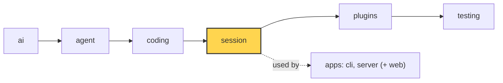

# 17 Part 4 · Context overflow

**Goal:** Recover when the model says the context is too big.

**Builds on:** [16 Compaction](16-compaction.md) · **Next:** [18 Profiles and built-in plugins](18-profiles-plugins.md)

## Where we are



*This chapter adds overflow recovery to the `session` layer (marked). The detection lives in `ai`.*

Big picture of Part 4: [part-4-session](13-0-part-4-session.md).

Code in this chapter (commit `2fc2776`):

- `packages/simp_agent/src/simp_agent/ai/__init__.py` — `is_context_overflow`, `_OVERFLOW`, `is_retryable`
- `packages/simp_agent/src/simp_agent/session/__init__.py` — `AgentSession._run` (the overflow branch), `compact`
- `packages/simp_agent/tests/test_queues_compaction.py` — `test_overflow_compacts_and_retries_once`, `test_second_overflow_stops`

## Problem

[16](16-compaction.md) compacts **before** the history gets too big. But that check is a guess:

- `estimate_tokens` uses "4 characters ≈ 1 token" for messages after the last real `usage`. Code and JSON can have more tokens per character.
- `Model.context_window` may be set wrong in a profile ([18](18-profiles-plugins.md)).
- One tool result can be huge and arrive in the same turn.

So sometimes the provider answers: "prompt is too long: 210000 tokens > 200000 maximum". The stream ends with an assistant error ([03](03-parse.md)). The retry from [15](15-retry.md) does not help: the same request fails again. Without a fix, the session is stuck: every new prompt makes the history even bigger.

This is a **[context overflow](glossary.md#context-overflow)**.

Where chapter 16 ends and this chapter starts:

| | When | How it knows | What it does |
|---|---|---|---|
| Prevent: auto compaction ([16](16-compaction.md)) | before each model call, in `_prepare` | `should_compact` on an estimate | compact, then call |
| Repair: overflow recovery (this chapter) | after a failed call, in `_run` | `is_context_overflow` on the provider error | compact once, then `continue_()` |

The first one is the normal path and avoids most errors. The second one is the safety net when the guess was wrong.

## Naive version

```text
FUNCTION run(session, text):
    WAIT for session.prompt(text)
    WHILE the last message is an error:
        IF its error text has "too long":
            WAIT for session.compact()
            WAIT for the agent to continue
        ELSE:
            STOP
```

It fixes one overflow for one provider. It breaks when:

1. **Each provider says it differently.** Anthropic says "prompt is too long", OpenAI says "maximum context length" or "context_length_exceeded".
2. **Endless loop.** If compaction cannot make it small enough (one huge turn, see the `find_cut` limit in [16](16-compaction.md)), it compacts and fails forever, paying for a summary each time.
3. **Compaction fails.** If `compact()` fails, it still continues and fails again.

We also add one guard: an overflow must never go to the retry path of [15](15-retry.md). Retrying an overflow sends the same too-big request again, so we make sure it is never retried.

| Problem | Fix | Section |
|---|---|---|
| 1. many wordings | one regex in `ai` | [Detecting overflow](#detecting-overflow) |
| guard: no retry | `is_retryable` says no for overflow | [Detecting overflow](#detecting-overflow) |
| 2. endless loop | an `overflowed` flag: compact once per run | [Compact and continue, once](#compact-and-continue-once) |
| 3. compaction fails | `compact()` returns `False` → stop | [Compact and continue, once](#compact-and-continue-once) |

## Real design

### Detecting overflow

Real code: [ai/__init__.py](../../packages/simp_agent/src/simp_agent/ai/__init__.py) — `_OVERFLOW`, `is_context_overflow`, `is_retryable`

```text
_OVERFLOW = one regex, ignore case, any of:
    "prompt (is) too long", "request_too_large", "exceeds the context window",
    "maximum context length", "context_length_exceeded", "too many tokens",
    "token limit exceeded"

FUNCTION is_context_overflow(error):
    RETURN true IF _OVERFLOW is found in (error or "")   // no text -> false

FUNCTION is_retryable(error, kind):
    IF kind is in NON_RETRYABLE: RETURN false            // some error kinds are never retried, see 15
    RETURN NOT is_context_overflow(error) AND _RETRYABLE is found in (error or "")
```

- One regex hides each provider's wording. The session does not need to know which provider it talks to.
- `error or ""` makes both safe when there is no error text: they return `false`.
- So an error is an overflow or retryable, never both. Each has its own fix.
- Limit: a new wording from a provider needs a new pattern.

### Compact and continue, once

The loop in `AgentSession._run` was built in [15](15-retry.md#the-retry-loop-in-_run). Here is only the overflow branch. It is the first branch of the loop.

Real code: [session/__init__.py](../../packages/simp_agent/src/simp_agent/session/__init__.py) — `AgentSession._run`

```text
overflowed = false, attempt = 0
WHILE last message is an assistant error:
    IF self.auto_compact AND NOT overflowed AND is_context_overflow(last.error):
        overflowed = true                  // never compact twice in one run
        IF NOT (WAIT for self.compact()): STOP loop
    ELSE IF ...retryable...:               // retry with backoff, chapter 15
        ...
    ELSE:
        STOP loop
    ADD (WAIT for a.continue_()) to new
```

- **`self.auto_compact`** — if the app turns off auto compaction, it also gets no overflow recovery. One switch for both.
- **`not overflowed`** — only **once** per run. If one compaction is not enough, a second one with the same settings will not help. The flag stops the endless loop and the repeated cost of summary calls.
- **`if not await self.compact(): break`** — `compact()` ([16](16-compaction.md#in-the-session)) turns every failure into `False`: "nothing to compact" and "summary call failed". Calling the model again with the same view would only give the same overflow, so we stop.
- **`a.continue_()`** — same as retry: no new user text, just call the model again.

Why does `continue_()` now work? Two things:

1. `compact()` appended a `CompactionEntry` ([16](16-compaction.md)). `build_view` now sends the summary plus recent messages, not the full history.
2. The overflow error message stays in history (append-only), but `transform_messages` drops error turns from what is sent ([01](01-pick-clean.md#2-clean-transform_messages)). So the model does not see "prompt is too long" either.

Clients see `compaction_start` and `compaction_end` events, as in [16](16-compaction.md). An overflow recovery looks the same as auto compaction in the UI. The only difference is the error turn before it.

### Overflow edge cases

The full order of checks for both branches is in [15](15-retry.md#order-of-checks-and-edge-cases). The cases that matter for overflow:

- **Second overflow.** `overflowed` is `True`, so the overflow branch is skipped. Overflow is never retryable, so the loop breaks. The run ends with the overflow error as the last message.
- **`auto_compact=False`.** The overflow branch is skipped, retry says no, so an overflow ends the run at once. No retry is wasted on it.
- **Recent part too big.** `compact()` uses the normal settings; it does not cut harder. If the recent part alone (`keep_recent_tokens`) is still too big, the second call overflows and the run stops. A clear error is better than a loop.
- **Overflow, then a 429.** The two counters are separate: `overflowed` is a flag, `attempt` counts retries. Overflow → compact → `429` → retry with backoff → done works in one run.

## Test

`packages/simp_agent/tests/test_queues_compaction.py::test_overflow_compacts_and_retries_once`:

```python
OVERFLOW = AssistantMessage(stop_reason="error", error="prompt is too long: 210000 tokens > 200000 maximum")
...
async def test_overflow_compacts_and_retries_once():
    stream = FakeProvider(OVERFLOW, AssistantMessage([TextContent("SUM")]), DONE)
    seen = stream.messages
    a = AgentSession(Model(), [], stream_fn=stream, system_prompt="s")  # big window: only the overflow forces compaction
    a.compaction.keep_recent_tokens = 5000
    a.agent.messages = history()
    await a.prompt("next")
    assert len(seen) == 3 and a.messages[-1] is DONE
    assert seen[2][0].content.startswith(SUM_HEAD) and OVERFLOW not in seen[2]
```

What it checks:

- The model has a big default window, so `should_compact` is false. Only the overflow can trigger compaction.
- `FakeProvider` ([04](04-label-test.md)) replies: first the overflow error, then `"SUM"` (the summary call), then `DONE`.
- 3 calls in total, and the run ends with `DONE`.
- The third call starts with the summary (`SUM_HEAD`) and does not contain the overflow error.

The next test, `test_second_overflow_stops`, gives `OVERFLOW, SUM, OVERFLOW`. It checks that there are still only 3 calls and the run ends with the error: the "only once" rule.

Run both:

```sh
uv run pytest packages/simp_agent/tests/test_queues_compaction.py -k overflow -q
```

## Why this way

> **Detect by text, compact once, then stop.** The provider is the only one who knows the real token count, so its error is the final word. A regex covers all providers. Compacting once and continuing fixes the common case (the estimate was a bit low). Stopping after one try avoids a loop that costs money and never ends. The cost: an unknown error wording is not seen as an overflow, and a session whose recent turns alone are too big still fails. The user then sees the error and can start a new session.

## Exercises

1. **Overflow, then a 429.** Write a test with `FakeProvider(OVERFLOW, AssistantMessage([TextContent("SUM")]), AssistantMessage(stop_reason="error", error="429 too many requests"), DONE)`. Set `retry_base_delay=0` and use `history()`. Check there are 4 calls and the last message is `DONE`.
   *Hint:* copy `test_overflow_compacts_and_retries_once`. Pass `retry_base_delay=0` to `AgentSession(...)`.
2. **Recovery off.** Same as the first test, but pass `auto_compact=False`. How many calls do you expect? (Answer: 1. Overflow is not retryable, so the loop breaks at once.)
   *Hint:* check `len(seen)` and `a.messages[-1].stop_reason == "error"`.

## Recap

- `is_context_overflow` matches the "too long" wordings of all providers.
- `is_retryable` is false for overflow, so the two paths never mix.
- In `_run`: on overflow, `compact()` once, then `continue_()`. If compaction fails, or it overflows again, stop.
- The error stays in history but is dropped from the view.
- The overflow branch comes first. A second overflow always ends the run.
- Auto compaction ([16](16-compaction.md)) prevents; overflow recovery repairs.

**Builds on:** [16 Compaction](16-compaction.md) · **Next:** [18 Profiles and built-in plugins](18-profiles-plugins.md)
