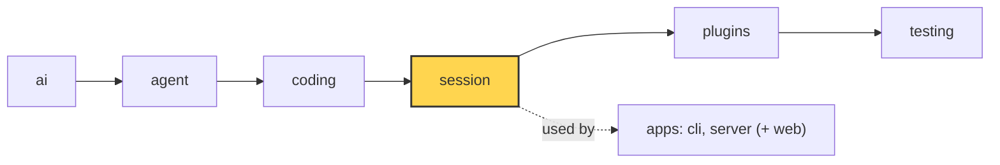

# 17 Part 4 · Context overflow

**Goal:** Recover when the model says the context is too big.

**Builds on:** [16 Compaction](16-compaction.md) · **Next:** [18 Profiles and built-in plugins](18-profiles-plugins.md)

## Where we are



*This chapter adds overflow recovery to the `session` layer (marked). The detection lives in `ai`.*

Big picture of Part 4: [part-4-session](13-0-part-4-session.md).

Code in this chapter (commit `2fc2776`):

- `packages/simp_agent/src/simp_agent/ai/__init__.py` — `is_context_overflow`, `_OVERFLOW`, `is_retryable`
- `packages/simp_agent/src/simp_agent/session/__init__.py` — `AgentSession._run` (the overflow branch), `compact`
- `packages/simp_agent/tests/test_queues_compaction.py` — `test_overflow_compacts_and_retries_once`, `test_second_overflow_stops`

## Problem

We keep the story of [16](16-compaction.md). The user works in one long session on the fizzbuzz project, and the model has a 200 000-token [context window](glossary.md#context-window). Before each model call, auto compaction checks the size and makes the history smaller when it gets close to the limit.

But that size is a guess ([16](16-compaction.md#when-do-we-compact)), and the guess can be too low. Code and JSON often have more tokens per character than we assume (we assume 4 characters per token), and the window number in a profile can be wrong. After the agent reads one more large file, the guess says 180 000: below the line of [16](16-compaction.md#when-do-we-compact), so no compaction. But the provider counts 210 000 tokens and refuses:

```text
prompt is too long: 210000 tokens > 200000 maximum
```

This is a **[context overflow](glossary.md#context-overflow)**. Retry ([15](15-retry.md)) cannot fix it: the same request fails the same way every time. And the session is stuck, because every new prompt makes the history even bigger.

So we add a second line of defence. Chapter 16 **prevents** an overflow before the call; this chapter **repairs** one after it:

| | When | What it does |
|---|---|---|
| Prevent ([16](16-compaction.md)) | before each model call | compact if the guess is too big, then call |
| Repair (this chapter) | after the provider says "too long" | compact once, then call again |

## Naive version

```text
AFTER a run ends:
    WHILE the last message is an error:
        IF the error text has "too long":
            compact, then call the model again
        ELSE:
            STOP
```

This fixes our one overflow with one provider. It breaks in four ways:

- **Other providers say it differently.** OpenAI says "maximum context length", not "too long", so the check misses it. → [How do we know it is an overflow?](#how-do-we-know-it-is-an-overflow)
- **Retry gets in the way.** Retry from [15](15-retry.md) runs in the same place. Some overflow errors look like retry errors ("too many tokens" vs "too many requests"), so retry could wait and send the same too-big request again. → [same section](#how-do-we-know-it-is-an-overflow)
- **It may never end.** If one compaction is not enough, it compacts again and again, paying for a summary each time. → [Why only once?](#why-only-once)
- **Compaction can fail.** Then it calls the model again anyway and gets the same error. → [What if it still does not fit?](#what-if-it-still-does-not-fit)

## Our overflow, step by step

Here is what happens to the 210 000-token error with the real fix:

1. The model call fails. The run ends with an error message: "prompt is too long…".
2. After the run, the session looks at that last message, in the same place where retry looks ([15](15-retry.md#how-does-retry-work)).
3. It sees that the error is an overflow, not a short failure.
4. It compacts once, the same compaction as [16](16-compaction.md). Old messages become a summary.
5. It asks the model to go on (`continue_()`), with no new user message.
6. This time the model gets the summary plus about 20 000 tokens of recent messages instead of 210 000, and it answers.

The error message stays in the saved history, because history is never rewritten. But error turns are never sent to the model ([01](01-pick-clean.md#2-clean-transform_messages)), so the model does not see "prompt is too long". The UI sees the same "compacting…" events as in [16](16-compaction.md).

Real code: [session/\_\_init\_\_.py](../../packages/simp_agent/src/simp_agent/session/__init__.py) — `AgentSession._run`

## How do we know it is an overflow?

Each provider words it differently: "prompt is too long", "maximum context length", "context_length_exceeded", "too many tokens", and so on. We keep all these wordings in one list, in the `ai` layer, next to the retry wordings of [15](15-retry.md#which-errors-are-worth-trying-again). Both lists read provider error text, so the session never needs to know which provider it talks to.

One error must go to **one** fix only. "Too many tokens" (an overflow) looks a lot like "too many requests" (a rate limit, worth retrying). So before the retry check looks for retry words, it first asks "is this an overflow?". If yes, the error is not retried. An error is either an overflow or retryable, never both.

The limit: a provider with a new wording is not caught until we add it to the list.

Real code: [ai/\_\_init\_\_.py](../../packages/simp_agent/src/simp_agent/ai/__init__.py) — `_OVERFLOW`, `is_context_overflow`, `is_retryable`

## Why only once?

A second compaction with the same settings would cut at the same place and give the same result, and it would pay for another summary. So each run remembers that it has already compacted for an overflow (the `overflowed` flag), and does not do it again.

Overflow repair and retry keep separate counts. So one run can have both: overflow → compact → rate limit → wait → success.

## What if it still does not fit?

Then the run stops, and the error stays as the last message. A clear error is better than a loop. The user can start a new session.

- **A second overflow in the same run:** no second compaction (see above), and an overflow is never retried, so the run stops.
- **Compaction fails** ("nothing to compact", or the summary call fails): there is no smaller history to send, so the run stops.
- **The recent part alone is too big:** compaction always keeps the recent messages word for word ([16](16-compaction.md#where-do-we-cut)), so the next call overflows again, and the run stops.
- **Auto compaction is turned off** (`auto_compact=False`): repair is off too, because it is the same switch. The run stops at the first overflow.

Real code: [tests/test\_queues\_compaction.py](../../packages/simp_agent/tests/test_queues_compaction.py) — `test_overflow_compacts_and_retries_once`, `test_second_overflow_stops`

**Builds on:** [16 Compaction](16-compaction.md) · **Next:** [18 Profiles and built-in plugins](18-profiles-plugins.md)
