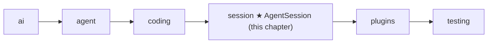

# 17 Part 4 · Sessions

**Goal:** Keep a conversation across turns and save it.

**Builds on:** [16 Part 4 big picture](16-part-4-session.md) · **Next:** [18 Plugins](18-plugins.md)

## Where we are



This chapter starts the `session` layer. Big picture of Part 4: [part-4-session](16-part-4-session.md).

Yesterday the user asked the agent to write `fizzbuzz.py`. In the middle of the task they closed the CLI. Today they open it again and type "now add tests". At the end of Part 3 we have an `Agent` ([08](08-events-abort.md)) with coding tools ([13](13-coding-tools.md)) and a system prompt ([14](14-system-prompt.md)), but its whole history lives in memory. When the program stopped, the conversation was gone, so today the agent has no idea what `fizzbuzz.py` is.

This chapter adds one object, the **[session](glossary.md#session)**, that owns the agent for a whole conversation and keeps it on disk. We build it by answering five questions.

## What must survive a restart?

The messages. The model has no memory of its own; everything it knows about yesterday is in the list of messages we send it. So if we keep every message (the user's words, each assistant reply, each tool result), we can rebuild the conversation and the agent can go on as if it never stopped.

We keep them as **[JSONL](glossary.md#jsonl)**: one JSON object per line, one line per message. A saved user message looks like this:

```text
{"content": "now add tests", "role": "user"}
```

The `role` field says which kind of message the line is, so we can turn the line back into the right class ([ref-objects](ref-objects.md#going-to-json-and-back)).

## When do we save?

The simple idea is to save the whole list when the run ends. But a run can die in the middle, after the model has already written `fizzbuzz.py`; then nothing is saved, and on resume the model does not know the file exists.

So the session saves each message the moment it is finished: on every `message_end` event ([08](08-events-abort.md)). In one run that happens many times:

| Moment | Finished message | Saved? |
|---|---|---|
| The user sends the question | [1] user: "write fizzbuzz.py" | yes, at once |
| The model is still streaming its reply | (not finished) | no |
| The model's reply ends: it asks for `write` | [2] assistant: tool call `write fizzbuzz.py` | yes, at once |
| The `write` tool is done; the file exists | [3] tool result: "Wrote 120 chars to fizzbuzz.py" | yes, at once |
| The model's last reply ends | [4] assistant: "Done." | yes, at once |

Each save adds one line at the end and never rewrites old lines. So if the program dies after [3], the history already shows that `fizzbuzz.py` was written; a crash loses at most the one message that was still being written.

Real code: [session/\_\_init\_\_.py](../../packages/simp_agent/src/simp_agent/session/__init__.py) — `_on_agent_event`

## Where do we save?

Not every app wants a file. Tests want a list in memory, the CLI wants files, and the server wants a database ([27](27-store-auth.md)). So the session does not know where things go. It only talks to a **[SessionStore](glossary.md#sessionstore)**, which is anything with two methods:

```python
class SessionStore(Protocol):
    def append(self, entry) -> Any: ...   # save one entry; may be async
    def load(self) -> list: ...           # give back all entries
```

`Protocol` is Python's way to say "any class with these methods fits"; the store does not need to inherit from anything. A list in memory is already a full store, and the tests use exactly that (`ListStore`). A database store needs `await` and a list does not, so the session accepts both, with the same [`_maybe_await`](glossary.md#_maybe_await) helper as the hooks in [10](10-hooks-approval.md). Besides messages, `append` also gets a few entries that are saved but never sent to the model, like a plugin's [custom entry](glossary.md#custom-entry) ([18](18-plugins.md)).

The CLI's store is `JsonlStore`. Its `append` opens the file in `"a"` mode (add at the end), writes one line and closes the file, so the line is on disk right away. Its `load` reads the lines back into messages. Each project folder has its own sessions, in `~/.simp-agent/sessions/<cwd-slug>/<id>.jsonl`, where `session_dir(cwd)` turns the project path into a folder name (`/home/me/project` becomes `home-me-project`).

Real code: [simp_cli/\_\_init\_\_.py](../../apps/cli/src/simp_cli/__init__.py) — `JsonlStore`, `session_dir`

## How does the user come back?

The session never loads by itself. The app does, because only the app knows *which* conversation the user wants: an id they typed, the latest one, or a new one. (The CLI's `latest_session(cwd)` picks the newest file for this folder.) The app loads it and passes the list in:

```python
AgentSession(model, store=store, messages=store.load())
```

Now the user types "now add tests" and the app calls `session.prompt(text)`: a new user message, and the agent runs. Sometimes there is no new message to add. The run stopped on an error, or the last saved message is a tool result the model never answered. Then the app calls `session.continue_()`, which runs the agent again on the same history. The CLI does this when it resumes with no task. Retry in [19](19-retry.md) uses the same call.

## Why does the session own the agent?

The CLI and the server both need the same setup around the agent: tools, a place to save, approval, project rules. So that setup is written once, in the session. The session creates the agent itself, and apps only talk to the session.

If you give it nothing, it uses the coding tools ([13](13-coding-tools.md)), the local machine ([12](12-exec-env.md)) and the coding prompt ([14](14-system-prompt.md)). It also plugs its own checks into the agent's hooks ([10](10-hooks-approval.md)): before a tool, after a tool, and before each model call (`_before_tool_call`, `_after_tool_call`, `_prepare`). That is where every later feature goes: plugins ([18](18-plugins.md)), retry ([19](19-retry.md)), compaction ([20](20-compaction.md)). The loop itself never changes.

There is only one history: the session uses the agent's list of messages, not a copy.

### What the app can call

An app talks to the session in three ways.

**Send a new message** (`prompt(text)`). Use this when the user types something new. The session:

1. Does its one-time setup, if this is the first run (see below).
2. Adds the text to the history as a new user message.
3. Runs the agent until it is done: the model answers, tools run, the model answers again, until it stops.
4. Saves each finished message as it goes, and passes every event on to the app.
5. Gives back the messages added in this run.

**Go on without a new message** (`continue_()`). Use this when there is nothing new to say, but the work is not finished: the last run stopped on an error, or the history ends with a tool result the model has not answered yet. The session does the same steps, but skips step 2: the model just looks at the same history again. Later, retry ([19](19-retry.md)) and overflow recovery ([21](21-overflow.md)) use this same "go on" when they run the model again.

**One-time setup** (`start()`). Some work must happen once, before the model answers for the first time:

- **Read the project rules.** The model must follow `AGENTS.md` from its first answer. So the session reads that file and adds it to the system prompt.
- **Let plugins get ready** ([18](18-plugins.md)). Each plugin gets a chance to set itself up, for example to turn plan mode back on.

This can't happen when the session is created (`__init__`). Reading a file means waiting, and Python does not let object creation wait. So both ways in (send a message, go on) call the setup first. The setup remembers that it has run, so from the second time on it does nothing.

As a result, `AGENTS.md` is read **once per session**. If you edit it, start a new session to see the change.

Later chapters add to these steps but do not change them: plugins can read or change the user's text before the run ([18](18-plugins.md)), and retry and overflow recovery look at the result after the run ([19](19-retry.md), [21](21-overflow.md)).

> **Not the same `start`:** the CLI ([24](24-cli.md)) and the server ([25](25-server-run.md)) each have their own `start`. It runs the session in the background, so the terminal or the web request does not wait. It is not this one-time setup.

Real code: [session/\_\_init\_\_.py](../../packages/simp_agent/src/simp_agent/session/__init__.py) — `AgentSession.__init__`, `prompt`, `continue_`, `start`

## Prompt sections

`start()` adds `AGENTS.md` as a **[prompt section](glossary.md#prompt-section)**. The session builds the system prompt from a small table of sections. Each section has an id, an order and a value: a string, or a function that makes the string. To build the prompt, the session sorts the sections by order, skips empty ones and joins them with a blank line. With the default prompt and an `AGENTS.md` that says `use tabs`, the model gets:

```text
You are an expert coding assistant. ...   <- section "coding", order 0

# Project Context                         <- section "context_file", order 10

## /home/me/project/AGENTS.md

use tabs
```

The `coding` section is a function, so it always uses the current tools and folder. If the app passes its own `system_prompt` string, that becomes the only base section and no coding text or `AGENTS.md` is added.

A plugin adds its own section with `add_prompt_section(id, value, order)`; the default order 100 puts it after these two. Adding the same id again replaces the text but keeps its place. Because the prompt is rebuilt before every model call ([14](14-system-prompt.md#why-is-the-prompt-a-function-not-a-fixed-string)), a change shows up on the next turn. Plugins come in [18](18-plugins.md); plan mode in [22](22-profiles-plugins.md) is a full example of a section turned on and off.

Real code: [session/\_\_init\_\_.py](../../packages/simp_agent/src/simp_agent/session/__init__.py) — `add_prompt_section`, `remove_prompt_section`, `_build_prompt`

**Next:** [18 Plugins](18-plugins.md) — plugins use the session's hooks and prompt sections.
