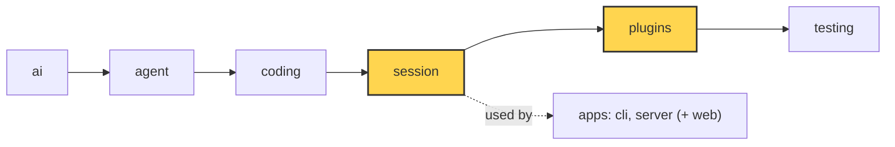

# 18 Part 4 · Profiles and built-in plugins

**Goal:** Pick models by profile and ship two real plugins.

**Builds on:** [17 Context overflow](17-overflow.md) · **Next:** [19 The CLI](19-cli.md)

## Where we are



*This chapter adds `session/profile.py` and fills the `plugins` layer (both marked).*

Big picture of Part 4: [part-4-session](part-4-session.md).

Code in this chapter (commit `2fc2776`):

- `packages/simp_agent/src/simp_agent/session/profile.py` — `build_model`
- `packages/simp_agent/src/simp_agent/plugins/__init__.py` — `build_plugins`
- `packages/simp_agent/src/simp_agent/plugins/redact_secrets.py` — `RedactSecrets`
- `packages/simp_agent/src/simp_agent/plugins/plan_mode.py` — `PlanMode`
- `packages/simp_agent/tests/test_profile.py`, `apps/cli/tests/test_sockets.py` — the profile and plugin tests

## Problem

Part 4 is almost done. The session saves, retries, compacts and runs plugins. Two gaps are left before the apps:

1. **Choosing a model.** A `Model` ([01](01-pick-clean.md#in-model-and-context), all fields: [ref-objects](ref-objects.md#request-objects-tool-context-model)) has many fields. Users want to write "use my `local` setup" in a settings file, not build a `Model` by hand. Both the CLI and the server need this, and they must agree.
2. **Plugins that prove the sockets.** [14](14-plugins.md) built the hook points. We need real plugins that use them: one that keeps secrets out of the model and the logs, and one that makes the agent read-only.

## Naive version

Profiles as a direct dict → `Model`:

```python
from simp_agent.ai import Model

profiles = {
    "claude": {"id": "claude-sonnet-5-5"},
    "local": {"api": "openai-completions", "id": "qwen", "base_url": "http://localhost:8000/v1"},
}

def model_for(name):
    return Model(**profiles[name])
```

It works for `claude`. It breaks when:

1. **`provider` is not set.** For `local` the API is OpenAI, but `provider` keeps its default. The wrong API key is used.
2. **Unknown keys crash.** A profile with `plugins = [...]` passes `plugins=` to `Model` and raises `TypeError`.
3. **A `None` hides a default.** Settings files say `model`, not `id`, so the app reads `pr.get("model")`. For a missing key this is `None`, and `Model(id=None)` loses `Model`'s default `id`.
4. **Usage from OpenAI streams is not clear.** OpenAI-style servers send token usage in a stream only when asked (`stream_options`). The profile should say so plainly, and still let a server that does not support it turn it off. Without usage, `estimate_tokens` ([16](16-compaction.md)) must guess.
5. **No plugins at all.** The profile can list plugin names, but nothing turns a name into a plugin object.

## Step by step: from naive to real

Each naive problem has one fix. The code is shown once, in the next section:

| Naive problem | Fix | Where |
|---|---|---|
| 1. wrong `provider` | `provider` comes from `api` | [build_model](#profiles-and-build_model) |
| 2. unknown keys crash | only known keys are read | [build_model](#profiles-and-build_model) |
| 3. `None` hides a default | drop every `None` | [build_model](#profiles-and-build_model) |
| 4. no usage from OpenAI | `include_usage` on, unless set | [build_model](#profiles-and-build_model) |
| 5. no plugins | a name table makes new objects (plugins keep state) | [build_plugins](#build_plugins-names-to-objects), [RedactSecrets](#redactsecrets), [PlanMode](#planmode) |

## Real design

### Profiles and build_model

A **[profile](glossary.md#profile)** is a plain dict (from a settings file) that describes one model setup.

Real code: [session/profile.py](../../packages/simp_agent/src/simp_agent/session/profile.py) — `build_model`

```text
// A settings profile (plain dict from TOML) -> Model. Shared by the CLI and the server.
FUNCTION build_model(pr):
    api = pr "api", default "anthropic-messages"
    kw:
        id          = pr "model"
        api         = api
        provider    = "openai" IF api starts with "openai" ELSE "anthropic"
        base_url    = pr "base_url"
        api_key_env = pr "api_key_env"
        compat      = a COPY of pr "compat" (empty if missing)
    IF pr has max_tokens or context_window: ADD them to kw
    IF api starts with "openai":
        SET compat include_usage = true, ONLY IF not set yet
    DROP every kw value that is None      // None -> Model's default
    RETURN Model(kw)
```

Key idea: one function, so a profile means the same model in the CLI and the server.

Each line fixes one naive problem:

- **`provider` comes from `api`.** `openai-completions` and `openai-responses` → `"openai"`, else `"anthropic"`. The provider name is what `get_api_key` gets ([01](01-pick-clean.md#1-pick-_providers-register_provider)).
- **Only known keys are read.** `model` becomes `id`. Other keys, like `plugins`, are ignored here, so one profile dict can hold model and app settings.
- **`None` is dropped.** `Model`'s own defaults stay.
- **`include_usage` on by default for OpenAI APIs.** `setdefault` keeps an explicit `False`, for a server that does not support it.
- `compat` is copied (`dict(...)`), so the settings dict is never changed.

`build_model` lives in the `session` layer because both apps use it. The CLI (`apps/cli/src/simp_cli/__init__.py`) first merges the profile from `~/.simp-agent/settings.json` with command line flags (`resolve_config`), checks a few things, then calls `profile.build_model`. The server imports it directly.

Note: keys are never in the profile. Only `api_key_env`, the **name** of an env var. The app reads the key ([19](19-cli.md), [22](22-store-auth.md)).

### build_plugins: names to objects

Real code: [plugins/\_\_init\_\_.py](../../packages/simp_agent/src/simp_agent/plugins/__init__.py) — `build_plugins`

```text
FUNCTION build_plugins(names):
    known = "redact_secrets" -> RedactSecrets, "plan_mode" -> PlanMode
    IF any name is not in known:
        RAISE error "unknown plugin ...; have [list]"
    FOR EACH name, in order: MAKE a NEW object of its class
    RETURN the list
```

A profile lists plugins by name. `build_plugins` turns names into fresh objects and raises a clear error on a typo. The server calls it for every profile when it starts (`create_app`), so a typo stops the boot, not the first chat.

Why fresh objects? A plugin keeps state (plan mode's on/off). Each session needs its own.

### RedactSecrets

**[RedactSecrets](glossary.md#redactsecrets)** (`plugins/redact_secrets.py`) masks secrets in tool output and in everything sent to the model.

```python
PATTERNS = re.compile(
    r"sk-[A-Za-z0-9_-]{16,}"  # OpenAI / Anthropic style keys
    r"|eyJ[\w-]+\.[\w-]+\.[\w-]+"  # JWT
    r"|AKIA[0-9A-Z]{16}"  # AWS access key id
    r"|gh[pousr]_[A-Za-z0-9]{30,}"  # GitHub tokens
)
SECRET_ENV = re.compile(r"KEY|TOKEN|SECRET|PASSWORD", re.I)
MASK = "[REDACTED]"
```

Two ways to find a secret:

1. **Known shapes** (`PATTERNS`): API keys, JWTs, AWS and GitHub tokens.
2. **Known values**, collected in `setup`:

Real code: [plugins/redact_secrets.py](../../packages/simp_agent/src/simp_agent/plugins/redact_secrets.py) — `RedactSecrets.setup`

```text
FUNCTION setup(api, config):
    values = config "secrets" (empty list if missing)
    IF config "env" is on (default on):
        FOR EACH env var whose name has KEY / TOKEN / SECRET / PASSWORD:
            ADD its value to values
    secrets = values with length >= 8, no repeats, LONGEST FIRST
```

`config["secrets"]` lets the app pass its own keys (the server passes its provider keys). With `env` on (the default), the value of every env var whose name has `KEY`, `TOKEN`, `SECRET` or `PASSWORD` is also masked. Values shorter than 8 characters are skipped: masking `"1"` everywhere would break the output. Longest first, so a long secret is masked whole before a shorter one that is part of it.

It uses three hooks from [14](14-plugins.md):

Real code: [plugins/redact_secrets.py](../../packages/simp_agent/src/simp_agent/plugins/redact_secrets.py) — `RedactSecrets.tool_result`, `tool_update`, `context`

```text
FUNCTION tool_result(call, result):
    masked = mask(result content)
    IF masked is different: REPLACE the content with masked
    ELSE: do nothing

FUNCTION tool_update(call, text):
    RETURN mask(text)              // streamed output

FUNCTION context(messages):
    RETURN a masked COPY of each message   // history keeps the original
```

- `tool_result`: if `bash` prints `cat .env`, the saved tool result is masked.
- `tool_update`: streamed output is masked before the UI sees it.
- `context`: every message in the model's view is masked. `deep` walks every string field of every dataclass (text, thinking, tool call arguments) and returns **copies**. It skips `id`, `signature`, `type` and `role`: these are provider data we must not touch, and changing them would break the next call.

Example, IN → OUT (env var `API_KEY` holds a key `sk-abc...`; masked by the env name and by the `sk-` pattern):

| | Before | After |
|---|---|---|
| tool result (`bash: cat .env`) | `API_KEY=sk-abc...` | `API_KEY=[REDACTED]` (saved masked) |
| user message in history | `my key is sk-abc...` | unchanged |
| same user message in the model's view | `my key is sk-abc...` | `my key is [REDACTED]` |

Why `context` and not only `tool_result`? The user may paste a key in their own message. History keeps the user's text (it is theirs), but the model never sees the key. And because the session passes the `context` chain as `redact` to `compact()` ([16](16-compaction.md)), the summary model does not see it either.

### PlanMode

**[Plan mode](glossary.md#plan-mode)** (`plugins/plan_mode.py`) makes the agent read-only: it may read and explore, then describe a plan.

Real code: [plugins/plan_mode.py](../../packages/simp_agent/src/simp_agent/plugins/plan_mode.py) — `PlanMode`

```text
BLOCKED = {write, edit, bash}
PROMPT = "PLAN MODE is on: plan only. Read and explore, then describe the plan. ..."

CLASS PlanMode (name "plan_mode"):
    start: enabled = False, api = none

    FUNCTION setup(api, config):
        keep api
        last = the LAST CustomEntry in history with type "plan_mode"
        IF last exists: _apply(last.data enabled)
        ELSE: _apply(config "enabled", default False)   // start value for a new session

    FUNCTION _apply(on):
        enabled = on
        IF on: ADD prompt section "plan_mode" = PROMPT, order 1000   // last
        ELSE: remove prompt section "plan_mode"

    FUNCTION set_enabled(on):
        _apply(on)
        WAIT for api.append_entry("plan_mode", {enabled: on})   // saved, not sent to model

    FUNCTION tool_call(call):
        IF enabled AND call.name is in BLOCKED:
            RETURN {block: "plan mode is on (read-only)"}
        RETURN nothing
```

Key idea: the prompt asks, the hook enforces. State lives in history, so resume works.

It uses every main socket from [14](14-plugins.md):

- **Two layers of defence.** A prompt section (order 1000, so last) *tells* the model to plan only. The `tool_call` hook *blocks* `write`, `edit` and `bash` if the model tries anyway. The prompt avoids wasted turns; the hook is the real guard. The model gets a tool result that says "User denied: blocked by plugin plan_mode: plan mode is on (read-only)", so it knows why.
- **State as a CustomEntry.** `set_enabled` appends a `CustomEntry` with type `plan_mode` ([ref-objects](ref-objects.md#two-history-entries-that-are-not-messages)). It is saved but not sent to the model. On resume, `setup` finds the **last** such entry in history and restores the state. No extra file.
- **`config["enabled"]`** is only the start value for a new session.

The app turns it on and off. The server has a `SetPlanMode` command that finds the `PlanMode` plugin in `session.plugins` and calls `set_enabled` ([21](21-transport.md)).

For the fizzbuzz task: with plan mode on, the agent may `read` and `ls`, then answers "I will write `fizzbuzz.py` with ...". Its `write` call is blocked. Turn it off, and the next prompt can write the file.

## Test

`packages/simp_agent/tests/test_profile.py`:

```python
def test_build_model_openai_defaults():
    m = build_model({"api": "openai-completions", "model": "x", "base_url": "http://h/v1", "context_window": 1000,
                     "api_key_env": "K"})
    assert (m.id, m.api, m.provider, m.base_url, m.api_key_env) == ("x", "openai-completions", "openai", "http://h/v1", "K")
    assert m.compat["include_usage"] is True and m.context_window == 1000


def test_build_model_keeps_explicit_compat():
    m = build_model({"api": "openai-responses", "model": "x", "compat": {"include_usage": False}})
    assert m.compat["include_usage"] is False


def test_build_plugins():
    assert [type(p).__name__ for p in build_plugins(["plan_mode", "redact_secrets"])] == ["PlanMode", "RedactSecrets"]
    with pytest.raises(ValueError, match="unknown plugin"):
        build_plugins(["nope"])
```

What it checks:

- `model` → `id`, `provider` from `api`, and `include_usage` on by default.
- An explicit `include_usage: False` is kept.
- `build_plugins` keeps the order of names and rejects unknown ones.

The two plugins are tested with a full session in `apps/cli/tests/test_sockets.py`:

- `test_redact_plugin_masks_key_in_tool_output`: a tool prints a key; the saved result is `"token=[REDACTED] and [REDACTED]"`, the model's view has no key, and history still has the user's own text.
- `test_plan_mode_blocks_write_and_survives_resume`: plan mode blocks a `write`, the system prompt has `PLAN MODE`, and a new session loaded from the same `JsonlStore` comes back with plan mode on.

Run them:

```sh
uv run pytest packages/simp_agent/tests/test_profile.py -q
uv run pytest apps/cli/tests/test_sockets.py -k "redact or plan_mode" -q
```

## Why this way

> **One profile function, plugins by name, state in history.** `build_model` is shared, so the CLI and the server read a profile the same way. Plugins are picked by name, so a settings file can turn them on, and a typo fails early. The two built-in plugins use only the public sockets from [14](14-plugins.md); they are proof that the sockets are enough. Plan mode keeps its state as a `CustomEntry`, so resume needs no extra file. The cost: `RedactSecrets` only finds known shapes and known values. A secret with a new shape still gets through.

## Exercises

1. Call `build_model({"api": "openai-completions", "model": "qwen", "plugins": ["plan_mode"]})`. Check `provider`, `max_tokens` and `compat`. Hint: `plugins` is ignored, `max_tokens` keeps `Model`'s default `8192`, and `compat` is `{"include_usage": True}`.
2. Make a `RedactSecrets()`, call `setup(None, {"secrets": ["my-long-password"], "env": False})`, then `mask("pw=my-long-password key=sk-" + "a" * 20)`. Both parts should become `[REDACTED]`. Then try a secret of 5 characters. Hint: values shorter than 8 are skipped on purpose.

## Recap

- A profile is a plain dict; `build_model` turns it into a `Model` with the right `provider` and defaults.
- `build_plugins(names)` makes fresh plugin objects and rejects typos.
- `RedactSecrets` masks known patterns and known values in tool results, streamed output and the model's view (copies only).
- `PlanMode` adds a prompt section and blocks `write`, `edit`, `bash`; its on/off state is a `CustomEntry`, so it survives resume.
- Part 4 is done: the session is ready for the apps in Part 5.

**Builds on:** [17 Context overflow](17-overflow.md) · **Next:** [19 The CLI](19-cli.md)
