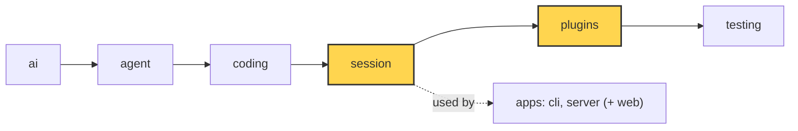

# 18 Part 4 · Profiles and built-in plugins

**Goal:** Pick models by profile and ship two real plugins.

**Builds on:** [17 Context overflow](17-overflow.md) · **Next:** [19 The CLI](19-cli.md)

## Where we are



*This chapter adds `session/profile.py` and fills the `plugins` layer (both marked).*

Big picture of Part 4: [part-4-session](13-0-part-4-session.md).

Code in this chapter (commit `2fc2776`):

- `packages/simp_agent/src/simp_agent/session/profile.py` — `build_model`
- `packages/simp_agent/src/simp_agent/plugins/__init__.py` — `build_plugins`
- `packages/simp_agent/src/simp_agent/plugins/redact_secrets.py` — `RedactSecrets`
- `packages/simp_agent/src/simp_agent/plugins/plan_mode.py` — `PlanMode`
- `packages/simp_agent/tests/test_profile.py`, `apps/cli/tests/test_sockets.py` — the profile and plugin tests

## Problem

Part 4 built a session that saves, retries, compacts and runs plugins. One question is left before the apps of Part 5: how does a user **choose** these things? A user does not write Python. They write a settings file, like this one for the server (`settings.toml`):

```toml
[profiles.local]
api = "openai-completions"
model = "qwen"
base_url = "http://localhost:8000/v1"
api_key_env = "LOCAL_KEY"
context_window = 32000
plugins = ["plan_mode"]
```

A **[profile](glossary.md#profile)** is one named block like this: a plain dict that describes one model setup, plus a few app settings. Each app has its own file: the CLI reads `~/.simp-agent/settings.json`, and the server and the evals ([12](12-evals.md#main-reuse-the-servers-settings)) read `settings.toml`. The shape of a profile is the same in both.

So this chapter has two jobs. Both turn plain text from a settings file into real objects:

1. **`model = "qwen"` and friends → a `Model`** ([01](01-pick-clean.md#in-model-and-context)). Both apps need this, and they must agree on what a profile means.
2. **`plugins = ["plan_mode"]` → plugin objects.** [14](14-plugins.md) built the hooks a plugin can use. Here we write the first two real plugins: one keeps secrets away from the model, and one makes the agent read-only.

## Naive version

Where it plugs in: a profile only makes the inputs of `AgentSession` ([13](13-session.md#one-class-that-owns-the-agent)): the `Model` and the list of plugins ([14](14-plugins.md)). The session, the agent and the loop do not change. First try: pass the dict straight to `Model`:

```python
from simp_agent.ai import Model

def model_for(profile):
    return Model(id=profile.get("model"), **{k: v for k, v in profile.items() if k != "model"})
```

With the `local` profile above, this breaks in five ways:

1. **Wrong key.** `provider` is not in the profile, so it keeps `Model`'s default, `"anthropic"`. The provider name decides which API key `get_api_key` looks up ([01](01-pick-clean.md#1-pick-_providers-register_provider)), so the OpenAI-style server gets the wrong key.
2. **Unknown keys crash.** `plugins=` goes to `Model`, which has no such field: `TypeError`.
3. **A `None` hides a default.** If a profile has no `model` key, `profile.get("model")` is `None`, and `Model(id=None)` throws away `Model`'s own default `id`.
4. **No token counts.** OpenAI-style servers send token usage in a stream only when asked (`stream_options`, which our `compat` flag `include_usage` turns on). Without real usage, `estimate_tokens` ([16](16-compaction.md#when-estimate_tokens-and-should_compact)) can only guess the size of the history.
5. **No plugins.** Nothing turns the name `"plan_mode"` into an object.

## Step by step: from naive to real

| Naive problem | Fix | Where |
|---|---|---|
| 1. wrong key | `provider` comes from `api` | [build_model](#profiles-and-build_model) |
| 2. unknown keys crash | read only known keys | [build_model](#profiles-and-build_model) |
| 3. `None` hides a default | drop every `None` | [build_model](#profiles-and-build_model) |
| 4. no token counts | `include_usage` on, unless the profile says no | [build_model](#profiles-and-build_model) |
| 5. no plugins | a table from name to class, a new object each time | [build_plugins](#build_plugins-names-to-objects) |

## Real design

### Profiles and build_model

Real code: [session/profile.py](../../packages/simp_agent/src/simp_agent/session/profile.py) — `build_model`

```text
// A settings profile (plain dict) -> Model. Shared by the CLI and the server.
FUNCTION build_model(pr):
    api = pr "api", default "anthropic-messages"
    kw:
        id          = pr "model"
        api         = api
        provider    = "openai" IF api starts with "openai" ELSE "anthropic"
        base_url    = pr "base_url"
        api_key_env = pr "api_key_env"
        compat      = a COPY of pr "compat" (empty if missing)
    IF pr has max_tokens or context_window: ADD them to kw
    IF api starts with "openai":
        SET compat include_usage = true, ONLY IF not set yet
    DROP every kw value that is None      // None -> Model's default
    RETURN Model(kw)
```

Each part fixes one naive problem. `provider` now follows `api`: `openai-completions` and `openai-responses` give `"openai"`, all others give `"anthropic"`. Only the keys listed here are read, and `model` becomes `id`; other keys such as `plugins` are left for the app, so one profile can hold model settings and app settings side by side. Every `None` is dropped, so `Model` keeps its own defaults. `include_usage` is set with `setdefault`, so a profile can still say `include_usage = false` for a server that does not support it. And `compat` is a copy, so the settings dict is never changed.

`build_model` lives in the `session` layer, not in an app, because both apps call it and must get the same `Model` from the same profile. The CLI first puts its command-line flags on top of the profile (`resolve_config`) and checks a few things; then it calls `profile.build_model`. The server calls it directly. Neither file holds a key: a profile only has `api_key_env`, the **name** of an env var, and the app reads the key from there ([19](19-cli.md), [22](22-store-auth.md)).

### build_plugins: names to objects

Real code: [plugins/\_\_init\_\_.py](../../packages/simp_agent/src/simp_agent/plugins/__init__.py) — `build_plugins`

```text
FUNCTION build_plugins(names):
    known = "redact_secrets" -> RedactSecrets, "plan_mode" -> PlanMode
    IF any name is not in known:
        RAISE error "unknown plugin ...; have [list]"
    FOR EACH name, in order: MAKE a NEW object of its class
    RETURN the list
```

Why a new object each time? A plugin keeps state, like plan mode's on/off, and each session needs its own. Why raise on a typo? The server calls `build_plugins` once for every profile when it starts (`create_app`), so `plugins = ["plan_mod"]` stops the boot with a clear message instead of failing in the middle of the first chat.

The server always gives each session both built-in plugins, plus any other names from the profile. It also gives `setup` its `config`: the session passes `plugin_config[name]` to each plugin's `setup` ([14](14-plugins.md#the-hooks-in-the-order-they-run)), and the server sets `plugin_config = {"redact_secrets": {"secrets": <its provider keys>}}`. The CLI uses no plugins.

The two names in the table are the two plugins below. Both use only the hooks and the `PluginAPI` from [14](14-plugins.md); nothing in the session knows about them.

### RedactSecrets

The danger: the agent runs `cat .env` and an API key lands in the tool output. From there it goes to the model provider, into the saved history and onto the screen. Or the user pastes a key into their own message. **[RedactSecrets](glossary.md#redactsecrets)** (`plugins/redact_secrets.py`) replaces secrets with `[REDACTED]`.

It finds a secret in two ways. First, by its **shape**:

```python
PATTERNS = re.compile(
    r"sk-[A-Za-z0-9_-]{16,}"  # OpenAI / Anthropic style keys
    r"|eyJ[\w-]+\.[\w-]+\.[\w-]+"  # JWT
    r"|AKIA[0-9A-Z]{16}"  # AWS access key id
    r"|gh[pousr]_[A-Za-z0-9]{30,}"  # GitHub tokens
)
SECRET_ENV = re.compile(r"KEY|TOKEN|SECRET|PASSWORD", re.I)
MASK = "[REDACTED]"
```

Second, by its **value**. `setup` collects known values once:

Real code: [plugins/redact_secrets.py](../../packages/simp_agent/src/simp_agent/plugins/redact_secrets.py) — `RedactSecrets.setup`, `mask`

```text
FUNCTION setup(api, config):
    values = config "secrets" (empty list if missing)
    IF config "env" is on (default on):
        FOR EACH env var whose name has KEY / TOKEN / SECRET / PASSWORD:
            ADD its value to values
    secrets = values with length >= 8, no repeats, LONGEST FIRST

FUNCTION mask(text):
    REPLACE each value in secrets with MASK
    REPLACE each PATTERNS match with MASK
```

Values shorter than 8 characters are skipped: if an env var holds `"1"`, masking every `1` would ruin the output. Longest first matters when one secret contains another. With `abcdefgh` and `abcdefgh123`, masking the short one first would leave `[REDACTED]123`, and part of the long secret would leak.

Then three hooks use `mask`:

Real code: [plugins/redact_secrets.py](../../packages/simp_agent/src/simp_agent/plugins/redact_secrets.py) — `tool_result`, `tool_update`, `context`, `deep`

```text
FUNCTION tool_result(call, result):     // the saved tool result
    masked = mask(result content)
    IF masked is different: REPLACE the content with masked

FUNCTION tool_update(call, text):       // streamed output, before the UI sees it
    RETURN mask(text)

FUNCTION context(messages):             // the model's view of history
    RETURN [deep(m) for each message]   // copies: history keeps the original

FUNCTION deep(x):
    string -> mask(x); list or dict -> deep of each item
    dataclass -> a COPY with deep of each field, except id, signature, type, role
```

`deep` walks every string inside a message: text, thinking and tool call arguments. It skips `id`, `signature`, `type` and `role`, because these are provider data; if we changed them, the next call to the provider would fail.

Example: env var `API_KEY` holds `sk-abc...`.

| | In history (saved) | In the model's view |
|---|---|---|
| tool result of `bash: cat .env` | `API_KEY=[REDACTED]` | `API_KEY=[REDACTED]` |
| user message `my key is sk-abc...` | unchanged | `my key is [REDACTED]` |

Why mask in `context` too, and not only in `tool_result`? Because of the second row. The user's message is theirs, so history keeps it as written, but the model never sees the key. The summary model of compaction does not see it either, because the session hands the same `context` chain to `compact()` ([16](16-compaction.md#compact-putting-it-together)).

### PlanMode

Back to fizzbuzz. The user wants to see the plan before the agent touches any file. They turn **[plan mode](glossary.md#plan-mode)** on and ask "write fizzbuzz.py". The agent may `read` and `ls`, then answers "I will write `fizzbuzz.py` with ...". If it tries `write`, the call is blocked. The user turns plan mode off, and the next prompt writes the file.

Real code: [plugins/plan_mode.py](../../packages/simp_agent/src/simp_agent/plugins/plan_mode.py) — `PlanMode`

```text
BLOCKED = {write, edit, bash}
PROMPT = "PLAN MODE is on: plan only. Read and explore, then describe the plan. ..."

CLASS PlanMode (name "plan_mode"):
    start: enabled = False, api = none

    FUNCTION setup(api, config):
        keep api
        last = the LAST CustomEntry in history with type "plan_mode"
        IF last exists: _apply(last.data enabled)
        ELSE: _apply(config "enabled", default False)   // start value for a new session

    FUNCTION _apply(on):
        enabled = on
        IF on: ADD prompt section "plan_mode" = PROMPT, order 1000   // last
        ELSE: remove prompt section "plan_mode"

    FUNCTION set_enabled(on):
        _apply(on)
        WAIT for api.append_entry("plan_mode", {enabled: on})

    FUNCTION tool_call(call):
        IF enabled AND call.name is in BLOCKED:
            RETURN {block: "plan mode is on (read-only)"}
        RETURN nothing
```

There are two layers. The prompt section ([13](13-session.md#prompt-sections-how-the-system-prompt-is-built)) *asks* the model to plan only; order 1000 puts it after every other section. This saves wasted turns, but a model can ignore a prompt. So the `tool_call` hook *enforces* it: a `write`, `edit` or `bash` call is blocked, and the model gets the usual denial result from [14](14-plugins.md#_hook-one-place-for-every-call), so it knows why.

The on/off state is saved as a `CustomEntry` through `api.append_entry` ([14](14-plugins.md#pluginapi-what-a-plugin-may-do)): it is in history, but never sent to the model. When a session is loaded again, `setup` finds the **last** such entry and restores the state, so plan mode survives a restart with no extra file. `config["enabled"]` is only the start value for a brand-new session.

The app is what calls `set_enabled`. In the server, the web page sends a `SetPlanMode` command, and the server finds the `PlanMode` in `session.plugins` and calls it ([21](21-transport.md)).

## Test

`packages/simp_agent/tests/test_profile.py`:

```python
def test_build_model_openai_defaults():
    m = build_model({"api": "openai-completions", "model": "x", "base_url": "http://h/v1", "context_window": 1000,
                     "api_key_env": "K"})
    assert (m.id, m.api, m.provider, m.base_url, m.api_key_env) == ("x", "openai-completions", "openai", "http://h/v1", "K")
    assert m.compat["include_usage"] is True and m.context_window == 1000


def test_build_model_keeps_explicit_compat():
    m = build_model({"api": "openai-responses", "model": "x", "compat": {"include_usage": False}})
    assert m.compat["include_usage"] is False


def test_build_plugins():
    assert [type(p).__name__ for p in build_plugins(["plan_mode", "redact_secrets"])] == ["PlanMode", "RedactSecrets"]
    with pytest.raises(ValueError, match="unknown plugin"):
        build_plugins(["nope"])
```

The first two tests cover naive problems 1 to 4: `model` becomes `id`, `provider` follows `api`, `include_usage` is on by default, and an explicit `False` is kept. The third checks that names keep their order and a typo raises.

The two plugins are tested inside a full session in `apps/cli/tests/test_sockets.py`. In `test_redact_plugin_masks_key_in_tool_output`, a tool prints a key; the saved result is `"token=[REDACTED] and [REDACTED]"`, the model's view has no key, and history still has the user's own text. In `test_plan_mode_blocks_write_and_survives_resume`, plan mode blocks a `write`, the system prompt has `PLAN MODE`, and a new session loaded from the same `JsonlStore` comes back with plan mode on.

Run them:

```sh
uv run pytest packages/simp_agent/tests/test_profile.py -q
uv run pytest apps/cli/tests/test_sockets.py -k "redact or plan_mode" -q
```

## Why this way

> **One profile function, plugins by name, state in history.** `build_model` is shared, so the CLI and the server read a profile the same way. Plugins are picked by name, so a settings file can turn them on, and a typo fails early. The two built-in plugins use only the public hooks from [14](14-plugins.md); they are proof that the hooks are enough. Plan mode keeps its state as a `CustomEntry`, so resume needs no extra file. The cost: `RedactSecrets` only finds known shapes and known values. A secret with a new shape still gets through.

## Exercises

1. Call `build_model({"api": "openai-completions", "model": "qwen", "plugins": ["plan_mode"]})`. Check `provider`, `max_tokens` and `compat`. Hint: `plugins` is ignored, `max_tokens` keeps `Model`'s default `8192`, and `compat` is `{"include_usage": True}`.
2. Make a `RedactSecrets()`, call `setup(None, {"secrets": ["my-long-password"], "env": False})`, then `mask("pw=my-long-password key=sk-" + "a" * 20)`. Both parts should become `[REDACTED]`. Then try a secret of 5 characters. Hint: values shorter than 8 are skipped on purpose.

## Recap

A profile is plain text in a settings file. `build_model` turns it into a `Model` the same way for every app, and `build_plugins` turns plugin names into fresh objects. `RedactSecrets` keeps secrets out of tool results, the screen and the model's view; `PlanMode` makes the agent read-only and keeps its state in history. Part 4 is now done. In Part 5 we build the apps on top of the session, starting with the CLI in [19](19-cli.md).

**Builds on:** [17 Context overflow](17-overflow.md) · **Next:** [19 The CLI](19-cli.md)
