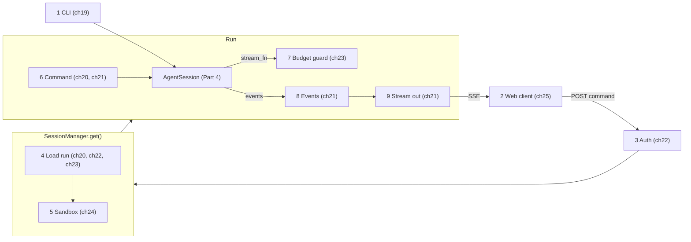

# Part 5 big picture: the system

**In one sentence:** Part 5 builds the apps around `AgentSession`: a terminal app (the CLI) for one user, and a server with a web client for many users. Text goes in, events come out, and everything a client needs to redraw the screen is saved.

Read this page before [19](19-cli.md). Come back to it any time you get lost in [19](19-cli.md)–[26](26-system-tests-deploy.md). It adds no new facts. The plain walk-through comes first; the map (picture and tables) is at the end.

## Example: from one terminal to a team in the browser

After Part 4 we have `AgentSession`: it keeps the chat on disk, retries, compacts and runs plugins. But it is only a Python object. Nobody can type to it yet.

The easy case comes first. The user opens a terminal and types **`simp-agent "write fizzbuzz.py"`**. One program, one user, one session. The program makes an `AgentSession`, prints each event as a line, and asks "allow this?" in the terminal before a tool runs. That is the CLI, and it uses the session directly.

Now the user's team wants the same agent in a browser, on one shared Mac. New problems show up at once:

1. **The browser is not in the same program.** It needs a way to send "write fizzbuzz.py" to the server and a way to get the answer back while it is still being written.
2. **The user reloads the page in the middle of the answer**, or the Wi‑Fi drops. The screen must come back exactly as it was, with no message lost and none shown twice.
3. **Many users share one server.** Each must log in and see only their own sessions. The Mac has limited memory, so not every session can stay loaded.
4. **Every model call costs real money.** One user, or one runaway run, must not spend the whole team's budget.
5. **The agent runs shell commands.** One user's `rm -rf` must not touch another user's files, or the server itself.
6. **We must test all this** in a real browser, without an API key and without paying for model calls, and then keep it running on the Mac.

Somebody must sit between the browser and `AgentSession` and solve all six. **That "somebody" is the server**, with a small web client on the other side.

## The core idea

The session from Part 4 stays the same. The server wraps each loaded session in a **[Run](glossary.md#run)**: a small object that holds the session, its state (idle, running, waiting for approval…) and the list of what has happened so far.

Only two HTTP routes carry everything. **Commands go in** by POST: the browser sends small JSON messages like `{"type": "prompt", "text": "write fizzbuzz.py"}`. **Events come out** by one long-open GET that uses SSE ("server-sent events": the server keeps the reply open and writes one event per line, as they happen).

The key rule is about what is saved. Events are of two kinds. A **[durable event](glossary.md#durable-event)** is a whole thing that happened, like "a message ended" or "a tool gave this result". It gets the next number (`seq`) and is saved. A **[live event](glossary.md#live-event)** is one small text piece as the model types. It is only sent, never saved, because saving every few letters would be slow, and the full message will come later as a durable event anyway. When a browser reconnects, it says "the last number I have is N". The server sends every durable event after N, then one **[snapshot](glossary.md#snapshot)**: the state right now, including the text of the message that is still being written. So the server never loses what a client needs, and a lost text piece does not matter.

## What each chapter adds

**[19 The CLI](19-cli.md): the one-user app.** It reads flags and the settings file, gives `AgentSession` a JSONL file as its store, prints events as lines and asks for tool approval in the terminal (skip with `--yes`). It is the simple case to compare the server with.

**[20 The server run](20-server-run.md): one session on a server.** This builds the `Run`, its states and the allowed moves between them (`TRANSITIONS`), and the command route. It answers problem 1 for commands: a prompt starts a run, a steer or follow-up is queued, an approval answers a waiting tool.

**[21 Transport](21-transport.md): events out, and reconnect.** It builds the protocol (the typed commands and events), the `seq` numbers, durable and live events, the snapshot and the SSE route. This is problem 2.

**[22 Store and auth](22-store-auth.md): many users.** It saves sessions and events in SQLite, so a server restart loses nothing, and checks a login token on every request, so each user sees only their own sessions. Part of problem 3.

**[23 Limits](23-limits.md): memory and money.** It caps how many runs stay loaded (the oldest idle one is closed first) and adds a budget guard in front of every model call, with a daily limit per user and a limit per run. The rest of problem 3, and problem 4.

**[24 Docker sandbox](24-docker-sandbox.md): keep users apart.** Each session gets its own container, and every tool command runs inside it. Problem 5.

**[25 Web client](25-web-client.md): the browser side.** It sends commands, reads the event stream, and turns each event into the next screen state with one pure function, `reduce()`. It is the other half of problems 1 and 2.

**[26 System tests and deploy](26-system-tests-deploy.md): prove it and run it.** A fake model gives the same answer every time, so Playwright tests can click the real web page with no API key. JSON logs, a database backup and launchd services run it on the Mac. Problem 6.

## The map

Now the same system with the real names. Use this as a reference when you read the chapters.

### The picture

There are two paths into the grey box (`AgentSession`, Part 4). Path A (top) is the CLI: it talks to the session directly. Path B (middle row, left to right) is the server: a command goes from the browser through auth, loading and the sandbox to the session. Then read the bottom row right to left: model calls pass the budget guard, events are saved, and they stream back to the browser. The yellow box (10) holds the tools that test and run the whole system. Blocks are steps. Cards on the arrows are the data passed between steps. Each purple tag names the main chapter of a block; the table below lists every chapter that adds to it.

### The blocks

| # | Block | What it does | IN | OUT | Code (file · function) | Chapter |
|---|---|---|---|---|---|---|
| 1 | CLI | Read flags and settings, open a JSONL file for the session, run one `AgentSession`, print events as lines. Ask in the terminal before a tool runs (unless `--yes`). | task text, flags | printed lines, exit code | `apps/cli/src/simp_cli/__init__.py` · `main()`, `run()`, `LinePrinter`; `apps/cli/src/simp_cli/repl.py` · `Repl` | [19](19-cli.md) |
| 2 | Web client | Send each user action as a JSON command with POST. Read events with a fetch-based SSE client, and turn them into screen state with one pure function. | user clicks and text | JSON command; `ChatState` | `apps/web/src/api.ts` · `api`, `subscribe()`; `apps/web/src/state.ts` · `reduce()`, `appendAt()` | [25](25-web-client.md) |
| 3 | Auth | Read the `Bearer` token from the request and find its user. No user → HTTP 401. | HTTP request | user `{id, name}` | `apps/server/src/simp_server/server.py` · `StaticTokenAuth.authenticate()`; `apps/server/src/simp_server/store.py` · `SqliteStore.user_by_token()`, `SqliteStore.login()` | [22](22-store-auth.md) |
| 4 | Load run | Find the session row of this user. If it is not in memory: make room (evict the oldest idle run if at the cap), open its sandbox, rebuild the `Run` from saved entries, and close a run that a crash left busy. | user, session id | `Run` | `apps/server/src/simp_server/server.py` · `SessionManager.get()`, `Run.__init__()`, `Run.recover()` | [20](20-server-run.md), [22](22-store-auth.md), [23](23-limits.md) |
| 5 | Sandbox | Give the session a workspace. With Docker, each session has its own container, and every command runs inside it. | `sandbox_ref` | `ExecutionEnv` (`LocalEnv` or `DockerEnv`) | `apps/server/src/simp_server/sandboxes/docker.py` · `DockerSandbox.open()`, `DockerEnv.exec()` | [24](24-docker-sandbox.md) |
| 6 | Command | Check the JSON body against the protocol (bad → 422). Then: prompt, steer, follow-up, abort, approve, compact, continue or plan mode. Every run state change is checked by `TRANSITIONS`. | `Command` | a run starts, or a message is queued, or an answer is given | `apps/server/src/simp_server/server.py` · `post_command()` in `create_app()`, `Run.command()`, `Run.start()`, `Run.set_state()`; `apps/server/src/simp_server/protocol.py` · `check_transition()` | [20](20-server-run.md), [21](21-transport.md) |
| 7 | Budget guard | Before each model call: is the server paused, the user revoked, or the daily or run limit reached? If yes, return an error message and do not call the model. | model, context | stream events, or a budget error | `apps/server/src/simp_server/budget.py` · `guard()`; `apps/server/src/simp_server/server.py` · `Run.over_budget()` | [23](23-limits.md) |
| 8 | Events | Turn session events into protocol events. Durable events get the next `seq`, go into the log and the store, and are sent. Live deltas are only sent, and fill the in-flight buffer. Each assistant message also saves its usage and cost. | session events | protocol events | `apps/server/src/simp_server/server.py` · `Run.on_event()`, `Run.durable()`, `Run._send()`; `apps/server/src/simp_server/store.py` · `SqliteStore.add_entry()`, `SqliteStore.add_usage()` | [21](21-transport.md), [22](22-store-auth.md), [23](23-limits.md) |
| 9 | Stream out | When a client connects: send the durable events after `N`, then one snapshot, then live events from a queue. Send a ping when idle; drop a client that is too slow. | `after=N` or `Last-Event-ID` | `text/event-stream` | `apps/server/src/simp_server/server.py` · `Run.subscribe()`, `events()` and `gen()` in `create_app()`; `apps/server/src/simp_server/fake.py` · `sse()` | [21](21-transport.md) |
| 10 | Test + run | A fake model and a fake server make the whole system run with no API key. Playwright tests click the real web UI. JSON logs, a database backup, and two launchd services run it on one Mac. | the whole system | passing tests, a running service | `apps/server/src/simp_server/fakellm.py` · `stream()`; `apps/server/src/simp_server/fake.py` · `Hub`; `apps/server/src/simp_server/ops.py` · `JsonFormatter`, `backup()`; `deploy/launchd/` | [26](26-system-tests-deploy.md) |

Not numbered: `AgentSession` (the agent loop, tools, plugins, retry and compaction) is Part 4, [13](13-session.md)–[18](18-profiles-plugins.md). The server entry point `apps/server/src/simp_server/__main__.py` · `main()` only picks a mode ([20](20-server-run.md)).

### Which block is inside which

The CLI (1) and the server (2–9) are two apps on the same `AgentSession`. The CLI gives it a `JsonlStore` and a terminal `ask` function; the server gives it the `Run` as the store and `Run.approve` as the approve function. Every HTTP route for a session first runs Auth (3), then `SessionManager.get()`, which is Load run (4) plus opening the Sandbox (5). Commands (6), Events (8) and Stream out (9) are all methods of `Run`. The budget guard (7) wraps the model call: `Run` passes `budget.guard(stream_fn, over_budget)` to `AgentSession` as its `stream_fn`, so every model call, and the title call, goes through it. Events (8) is a session subscriber (`session.subscribe(self.on_event)`), and core messages and protocol events share one `seq` counter. Test + run (10) sits outside the flow: it swaps the model (FakeLLM) or the whole server (`fake.py`) and keeps the rest real.

### The objects

| Object | Fields | Meaning |
|---|---|---|
| [Protocol](glossary.md#protocol) | `Command` and `ServerEvent` models | The typed messages between server and client. The TypeScript types in `protocol.gen.ts` are generated from them. |
| [Run](glossary.md#run) | `session`, `env`, `log`, `seq`, `inflight`, `pending`, `subs`, `info`, `task`, `run_start`, … | One loaded session on the server. |
| [Run state](glossary.md#run-state) | `idle`, `running`, `waiting_approval`, `aborting`, `error` | Where the run is. Allowed moves are in `TRANSITIONS`. |
| [Durable event](glossary.md#durable-event) | `seq`, `type`, … | Saved to the store with a number; sent again on reconnect. |
| [Live event](glossary.md#live-event) | `msg_id` or `call_id`, `offset`, `delta` | A small text piece, sent only, never saved. |
| [Snapshot](glossary.md#snapshot) | `last_seq`, `run_state`, `in_flight`, `pending_approval`, `title`, `plan_mode` | The state "right now", sent after the missed events. |
| [In-flight buffer](glossary.md#in-flight-buffer) | `msg_id`, `thinking`, `text`, `tool_outputs` | The text of the message that is still streaming. |
| [Sandbox](glossary.md#sandbox) | `open()`, `close()`, `remove()` | Gives each session its `ExecutionEnv`. |
| [Budget guard](glossary.md#budget-guard) | `Limits`: `user_day_usd` (2.0), `run_usd` (0.5) | Stops a model call when a limit is reached. |
| `ChatState` | `lastSeq`, `runState`, `items`, `inFlight`, `pending`, … | What the web client draws. `reduce()` makes the next one from an event. |

### The worked example with all blocks

You log in to the web app and type "write fizzbuzz.py" in a new session. The app POSTs `{"type": "prompt", "text": "write fizzbuzz.py"}` to `/api/sessions/{sid}/commands` (2); its event stream is already open. The `Bearer` token in the header finds your user (3). The session is new, so `SessionManager.get()` builds an empty `Run` (4), and with Docker the session gets its own container, where the `write` tool will put `fizzbuzz.py` (5). The run is `idle`, so `Run.start()` moves it to `running` and starts `session.prompt(...)` as a task (6). Before the model call, `over_budget()` checks the limits; you spent less than $2.0 today, so the call goes on (7). Text pieces go out as live `TextDelta` events; when the message ends, a durable `AssistantMessage` is saved with its usage, and the `write` call ends as a durable `ToolResult` (8). Your browser gets each event as an SSE line and `reduce()` draws it (9).

Now you reload the page while the model is still typing its last sentence. The page has nothing, so it opens the stream again with `Last-Event-ID: 0`, and the server sends every durable event (the message, the tool result), then a snapshot: run state `running`, plus the half-written text in the in-flight buffer. New text pieces then arrive live, and the screen looks as if nothing happened. If only the network drops and the page stays open, the client sends its last seq in the same header and gets only what it missed.

In the Playwright tests (10) the same flow runs against FakeLLM, so the answer is always the same and no API key is needed. In a terminal, `simp-agent "write fizzbuzz.py"` (1) skips blocks 2–9: it makes the `AgentSession` itself and prints the events.

## Builds on / Next

- Builds on: [Part 4 big picture](13-0-part-4-session.md) and [13 Sessions](13-session.md)–[18 Profiles and built-in plugins](18-profiles-plugins.md).
- Chapters: [19 The CLI](19-cli.md) · [20 The server run](20-server-run.md) · [21 Transport](21-transport.md) · [22 Store and auth](22-store-auth.md) · [23 Limits](23-limits.md) · [24 Docker sandbox](24-docker-sandbox.md) · [25 Web client](25-web-client.md) · [26 System tests and deploy](26-system-tests-deploy.md).
- Next: [27 Choices, limits and extending](27-limits-choices-extend.md).
