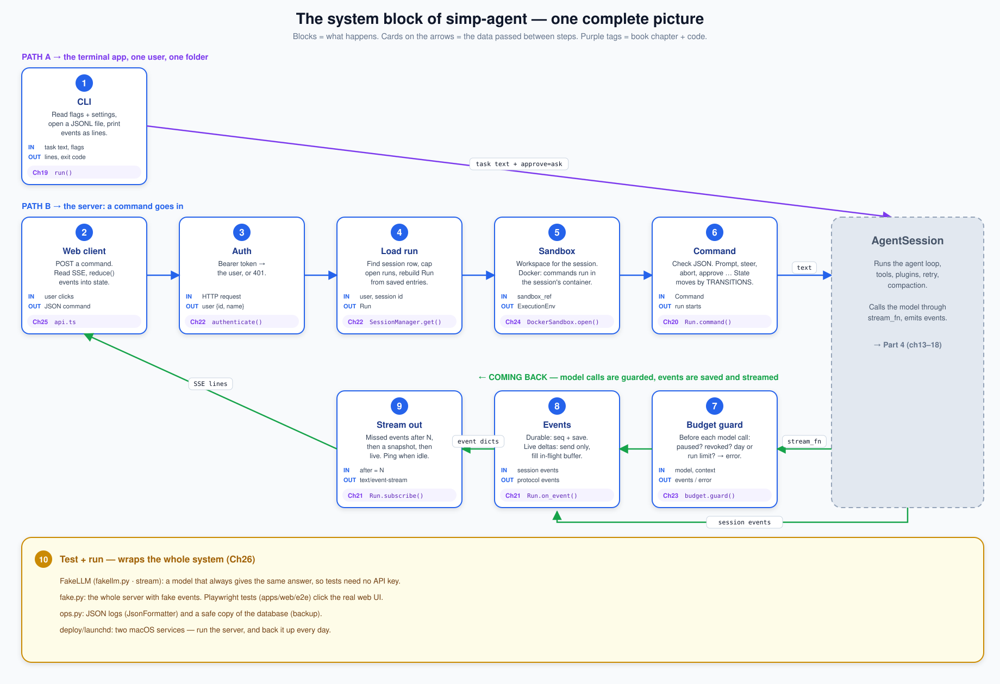
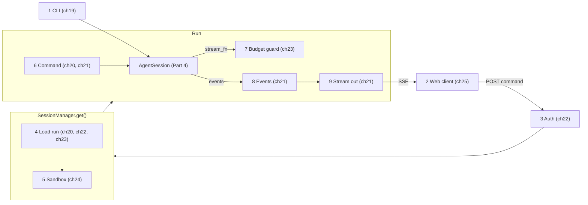

# Part 5 big picture: the system

**In one sentence:** Part 5 builds the apps around `AgentSession`: a terminal app (the CLI) for one user, and a server with a web client for many users. A task text goes in (typed in a terminal, or sent as a JSON command over HTTP). Events come out (printed lines, or an SSE stream), and every message and event is saved.

Read this page before [19](19-cli.md), and come back to it any time you get lost in [19](19-cli.md)–[26](26-system-tests-deploy.md). It adds no new facts; it only puts the pieces of those eight chapters side by side.

## The picture

There are two paths into the grey box (`AgentSession`, Part 4). Path A (top) is the CLI: it talks to the session directly. Path B (middle row, left to right) is the server: a command goes from the browser through auth, loading and the sandbox to the session. Then read the bottom row right to left: model calls pass the budget guard, events are saved, and they stream back to the browser. The yellow box (10) holds the tools that test and run the whole system. Blocks are steps. Cards on the arrows are the data passed between steps. Purple tags say which chapter builds the block.

## The blocks

| # | Block | What it does | IN | OUT | Code (file · function) | Chapter |
|---|---|---|---|---|---|---|
| 1 | CLI | Read flags and settings, open a JSONL file for the session, run one `AgentSession`, print events as lines. Ask in the terminal before a tool runs (unless `--yes`). | task text, flags | printed lines, exit code | `apps/cli/src/simp_cli/__init__.py` · `main()`, `run()`, `LinePrinter`; `apps/cli/src/simp_cli/repl.py` · `Repl` | [19](19-cli.md) |
| 2 | Web client | Send each user action as a JSON command with POST. Read events with a fetch-based SSE client, and turn them into screen state with one pure function. | user clicks and text | JSON command; `ChatState` | `apps/web/src/api.ts` · `api`, `subscribe()`; `apps/web/src/state.ts` · `reduce()`, `appendAt()` | [25](25-web-client.md) |
| 3 | Auth | Read the `Bearer` token from the request and find its user. No user → HTTP 401. | HTTP request | user `{id, name}` | `apps/server/src/simp_server/server.py` · `StaticTokenAuth.authenticate()`; `apps/server/src/simp_server/store.py` · `SqliteStore.user_by_token()`, `SqliteStore.login()` | [22](22-store-auth.md) |
| 4 | Load run | Find the session row of this user. If it is not in memory: make room (evict the oldest idle run if at the cap), open its sandbox, rebuild the `Run` from saved entries, and close a run that a crash left busy. | user, session id | `Run` | `apps/server/src/simp_server/server.py` · `SessionManager.get()`, `Run.__init__()`, `Run.recover()` | [20](20-server-run.md), [22](22-store-auth.md), [23](23-limits.md) |
| 5 | Sandbox | Give the session a workspace. With Docker, each session has its own container, and every command runs inside it. | `sandbox_ref` | `ExecutionEnv` (`LocalEnv` or `DockerEnv`) | `apps/server/src/simp_server/sandboxes/docker.py` · `DockerSandbox.open()`, `DockerEnv.exec()` | [24](24-docker-sandbox.md) |
| 6 | Command | Check the JSON body against the protocol (bad → 422). Then: prompt, steer, follow-up, abort, approve, compact, continue or plan mode. Every run state change is checked by `TRANSITIONS`. | `Command` | a run starts, or a message is queued, or an answer is given | `apps/server/src/simp_server/server.py` · `post_command()` in `create_app()`, `Run.command()`, `Run.start()`, `Run.set_state()`; `apps/server/src/simp_server/protocol.py` · `check_transition()` | [20](20-server-run.md), [21](21-transport.md) |
| 7 | Budget guard | Before each model call: is the server paused, the user revoked, or the daily or run limit reached? If yes, return an error message and do not call the model. | model, context | stream events, or a budget error | `apps/server/src/simp_server/budget.py` · `guard()`; `apps/server/src/simp_server/server.py` · `Run.over_budget()` | [23](23-limits.md) |
| 8 | Events | Turn session events into protocol events. Durable events get the next `seq`, go into the log and the store, and are sent. Live deltas are only sent, and fill the in-flight buffer. Each assistant message also saves its usage and cost. | session events | protocol events | `apps/server/src/simp_server/server.py` · `Run.on_event()`, `Run.durable()`, `Run._send()`; `apps/server/src/simp_server/store.py` · `SqliteStore.add_entry()`, `SqliteStore.add_usage()` | [21](21-transport.md), [22](22-store-auth.md), [23](23-limits.md) |
| 9 | Stream out | When a client connects: send the durable events after `N`, then one snapshot, then live events from a queue. Send a ping when idle; drop a client that is too slow. | `after=N` or `Last-Event-ID` | `text/event-stream` | `apps/server/src/simp_server/server.py` · `Run.subscribe()`, `events()` and `gen()` in `create_app()`; `apps/server/src/simp_server/fake.py` · `sse()` | [21](21-transport.md) |
| 10 | Test + run | A fake model and a fake server make the whole system run with no API key. Playwright tests click the real web UI. JSON logs, a database backup, and two launchd services run it on one Mac. | the whole system | passing tests, a running service | `apps/server/src/simp_server/fakellm.py` · `stream()`; `apps/server/src/simp_server/fake.py` · `Hub`; `apps/server/src/simp_server/ops.py` · `JsonFormatter`, `backup()`; `deploy/launchd/` | [26](26-system-tests-deploy.md) |

Not numbered: `AgentSession` (the agent loop, tools, plugins, retry and compaction) is Part 4, [13](13-session.md)–[18](18-profiles-plugins.md). The server entry point `apps/server/src/simp_server/__main__.py` · `main()` only picks a mode ([20](20-server-run.md)).

## Which block is inside which

- **The CLI (1) and the server (2–9) are two apps on the same `AgentSession`.** The CLI gives it a `JsonlStore` and a terminal `ask` function. The server gives it a `Run` as the store and `Run.approve` as the approve function.
- **A `Run` is the server's wrapper around one `AgentSession`.** It holds the session, the durable event log, the in-flight buffer, the run state and the open client queues. Blocks 6, 8 and 9 are all `Run` methods.
- **`SessionManager.get()` = Load run (4) + Sandbox open (5).** Every HTTP route for a session calls it first, after Auth (3).
- **Budget guard (7) wraps the model call.** `Run` passes `budget.guard(stream_fn, over_budget)` to `AgentSession` as its `stream_fn`, so every model call (and the title call) goes through it.
- **Events (8) is a session subscriber.** `Run.__init__` calls `session.subscribe(self.on_event)`. `Run.append` is the store method; core messages and protocol events share one `seq` counter.
- **Two HTTP routes carry everything:** POST `/api/sessions/{sid}/commands` for commands in (6), and GET `/api/sessions/{sid}/events` for events out (9).
- **Test + run (10) is outside the flow.** It swaps the model (FakeLLM) or the whole server (`fake.py`) and keeps the rest real.

The small chart below shows only the nesting:

**Rule for the whole Part:** the server never loses what a client needs. Every durable event is kept in the run's log and in the store, so a client that reconnects gets the missed events and a snapshot. Live deltas may be lost; the snapshot fills the gap.

## The objects

| Object | Fields | Meaning |
|---|---|---|
| [Protocol](glossary.md#protocol) | `Command` and `ServerEvent` models | The typed messages between server and client. The TypeScript types in `protocol.gen.ts` are generated from them. |
| [Run](glossary.md#run) | `session`, `log`, `seq`, `inflight`, `pending`, `subs`, `info` | One loaded session on the server. |
| [Run state](glossary.md#run-state) | `idle`, `running`, `waiting_approval`, `aborting`, `error` | Where the run is. Allowed moves are in `TRANSITIONS`. |
| [Durable event](glossary.md#durable-event) | `seq`, `type`, … | Saved to the store with a number; sent again on reconnect. |
| [Live event](glossary.md#live-event) | `msg_id` or `call_id`, `offset`, `delta` | A small text piece, sent only, never saved. |
| [Snapshot](glossary.md#snapshot) | `last_seq`, `run_state`, `in_flight`, `pending_approval`, `title`, `plan_mode` | The state "right now", sent after the missed events. |
| [In-flight buffer](glossary.md#in-flight-buffer) | `msg_id`, `thinking`, `text`, `tool_outputs` | The text of the message that is still streaming. |
| [Sandbox](glossary.md#sandbox) | `open()`, `close()`, `remove()` | Gives each session its `ExecutionEnv`. |
| [Budget guard](glossary.md#budget-guard) | `Limits`: `user_day_usd` (2.0), `run_usd` (0.5) | Stops a model call when a limit is reached. |
| `ChatState` | `lastSeq`, `runState`, `items`, `inFlight`, `pending`, … | What the web client draws. `reduce()` makes the next one from an event. |

## One worked example: "write fizzbuzz.py" from the browser

You log in to the web app and type "write fizzbuzz.py" in a new session.

1. **CLI:** not used here. In a terminal, `simp-agent "write fizzbuzz.py"` would make an `AgentSession` with a JSONL store and print the events itself.
2. **Web client:** the app POSTs `{"type": "prompt", "text": "write fizzbuzz.py"}` to `/api/sessions/{sid}/commands`. It already has the events stream open.
3. **Auth:** the `Bearer` token in the header finds your user.
4. **Load run:** the session is new and not in memory, so `SessionManager.get()` builds a `Run` with no messages.
5. **Sandbox:** with Docker, the session gets its own container; the `write` tool will put `fizzbuzz.py` in its workspace.
6. **Command:** the run is `idle`, so `Run.start()` moves it to `running` and runs `session.prompt(...)` as a task.
7. **Budget guard:** before the model call, `over_budget()` checks the limits. You spent less than $2.0 today, so the call goes on.
8. **Events:** text deltas go out as live `TextDelta` events. When the message ends, a durable `AssistantMessage` event is saved with its usage. The `write` call ends as a durable `ToolResult`. At the end the run goes back to `idle`.
9. **Stream out:** your browser gets each event as an SSE line, and `reduce()` draws it. If you reload the page, it reconnects with `after=N` and gets the missed events plus a snapshot.
10. **Test + run:** in the Playwright tests the same flow runs against FakeLLM, so the answer is always the same and no API key is needed.

## Builds on / Next

- Builds on: [Part 4 big picture](13-0-part-4-session.md) and [13 Sessions](13-session.md)–[18 Profiles and built-in plugins](18-profiles-plugins.md).
- Chapters: [19 The CLI](19-cli.md) · [20 The server run](20-server-run.md) · [21 Transport](21-transport.md) · [22 Store and auth](22-store-auth.md) · [23 Limits](23-limits.md) · [24 Docker sandbox](24-docker-sandbox.md) · [25 Web client](25-web-client.md) · [26 System tests and deploy](26-system-tests-deploy.md).
- Next: [27 Choices, limits and extending](27-limits-choices-extend.md).
