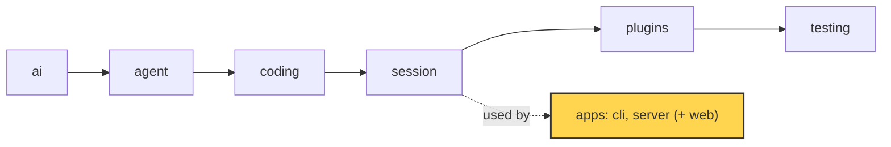

# 19 Part 5 · The CLI

**Goal:** Wrap the session in a terminal app.

**Builds on:** [18 Profiles and built-in plugins](18-profiles-plugins.md) · **Next:** [20 The server run](20-server-run.md)

## Where we are



*This chapter builds the first app: `apps/cli` (marked). It only uses the library; the library does not know it exists.*

Big picture of Part 5: [part-5-system](19-0-part-5-system.md).

Code in this chapter (commit `2fc2776`):

- `apps/cli/src/simp_cli/__init__.py` — `JsonlStore`, `session_dir`, `LinePrinter`, `run`, `main`
- `apps/cli/src/simp_cli/repl.py` — `Repl`
- `apps/cli/src/simp_cli/components.py` — `UserMsg`, `AssistantMsg`, `ToolCall`, `Notice`, `Chat`
- `apps/cli/tests/test_cli.py`, `apps/cli/tests/test_tui.py` — the CLI tests

## Problem

At the end of Part 4 we have an `AgentSession` ([13](13-session.md)) with plugins, retry, compaction and profiles ([14](14-plugins.md)–[18](18-profiles-plugins.md)). It can write `fizzbuzz.py`. But you can only use it from Python code.

A person at a terminal needs more:

- Type `simp-agent "write fizzbuzz.py"` and see the answer as it streams.
- Talk for many turns, and come back tomorrow to the same conversation.
- Type while the agent works, to steer it ([07](07-steering.md)).
- Press Ctrl-C to stop a run, without killing the program.
- Say yes or no before the agent runs `bash` or writes a file ([08](08-hooks-approval.md)).

The CLI is the thin layer that does this. It lives in `apps/cli/src/simp_cli/` (the three files are listed at the top).

## Naive version

The first idea: a loop with `input()` and one `asyncio.run` per line.

```text
session = new AgentSession(Model())
ON each event:
    IF it is message_end of an assistant message:
        PRINT the message text

LOOP forever:
    line = read a line from the keyboard ("> ")
    IF input ended, or line is empty or "/exit": STOP
    START a new event loop, run session.prompt(line), WAIT until it ends
```

This is a sketch, not code from the repo.

It works for one fizzbuzz turn. It breaks when:

1. **Nothing streams.** You see the answer only at `message_end`. A long answer looks like a hang.
2. **You cannot type while it runs.** `input()` is not called until `asyncio.run` returns. So no steering, no follow-up.
3. **Ctrl-C kills everything.** It raises `KeyboardInterrupt` and the program dies. It does not call `session.abort()` ([06](06-events-abort.md)).
4. **Nothing is saved.** There is no store, so no resume.
5. **No approval.** The agent runs `bash` with no question.
6. **Each line makes a new event loop.** `asyncio.run` is called again and again on one session. Async state from the last run is gone.

## Real design

The real CLI fixes each break above; each section says which one. It also splits into two modes: a simple **print mode** for one task, and a full **REPL** for chat.

### main: pick a mode

`apps/cli/src/simp_cli/__init__.py`:

```text
task = the -p text, or else all plain words joined
IF there is a task:
    EXIT with the code from run(task, model, args)    // print mode
load the repl module now                              // needs the `cli` extra
EXIT with the code from repl(model, args)
```

Real code: [apps/cli/src/simp_cli/__init__.py](../../apps/cli/src/simp_cli/__init__.py), function `main`.

`main()` reads flags with `argparse`. If there is a task (`-p "task"` or plain words), it runs **[print mode](glossary.md#print-mode)**. With no task, it starts the **[REPL](glossary.md#repl)**. The REPL import is inside `main`, so print mode does not load `prompt_toolkit`.

`pyproject.toml` maps the command to this function: `simp-agent = "simp_cli:main"`.

### Keys come from the environment

Before it picks a mode, `main` builds the model. `resolve_config` takes a profile from `~/.simp-agent/settings.json` ([18](18-profiles-plugins.md)) and puts CLI flags on top. One CLI rule matters here: **an API key is never read from the file**. Why: a settings file is easy to share or commit by mistake.

So `resolve_config` removes `"api_key"` from the profile. The file can only name an environment variable, `api_key_env`. Example:

- settings: `{"api_key_env": "MY_KEY"}`, and `$MY_KEY` is set → the key is `$MY_KEY`.
- `$MY_KEY` not set → `OPENAI_API_KEY` for OpenAI-style APIs (or `"dummy"`, for servers with no key), else `ANTHROPIC_API_KEY`.

Real code: [apps/cli/src/simp_cli/__init__.py](../../apps/cli/src/simp_cli/__init__.py), functions `resolve_config` and `env_api_key`.

`env_api_key(model)` is the CLI's `get_api_key`. Providers never read the environment themselves ([01](01-pick-clean.md#1-pick-_providers-register_provider)); the app does.

### Sessions on disk

Both modes use `JsonlStore` from [13](13-session.md). Each working folder has its own sessions:

```text
FUNCTION session_dir(cwd):
    name = cwd without "/" at the ends, with each "/" changed to "-"
    RETURN folder SESSIONS / name
```

Real code: [apps/cli/src/simp_cli/__init__.py](../../apps/cli/src/simp_cli/__init__.py), function `session_dir`.

Example: working in `/Users/a/proj` → sessions live in `~/.simp-agent/sessions/Users-a-proj/`, one `<id>.jsonl` file per session. This fixes break 4 (nothing saved).

So `-c` / `--continue` means "the latest session **for this folder**". `latest_session(cwd)` picks the file with the newest modified time. `--resume ID` opens one session by id. A new session gets `uuid.uuid4().hex[:8]` as its id.

### Print mode

Print mode fixes breaks 1, 3 and 5: it streams, Ctrl-C only aborts, and it asks before risky tools.

`run(task, model, args)` is print mode. The heart of it:

```text
store = JsonlStore(file "<sid>.jsonl" in session_dir(cwd))
session = AgentSession(model, tools, store,
                       messages = store.load(),            // resume
                       get_api_key = env_api_key(model),
                       approve = none IF -y ELSE ask)
session sends each event to a new LinePrinter
WHEN Ctrl-C comes: call session.abort()
```

Real code: [apps/cli/src/simp_cli/__init__.py](../../apps/cli/src/simp_cli/__init__.py), function `run`.

Four things happen:

- The store is loaded and passed as `messages=`. That is the resume pattern from [13](13-session.md).
- `approve=None if args.yes else ask`. With `-y`, nothing asks. Else `ask` asks on the terminal (see below).
- Ctrl-C (`SIGINT`) calls `session.abort()`. The run stops cleanly. The program does not die.
- A `LinePrinter` subscribes to session events.

At the end, `run` returns exit code `1` if the last message has `stop_reason` `"error"` or `"aborted"`, else `0`. So a shell script can check if the task worked.

**Why a `LinePrinter`?** Print mode output often goes to a file or a pipe. Printing every token makes a mess there. `LinePrinter` keeps deltas in a buffer and prints only full lines:

```text
FUNCTION _add(text, dim):
    IF dim is not the same as last time:
        flush what is in buf             // never mix dim and normal text on one line
    ADD text to buf
    split buf at each new line; the last, unfinished piece stays in buf
    FOR EACH finished line: PRINT it
```

Real code: [apps/cli/src/simp_cli/__init__.py](../../apps/cli/src/simp_cli/__init__.py), method `LinePrinter._add`.

Thinking text is dim, but only when `self.out.isatty()`. In a pipe there are no **[ANSI codes](glossary.md#ansi-codes)**. Tool calls print as `> bash: ...`, and tool errors as `  ! ...`.

### The REPL

`repl.py` builds a `prompt_toolkit` `Application`. It is **not** full screen. The layout has three rows:

```text
RETURN an Application with:
    rows, top to bottom: live, prompt, bar
    keyboard focus on prompt
    redraw every 0.5 s
    erase itself when done
```

Real code: [apps/cli/src/simp_cli/repl.py](../../apps/cli/src/simp_cli/repl.py), method `Repl.build_app`.

- `live`: the `Chat.live` components, plus the approval question if one is waiting.
- `prompt`: one input line. Its prefix is `> `, `… ` while running, or `Allow? [y/N/a] ` while asking.
- `bar`: a toolbar with model id, session id, about how many tokens (`estimate_tokens` from [16](16-compaction.md)), and state (`idle`, `running`, `compacting`, `retrying`).

Finished components go above the app with `run_in_terminal`. Why not full screen? Because then the text stays in the normal terminal: you can scroll back and copy it like any other output.

The input and the agent run at the same time. `start` makes the run a task and returns:

```text
FUNCTION start(run):
    start run as a background task, and RETURN at once
```

Real code: [apps/cli/src/simp_cli/repl.py](../../apps/cli/src/simp_cli/repl.py), method `Repl.start`.

So the input line stays alive while the agent works. This fixes breaks 1, 2 and 6 of the naive version: one event loop, streaming, and typing during a run.

### Components

The `live` row above is filled with small **[components](glossary.md#component)** from `components.py`. A component is any object with `render(width) -> list[str]`:

```text
COMPONENT UserMsg(text):
    FUNCTION render(width):
        RETURN the lines of "> " + text in bold, drawn at this width
```

Real code: [apps/cli/src/simp_cli/components.py](../../apps/cli/src/simp_cli/components.py), class `UserMsg`.

`_render` uses `rich` to draw into a string, not into the real terminal. So `render` is pure: a test can call `render(80)` and read the lines.

There are four components: `UserMsg`, `AssistantMsg`, `ToolCall` and `Notice`. Some details:

- `AssistantMsg` shows plain text while streaming and Markdown only when `done`. The comment says why: "half-done markdown jumps around".
- `ToolCall` shows at most `TOOL_LINES = 12` lines of output, then `… (N more lines)`.
- A `CompactionEntry` ([16](16-compaction.md)) shows as the notice `— earlier history compacted —`.

`Chat` turns messages and events into components. It has two places:

- `live`: components still changing (the streaming answer, tools waiting for a result).
- `commit(c)`: a finished component. It goes to normal terminal scrollback, once.

The key method is `on_message`. It takes one finished message:

```text
FUNCTION on_message(m):     // called by live message_end AND by resume replay
    IF m is a user message:   commit UserMsg(m)
    IF m is an assistant message:
        drop the streaming component from live
        commit AssistantMsg(m), if it has something to show
        FOR EACH tool call in m: ADD a ToolCall to live      // waits for its result
    IF m is a tool result:    take its ToolCall out of live, add the result, commit it
    IF m is a compaction:     commit Notice("— earlier history compacted —")
```

Real code: [apps/cli/src/simp_cli/components.py](../../apps/cli/src/simp_cli/components.py), method `Chat.on_message`.

Example, fizzbuzz. One assistant message comes in: text "I will write it." and a call `write(path="fizzbuzz.py")`.

- Scrollback gets the lines of `I will write it.` (now Markdown, as it is done).
- `live` gets a `ToolCall` for `write: fizzbuzz.py`, still waiting.
- Then the tool result message comes in. The same `ToolCall` leaves `live`, gets the result, and goes to scrollback once.

Live events call it on `message_end`. Resume calls it too, through `replay(messages)`. One path for both means a resumed fizzbuzz session looks the same as when it ran live. `test_replay_equals_live` in `apps/cli/tests/test_tui.py` checks exactly this.

### Routing input

What a line means depends on the state. That logic is a pure function in `__init__.py`, so it is easy to test:

```text
FUNCTION route(line, running):        // gives back (kind, text)
    text = line without spaces at the ends
    IF text is empty:        RETURN ("empty", "")
    IF text starts with "/": RETURN ("command", text)
    IF running:
        IF text starts with ">>": RETURN ("follow_up", text after ">>", trimmed)
        ELSE:                     RETURN ("steer", text)
    RETURN ("prompt", text)
```

Real code: [apps/cli/src/simp_cli/__init__.py](../../apps/cli/src/simp_cli/__init__.py), function `route`.

`Repl.submit` acts on the result:

- `prompt` → `self.start(self.session.prompt(text))`.
- `steer` → `self.session.steer(text)`. A **[steer](glossary.md#steer)** message goes in at the next turn ([07](07-steering.md)).
- `follow_up` → `self.session.follow_up(text)`. Runs after the agent would stop.
- `command` → `Repl.command`: `/help`, `/history`, `/new`, `/sessions`, `/compact`, `/exit`.

Some commands need an idle agent. While running, `/new`, `/sessions` and `/compact` say `busy: Ctrl-C to abort first`.

`submit` checks two states before `route`. If an approval is waiting, the line is the answer. If a session list is shown (`/sessions` or `-r`), the line is a number to pick.

Ctrl-C uses another pure function:

```text
FUNCTION interrupt_action(running, last_idle_ctrl_c, now):
    // Ctrl-C gives: "abort" (while running)
    //               "exit"  (second one within 2 s when idle)
    //               "warn"  (else)
```

Real code: [apps/cli/src/simp_cli/__init__.py](../../apps/cli/src/simp_cli/__init__.py), function `interrupt_action`.

While running, Ctrl-C aborts the run. When idle, the first Ctrl-C only warns; a second one within 2 seconds exits. Ctrl-D on an empty line also exits.

### Approval in the terminal

The session already has the approval policy ([08](08-hooks-approval.md)). In `session/__init__.py`, `approve(call)` returns `"allow"`, `"deny"` or `"always"`. Only `bash`, `write` and `edit` ask (`needs_approval`). `"always"` adds the tool name to `always_allowed`. The CLI only has to ask the human.

Both modes turn the typed text into an answer with one function:

```text
FUNCTION approval_answer(text):
    t = text trimmed and in lower case
    IF t is "y" or "yes":       RETURN "allow"
    IF t is "a" or "always":    RETURN "always"
    RETURN "deny"
```

Real code: [apps/cli/src/simp_cli/__init__.py](../../apps/cli/src/simp_cli/__init__.py), function `approval_answer`.

Anything else is `"deny"`. The safe answer is the default.

**In print mode**, `ask` is a plain blocking `input()`:

```text
FUNCTION ask(call):     // blocking input is fine: nothing else runs while a tool waits
    PRINT "? " + describe_call(call)
    REMOVE the Ctrl-C handler for now     // so Ctrl-C raises inside input()
    TRY:   RETURN approval_answer(input("Allow? [y/N/a] "))
    IF Ctrl-C:        call session.abort(); RETURN "deny"
    IF input ended:   RETURN "deny"
    ALWAYS at the end: put the Ctrl-C handler back (it calls session.abort)
```

Real code: [apps/cli/src/simp_cli/__init__.py](../../apps/cli/src/simp_cli/__init__.py), function `ask` inside `run`.

**In the REPL**, a blocking `input()` would freeze the screen. So `approve` is async and waits on a future:

```text
FUNCTION approve(call):      // async
    pending = a new empty future, holding call
    redraw the screen                     // the question shows
    WAIT for pending to get an answer
    RETURN that answer
    ALWAYS at the end: pending = none, redraw the screen
```

Real code: [apps/cli/src/simp_cli/repl.py](../../apps/cli/src/simp_cli/repl.py), method `Repl.approve`.

The question shows in the live region. The next Enter calls `submit`, which sees `self.pending` and runs `self.pending.set_result(approval_answer(line))`. Ctrl-C while asking sets `"deny"` and then aborts.

`describe_call` makes the question short: `bash: <command>`, or `<tool>: <path>` for `write`, `edit` and `read` (for example `write: fizzbuzz.py`).

## Test

`apps/cli/tests/test_cli.py::test_route`:

```python
def test_route():
    assert cli.route("hi", False) == ("prompt", "hi")
    assert cli.route("hi", True) == ("steer", "hi")
    assert cli.route(">> later", True) == ("follow_up", "later")
    assert cli.route("/new", True) == ("command", "/new")
    assert cli.route("  ", True) == ("empty", "")
```

What it checks:

- The same text `hi` is a new `prompt` when idle, but a `steer` while running.
- `>>` while running is a `follow_up`, and the `>>` is removed.
- A `/` line is always a command, even while running.
- Spaces only is `empty`.

No terminal, no model, no event loop. That is why `route` is a pure function and the REPL "only wires it to the terminal" (the comment above it in `__init__.py`).

Other tests in the same files use the same idea:

- `test_approval_answer_default_no` and `test_interrupt_action` test the other pure functions.
- `test_deny_skips_tool` and `test_always_asks_once_and_read_never_asks` run an `AgentSession` on `FakeProvider` ([04](04-label-test.md)) with an `approve` function.
- `test_print_mode_full_lines_no_ansi` (in `test_tui.py`) feeds deltas to `LinePrinter` and checks it prints only full lines, with no ANSI.
- `test_pty_streaming_screen` starts a real REPL in a pseudo terminal and reads the screen with `pyte`. It checks that the answer shows while it still streams.

Run them:

```sh
uv run pytest apps/cli/tests/test_cli.py apps/cli/tests/test_tui.py -q
```

## Why this way

> **A thin app over the session, with pure logic pulled out.** The CLI adds no agent behaviour. Saving, approval policy, steering and abort all live in `AgentSession`; the CLI only connects keys and screen to them. Rules that are easy to get wrong (`route`, `approval_answer`, `interrupt_action`, `LinePrinter`, component `render`) are pure and unit tested. The REPL is not full screen, so finished output stays in normal scrollback. The cost: two modes with two `ask` functions, and the REPL itself is mostly tested by one slow pty test.

## Exercises

1. Run `route(">> later", False)` in your head. What does it return? (Answer: `("prompt", ">> later")`. `>>` only counts while running.)
2. In `approval_answer`, what does the text `"Y "` return? Why? (Answer: `"allow"`. It uses `strip().lower()`.)

## Recap

- `main()` picks **print mode** (a task is given) or the **REPL** (no task).
- Sessions are JSONL files per working folder; `-c` continues the latest, `--resume ID` opens one.
- Print mode prints full lines only, aborts on Ctrl-C, and returns exit code 1 on error or abort.
- Components render to lines; `Chat.on_message` is shared by live events and resume replay.
- The REPL runs the agent as a task, so you can steer, follow up and abort while it works.
- `route` decides what a line means; `approval_answer` turns `y` / `a` / anything into allow / always / deny.

**Builds on:** [18 Profiles and built-in plugins](18-profiles-plugins.md) · **Next:** [20 The server run](20-server-run.md)
