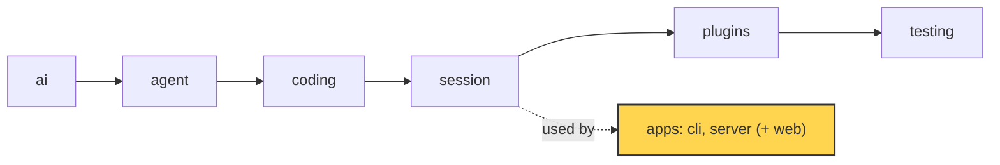

# 19 Part 5 · The CLI

**Goal:** Wrap the session in a terminal app.

**Builds on:** [18-profiles-plugins](18-profiles-plugins.md) · **Next:** [20-server-run](20-server-run.md)



*This chapter builds the first app: `apps/cli` (marked). It only uses the library; the library does not know it exists.*

## Problem

At the end of Part 4 we have an `AgentSession` ([13](13-session.md)) with plugins, retry, compaction and profiles ([14](14-plugins.md)–[18](18-profiles-plugins.md)). It can write `fizzbuzz.py`. But you can only use it from Python code.

A person at a terminal needs more:

- Type `simp-agent "write fizzbuzz.py"` and see the answer as it streams.
- Talk for many turns, and come back tomorrow to the same conversation.
- Type while the agent works, to steer it ([07](07-steering.md)).
- Press Ctrl-C to stop a run, without killing the program.
- Say yes or no before the agent runs `bash` or writes a file ([08](08-hooks-approval.md)).

The CLI is the thin layer that does this. It lives in `apps/cli/src/simp_cli/` and has three files:

| File | What it does |
|---|---|
| `__init__.py` | Settings, `JsonlStore`, pure input logic, print mode, `main()` |
| `components.py` | Turns messages and events into lines of text to show |
| `repl.py` | The interactive app built on `prompt_toolkit` |

## Naive version

The first idea: a loop with `input()` and one `asyncio.run` per line.

```python
import asyncio
from simp_agent.ai import Model
from simp_agent.session import AgentSession

def show(e):
    if e["type"] == "message_end" and e["message"].role == "assistant":
        print(e["message"].text())

session = AgentSession(Model())
session.subscribe(show)

while True:
    try:
        line = input("> ")
    except EOFError:
        break
    if line.strip() in ("", "/exit"):
        break
    asyncio.run(session.prompt(line))  # blocks until the run ends
```

It works for one fizzbuzz turn. It breaks when:

1. **Nothing streams.** You see the answer only at `message_end`. A long answer looks like a hang.
2. **You cannot type while it runs.** `input()` is not called until `asyncio.run` returns. So no steering, no follow-up.
3. **Ctrl-C kills everything.** It raises `KeyboardInterrupt` and the program dies. It does not call `session.abort()` ([06](06-events-abort.md)).
4. **Nothing is saved.** There is no store, so no resume.
5. **No approval.** The agent runs `bash` with no question.
6. **Each line makes a new event loop.** `asyncio.run` is called again and again on one session. Async state from the last run is gone.

The real CLI fixes each point. It also splits into two modes: a simple **print mode** for one task, and a full **REPL** for chat.

## Step by step: from naive to real

**Step 1: stream and print full lines.** Print deltas as they come, but keep a buffer and print only full lines.

```python
*lines, self.buf = self.buf.split("\n")
for line in lines:
    self._line(line)
```

Why: the answer shows while it runs, and files or pipes get clean lines. This is `LinePrinter`.

**Step 2: handle Ctrl-C.** Call `session.abort()` instead of dying.

```python
loop.add_signal_handler(signal.SIGINT, session.abort)
```

Why: the run stops cleanly and the program lives on.

**Step 3: save the session.** Use one `JsonlStore` file per working folder, and load it as `messages=`.

```python
store = JsonlStore(session_dir(cwd) / f"{sid}.jsonl")
session = AgentSession(model, make_tools(args.bash_max_timeout_s), store, messages=store.load(), ...)
```

Why: `-c` and `--resume ID` can open the same chat later.

**Step 4: ask before risky tools.** Pass `approve=` to the session. Anything but yes is "deny".

```python
approve=None if args.yes else ask
```

Why: `bash`, `write` and `edit` need a human answer. `-y` turns the question off.

**Step 5: run the agent as a task.** Start the run with `asyncio.ensure_future` and keep one event loop.

```python
def start(self, coro) -> None:
    self.task = asyncio.ensure_future(coro)
```

Why: the input line stays alive, so you can type while the agent works.

**Step 6: route each line.** One pure function decides what a line means (`route`, shown below). Then the REPL wires it to the session.

Why: it is easy to test without a terminal.

## Real design

### main: pick a mode

`apps/cli/src/simp_cli/__init__.py`:

```python
    task = a.print_task or " ".join(a.task)
    if task:
        sys.exit(asyncio.run(run(task, model, a)))
    from .repl import repl  # needs the `cli` extra

    sys.exit(asyncio.run(repl(model, a)))
```

`main()` reads flags with `argparse`. If there is a task (`-p "task"` or plain words), it runs **[print mode](glossary.md#print-mode)**. With no task, it starts the **[REPL](glossary.md#repl)**. The REPL import is inside `main`, so print mode does not load `prompt_toolkit`.

`pyproject.toml` maps the command to this function: `simp-agent = "simp_cli:main"`.

Before the mode, `main` builds the model. `resolve_config` takes a profile from `~/.simp-agent/settings.json` and puts CLI flags on top. Profiles are explained in [18](18-profiles-plugins.md). One CLI rule matters here: keys never come from the file.

```python
    cfg.pop("api_key", None)
```

Only the name of an environment variable (`api_key_env`) can be in settings. `env_api_key(model)` is the CLI's `get_api_key`: it reads that variable, then falls back to `OPENAI_API_KEY` or `ANTHROPIC_API_KEY`. Providers never read the environment themselves ([04](04-providers.md)); the app does.

### Sessions on disk

Both modes use `JsonlStore` from [13](13-session.md). Each working folder has its own sessions:

```python
def session_dir(cwd: str) -> Path:
    return SESSIONS / cwd.strip("/").replace("/", "-")
```

So `-c` / `--continue` means "the latest session **for this folder**". `latest_session(cwd)` picks the file with the newest modified time. `--resume ID` opens one session by id. A new session gets `uuid.uuid4().hex[:8]` as its id.

### Print mode

`run(task, model, args)` is print mode. The heart of it:

```python
    store = JsonlStore(session_dir(cwd) / f"{sid}.jsonl")
    session = AgentSession(model, make_tools(args.bash_max_timeout_s), store, messages=store.load(),
                           get_api_key=env_api_key(model), approve=None if args.yes else ask)
    session.subscribe(LinePrinter(args.thinking))
    loop.add_signal_handler(signal.SIGINT, session.abort)
```

Four things happen:

- The store is loaded and passed as `messages=`. That is the resume pattern from [13](13-session.md).
- `approve=None if args.yes else ask`. With `-y`, nothing asks. Else `ask` asks on the terminal (see below).
- Ctrl-C (`SIGINT`) calls `session.abort()`. The run stops cleanly. The program does not die.
- A `LinePrinter` subscribes to session events.

At the end, `run` returns exit code `1` if the last message has `stop_reason` `"error"` or `"aborted"`, else `0`. So a shell script can check if the task worked.

**Why a `LinePrinter`?** Print mode output often goes to a file or a pipe. Printing every token makes a mess there. `LinePrinter` keeps deltas in a buffer and prints only full lines:

```python
    def _add(self, text: str, dim: bool) -> None:
        if dim != self.dim:
            self.flush()
        self.dim, self.buf = dim, self.buf + text
        *lines, self.buf = self.buf.split("\n")
        for line in lines:
            self._line(line)
```

Thinking text is dim, but only when `self.out.isatty()`. In a pipe there are no **[ANSI codes](glossary.md#ansi-codes)**. Tool calls print as `> bash: ...`, and tool errors as `  ! ...`.

### Components

The REPL shows richer output. It uses small **[components](glossary.md#component)** in `components.py`. A component is any object with `render(width) -> list[str]`:

```python
class UserMsg:
    def __init__(self, text: str):
        self.text = text

    def render(self, width: int) -> list[str]:
        return _render(width, Text("> " + self.text, style="bold"))
```

`_render` uses `rich` to draw into a string, not into the real terminal. So `render` is pure: a test can call `render(80)` and read the lines.

There are four components: `UserMsg`, `AssistantMsg`, `ToolCall` and `Notice`. Some details:

- `AssistantMsg` shows plain text while streaming and Markdown only when `done`. The comment says why: "half-done markdown jumps around".
- `ToolCall` shows at most `TOOL_LINES = 12` lines of output, then `… (N more lines)`.
- A `CompactionEntry` ([16](16-compaction.md)) shows as the notice `— earlier history compacted —`.

`Chat` turns messages and events into components. It has two places:

- `live`: components still changing (the streaming answer, tools waiting for a result).
- `commit(c)`: a finished component. It goes to normal terminal scrollback, once.

The key method is `on_message`:

```python
    def on_message(self, m) -> None:
        """One finished message. Used by live message_end AND by resume replay."""
```

Live events call it on `message_end`. Resume calls it too, through `replay(messages)`. One path for both means a resumed fizzbuzz session looks the same as when it ran live. `test_replay_equals_live` in `apps/cli/tests/test_tui.py` checks exactly this.

### The REPL

`repl.py` builds a `prompt_toolkit` `Application`. It is **not** full screen. The layout has three rows:

```python
        return Application(Layout(HSplit([live, prompt, bar]), focused_element=prompt), key_bindings=kb,
                           refresh_interval=0.5, erase_when_done=True)
```

- `live`: the `Chat.live` components, plus the approval question if one is waiting.
- `prompt`: one input line. Its prefix is `> `, `… ` while running, or `Allow? [y/N/a] ` while asking.
- `bar`: a toolbar with model id, session id, about how many tokens (`estimate_tokens` from [16](16-compaction.md)), and state (`idle`, `running`, `compacting`, `retrying`).

Finished components go above the app with `run_in_terminal`. Why not full screen? Because then the text stays in the normal terminal: you can scroll back and copy it like any other output.

The input and the agent run at the same time. `start` makes the run a task and returns:

```python
    def start(self, coro) -> None:
        self.task = asyncio.ensure_future(coro)
```

So the input line stays alive while the agent works. This fixes points 1, 2 and 6 of the naive version: one event loop, streaming, and typing during a run.

### Routing input

What a line means depends on the state. That logic is a pure function in `__init__.py`, so it is easy to test:

```python
def route(line: str, running: bool) -> tuple[str, str]:
    """Input line -> (kind, text). kind: empty | command | prompt | steer | follow_up."""
    text = line.strip()
    if not text:
        return "empty", ""
    if text.startswith("/"):
        return "command", text
    if running:
        return ("follow_up", text[2:].strip()) if text.startswith(">>") else ("steer", text)
    return "prompt", text
```

`Repl.submit` acts on the result:

- `prompt` → `self.start(self.session.prompt(text))`.
- `steer` → `self.session.steer(text)`. A **[steer](glossary.md#steer)** message goes in at the next turn ([07](07-steering.md)).
- `follow_up` → `self.session.follow_up(text)`. Runs after the agent would stop.
- `command` → `Repl.command`: `/help`, `/history`, `/new`, `/sessions`, `/compact`, `/exit`.

Some commands need an idle agent. While running, `/new`, `/sessions` and `/compact` say `busy: Ctrl-C to abort first`.

`submit` checks two states before `route`. If an approval is waiting, the line is the answer. If a session list is shown (`/sessions` or `-r`), the line is a number to pick.

Ctrl-C uses another pure function:

```python
def interrupt_action(running: bool, last_idle_ctrl_c: float | None, now: float) -> str:
    """Ctrl-C -> abort (while running) | exit (second one within 2s when idle) | warn."""
```

While running, Ctrl-C aborts the run. When idle, the first Ctrl-C only warns; a second one within 2 seconds exits. Ctrl-D on an empty line also exits.

### Approval in the terminal

The session already has the approval policy ([08](08-hooks-approval.md)). In `session/__init__.py`, `approve(call)` returns `"allow"`, `"deny"` or `"always"`. Only `bash`, `write` and `edit` ask (`needs_approval`). `"always"` adds the tool name to `always_allowed`. The CLI only has to ask the human.

Both modes turn the typed text into an answer with one function:

```python
def approval_answer(text: str) -> str:
    return {"y": "allow", "yes": "allow", "a": "always", "always": "always"}.get(text.strip().lower(), "deny")
```

Anything else is `"deny"`. The safe answer is the default.

**In print mode**, `ask` is a plain blocking `input()`:

```python
    def ask(call) -> str:  # blocking input is fine here: nothing else runs while a tool waits
        print(f"? {describe_call(call)}", flush=True)
        loop.remove_signal_handler(signal.SIGINT)  # let Ctrl-C raise in input()
```

It removes the Ctrl-C handler for a moment, so Ctrl-C raises `KeyboardInterrupt` in `input()`. Then it calls `session.abort()` and returns `"deny"`. End of input (`EOFError`) is also `"deny"`. The `finally` puts the handler back.

**In the REPL**, a blocking `input()` would freeze the screen. So `approve` is async and waits on a future:

```python
    async def approve(self, call) -> str:
        self.pending = asyncio.get_running_loop().create_future()
        self.pending.call = call
        self.invalidate()
        try:
            return await self.pending
        finally:
            self.pending = None
            self.invalidate()
```

The question shows in the live region. The next Enter calls `submit`, which sees `self.pending` and runs `self.pending.set_result(approval_answer(line))`. Ctrl-C while asking sets `"deny"` and then aborts.

`describe_call` makes the question short: `bash: <command>`, or `write: <path>` for `write`, `edit` and `read`.

## Test

`apps/cli/tests/test_cli.py::test_route`:

```python
def test_route():
    assert cli.route("hi", False) == ("prompt", "hi")
    assert cli.route("hi", True) == ("steer", "hi")
    assert cli.route(">> later", True) == ("follow_up", "later")
    assert cli.route("/new", True) == ("command", "/new")
    assert cli.route("  ", True) == ("empty", "")
```

What it checks:

- The same text `hi` is a new `prompt` when idle, but a `steer` while running.
- `>>` while running is a `follow_up`, and the `>>` is removed.
- A `/` line is always a command, even while running.
- Spaces only is `empty`.

No terminal, no model, no event loop. That is why `route` is a pure function and the REPL "only wires it to the terminal" (the comment above it in `__init__.py`).

Other tests in the same files use the same idea:

- `test_approval_answer_default_no` and `test_interrupt_action` test the other pure functions.
- `test_deny_skips_tool` and `test_always_asks_once_and_read_never_asks` run an `AgentSession` on `FakeProvider` ([02](02-fake-provider.md)) with an `approve` function.
- `test_print_mode_full_lines_no_ansi` (in `test_tui.py`) feeds deltas to `LinePrinter` and checks it prints only full lines, with no ANSI.
- `test_pty_streaming_screen` starts a real REPL in a pseudo terminal and reads the screen with `pyte`. It checks that the answer shows while it still streams.

Run them:

```sh
uv run pytest apps/cli/tests/test_cli.py apps/cli/tests/test_tui.py -q
```

## Why this way

> **A thin app over the session, with pure logic pulled out.** The CLI adds no agent behaviour. Saving, approval policy, steering and abort all live in `AgentSession`; the CLI only connects keys and screen to them. Rules that are easy to get wrong (`route`, `approval_answer`, `interrupt_action`, `LinePrinter`, component `render`) are pure and unit tested. The REPL is not full screen, so finished output stays in normal scrollback. The cost: two modes with two `ask` functions, and the REPL itself is mostly tested by one slow pty test.

## Exercises

1. Run `route(">> later", False)` in your head. What does it return? (Answer: `("prompt", ">> later")`. `>>` only counts while running.)
2. In `approval_answer`, what does the text `"Y "` return? Why? (Answer: `"allow"`. It uses `strip().lower()`.)

## Recap

- `main()` picks **print mode** (a task is given) or the **REPL** (no task).
- Sessions are JSONL files per working folder; `-c` continues the latest, `--resume ID` opens one.
- Print mode prints full lines only, aborts on Ctrl-C, and returns exit code 1 on error or abort.
- Components render to lines; `Chat.on_message` is shared by live events and resume replay.
- The REPL runs the agent as a task, so you can steer, follow up and abort while it works.
- `route` decides what a line means; `approval_answer` turns `y` / `a` / anything into allow / always / deny.

**Builds on:** [18-profiles-plugins](18-profiles-plugins.md) · **Next:** [20-server-run](20-server-run.md)

