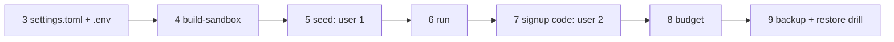

# 20 — Operator tutorial

> **Who this is for:** an operator — the person who runs the server for a small team on one Mac.
> **What you need first:** [01 Quick start](01-quick-start.md) (Path B), and the words
> [sandbox](glossary.md#sandbox) and [profile](glossary.md#profile). Your users read
> [11 The web UI](11-web.md).
> **What you will learn:** one path, in order: write the settings, build the Docker sandbox,
> make two users (one with `seed`, one with a signup code), start the server, see the budget,
> and do a backup and restore drill.
> **Code paths covered:** `apps/server/src/simp_server/server.py` (`load_settings`, `take_keys`,
> `check_sandbox`, `signup`, `main`), `__main__.py`, `ops.py`, `budget.py`,
> `sandboxes/docker.py`, `apps/server/sandboxes/Dockerfile`.
> **Verified at commit:** `a8615b1`. Steps 5–9 were run with `allow_local_sandbox = true` (LocalSandbox). Step 4 and the Docker
> sandbox were **not run**: Docker was not installed on the test machine. They are
> marked *(not run)*. Please tell the Editor if one is wrong.

This chapter gives only the order of the steps. Each step ends with a **Home** link to the
chapter that explains it in full.

## 1. What you will build



Everything lives in one **home folder**, `~/.simp-server` (or the folder in `$SIMP_SERVER_HOME`).

## 2. What you need

- A Mac with [uv](https://docs.astral.sh/uv/) and **Docker Desktop**. Start Docker Desktop
  first; `docker info` must work.
- The repo, set up as in [01](01-quick-start.md#2-get-the-code-both-paths): `uv sync`.
- A model API key. (No key? Use `--fake-llm` in step 6; the budget in step 8 then stays at $0.)

Run all commands from the repo folder.

## 3. Write the settings and the key

```sh
mkdir -p ~/.simp-server
cat > ~/.simp-server/settings.toml <<'EOF'
default_profile = "claude"
signup_code = "change-me-please"

[plugins]
sandbox = "simp_server.sandboxes.docker:DockerSandbox"

[profiles.claude]
api = "anthropic-messages"
model = "claude-sonnet-5-5"
api_key_env = "ANTHROPIC_API_KEY"
price_in = 3      # USD per 1M input tokens
price_out = 15    # USD per 1M output tokens

[budget]
user_day_usd = 2.0
run_usd = 0.5
EOF
echo 'ANTHROPIC_API_KEY=sk-ant-...' > ~/.simp-server/.env
chmod 600 ~/.simp-server/.env
```

Why each part:

- `signup_code` lets people create their own account on the login page. Without it, sign-up is
  closed (error 403).
- `sandbox = ...DockerSandbox` gives each [session](glossary.md#session) its own container.
  Why you need it: see step 5.
- `price_in` / `price_out` let the server compute cost. **Without prices every call costs $0 and
  no budget ever stops it.** The server only logs a warning at start.
- The key goes in `.env`, not in `settings.toml`. A key you `export` in your shell is not seen by
  a server that is started later by launchd, so use `.env`.

**Home:** [21 Configuration reference](21-configuration.md) (all keys), 24 Money and limits.

## 4. Build the sandbox image *(not run)*

```sh
uv run simp-server build-sandbox
```

This runs `docker build` on `apps/server/sandboxes/Dockerfile` and makes the image
`simp-sandbox:latest`. It is slow the first time only. Do it once, and again if the Dockerfile
changes.

**Home:** 23 Sandboxes.

## 5. Make user 1 with `seed`

```sh
uv run simp-server seed --name hung
```

It prints one line: the user's [access token](glossary.md#access-token). **Copy it now.** It is
shown once.

**Why Docker matters (a warning you can see).** If the sandbox were still `LocalSandbox`, a second
`seed` would print its token **and** this warning (real output):

```text
warning: 2 users but the sandbox is LocalSandbox (no isolation). Run `simp-server build-sandbox` and set [plugins] sandbox = "simp_server.sandboxes.docker:DockerSandbox" (or SIMP_SANDBOX=docker), or set allow_local_sandbox = true. A running server keeps going; it refuses to start next time.
```

With `LocalSandbox`, tools run on your Mac as you. That is fine for one person, not for several.
So the server **refuses to start** with several users and `LocalSandbox`, and sign-up is refused
too. In this tutorial `settings.toml` already names `DockerSandbox`, so you will not see it.

**Home:** [22 Users and accounts](22-users.md).

## 6. Start the server

```sh
uv run simp-server run          # port 8766
# no key?  uv run simp-server run --fake-llm
```

Startup can take about ten seconds. Wait for the log line `Uvicorn running on
http://127.0.0.1:8766`. Logs are JSON lines. In a second terminal, check it:

```sh
curl -s -XPOST http://127.0.0.1:8766/api/hello -H 'content-type: application/json' -d '{"protocol_version":1}'
```

For the browser, start the web UI as in [01](01-quick-start.md#44-start-it), or run `make dev`
instead of `simp-server run` (it builds the image and uses Docker when Docker runs).

The server listens on `127.0.0.1` only. Opening it to your network needs two settings (`host` and
`allowed_hosts`): see [chapter 21](21-configuration.md#2-top-level-keys). Leave it local for now.

**Home:** [21 Configuration reference](21-configuration.md), 25 Day-to-day ops.

## 7. Make user 2 with the signup code

Open the web UI, press **Create account**, and enter a name (2–32 of `a-z 0-9 _ -`), a password
(at least 8 characters) and the code `change-me-please`. Or do the same in the terminal:

```sh
curl -s -XPOST http://127.0.0.1:8766/api/signup -H 'content-type: application/json' \
  -d '{"name":"ann","password":"password1","code":"change-me-please"}'
```

A good reply is `{"token":"..."}`. A wrong code gives
`{"detail":"sign-up is closed or the invite code is wrong"}`. Check both users:

```sh
uv run simp-server users
```

```text
ann	active
hung	active
```

Give the signup code only to people you trust: anyone with it can make an account that spends
your money.

**Home:** [22 Users and accounts](22-users.md) (passwords, `revoke`, `rotate`).

## 8. See the budget

Each user may spend `user_day_usd` per day (since local midnight) and `run_usd` per run. See a
user's spend with their token:

```sh
curl -s http://127.0.0.1:8766/api/usage -H "authorization: Bearer <token>"
```

```text
{"today_usd":0,"day_limit_usd":2.0,"paused":false}
```

The web UI shows the same in the chat header, as `$0.00 / $2`. After real chats `today_usd`
grows. At the limit, the next LLM call is refused with a `budget` error.

**Kill switch.** Stop every LLM call for **everyone** at once, then lift it:

```sh
uv run simp-server pause     # prints: paused
uv run simp-server resume    # prints: resumed
```

Limits are *soft*: calls already running may finish and push a user a little over.

**Home:** [24 Money and limits](24-money.md).

## 9. Restore drill

A backup you never restored is only a hope. Do this drill once now, not on the day you need it.
Do it with the server stopped, and only on a home you can afford to break.

**9.1 Make a backup** (safe even while the server runs):

```sh
uv run simp-server backup --to ~/simp-backups
```

It prints the file, for example `~/simp-backups/simp-20261012-153123.tar.gz`. It holds `simp.db`
(users and history), `settings.toml`, `workspaces/` and `sandboxes/`. It does **not** hold `.env`:
keep your keys somewhere safe yourself.

**9.2 Break it on purpose.** Stop the server (`Ctrl-C`), then delete the database:

```sh
rm ~/.simp-server/simp.db*
uv run simp-server users        # prints nothing: all users are gone
```

**9.3 Restore:**

```sh
tar xzf ~/simp-backups/simp-20261012-153123.tar.gz -C ~/.simp-server
uv run simp-server users
```

```text
ann	active
hung	active
```

Start the server again (step 6) and log in. Note: `tar` overwrites `settings.toml` and
`workspaces/` with the backup's copy; `.env` is not touched.

**Home:** [25 Day-to-day ops](25-ops.md) (daily backups with launchd, upgrades).

## 10. What you did

You wrote `settings.toml` and `.env`, built the sandbox, made a user with `seed` and one with a
signup code, saw the spend and the kill switch, and proved that a backup restores. Not covered
here: running as a service, logs and upgrades (25), the security model (26), problems (27).

> **Test note.** On a machine without Docker, I ran steps 5–9 with `allow_local_sandbox = true`
> instead of DockerSandbox and `--fake-llm`. The two-user list, the 403 on a wrong code, the usage
> JSON, pause/resume, the LocalSandbox warning and the restore all behaved as shown. The Docker
> build and container start are the untested part.

---

**Next:** [21 Configuration reference](21-configuration.md), then [22 Users and accounts](22-users.md), 23 Sandboxes, 24 Money and
limits, 25 Day-to-day ops, 26 Security model and known gaps, 27 Troubleshooting.

*(Next: [21](21-configuration.md), [25](25-ops.md), [27](27-troubleshooting.md).)*

**Back:** [13 Working well with the agent](13-working-well.md), [01 Quick start](01-quick-start.md).

**Built on by:** 21–27 (Part 2).
