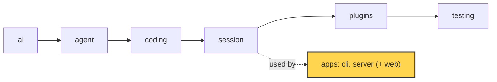
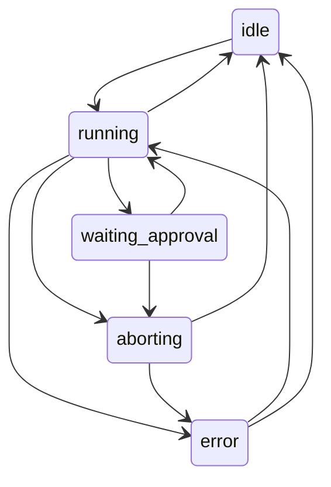

# 20 Part 5 · The server run

**Goal:** Run a session on a server with a typed protocol.

**Builds on:** [19 The CLI](19-cli.md), [13 Sessions](13-session.md), [06 Events and abort](06-events-abort.md) · **Next:** [21 Transport](21-transport.md)

## Where we are



*This chapter starts the `server` app (marked). It uses the `session` layer from the outside.*

Big picture of Part 5: [part-5-system](19-0-part-5-system.md).

Code in this chapter (commit `2fc2776`):

- `apps/server/src/simp_server/protocol.py` — the protocol models, `Snapshot`, `TRANSITIONS`, `check_transition`
- `apps/server/src/simp_server/server.py` — `Run`, `SessionManager`
- `apps/server/src/simp_server/gen_protocol.py` — writes `protocol.gen.ts`
- `apps/server/src/simp_server/__main__.py` — `main`
- `apps/server/tests/test_protocol.py` — the protocol tests

## Problem

In [19](19-cli.md) you ran the agent in a terminal: one person, one screen, one Python program. Now picture a team. Ana opens a browser tab and types "write `fizzbuzz.py`". The agent works for two minutes. She sees the text stream in, answers an approval for `bash`, then closes her laptop. An hour later she opens the tab again and wants to see the whole story.

The terminal never had these problems. A run takes minutes, but an HTTP request should not wait that long, so the run must live on the server, not inside one request. The browser is TypeScript and the server is Python: two programs that must agree on every message shape, or one side breaks in silence when the other renames a field. Many things can happen at once: Ana can send a prompt while a run is busy, press "abort" twice, or answer an approval that is already gone, so the server must say what is allowed *now*. And a tab that closes and comes back must see the full story.

This chapter builds two things. A **[protocol](glossary.md#protocol)** is the fixed list of messages that go between server and browser. A **[Run](glossary.md#run)** is one server object per conversation: it owns the `AgentSession` ([13](13-session.md)), turns its events into protocol messages, and keeps one clear **[run state](glossary.md#run-state)**, a name like `idle` or `running`. Do not mix it up with an agent [run](glossary.md#run-agent) ([05](05-agent-loop.md)): the `Run` lives as long as the conversation, and it starts many agent runs, one per prompt.

## Starting point: 19's `run()`, behind a web request

[19](19-cli.md#print-mode) ended with print mode. Its heart makes one `AgentSession` ([13](13-session.md)) and prints its events ([06](06-events-abort.md)):

```text
store = JsonlStore(file "<sid>.jsonl" in session_dir(cwd))
session = AgentSession(model, tools, store,
                       messages = store.load(),
                       get_api_key = env_api_key(model),
                       approve = none IF -y ELSE ask)
session sends each event to a new LinePrinter
WHEN Ctrl-C comes: call session.abort()
```

Real code: [apps/cli/src/simp_cli/__init__.py](../../apps/cli/src/simp_cli/__init__.py), function `run`.

The server is a second front door to this same `AgentSession`. The simplest move: put this code inside an HTTP handler, run `session.prompt(text)`, wait, and return the messages. It breaks when:

1. **The run is long.** The request hangs for minutes. Proxies and browsers time out. The user sees no live text, because no `LinePrinter` is there to get the events.
2. **Two prompts come at once.** Both call `session.prompt()` on the same session. Two loops now share one message list.
3. **The body is any dict.** `{"txt": "hi"}` gives a `KeyError` and a 500. Nothing tells the browser what shapes exist.
4. **The tab reloads.** The answer of the running request is lost. There is no way to say "give me what I missed". (Fixed in [21](21-transport.md).)
5. **Approval** ([08](08-hooks-approval.md)) cannot work: `ask` reads the terminal, and the request is blocked, so the user has no way to send "allow". (Fixed in [21](21-transport.md).)

## Real design

The server lives in `apps/server/src/simp_server/`. We build it by following one request, Ana's "write fizzbuzz.py", from start to end: the server starts, the prompt comes in, the server finds the `Run` for the session, the `Run` drives the agent through its states, events go out, and a side call names the session. Each step fixes one or more of the breaks above. Last, we give the browser the same message types.

This chapter owns the **messages** and the **Run's state**. [21 Transport](21-transport.md) then moves them over the wire: the `seq` counter, replay after a reconnect, the command queue and approval (problems 4 and 5). [22 Store and auth](22-store-auth.md) saves the log and loads a session again.

### Starting the server

*Step 1.* Before any request, we need a command to start the server. `apps/server/src/simp_server/__main__.py` looks at the first word. `simp-server run` starts the real server in `server.py`. The other words (`seed`, `passwd`, `users`, `revoke`, `rotate`, `backup`, `pause`, `resume`) are admin commands from [22](22-store-auth.md) and [23](23-limits.md). `build-sandbox` builds the sandbox image ([24](24-docker-sandbox.md)). Anything else runs a fake server (`fake.py`) that plays a scripted run with no model. **Why a fake:** the web client and its browser tests ([25](25-web-client.md), [26](26-system-tests-deploy.md)) can then run with no API key and no cost.

Real code: [apps/server/src/simp_server/__main__.py](../../apps/server/src/simp_server/__main__.py), function `main`.

### Protocol models

*Step 2.* The server is up, and the browser sends its first JSON. To read it safely, we need typed messages.

**Problem 3:** the body is any dict, and the browser does not know which shapes exist.

**What we do:** `apps/server/src/simp_server/protocol.py` is the single source of truth for the wire. Every message is a Pydantic model, and they all share one base:

```text
BASE MODEL _M for every message:
    unknown field         -> error           // extra="forbid"
    fields with a default -> "required" in the schema
```

Real code: [apps/server/src/simp_server/protocol.py](../../apps/server/src/simp_server/protocol.py), class `_M`.

**Why Pydantic:** one class gives us checking on the way in, JSON on the way out, and a JSON Schema for TypeScript (the last step, below). **Why these rules:** `extra="forbid"` turns `{"type": "prompt", "txt": "hi"}` into a clear error, not a silent drop. The second rule sounds backwards, but think of the server's output: when the server sends a model, every field with a default is filled in, so it is always in the JSON. Marking it "required" lets TypeScript trust that it is there, with no `?` and no `undefined` checks.

Every model has a `type` field with one fixed value, like `type: Literal["prompt"] = "prompt"`. That field is the **[discriminator](glossary.md#discriminator)**: one field whose value says which model the JSON is.

```text
Command = ONE OF Prompt, Steer, FollowUp, Abort, Approve,
                 Compact, Continue, SetPlanMode
          (pick which one by the "type" field)
```

Real code: [apps/server/src/simp_server/protocol.py](../../apps/server/src/simp_server/protocol.py), `Command`.

Example: IN `{"type": "prompt", "text": "write fizzbuzz.py"}` → Pydantic reads `type`, checks only the `Prompt` model → OUT `Prompt(text="write fizzbuzz.py")`.

There are three groups of messages. The **handshake** comes first: the browser sends `Hello(protocol_version=...)`, and `check_hello` answers with a `Hello`, or a `HelloError` that lists the supported versions (`SUPPORTED_VERSIONS = {1}`). So an old tab learns at once that the server changed. Then the browser sends **commands**, and each maps to a session feature you already know: steering and follow-up ([07](07-steering.md)), abort ([06](06-events-abort.md)), approval ([08](08-hooks-approval.md)), compaction ([16](16-compaction.md)) and plan mode ([18](18-profiles-plugins.md)). The server sends back **server events**, of two kinds. A **[durable event](glossary.md#durable-event)** has a `seq` number (a counter, one per event; [21](21-transport.md) owns it) and is saved. A **[live event](glossary.md#live-event)** is a streaming piece of text: no `seq`, not saved, because the full text is saved later in the `AssistantMessage` and `ToolResult` events. A **[snapshot](glossary.md#snapshot)** tells a tab that (re)connects "where we are now", including text still streaming.

The full list of event names and every `Snapshot` field is in [ref-objects · Server protocol messages](ref-objects.md#server-protocol-messages). How they are used is [21](21-transport.md).

### The Run

*Step 3.* The prompt is parsed. Now the server needs the one object that owns this conversation.

**Problems 1 and 2:** a run takes minutes, and two prompts must never start two loops on one session.

**What we do:** one owner per conversation. `apps/server/src/simp_server/server.py` has `class Run`. Its docstring: "AgentSession + durable protocol log + in-flight buffers." Every HTTP route asks `SessionManager.get(user, sid)` for the `Run` of a session. On first use it loads the saved log, opens the sandbox and makes one `Run`; after that it returns the same `Run` from `self.runs`. So two requests for one session always reach the same object.

The constructor builds an `AgentSession`. Look for `this Run` below: the `Run` passes itself in three places.

```text
session = new AgentSession(model,
              store       = this Run,             // Run has append()
              env         = env,
              stream_fn   = guarded_stream,       // budget check, see 23
              get_api_key = the manager's key for this model,
              approve     = this Run's approve,
              messages    = the saved history,
              plugins     = redact_secrets, plan_mode + the profile's plugins,
              plugin_config = redact_secrets gets the manager's API keys)
session sends each event to this Run's on_event
```

`stream_fn` and `env` come from later chapters: `guarded_stream` checks the money budget before each model call ([23](23-limits.md)), and `env` is the sandbox ([24](24-docker-sandbox.md)). `redact_secrets` and `plan_mode` are always on. API keys must never reach the model, so the server hands its own keys to `redact_secrets` through `plugin_config` and they are always hidden. The web UI has a plan-mode switch, so the plugin must always be there for that switch to work.

Real code: [apps/server/src/simp_server/server.py](../../apps/server/src/simp_server/server.py), method `Run.__init__`.

So the `Run` is the session's `SessionStore` ([13](13-session.md)), its approval callback ([08](08-hooks-approval.md)) and an event subscriber ([06](06-events-abort.md)). **Why:** that is the whole link between the library and the server. The library does not know a server exists. What `approve` and `on_event` do is [21](21-transport.md).

### Run state machine

*Step 4.* To start the work, the `Run` changes its state. So first we need the list of states and the legal moves.

**Problem:** the user can press "abort" twice, or answer an approval that is already gone. The server must know what is allowed *now*.

**What we do:** the run state is one of five names, and the legal moves live in one table next to the models:

```text
RunStateName = ONE OF "idle", "running", "waiting_approval", "aborting", "error"

TRANSITIONS (from -> allowed next states):
    idle             -> running
    running          -> waiting_approval, aborting, idle, error
    waiting_approval -> running, aborting
    aborting         -> idle, error
    error            -> running, idle

FUNCTION check_transition(old, new):
    IF new is not in TRANSITIONS[old]:
        RAISE error "bad run_state transition old -> new"
```

Real code: [apps/server/src/simp_server/protocol.py](../../apps/server/src/simp_server/protocol.py), `TRANSITIONS` and function `check_transition`.



One move is missing on purpose: after a server restart, `recover` (below) jumps from any busy state straight to `error` without the table.

**Why a table:** a wrong move like `idle -> waiting_approval` raises at once, on the server. Without it, the UI would just show a strange state and nobody would know why.

The state is one field, `self.info.run_state`. A run is **busy** when the state is `running`, `waiting_approval` or `aborting`; `_run` and `recover` below use this word.

**Changing state.** Every change goes through one method:

```text
FUNCTION set_state(s):
    check_transition(current state, s)      // raises on a bad move
    run_state = s
    SEND durable event RunState(state = s)  // saved, with a seq
```

Real code: [apps/server/src/simp_server/server.py](../../apps/server/src/simp_server/server.py), method `Run.set_state`.

**Why:** every change is checked, and every change is in the log. A tab that comes back reads the state from the log.

**Starting a run.** `start()` sets `running`, then puts the work in a background task and returns:

```text
FUNCTION start(text, fresh = true):
    IF fresh: run_start = now               // the run budget clock (23)
    set_state("running")
    run_id = 8 random hex chars             // for the logs
    IF text is a function: fn = text        // e.g. Compact passes session.compact
    ELSE:                  fn = "call session.prompt(text)"   // called later, in the task
    start _run(fn) as a background task     // do not wait for it
```

Real code: [apps/server/src/simp_server/server.py](../../apps/server/src/simp_server/server.py), method `Run.start`.

The background task runs `_run(fn)`, which calls `_turn(fn)`. `_turn` runs `fn`; if `fn` raises, the error becomes an error `Notice` (a durable event with a short message for the user). When `fn` ends, `_turn` picks the next state. After an abort it clears the steer and follow-up queues ([07](07-steering.md)), goes to `idle` and adds a "run aborted" notice. If the last assistant message has `stop_reason == "error"`, it goes to `error`. Otherwise it goes to `idle`, and if a follow-up came in after the loop stopped, it starts the next run at once.

`_run` wraps `_turn` in a `finally`. If the run is still busy there (a crash, a failed store write, a cancel), it writes `RunState(error)` and a "run stopped unexpectedly" notice. **Why:** a session is never stuck "running" after a crash.

Example, the fizzbuzz prompt on an idle run:

```text
POST Prompt("write fizzbuzz.py")        state idle
  set_state("running")                  check idle -> running: ok
  log: RunState(state="running")        seq 1 (a new session)
  background task starts, POST returns  (problem 1 fixed)
... the agent writes fizzbuzz.py, events stream (21) ...
  _turn ends, last stop_reason="stop"
  set_state("idle")                     check running -> idle: ok
  log: RunState(state="idle")           seq N  (the saved messages in between took seq 2 .. N-1)
```

**Why this fixes problem 2:** text that comes in while busy never calls `start()` again; [21 · The command queue](21-transport.md#the-command-queue) queues it as a steer or follow-up. One `Run`, one loop.

**After a restart: `recover`.** If the process dies in the middle of a run, the saved state is still busy but no loop runs. When the session is loaded again, `Run.recover()` closes the run: open approvals and tool calls get "aborted" answers, and the state becomes `error`. Its home, with a full before/after example, is [22 · recover](22-store-auth.md#recover).

### The title call

*Step 5.* When the first assistant message is saved and the session has no title yet, `Run` starts `title_task`, a background task running `_title()`. It makes one extra small model call with `TITLE_PROMPT` ("Name this coding session in 3 to 6 words..."), records its usage like any call ([23](23-limits.md)), saves the answer with `store.set_title` and sends a durable `SessionTitle` event (`type: "session_title"`). If the call fails, the title just stays empty. This is the **[title call](glossary.md#title-call)** that [23](23-limits.md) and [26](26-system-tests-deploy.md) refer to.

### gen_protocol → protocol.gen.ts

*Step 6.* The request is done on the server side. One question is left: how does the web client get the same types?

**Problem 3, browser side:** the browser is TypeScript. If someone renames a Python field, the browser breaks in silence.

**What we do:** generate the TypeScript types from the same models. `protocol.py` has a root model only for this job:

```text
MODEL Protocol:      // used only to make the schema; pulls every wire type into one document
    hello:       Hello
    hello_error: HelloError
    event:       ServerEvent
    command:     Command
    session:     SessionInfo
```

Real code: [apps/server/src/simp_server/protocol.py](../../apps/server/src/simp_server/protocol.py), class `Protocol`.

`json_schema()` turns it into one **[JSON Schema](glossary.md#json-schema)** document. A helper `_untitle` drops per-field titles; without it, the tool would make one named TS type per field, and the file would be full of tiny types.

`apps/server/src/simp_server/gen_protocol.py` pipes that schema into the `json-schema-to-typescript` tool through `npx` (Node's "download and run a tool" command; we use a ready tool rather than write our own):

```text
FUNCTION generate():
    cmd = npx json-schema-to-typescript@15
              with a banner comment "Generated from ... protocol.py. Do not edit"
              and --unreachableDefinitions    // also emit types nothing points to
    RUN cmd, with json_schema() as its input
    RETURN what it prints (the TypeScript text)    // fails if the tool fails
```

Real code: [apps/server/src/simp_server/gen_protocol.py](../../apps/server/src/simp_server/gen_protocol.py), function `generate`.

Run as a script, it writes `apps/web/src/protocol.gen.ts`. With `--check`, it only compares and exits with an error if the file is stale.

**Why:** the web client ([25](25-web-client.md)) imports these types. Rename a Python field and the TS build fails, so the two sides cannot drift.

## Test

`apps/server/tests/test_protocol.py` tests the protocol, the state machine and the fake server. Here is the state machine test, `test_hello_and_state_machine`:

```python
def test_hello_and_state_machine():
    assert isinstance(p.check_hello(p.Hello(protocol_version=1)), p.Hello)
    assert isinstance(p.check_hello(p.Hello(protocol_version=2)), p.HelloError)
    p.check_transition("waiting_approval", "aborting")
    with pytest.raises(ValueError):
        p.check_transition("idle", "waiting_approval")
```

It checks the handshake and one legal and one illegal move.

Other tests: `test_round_trip_every_event_and_command` dumps every event and command to JSON and parses it back. `test_no_ts_drift` checks that `protocol.gen.ts` equals `generate()` (skipped without `npx`).

None of these tests call a model, so they need no API key. Run them:

```
uv run pytest apps/server/tests/test_protocol.py -q
```

## Why this way

> **One typed protocol, one owner per conversation.** All wire shapes live in one Python file, and TypeScript is generated from it, so the two sides cannot drift without a failing check. Each conversation has one `Run` that owns its `AgentSession`, runs it in a background task, and changes state only through `set_state()` and the `TRANSITIONS` table. The cost: one extra code-gen step that needs Node, and the whole event log of an open session is kept in memory. That shortcut is marked with a [`ponytail:` comment](glossary.md#ponytail-comment) in `Run.__init__`; [27](27-limits-choices-extend.md) lists all of them.

## Exercises

1. Add `"paused"` to `RunStateName` and `TRANSITIONS` (idle to paused, paused to idle). Which test in `test_protocol.py` must you extend? Run it.
2. In `test_hello_and_state_machine`, add a check that `error -> waiting_approval` raises `ValueError`. Does it pass without changing the table?

## Recap

`simp-server run` starts the server. `protocol.py` holds every wire message as a Pydantic model that rejects unknown fields and is picked by its `type` field. Each conversation has one `Run`, made by `SessionManager.get()`. The `Run` is its session's store, approval callback and event subscriber; `start()` runs the work in a background task, and `_run()` never leaves a run stuck busy. The run state is one of five names, and `set_state()` is the only way to change it: each move is checked against `TRANSITIONS` and logged as a `RunState` event. After the first answer, the title call names the session. From the same models, `gen_protocol.py` writes `apps/web/src/protocol.gen.ts`, and `test_no_ts_drift` fails if the two drift apart.

So far the `Run` makes durable events, but nobody receives them. [21](21-transport.md) sends them to the browser and takes commands back.

**Builds on:** [19 The CLI](19-cli.md), [13 Sessions](13-session.md), [06 Events and abort](06-events-abort.md) · **Next:** [21 Transport](21-transport.md)

