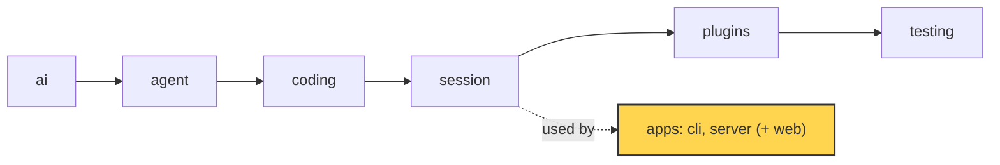
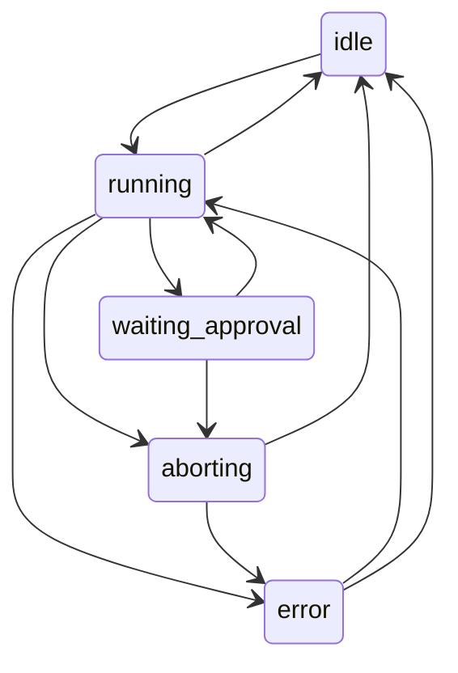

# 20 Part 5 · Server: the Run

**Goal:** Run a session on a server with a typed protocol.

**Builds on:** [19-cli](19-cli.md) · **Next:** [21-transport](21-transport.md)



*This chapter starts the `server` app (marked). It uses the `session` layer from the outside.*

## Problem

In [19](19-cli.md) we wrapped an `AgentSession` ([13](13-session.md)) in a terminal app. One person, one process, one screen. Now we want the same agent in a browser. The fizzbuzz task ("write `fizzbuzz.py`") should run on a server, and a web page should show it live.

That brings new problems that the CLI never had:

- **A run takes minutes.** An HTTP request should not wait that long. The run must live on the server, not inside one request.
- **The browser and the server are two programs.** One is Python, one is TypeScript. They must agree on every message shape. If one side renames a field, the other side breaks in silence.
- **Many things can happen at once.** The user can send a prompt while a run is busy, press "abort" twice, or answer an approval that is already gone. The server must say what is allowed *now*.
- **Tabs close and reconnect.** A tab that comes back must see the full story, including text that is still streaming.

We need two things. A **[protocol](glossary.md#protocol)**: the fixed list of messages that go between server and browser. And a **[Run](glossary.md#run)**: one server object per conversation that owns the `AgentSession`, turns its events into protocol events, and keeps a clear **[run state](glossary.md#run-state)**.

## Naive version

The simplest idea: one dict of sessions, and an endpoint that runs the prompt and returns the messages.

```python
from fastapi import FastAPI
from simp_agent.ai import Model, to_dict
from simp_agent.session import AgentSession

app = FastAPI()
sessions: dict[str, AgentSession] = {}

@app.post("/sessions/{sid}")
def new(sid: str):
    sessions[sid] = AgentSession(Model())
    return {"id": sid}

@app.post("/sessions/{sid}/prompt")
async def prompt(sid: str, body: dict):
    s = sessions[sid]
    await s.prompt(body["text"])          # waits for the whole run
    return [to_dict(m) for m in s.messages]
```

It works for one happy fizzbuzz run. It breaks when:

1. **The run is long.** The request hangs for minutes. Proxies and browsers time out. The user sees nothing until the end: no live text.
2. **Two prompts come at once.** Both call `s.prompt()` on the same session. Two loops now share one message list.
3. **The body is any dict.** `{"txt": "hi"}` gives a `KeyError` and a 500. Nothing tells the browser what shapes exist.
4. **The tab reloads.** The answer of the running request is lost. There is no way to say "give me what I missed".
5. **Approval** ([08](08-hooks-approval.md)) cannot work: the request is blocked, so the user has no way to send "allow".

## Real design

The server lives in `apps/server/src/simp_server/`. This chapter covers three parts: the protocol models, the `Run` and its state machine, and the code generator that writes the TypeScript side. Streaming to the browser is [21](21-transport.md). Storage and login are [22](22-store-auth.md).

### Entry point

`apps/server/src/simp_server/__main__.py` is small. It looks at the first word and picks a mode:

```python
def main():
    if sys.argv[1:] == ["build-sandbox"]:
        sys.exit(build_image())
    if sys.argv[1:2] in (["run"], ["seed"], ["passwd"], ["users"], ["revoke"], ["rotate"], ["backup"], ["pause"], ["resume"]):
        from .server import main as server_main
        return server_main()
    from .fake import main as fake_main  # `simp-server fake ...`
    fake_main()
```

`simp-server run` starts the real server in `server.py`. Anything else falls to a fake server (`fake.py`) that plays a scripted run with no model. The fake is useful for the web client and for tests (see below). `build-sandbox` is for [24](24-docker-sandbox.md). `__init__.py` is only a docstring.

### Protocol models

`apps/server/src/simp_server/protocol.py` is the single source of truth for the wire. Every message is a Pydantic model. They all share one base:

```python
class _M(BaseModel):
    model_config = ConfigDict(extra="forbid", json_schema_serialization_defaults_required=True)
```

`extra="forbid"` means an unknown field is an error, not a silent drop. So `{"txt": "hi"}` fails loudly. The second option marks fields with defaults as "required" in the output schema, because the server always sends them. The TypeScript side can then trust that they exist.

Every model has a `type` field with a fixed `Literal` value, like `type: Literal["prompt"] = "prompt"`. That field is the **[discriminator](glossary.md#discriminator)**: one field whose value says which model the JSON is. The union types use it:

```python
Command = Annotated[Union[Prompt, Steer, FollowUp, Abort, Approve, Compact, Continue, SetPlanMode], Field(discriminator="type")]
...
server_event = TypeAdapter(ServerEvent)
command = TypeAdapter(Command)
```

With a discriminator, Pydantic reads `type` first and checks only that one model. Error messages are short and clear.

There are three groups of messages.

**Handshake.** The browser sends `Hello(protocol_version=...)`. `check_hello` answers with a `Hello` or a `HelloError` that lists the supported versions (`SUPPORTED_VERSIONS = {1}`). An old tab learns early that the server changed.

**Commands** (browser to server): `Prompt`, `Steer`, `FollowUp`, `Abort`, `Approve`, `Compact`, `Continue`, `SetPlanMode`. They map one to one to session features you already know: steering and follow-up ([07](07-steering.md)), abort ([06](06-events-abort.md)), approval ([08](08-hooks-approval.md)), compaction ([16](16-compaction.md)), plan mode ([18](18-profiles-plugins.md)).

**Server events** come in two kinds. The docstring of the file says it:

> DURABLE events carry a monotonic per-session `seq` (= SSE id). LIVE events have no seq and are lost on reconnect; the snapshot that follows a (re)connect carries everything still in flight.

- A **[durable event](glossary.md#durable-event)** has a `seq` number: `UserMessage`, `AssistantMessage`, `ToolResult`, `ApprovalRequest`, `ApprovalResolved`, `RunState`, `Compaction`, `Notice`, `SessionTitle`. These are saved and can be replayed.
- A **[live event](glossary.md#live-event)** has no `seq`: `TextDelta`, `ThinkingDelta`, `ToolOutput`. These are small pieces of streaming text. They are not saved.
- A **[snapshot](glossary.md#snapshot)** says "here is where we are now": `last_seq`, `run_state`, the `in_flight` text so far, any `pending_approval`, the `title` and `plan_mode`.

Why split? The final `AssistantMessage` holds the full text anyway, so saving every tiny delta is waste. Deltas are only for "watch it type"; the snapshot fills the gap after a reconnect. Each delta has an `offset`, so the client can tell where it fits in the text it already has.

### Run state machine

The run state is one of five names:

```python
RunStateName = Literal["idle", "running", "waiting_approval", "aborting", "error"]
```

And the legal moves live in one table, next to the models:

```python
TRANSITIONS: dict[str, set[str]] = {
    "idle": {"running"},
    "running": {"waiting_approval", "aborting", "idle", "error"},
    "waiting_approval": {"running", "aborting"},
    "aborting": {"idle", "error"},
    "error": {"running", "idle"},
}


def check_transition(old: str, new: str) -> None:
    if new not in TRANSITIONS[old]:
        raise ValueError(f"bad run_state transition {old} -> {new}")
```



Why a table? With a table, a wrong move like `idle -> waiting_approval` raises at once instead of leaving the UI in a strange state.

### The Run

`apps/server/src/simp_server/server.py` has `class Run`. Its docstring: "AgentSession + durable protocol log + in-flight buffers." One `Run` exists per open conversation. `SessionManager.get()` creates it on first use and keeps it in `self.runs`.

The constructor builds an `AgentSession` and passes **itself** as the store:

```python
self.session = AgentSession(
    self.model, store=self, env=env, cwd=getattr(env, "root", None) or "/", stream_fn=self.guarded_stream,
    get_api_key=mgr.api_key_for(self.model), approve=self.approve,
    ...)
self.session.subscribe(self.on_event)
```

So the `Run` is a `SessionStore` ([13](13-session.md)): it has `append`. It is also the approval callback (`approve`) and an event subscriber (`on_event`). That is the whole link between the library and the server. The library does not know a server exists.

**One seq counter for everything.** Library messages and protocol events share `self.seq`:

```python
async def append(self, entry) -> None:
    self.seq += 1
    await self.mgr.store.add_entry(self.user_id, self.sid, self.seq, "msg", to_dict(entry))

async def durable(self, cls, **kw) -> None:
    self.seq += 1
    ev = cls(seq=self.seq, **kw).model_dump()
    self.log.append(ev)
    self._send(ev)
    await self.mgr.store.add_entry(self.user_id, self.sid, ev["seq"], ev["type"], ev)
```

`durable()` is the only way to emit a durable event. It builds the model (so a wrong field fails here, on the server), keeps it in the in-memory `log`, sends it to every open connection, and saves it. `_send` uses `put_nowait` and drops a client whose queue is full, so a slow tab never blocks the run.

**Changing state.** Every state change goes through one method:

```python
async def set_state(self, s: str) -> None:
    p.check_transition(self.state, s)
    self.info.run_state = s
    await self.durable(p.RunState, state=s)
```

So every change is checked, and every change is a durable `RunState` event. A tab that reconnects can read the state from the log.

**Starting a run.** `start()` sets `running` and puts the work in a background task:

```python
await self.set_state("running")
self.run_id = uuid.uuid4().hex[:8]
...
fn = text if callable(text) else functools.partial(self.session.prompt, text)
self.task = asyncio.create_task(self._run(fn))
```

This fixes naive problem 1: the HTTP request returns at once, and the run goes on without it. `_turn()` runs `fn`, then sets `idle`, or `error` if the last assistant message has `stop_reason == "error"`. If the state is `aborting`, it clears the queues, goes to `idle` and adds a "run aborted" notice. `_run()` wraps `_turn()` in a `finally` that moves a stuck busy run to `error`, so a session is never stuck "running" after a crash.

**Routing commands.** `Run.command()` decides what each command means now:

```python
if isinstance(c, (p.Prompt, p.FollowUp, p.Steer)):
    if not self.busy:
        await self.start(c.text)
    elif len(self.session.agent.steering) + len(self.session.agent.follow_ups) >= MAX_QUEUED:
        raise HTTPException(429, f"{MAX_QUEUED} messages already queued")
    elif isinstance(c, p.Steer):
        self.session.steer(c.text)
    else:
        self.session.follow_up(c.text)
```

`busy` means `running`, `waiting_approval` or `aborting`. When idle, any text starts a run. When busy, it is queued as a steer or follow-up ([07](07-steering.md)), up to `MAX_QUEUED = 20`. This fixes naive problem 2: there is never a second loop. `Approve` needs a matching pending `call_id`, else 409. `Compact` and `Continue` give 409 while busy.

**Events to protocol.** `on_event()` turns library events ([06](06-events-abort.md)) into protocol events. Text and thinking deltas grow `self.inflight` and go out as live `TextDelta`/`ThinkingDelta` with an `offset`. A `message_end` with an assistant message becomes a durable `AssistantMessage`, and the usage is recorded for cost limits ([23](23-limits.md)). After the first assistant message, a small background task (`_title`) asks the model for a session title and sends `SessionTitle`.

**Approval over the network.** `approve()` is the callback the session calls before a risky tool ([08](08-hooks-approval.md)):

```python
self.answer = asyncio.get_running_loop().create_future()
self.pending = p.PendingApproval(call_id=call.id, tool=call.name, args=call.arguments)
try:
    await self.durable(p.ApprovalRequest, call_id=call.id, tool=call.name, args=call.arguments)
    if self.state == "running":
        await self.set_state("waiting_approval")
    decision = await self.answer
except asyncio.CancelledError:
    self.pending = None
    await self.durable(p.ApprovalResolved, call_id=call.id, decision="aborted")
    raise
```

The run waits on a future. A later `Approve` command (a new HTTP request) calls `self.answer.set_result(...)`. This fixes naive problem 5. If the user aborts, the wait is cancelled and the log still gets a closing `ApprovalResolved` with `"aborted"`. Every request in the log has an answer.

**After a restart.** When a `Run` is loaded from the store, `SessionManager.get()` calls `recover()`. If the last saved state was busy, the process died mid-run. `recover()` closes open approvals as `aborted`, adds an error `ToolResult` for each tool call with no result, then sets `error` and adds a warning notice. Here it writes `self.info.run_state = "error"` directly, "bypassing check_transition on purpose", because `waiting_approval -> error` is not in the table.

**Reconnect.** `subscribe(after)` returns every durable event with `seq > after`, then a `Snapshot`, and gives a new queue for live events. Its docstring: "No await here, so nothing slips in between." This fixes naive problem 4. How the events reach the browser over HTTP is [21](21-transport.md).

### gen_protocol → protocol.gen.ts

The browser needs the same types in TypeScript. Writing them by hand would drift. So we generate them.

`protocol.py` has a root model only for this job:

```python
class Protocol(_M):
    """Root used only for schema generation: pulls every wire type into one document."""

    hello: Hello
    hello_error: HelloError
    event: ServerEvent
    command: Command
    session: SessionInfo
```

`json_schema()` turns it into one **[JSON Schema](glossary.md#json-schema)** document. A small helper `_untitle` drops per-field titles, so the TS output has plain inline types and not aliases like `type Seq1 = number`.

`apps/server/src/simp_server/gen_protocol.py` pipes that schema into the `json-schema-to-typescript` tool through `npx`:

```python
def generate() -> str:
    cmd = ["npx", "--yes", "json-schema-to-typescript@15", "--bannerComment",
           "/* Generated from apps/server/src/simp_server/protocol.py. Do not edit; run gen_protocol. */",
           "--unreachableDefinitions"]
    return subprocess.run(cmd, input=json_schema(), capture_output=True, text=True, check=True).stdout
```

Run as a script, it writes `apps/web/src/protocol.gen.ts`. With `--check`, it only compares and exits with an error if the file is stale. The output file starts with the banner comment and an `interface Protocol` that lists every event and command.

Now the web client ([25](25-web-client.md)) imports these types. If you rename a Python field, the TS build fails. This fixes naive problem 3 on both sides.

## Test

`apps/server/tests/test_protocol.py` tests the protocol, the state machine and the fake server. Here is the state machine test, `test_hello_and_state_machine`:

```python
def test_hello_and_state_machine():
    assert isinstance(p.check_hello(p.Hello(protocol_version=1)), p.Hello)
    assert isinstance(p.check_hello(p.Hello(protocol_version=2)), p.HelloError)
    p.check_transition("waiting_approval", "aborting")
    with pytest.raises(ValueError):
        p.check_transition("idle", "waiting_approval")
```

It checks the handshake (version 1 is fine, version 2 gets an error) and one legal and one illegal move. You cannot wait for approval when no run has started.

Other tests in the same file:

- `test_round_trip_every_event_and_command` dumps every event and command to JSON and parses it back through `server_event` and `command`. It also checks that `decision="maybe"` is rejected.
- `test_no_ts_drift` checks that `protocol.gen.ts` equals `generate()`. It is skipped when `npx` is not installed.
None of these tests call a model, so they need no API key. Run them:

```
uv run pytest apps/server/tests/test_protocol.py -q
```

## Why this way

> **One typed protocol, one owner per conversation.** All wire shapes live in one Python file, and TypeScript is generated from it, so the two sides cannot drift without a failing check. Each conversation has one `Run` that owns its `AgentSession`, runs it in a background task, and changes state only through `set_state()` and the `TRANSITIONS` table. Durable events get a `seq` and are saved; live deltas are not, and a snapshot covers the gap. The cost: one extra code-gen step that needs Node, and the whole event log of an open session is kept in memory (marked with a `ponytail:` comment in `Run.__init__`).

## Recap

- `protocol.py` holds every wire message as a Pydantic model with `extra="forbid"` and a `type` discriminator.
- Durable events have a `seq` and are saved. Live deltas have no `seq`. A `Snapshot` fills the gap on reconnect.
- Run state is `idle`, `running`, `waiting_approval`, `aborting` or `error`. `check_transition` enforces the `TRANSITIONS` table.
- `Run` owns one `AgentSession`. It is its store, its approval callback and its event subscriber.
- `start()` runs the work in a background task. `command()` starts, queues, aborts or approves.
- `gen_protocol.py` writes `apps/web/src/protocol.gen.ts` from the schema; `test_no_ts_drift` catches drift.

**Builds on:** [19-cli](19-cli.md) · **Next:** [21-transport](21-transport.md)

## Terms to add to glossary

- **protocol** — the fixed set of typed messages between simp-server and the web client, defined in `protocol.py`.
- **Run** — the server object that owns one `AgentSession`, its event log and its run state.
- **run state** — one of `idle`, `running`, `waiting_approval`, `aborting`, `error`; changes are checked by `check_transition`.
- **discriminator** — a field (here `type`) whose value says which model a JSON object is.
- **durable event** — a server event with a `seq`; it is saved and can be replayed.
- **live event** — a streaming delta with no `seq`; it is not saved and is lost on reconnect.
- **snapshot** — the event sent after (re)connect with `last_seq`, run state, in-flight text and any pending approval.
- **JSON Schema** — a standard JSON format that describes data shapes; used here to generate TypeScript types.
