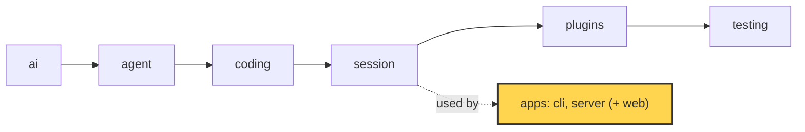
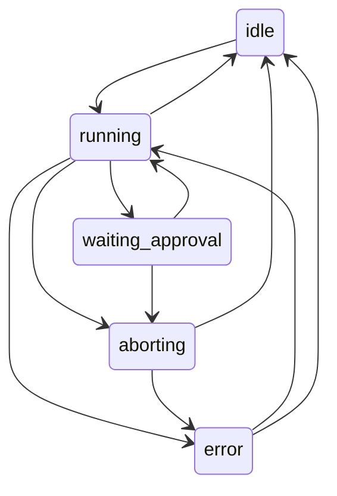

# 20 Part 5 · Server: the Run

**Goal:** Run a session on a server with a typed protocol.

**Builds on:** [19 The CLI](19-cli.md) · **Next:** [21 Transport](21-transport.md)

## Where we are



*This chapter starts the `server` app (marked). It uses the `session` layer from the outside.*

Code in this chapter (commit `2fc2776`):

- `apps/server/src/simp_server/protocol.py` — the protocol models, `Snapshot`, `TRANSITIONS`, `check_transition`
- `apps/server/src/simp_server/server.py` — `Run`, `SessionManager`
- `apps/server/src/simp_server/gen_protocol.py` — writes `protocol.gen.ts`
- `apps/server/src/simp_server/__main__.py` — `main`
- `apps/server/tests/test_protocol.py` — the protocol tests

## Problem

[19](19-cli.md) runs the agent in a terminal: one person, one screen. Now we want the same agent in a browser. The fizzbuzz task ("write `fizzbuzz.py`") should run on a server, and a web page should show it live.

New problems:

- **A run takes minutes.** An HTTP request should not wait that long. The run must live on the server, not inside one request.
- **The browser and the server are two programs.** One is Python, one is TypeScript. They must agree on every message shape. If one side renames a field, the other side breaks in silence.
- **Many things can happen at once.** The user can send a prompt while a run is busy, press "abort" twice, or answer an approval that is already gone. The server must say what is allowed *now*.
- **Tabs close and reconnect.** A tab that comes back must see the full story, including text that is still streaming.

We need two things. A **[protocol](glossary.md#protocol)**: the fixed list of messages that go between server and browser. And a **[Run](glossary.md#run)**: one server object per conversation that owns the `AgentSession`, turns its events into protocol events, and keeps a clear **[run state](glossary.md#run-state)**.

## Naive version

The simplest idea: one dict of sessions, and an endpoint that runs the prompt and returns the messages.

```text
sessions = empty map: id -> AgentSession

ON POST /sessions/{sid}:
    sessions[sid] = new AgentSession(Model())
    RETURN {id: sid}

ON POST /sessions/{sid}/prompt with body:
    s = sessions[sid]
    run s.prompt(body["text"]) and WAIT     // waits for the whole run
    RETURN all messages of s as dicts
```

This is a sketch, not code from the repo.

It works for one happy fizzbuzz run. It breaks when:

1. **The run is long.** The request hangs for minutes. Proxies and browsers time out. The user sees nothing until the end: no live text.
2. **Two prompts come at once.** Both call `s.prompt()` on the same session. Two loops now share one message list.
3. **The body is any dict.** `{"txt": "hi"}` gives a `KeyError` and a 500. Nothing tells the browser what shapes exist.
4. **The tab reloads.** The answer of the running request is lost. There is no way to say "give me what I missed".
5. **Approval** ([08](08-hooks-approval.md)) cannot work: the request is blocked, so the user has no way to send "allow".

## Step by step: from naive to real

**Step 1 — one fixed list of messages.** Give every message a model with a `type` field, and forbid unknown fields:

```text
BASE MODEL _M for every message:
    unknown field     -> error           // extra="forbid"
    fields with a default -> "required" in the schema
```

Why: `{"txt": "hi"}` now fails with a clear error. This fixes problem 3.

**Step 2 — one owner per conversation.** A `Run` holds the `AgentSession` and its state. Only one place can start a loop:

```text
IF the run is not busy:
    start a run with c.text
```

Why: a second prompt cannot start a second loop. This fixes problem 2.

**Step 3 — run in the background.** `start()` makes a task and returns at once:

```text
start _run(fn) as a background task       // do not wait for it
```

Why: the request no longer waits for the run. This fixes problem 1.

**Step 4 — numbered events.** Each saved event gets a `seq` number. Why: a tab that reconnects can ask for "everything after seq N". This fixes problem 4. The full replay story is in [21 · seq](21-transport.md#seq-one-counter-for-everything).

**Step 5 — wait for the user.** The run waits on a future. A later `Approve` command sets it:

```text
decision = WAIT for the answer future
```

Why: the run is not blocked inside one HTTP request. This fixes problem 5.

**Step 6 — a state table.** Every state change goes through `check_transition`. Then we generate the TypeScript types from the same models, so the browser cannot drift. The real code below is these six steps together.

## Real design

The server lives in `apps/server/src/simp_server/`. This chapter covers three parts: the protocol models, the `Run` and its state machine, and the code generator that writes the TypeScript side. Streaming to the browser is [21](21-transport.md). Storage and login are [22](22-store-auth.md).

### Entry point

`apps/server/src/simp_server/__main__.py` is small. It looks at the first word and picks a mode:

```text
FUNCTION main():
    IF the args are exactly "build-sandbox":
        build the sandbox image and EXIT
    IF the first arg is one of: run, seed, passwd, users, revoke,
                                rotate, backup, pause, resume:
        RETURN server.main()                  // the real server
    fake.main()                               // `simp-server fake ...`
```

Real code: [apps/server/src/simp_server/__main__.py](../../apps/server/src/simp_server/__main__.py), function `main`.

`simp-server run` starts the real server in `server.py`. Anything else falls to a fake server (`fake.py`) that plays a scripted run with no model.

### Protocol models

`apps/server/src/simp_server/protocol.py` is the single source of truth for the wire. Every message is a Pydantic model. They all share one base:

```text
BASE MODEL _M for every message:
    unknown field     -> error           // extra="forbid"
    fields with a default -> "required" in the schema
```

Real code: [apps/server/src/simp_server/protocol.py](../../apps/server/src/simp_server/protocol.py), class `_M`.

`extra="forbid"` means an unknown field is an error, not a silent drop. The second option marks default fields as "required" in the schema, so TypeScript can trust they exist.

Every model has a `type` field with a fixed `Literal` value, like `type: Literal["prompt"] = "prompt"`. That field is the **[discriminator](glossary.md#discriminator)**: one field whose value says which model the JSON is. The union types use it:

```text
Command = ONE OF Prompt, Steer, FollowUp, Abort, Approve,
                 Compact, Continue, SetPlanMode
          (pick which one by the "type" field)
server_event = a parser for ServerEvent
command      = a parser for Command
```

Real code: [apps/server/src/simp_server/protocol.py](../../apps/server/src/simp_server/protocol.py), `Command`, `server_event`, `command`.

Pydantic reads `type` first and checks only that one model.

There are three groups of messages.

**Handshake.** The browser sends `Hello(protocol_version=...)`. `check_hello` answers with a `Hello` or a `HelloError` that lists the supported versions (`SUPPORTED_VERSIONS = {1}`). An old tab learns early that the server changed.

**Commands** (browser to server): `Prompt`, `Steer`, `FollowUp`, `Abort`, `Approve`, `Compact`, `Continue`, `SetPlanMode`. They map one to one to session features you already know: steering and follow-up ([07](07-steering.md)), abort ([06](06-events-abort.md)), approval ([08](08-hooks-approval.md)), compaction ([16](16-compaction.md)), plan mode ([18](18-profiles-plugins.md)).

**Server events** come in two kinds, plus a snapshot:

- **[Durable event](glossary.md#durable-event)**: has a `seq`, is saved (`UserMessage`, `AssistantMessage`, `ToolResult`, `ApprovalRequest`, `ApprovalResolved`, `RunState`, `Compaction`, `Notice`, `SessionTitle`).
- **[Live event](glossary.md#live-event)**: no `seq`, not saved (`TextDelta`, `ThinkingDelta`, `ToolOutput`). The full text is saved later in `AssistantMessage` (text, thinking) and `ToolResult` (tool output).
- **[Snapshot](glossary.md#snapshot)**: "where we are now" (`last_seq`, `run_state`, `in_flight`, `pending_approval`, `title`, `plan_mode`).

How `seq`, replay and the snapshot work together is in [21 · Replay](21-transport.md#replay-after-then-snapshot-then-live).

### Run state machine

The run state is one of five names:

```text
RunStateName = ONE OF "idle", "running", "waiting_approval", "aborting", "error"
```

And the legal moves live in one table, next to the models:

```text
TRANSITIONS (from -> allowed next states):
    idle             -> running
    running          -> waiting_approval, aborting, idle, error
    waiting_approval -> running, aborting
    aborting         -> idle, error
    error            -> running, idle

FUNCTION check_transition(old, new):
    IF new is not in TRANSITIONS[old]:
        RAISE error "bad run_state transition old -> new"
```

Real code: [apps/server/src/simp_server/protocol.py](../../apps/server/src/simp_server/protocol.py), `TRANSITIONS` and function `check_transition`.



Why a table? With a table, a wrong move like `idle -> waiting_approval` raises at once instead of leaving the UI in a strange state.

### The Run

`apps/server/src/simp_server/server.py` has `class Run`. Its docstring: "AgentSession + durable protocol log + in-flight buffers." One `Run` exists per open conversation. `SessionManager.get()` creates it on first use and keeps it in `self.runs`.

The constructor builds an `AgentSession` and passes **itself** as the store:

```text
session = new AgentSession(model,
              store    = this Run,             // Run has append()
              env      = env,
              stream_fn = guarded_stream,
              get_api_key = the manager's key for this model,
              approve  = this Run's approve,
              ...)
session sends each event to this Run's on_event
```

Real code: [apps/server/src/simp_server/server.py](../../apps/server/src/simp_server/server.py), method `Run.__init__`.

So the `Run` is a `SessionStore` ([13](13-session.md)): it has `append`. It is also the approval callback (`approve`) and an event subscriber (`on_event`). That is the whole link between the library and the server. The library does not know a server exists.

**One seq counter for everything.** `Run.append` and `Run.durable` share one `self.seq`. `durable()` builds the model first, so a wrong field fails on the server. Details in [21 · seq](21-transport.md#seq-one-counter-for-everything).

**Changing state.** Every state change goes through one method:

```text
FUNCTION set_state(s):
    check_transition(current state, s)      // raises on a bad move
    run_state = s
    SEND durable event RunState(state = s)  // saved, with a seq
```

Real code: [apps/server/src/simp_server/server.py](../../apps/server/src/simp_server/server.py), method `Run.set_state`.

So every change is checked, and every change is a durable `RunState` event. A tab that reconnects can read the state from the log.

**Starting a run.** `start()` sets `running` and puts the work in a background task:

```text
set_state("running")
run_id = 8 random hex chars
...
IF text is a function: fn = text           // continue, compact
ELSE:                  fn = "session.prompt(text)"
start _run(fn) as a background task, and RETURN at once
```

Real code: [apps/server/src/simp_server/server.py](../../apps/server/src/simp_server/server.py), method `Run.start`.

This fixes naive problem 1: the HTTP request returns at once, and the run goes on without it. `_turn()` runs `fn`, then sets `idle`, or `error` if the last assistant message has `stop_reason == "error"`. `_run()` has a `finally` that moves a stuck busy run to `error`, so a session is never stuck "running" after a crash.

**Routing commands.** `Run.command()` decides what each command means now:

```text
IF c is Prompt, FollowUp or Steer:
    IF not busy:
        start a run with c.text
    ELSE IF steer queue + follow-up queue >= MAX_QUEUED:
        FAIL with HTTP 429 "messages already queued"
    ELSE IF c is Steer:
        session.steer(c.text)
    ELSE:
        session.follow_up(c.text)
```

Real code: [apps/server/src/simp_server/server.py](../../apps/server/src/simp_server/server.py), method `Run.command`.

`busy` means `running`, `waiting_approval` or `aborting`. When idle, any text starts a run. When busy, it is queued as a steer or follow-up ([07](07-steering.md)), up to `MAX_QUEUED = 20`. This fixes naive problem 2: there is never a second loop. `Approve` needs a matching pending `call_id`, else 409. `Compact` and `Continue` give 409 while busy.

**Events to protocol.** `on_event()` turns library events ([06](06-events-abort.md)) into protocol events. Deltas grow `self.inflight` (the [in-flight buffer](glossary.md#in-flight-buffer)) and go out as live events with an `offset`. A finished assistant message becomes a durable `AssistantMessage`. Usage is recorded for cost limits ([23](23-limits.md)).

**Approval over the network.** `approve()` is the callback the session calls before a risky tool ([08](08-hooks-approval.md)):

```text
answer  = a new empty future
pending = PendingApproval(call_id, tool, args)
TRY:
    SEND durable event ApprovalRequest(call_id, tool, args)
    IF state is "running": set_state("waiting_approval")
    decision = WAIT for answer          // a later Approve command fills it
IF the wait is cancelled (abort):
    pending = none
    SEND durable event ApprovalResolved(call_id, decision = "aborted")
    stop here (pass the cancel on)
```

Real code: [apps/server/src/simp_server/server.py](../../apps/server/src/simp_server/server.py), method `Run.approve`.

The run waits on a future. A later `Approve` command (a new HTTP request) calls `self.answer.set_result(...)`. This fixes naive problem 5. If the user aborts, the wait is cancelled and the log still gets a closing `ApprovalResolved` with `"aborted"`. Every request in the log has an answer.

**After a restart.** If the last saved state was busy, the process died mid-run. `recover()` closes open approvals as `aborted`, adds an error `ToolResult` for each tool call with no result, then sets `error`. It writes `self.info.run_state = "error"` directly, "bypassing check_transition on purpose", because `waiting_approval -> error` is not in the table.

**Reconnect.** `subscribe(after)` sends saved events after `after`, then a `Snapshot`, then live events (this fixes naive problem 4); see [21 · Replay](21-transport.md#replay-after-then-snapshot-then-live).

### gen_protocol → protocol.gen.ts

The browser needs the same types in TypeScript. We generate them, so they cannot drift.

`protocol.py` has a root model only for this job:

```text
MODEL Protocol:      // used only to make the schema; pulls every wire type into one document
    hello:       Hello
    hello_error: HelloError
    event:       ServerEvent
    command:     Command
    session:     SessionInfo
```

Real code: [apps/server/src/simp_server/protocol.py](../../apps/server/src/simp_server/protocol.py), class `Protocol`.

`json_schema()` turns it into one **[JSON Schema](glossary.md#json-schema)** document. A helper `_untitle` drops per-field titles, so the TS output has plain inline types.

`apps/server/src/simp_server/gen_protocol.py` pipes that schema into the `json-schema-to-typescript` tool through `npx`:

```text
FUNCTION generate():
    cmd = npx json-schema-to-typescript@15
              with a banner comment "Generated from ... protocol.py. Do not edit"
              and --unreachableDefinitions
    RUN cmd, with json_schema() as its input
    RETURN what it prints (the TypeScript text)    // fails if the tool fails
```

Real code: [apps/server/src/simp_server/gen_protocol.py](../../apps/server/src/simp_server/gen_protocol.py), function `generate`.

Run as a script, it writes `apps/web/src/protocol.gen.ts`. With `--check`, it only compares and exits with an error if the file is stale. The output file starts with the banner comment and an `interface Protocol` that lists every event and command.

Now the web client ([25](25-web-client.md)) imports these types. If you rename a Python field, the TS build fails. This fixes naive problem 3 on both sides.

## Test

`apps/server/tests/test_protocol.py` tests the protocol, the state machine and the fake server. Here is the state machine test, `test_hello_and_state_machine`:

```python
def test_hello_and_state_machine():
    assert isinstance(p.check_hello(p.Hello(protocol_version=1)), p.Hello)
    assert isinstance(p.check_hello(p.Hello(protocol_version=2)), p.HelloError)
    p.check_transition("waiting_approval", "aborting")
    with pytest.raises(ValueError):
        p.check_transition("idle", "waiting_approval")
```

It checks the handshake and one legal and one illegal move.

Other tests: `test_round_trip_every_event_and_command` dumps every event and command to JSON and parses it back. `test_no_ts_drift` checks that `protocol.gen.ts` equals `generate()` (skipped without `npx`).

None of these tests call a model, so they need no API key. Run them:

```
uv run pytest apps/server/tests/test_protocol.py -q
```

## Why this way

> **One typed protocol, one owner per conversation.** All wire shapes live in one Python file, and TypeScript is generated from it, so the two sides cannot drift without a failing check. Each conversation has one `Run` that owns its `AgentSession`, runs it in a background task, and changes state only through `set_state()` and the `TRANSITIONS` table. Durable events get a `seq` and are saved; live deltas are not, and a snapshot covers the gap. The cost: one extra code-gen step that needs Node, and the whole event log of an open session is kept in memory (marked with a `ponytail:` comment in `Run.__init__`).

## Exercises

1. Add `"paused"` to `RunStateName` and `TRANSITIONS` (idle to paused, paused to idle). Which test in `test_protocol.py` must you extend? Run it.
2. In `test_hello_and_state_machine`, add a check that `error -> waiting_approval` raises `ValueError`. Does it pass without changing the table?

## Recap

- `protocol.py` holds every wire message as a Pydantic model with `extra="forbid"` and a `type` discriminator.
- Durable events have a `seq` and are saved. Live deltas have no `seq`. A `Snapshot` fills the gap on reconnect.
- Run state is `idle`, `running`, `waiting_approval`, `aborting` or `error`. `check_transition` enforces the `TRANSITIONS` table.
- `Run` owns one `AgentSession`. It is its store, its approval callback and its event subscriber.
- `start()` runs the work in a background task. `command()` starts, queues, aborts or approves.
- `gen_protocol.py` writes `apps/web/src/protocol.gen.ts` from the schema; `test_no_ts_drift` catches drift.

**Builds on:** [19 The CLI](19-cli.md) · **Next:** [21 Transport](21-transport.md)

