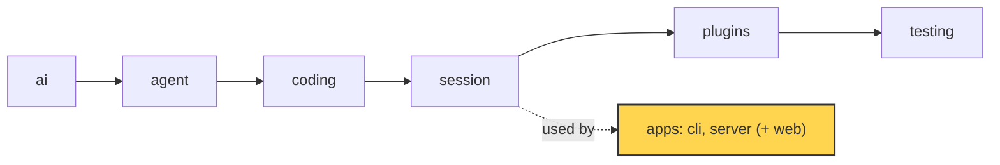
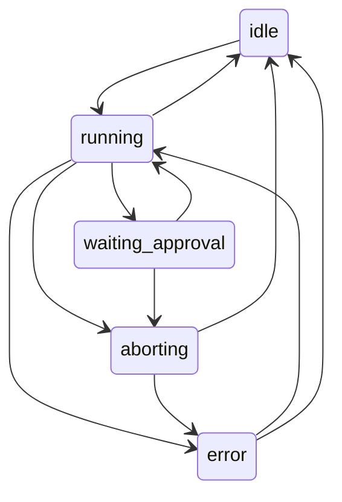

# 20 Part 5 · The server run

**Goal:** Run a session on a server with a typed protocol.

**Builds on:** [19 The CLI](19-cli.md) · **Next:** [21 Transport](21-transport.md)

## Where we are



*This chapter starts the `server` app (marked). It uses the `session` layer from the outside.*

Big picture of Part 5: [part-5-system](part-5-system.md).

Code in this chapter (commit `2fc2776`):

- `apps/server/src/simp_server/protocol.py` — the protocol models, `Snapshot`, `TRANSITIONS`, `check_transition`
- `apps/server/src/simp_server/server.py` — `Run`, `SessionManager`
- `apps/server/src/simp_server/gen_protocol.py` — writes `protocol.gen.ts`
- `apps/server/src/simp_server/__main__.py` — `main`
- `apps/server/tests/test_protocol.py` — the protocol tests

## Problem

[19](19-cli.md) runs the agent in a terminal: one person, one screen. Now we want the same agent in a browser. The fizzbuzz task ("write `fizzbuzz.py`") should run on a server, and a web page should show it live.

New problems:

- **A run takes minutes.** An HTTP request should not wait that long. The run must live on the server, not inside one request.
- **The browser and the server are two programs.** One is Python, one is TypeScript. They must agree on every message shape. If one side renames a field, the other side breaks in silence.
- **Many things can happen at once.** The user can send a prompt while a run is busy, press "abort" twice, or answer an approval that is already gone. The server must say what is allowed *now*.
- **Tabs close and reconnect.** A tab that comes back must see the full story, including text that is still streaming.

We need two things. A **[protocol](glossary.md#protocol)**: the fixed list of messages that go between server and browser. And a **[Run](glossary.md#run)**: one server object per conversation that owns the `AgentSession`, turns its events into protocol events, and keeps a clear **[run state](glossary.md#run-state)**.

## Naive version

The simplest idea: one dict of sessions, and an endpoint that runs the prompt and returns the messages.

```text
sessions = empty map: id -> AgentSession

ON POST /sessions/{sid}:
    sessions[sid] = new AgentSession(Model())
    RETURN {id: sid}

ON POST /sessions/{sid}/prompt with body:
    s = sessions[sid]
    run s.prompt(body["text"]) and WAIT     // waits for the whole run
    RETURN all messages of s as dicts
```

This is a sketch, not code from the repo.

It works for one happy fizzbuzz run. It breaks when:

1. **The run is long.** The request hangs for minutes. Proxies and browsers time out. The user sees nothing until the end: no live text.
2. **Two prompts come at once.** Both call `s.prompt()` on the same session. Two loops now share one message list.
3. **The body is any dict.** `{"txt": "hi"}` gives a `KeyError` and a 500. Nothing tells the browser what shapes exist.
4. **The tab reloads.** The answer of the running request is lost. There is no way to say "give me what I missed". (Fixed in [21](21-transport.md).)
5. **Approval** ([08](08-hooks-approval.md)) cannot work: the request is blocked, so the user has no way to send "allow". (Fixed in [21](21-transport.md).)

## Real design

The server lives in `apps/server/src/simp_server/`. We build it in four steps. Each step fixes one or more of the naive problems above.

This chapter owns the **messages** and the **Run's state**. Two other chapters own the rest:

- [21 Transport](21-transport.md): the `seq` counter, replay after a reconnect, the command queue (Prompt / Steer / FollowUp while busy), approval over the wire, and how library events become live and durable events. That fixes problems 4 and 5.
- [22 Store and auth](22-store-auth.md): where the log is saved, and how a session is loaded again.

### Protocol models

*Step 1.*

**Problem 3:** the body is any dict, and the browser does not know which shapes exist.

**What we do:** `apps/server/src/simp_server/protocol.py` is the single source of truth for the wire. Every message is a Pydantic model, and they all share one base:

```text
BASE MODEL _M for every message:
    unknown field         -> error           // extra="forbid"
    fields with a default -> "required" in the schema
```

Real code: [apps/server/src/simp_server/protocol.py](../../apps/server/src/simp_server/protocol.py), class `_M`.

**Why:** `extra="forbid"` turns `{"type": "prompt", "txt": "hi"}` into a clear error, not a silent drop. The second rule marks default fields as "required" in the schema, so TypeScript can trust that they are always there.

Every model has a `type` field with one fixed value, like `type: Literal["prompt"] = "prompt"`. That field is the **[discriminator](glossary.md#discriminator)**: one field whose value says which model the JSON is.

```text
Command = ONE OF Prompt, Steer, FollowUp, Abort, Approve,
                 Compact, Continue, SetPlanMode
          (pick which one by the "type" field)
```

Real code: [apps/server/src/simp_server/protocol.py](../../apps/server/src/simp_server/protocol.py), `Command`.

Example: IN `{"type": "prompt", "text": "write fizzbuzz.py"}` → Pydantic reads `type`, checks only the `Prompt` model → OUT `Prompt(text="write fizzbuzz.py")`.

There are three groups of messages:

- **Handshake.** The browser sends `Hello(protocol_version=...)`. `check_hello` answers with a `Hello`, or a `HelloError` that lists the supported versions (`SUPPORTED_VERSIONS = {1}`). Why: an old tab learns at once that the server changed.
- **Commands** (browser to server). Each maps to a session feature you already know: steering and follow-up ([07](07-steering.md)), abort ([06](06-events-abort.md)), approval ([08](08-hooks-approval.md)), compaction ([16](16-compaction.md)), plan mode ([18](18-profiles-plugins.md)).
- **Server events** (server to browser). A **[durable event](glossary.md#durable-event)** has a `seq` number and is saved. A **[live event](glossary.md#live-event)** is a streaming piece of text: no `seq`, not saved; the full text is saved later in `AssistantMessage` and `ToolResult`. A **[snapshot](glossary.md#snapshot)** says "where we are now" to a tab that (re)connects.

The full list of event names and every `Snapshot` field is in [ref-objects · Server protocol messages](ref-objects.md#server-protocol-messages). How they are used is [21](21-transport.md).

### Run state machine

*Step 2.*

**Problem:** the user can press "abort" twice, or answer an approval that is already gone. The server must know what is allowed *now*.

**What we do:** the run state is one of five names, and the legal moves live in one table next to the models:

```text
RunStateName = ONE OF "idle", "running", "waiting_approval", "aborting", "error"

TRANSITIONS (from -> allowed next states):
    idle             -> running
    running          -> waiting_approval, aborting, idle, error
    waiting_approval -> running, aborting
    aborting         -> idle, error
    error            -> running, idle

FUNCTION check_transition(old, new):
    IF new is not in TRANSITIONS[old]:
        RAISE error "bad run_state transition old -> new"
```

Real code: [apps/server/src/simp_server/protocol.py](../../apps/server/src/simp_server/protocol.py), `TRANSITIONS` and function `check_transition`.



**Why a table:** a wrong move like `idle -> waiting_approval` raises at once, on the server. Without it, the UI would just show a strange state and nobody would know why.

### The Run

*Step 3.*

**Problems 1 and 2:** a run takes minutes, and two prompts must never start two loops on one session.

**What we do:** one owner per conversation. `apps/server/src/simp_server/server.py` has `class Run`. Its docstring: "AgentSession + durable protocol log + in-flight buffers." `SessionManager.get()` makes one `Run` per open conversation on first use and keeps it in `self.runs`.

The constructor builds an `AgentSession` and passes **itself** in three places:

```text
session = new AgentSession(model,
              store       = this Run,             // Run has append()
              env         = env,
              stream_fn   = guarded_stream,       // budget check, see 23
              get_api_key = the manager's key for this model,
              approve     = this Run's approve,
              messages    = the saved history,
              plugins     = redact_secrets, plan_mode + the profile's plugins)
session sends each event to this Run's on_event
```

Real code: [apps/server/src/simp_server/server.py](../../apps/server/src/simp_server/server.py), method `Run.__init__`.

So the `Run` is the session's `SessionStore` ([13](13-session.md)), its approval callback ([08](08-hooks-approval.md)) and an event subscriber ([06](06-events-abort.md)). **Why:** that is the whole link between the library and the server. The library does not know a server exists. What `approve` and `on_event` do is [21](21-transport.md).

The state is one field, `self.info.run_state`. A run is **busy** when the state is `running`, `waiting_approval` or `aborting`.

**Changing state.** Every change goes through one method:

```text
FUNCTION set_state(s):
    check_transition(current state, s)      // raises on a bad move
    run_state = s
    SEND durable event RunState(state = s)  // saved, with a seq
```

Real code: [apps/server/src/simp_server/server.py](../../apps/server/src/simp_server/server.py), method `Run.set_state`.

**Why:** every change is checked, and every change is in the log. A tab that comes back reads the state from the log.

**Starting a run.** `start()` sets `running`, then puts the work in a background task and returns:

```text
FUNCTION start(text, fresh = true):
    IF fresh: run_start = now               // the run budget clock (23)
    set_state("running")
    run_id = 8 random hex chars             // for the logs
    IF text is a function: fn = text        // Continue and Compact pass a function
    ELSE:                  fn = "call session.prompt(text)"   // called later, in the task
    start _run(fn) as a background task     // do not wait for it
```

Real code: [apps/server/src/simp_server/server.py](../../apps/server/src/simp_server/server.py), method `Run.start`.

The background task does two jobs:

- `_turn(fn)` runs `fn`. If `fn` raises, the error becomes an error `Notice`. When it ends, it sets the next state: `idle` after an abort (with a "run aborted" notice), `error` if the last assistant message has `stop_reason == "error"`, else `idle`. If a follow-up came in after the loop stopped, it starts the next run at once.
- `_run(fn)` wraps `_turn` in a `finally`. If the run is still busy there (a crash, a failed store write, a cancel), it writes `RunState(error)` and a "run stopped unexpectedly" notice. **Why:** a session is never stuck "running" after a crash.

Example, the fizzbuzz prompt on an idle run:

```text
POST Prompt("write fizzbuzz.py")        state idle
  set_state("running")                  check idle -> running: ok
  log: RunState(state="running")        seq 1 (a new session)
  background task starts, POST returns  (problem 1 fixed)
... the agent writes fizzbuzz.py, events stream (21) ...
  _turn ends, last stop_reason="stop"
  set_state("idle")                     check running -> idle: ok
  log: RunState(state="idle")           seq N  (messages in between use the same counter)
```

**Why this fixes problem 2:** text that comes in while busy never calls `start()` again; [21 · The command queue](21-transport.md#the-command-queue) queues it as a steer or follow-up. One `Run`, one loop.

**After a restart: `recover`.** The process can die in the middle of a run. When [22](22-store-auth.md#recover) loads the session again, the last saved `RunState` is still busy, but no loop runs. `recover()` closes the run in the log:

1. Every `approval_request` with no `approval_resolved` gets `ApprovalResolved(decision="aborted")`.
2. Every tool call in the last assistant message with no result gets an error tool result: "aborted: the server restarted before this tool finished". It is saved as a history message (`append`) and sent as a `ToolResult` event.
3. The state becomes `error`, then a `Notice`: "interrupted: the server restarted during this run".

Example. The run asked to use `bash` (call `c2`) and waits for the user. Then the server dies.

```text
log before (last rows):                 recover adds:
  AssistantMessage, asks bash call c2     ApprovalResolved c2 "aborted"     seq 9
  ApprovalRequest c2 bash                 (history row: tool result c2)    seq 10
  RunState waiting_approval   seq 8       ToolResult c2, is_error=true      seq 11
                                          RunState error                    seq 12
  -- server dies --                       Notice warning "interrupted..."   seq 13
```

The history row at seq 10 uses the same counter, because `append` and the events share `self.seq` ([21 · seq](21-transport.md#seq-one-counter-for-everything)).

Item 3 writes `self.info.run_state = "error"` directly, "bypassing check_transition on purpose". **Why:** `waiting_approval -> error` is not in the table; it is only legal here, after a crash. Item 2 matters for the model: providers reject a history where a tool call has no result. After `recover`, the user can press Continue.

Real code: [apps/server/src/simp_server/server.py](../../apps/server/src/simp_server/server.py), method `Run.recover`.

### gen_protocol → protocol.gen.ts

*Step 4.*

**Problem 3, browser side:** the browser is TypeScript. If someone renames a Python field, the browser breaks in silence.

**What we do:** generate the TypeScript types from the same models. `protocol.py` has a root model only for this job:

```text
MODEL Protocol:      // used only to make the schema; pulls every wire type into one document
    hello:       Hello
    hello_error: HelloError
    event:       ServerEvent
    command:     Command
    session:     SessionInfo
```

Real code: [apps/server/src/simp_server/protocol.py](../../apps/server/src/simp_server/protocol.py), class `Protocol`.

`json_schema()` turns it into one **[JSON Schema](glossary.md#json-schema)** document. A helper `_untitle` drops per-field titles, so the TS output has plain inline types.

`apps/server/src/simp_server/gen_protocol.py` pipes that schema into the `json-schema-to-typescript` tool through `npx`:

```text
FUNCTION generate():
    cmd = npx json-schema-to-typescript@15
              with a banner comment "Generated from ... protocol.py. Do not edit"
              and --unreachableDefinitions
    RUN cmd, with json_schema() as its input
    RETURN what it prints (the TypeScript text)    // fails if the tool fails
```

Real code: [apps/server/src/simp_server/gen_protocol.py](../../apps/server/src/simp_server/gen_protocol.py), function `generate`.

Run as a script, it writes `apps/web/src/protocol.gen.ts`. With `--check`, it only compares and exits with an error if the file is stale.

**Why:** the web client ([25](25-web-client.md)) imports these types. Rename a Python field and the TS build fails, so the two sides cannot drift.

### Starting the server

`apps/server/src/simp_server/__main__.py` looks at the first word. `simp-server run` starts the real server in `server.py`. The other words (`seed`, `passwd`, `users`, `revoke`, `rotate`, `backup`, `pause`, `resume`) are admin commands from [22](22-store-auth.md) and [23](23-limits.md). `build-sandbox` builds the sandbox image ([24](24-docker-sandbox.md)). Anything else runs a fake server (`fake.py`) that plays a scripted run with no model.

Real code: [apps/server/src/simp_server/__main__.py](../../apps/server/src/simp_server/__main__.py), function `main`.

## Test

`apps/server/tests/test_protocol.py` tests the protocol, the state machine and the fake server. Here is the state machine test, `test_hello_and_state_machine`:

```python
def test_hello_and_state_machine():
    assert isinstance(p.check_hello(p.Hello(protocol_version=1)), p.Hello)
    assert isinstance(p.check_hello(p.Hello(protocol_version=2)), p.HelloError)
    p.check_transition("waiting_approval", "aborting")
    with pytest.raises(ValueError):
        p.check_transition("idle", "waiting_approval")
```

It checks the handshake and one legal and one illegal move.

Other tests: `test_round_trip_every_event_and_command` dumps every event and command to JSON and parses it back. `test_no_ts_drift` checks that `protocol.gen.ts` equals `generate()` (skipped without `npx`).

None of these tests call a model, so they need no API key. Run them:

```
uv run pytest apps/server/tests/test_protocol.py -q
```

## Why this way

> **One typed protocol, one owner per conversation.** All wire shapes live in one Python file, and TypeScript is generated from it, so the two sides cannot drift without a failing check. Each conversation has one `Run` that owns its `AgentSession`, runs it in a background task, and changes state only through `set_state()` and the `TRANSITIONS` table. Durable events get a `seq` and are saved; live deltas are not, and a snapshot covers the gap. The cost: one extra code-gen step that needs Node, and the whole event log of an open session is kept in memory (marked with a `ponytail:` comment in `Run.__init__`).

## Exercises

1. Add `"paused"` to `RunStateName` and `TRANSITIONS` (idle to paused, paused to idle). Which test in `test_protocol.py` must you extend? Run it.
2. In `test_hello_and_state_machine`, add a check that `error -> waiting_approval` raises `ValueError`. Does it pass without changing the table?

## Recap

- `protocol.py` holds every wire message as a Pydantic model with `extra="forbid"` and a `type` discriminator.
- Durable events have a `seq` and are saved. Live deltas have no `seq`. How they flow is [21](21-transport.md).
- Run state is `idle`, `running`, `waiting_approval`, `aborting` or `error`. `check_transition` enforces the `TRANSITIONS` table.
- `Run` owns one `AgentSession`. It is its store, its approval callback and its event subscriber.
- `set_state()` is the only way to change state; each change is checked and logged as `RunState`.
- `start()` runs the work in a background task; `_run()` never leaves a run stuck busy.
- `recover()` closes a run that was busy when the server died, and sets `error`.
- `gen_protocol.py` writes `apps/web/src/protocol.gen.ts` from the schema; `test_no_ts_drift` catches drift.

**Builds on:** [19 The CLI](19-cli.md) · **Next:** [21 Transport](21-transport.md)

