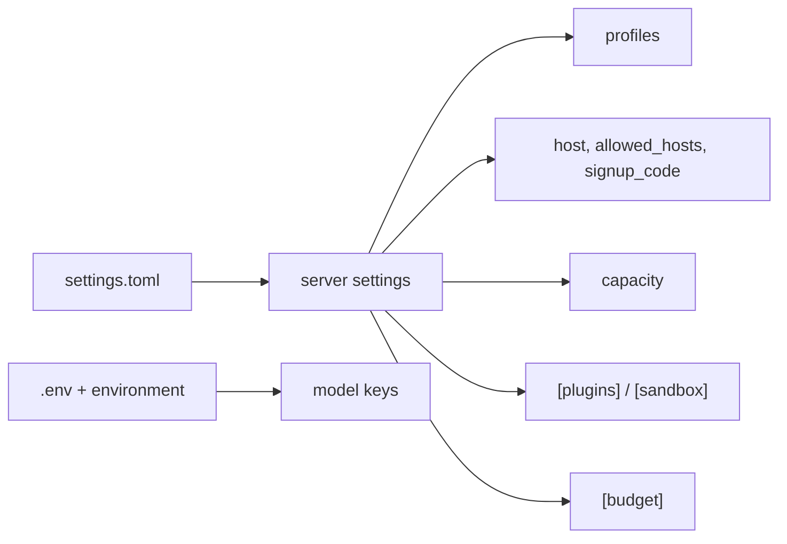

# 21 — Configuration reference

> **Who this is for:** an operator who needs to look up one `settings.toml` key.
> **What you need first:** [20 Operator tutorial](20-operator-tutorial.md) (you wrote a first file there) and the words [profile](glossary.md#profile), [plugin](glossary.md#plugin), [sandbox](glossary.md#sandbox).
> **What you will learn:** every key, its default, and what it does.
> **Code paths covered:** `apps/server/src/simp_server/server.py` (`load_settings`, `take_keys`, `SessionManager`, `create_app`), `budget.py`, `sandboxes/docker.py`, `packages/simp_agent/src/simp_agent/session/profile.py`, `ai/__init__.py` (`Model`).
> **Verified at commit:** `2c311ce` (read from code; not run).

**Back:** [20 Operator tutorial](20-operator-tutorial.md) · **Next:** [22 Users and accounts](22-users.md)

## 1. Where the file is

The server reads `~/.simp-server/settings.toml`. To use another folder, set the environment variable `SIMP_SERVER_HOME`. If the file does not exist, all defaults apply. Keys you leave out keep their default; unknown keys are ignored, so check your spelling. One exception: a misspelled key in `[budget]` stops the server at boot (TypeError).



## 2. Top-level keys

| Key | Default | Meaning |
|---|---|---|
| `data_dir` | the home folder (`~/.simp-server`) | Where the database, `workspaces/`, `.env` and the `PAUSED` file live. `~` is expanded. |
| `host` | `"127.0.0.1"` | The address the server listens on. Keep it local unless you know why not. |
| `allowed_hosts` | `["localhost", "127.0.0.1"]` | Host names the server accepts in the `Host` header. Any other name gets **403 bad host**. This stops DNS-rebinding tricks. If users reach you by a name or LAN address, add it (without the port). |
| `signup_code` | none | The shared invite code for the sign-up page. **Not set = sign-up is closed** (403). See [22 Users and accounts](22-users.md). |
| `default_profile` | the first profile in the file | Used when a new [session](glossary.md#session) names no profile. |
| `allow_local_sandbox` | `false` | With more than one user and `LocalSandbox`, the server refuses to start or sign up (no isolation). `true` turns this check off. For tests only. |
| `files_max_bytes` | `52428800` (50 MiB) | Biggest file you can upload (`PUT /files/raw`). Downloads have no limit. |

The port is not in the file: use `simp-server run --port N` (default 8766).

## 3. `[profiles.<name>]`

A [profile](glossary.md#profile) is a named model setup. Users pick one by name. You need at least one: the server does not check at boot, but creating a session fails (400 "unknown profile") if none exists.

| Key | Default | Meaning |
|---|---|---|
| `api` | `"anthropic-messages"` | The protocol: `anthropic-messages`, `openai-completions` or `openai-responses`. |
| `model` | `claude-sonnet-5-5` | The model id sent to the provider. |
| `base_url` | provider default | For OpenAI-compatible servers (for example a local one). |
| `context_window` | `200000` | Tokens the model can hold. [Compaction](glossary.md#compaction) uses it to know when to shrink the history. |
| `max_tokens` | `8192` | Most tokens the model may write per reply. |
| `api_key_env` | `ANTHROPIC_API_KEY` (or `OPENAI_API_KEY` for `openai-*` APIs) | **Name** of the variable that holds the key. The key itself never goes in `settings.toml`. |
| `price_in` / `price_out` | none (counts as 0) | USD per 1M input / output tokens. The budget needs them. At start the server warns for a profile without both. |
| `plugins` | `[]` | Extra plugin names for this profile. `redact_secrets` and `plan_mode` are always on. A wrong name stops the server at boot. |
| `compat` | `{}` | Provider quirks (for example `reasoning_effort`). For `openai-*` APIs `include_usage` is set to `true` unless you set it. Rarely needed. |

**Keys.** The server reads `<data_dir>/.env` and the process environment, then removes the keys from the environment so commands run by the agent cannot see them. An empty value counts as no key.

Example with a local OpenAI-compatible model:

```toml
[profiles.local]
api = "openai-completions"
model = "my-model"
base_url = "http://localhost:8000/v1"
context_window = 32000
```

## 4. `[budget]`

| Key | Default | Meaning |
|---|---|---|
| `user_day_usd` | `2.0` | Most one user may spend per day (local time). |
| `run_usd` | `0.5` | Most one run may spend. |

Cost = tokens × the profile prices. No prices means no cost, so no limit. The check runs before every model call.

## 5. `[plugins]` and `[sandbox]`

`[plugins]` picks the code for three slots, as `"module:Class"`:

| Key | Default |
|---|---|
| `sandbox` | `simp_server.server:LocalSandbox` (no isolation) |
| `store` | `simp_server.store:SqliteStore` |
| `auth` | `simp_server.server:StaticTokenAuth` |

Setting the environment variable `SIMP_SANDBOX=docker` switches `sandbox` to `DockerSandbox`; a `[plugins]` entry still wins.

`[sandbox]` has options for `DockerSandbox` only (full story: [23](23-sandboxes.md)):

| Key | Default |
|---|---|
| `workspaces_dir` | `<data_dir>/workspaces` |
| `image` | the image from `build-sandbox` |
| `network` | `"none"` (no network) |
| `memory` | `"1g"` |
| `cpus` | `"1"` (any value works; it is turned into a string) |
| `pids_limit` | `256` |

## 6. Capacity

The server keeps a session "loaded" in memory while it is in use.

| Key | Default | Meaning |
|---|---|---|
| `idle_minutes` | `15` | A session with no run, no open page and no pending work, unused this long, is unloaded and its sandbox closed. Its history stays; the next message loads it again. |
| `max_open_sessions` | `8` | Most sessions loaded at once. When full, the server first unloads the idle one used longest ago. If **every** loaded session is busy, the new request gets **503** "too many active sessions, try again later". Retrying works once one is free. |
| `evict_every` | `60` | Seconds between idle checks. |

Why the cap: each loaded session may hold a Docker container, which costs memory.

## 7. Change a setting

Edit the file and restart the server. Settings are read once at start. To check a sandbox setting before users come, see the steps in [20](20-operator-tutorial.md).

---

**Built on by:** [22 Users and accounts](22-users.md), [23 Sandboxes](23-sandboxes.md), [24 Money and limits](24-money.md), [25 Day-to-day ops](25-ops.md), [27 Troubleshooting](27-troubleshooting.md), [34 Extending: providers](34-providers.md).
**Builds on:** [20 Operator tutorial](20-operator-tutorial.md).

**Back:** [20 Operator tutorial](20-operator-tutorial.md) · **Next:** [22 Users and accounts](22-users.md)
