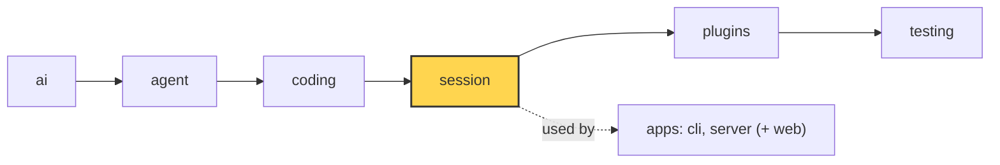

# 21 Part 4 · Context overflow

**Goal:** Recover when the model says the context is too big.

**Builds on:** [20 Compaction](20-compaction.md) · **Next:** [22 Profiles and built-in plugins](22-profiles-plugins.md)

## Where we are



*This chapter adds overflow recovery to the `session` layer (marked). The detection lives in `ai`.*

Big picture of Part 4: [part-4-session](16-part-4-session.md).

Code in this chapter (commit `2fc2776`):

- `packages/simp_agent/src/simp_agent/ai/__init__.py` — `is_context_overflow`, `_OVERFLOW`, `is_retryable`
- `packages/simp_agent/src/simp_agent/session/__init__.py` — `AgentSession._run` (the overflow branch), `compact`
- `packages/simp_agent/tests/test_queues_compaction.py` — `test_overflow_compacts_and_retries_once`, `test_second_overflow_stops`

## Problem

We keep the story of [20](20-compaction.md). The user works in one long session on the fizzbuzz project, and the model has a 200 000-token [context window](glossary.md#context-window). Before each model call, auto compaction checks the size of the history and makes it smaller when it gets close to the limit.

But that check is only a guess. `estimate_tokens` counts real `usage` from the last answer, and for newer messages it uses "4 characters ≈ 1 token". Code and JSON often have more tokens per character than that. The window number in a profile ([22](22-profiles-plugins.md)) can also be wrong. So one day the estimate says 185 000 tokens, the check says "fine", and the user asks the agent to read one more large file. The provider counts 210 000 tokens and answers with an error: "prompt is too long: 210000 tokens > 200000 maximum". The stream ends with an assistant error message ([04](04-parse.md)).

This is a **[context overflow](glossary.md#context-overflow)**: the provider refuses a call because the request is bigger than the context window. The retry of [19](19-retry.md) cannot fix it, because the same request fails the same way every time. And without a fix the session is stuck: every new prompt makes the history even bigger.

The fix is to repair after the error. Chapter 20 **prevents** an overflow before the call, and this chapter **repairs** one after the call:

| | When | How it knows | What it does |
|---|---|---|---|
| Prevent: auto compaction ([20](20-compaction.md)) | before each model call, in `_prepare` | `should_compact` on an estimate | compact, then call |
| Repair: overflow recovery (this chapter) | after a failed call, in `_run` | `is_context_overflow` on the provider error | compact once, then call again |

Prevention handles most cases. Repair is the safety net for the times the guess was wrong.

## Naive version

```text
FUNCTION run(session, text):
    WAIT for session.prompt(text)
    WHILE the last message is an error:
        IF its error text has "too long":
            WAIT for session.compact()
            WAIT for the agent to continue
        ELSE:
            STOP
```

This fixes our one overflow with one provider. It breaks in three ways.

The check looks only for "too long". That is Anthropic's wording ("prompt is too long"). OpenAI says "maximum context length" or "context_length_exceeded", so the check misses them. Even when the check works, the loop has no end. Sometimes one compaction cannot make the request small enough, for example when one huge recent turn must stay (`find_cut` in [20](20-compaction.md#where-do-we-cut) keeps it). Then the loop compacts, fails, and compacts again, and each time it pays for a summary call. And if `compact()` itself fails, the loop still calls the model again and gets the same error.

Where does the fix go? In the same place as retry: `AgentSession._run` ([19](19-retry.md#how-does-retry-work)). It runs after the agent loop ends with an error message. The retry loop from [19](19-retry.md) also needs a change. It must not see an overflow as a short failure. If it did, it would wait and then send the same too-big request again.

| Problem | Fix | Section |
|---|---|---|
| many wordings | one regex in `ai` | [Detecting overflow](#detecting-overflow) |
| retry would resend it | `is_retryable` says no for overflow | [Detecting overflow](#detecting-overflow) |
| endless loop | an `overflowed` flag: compact once per run | [Compact and continue, once](#compact-and-continue-once) |
| compaction fails | `compact()` returns `False`, so stop | [Compact and continue, once](#compact-and-continue-once) |

## Real design

### Detecting overflow

Real code: [ai/__init__.py](../../packages/simp_agent/src/simp_agent/ai/__init__.py) — `_OVERFLOW`, `is_context_overflow`, `is_retryable`

```text
_OVERFLOW = one regex, ignore case, any of:
    "prompt (is) too long", "request_too_large", "exceeds the context window",
    "maximum context length", "context_length_exceeded", "too many tokens",
    "token limit exceeded"

FUNCTION is_context_overflow(error):
    RETURN true IF _OVERFLOW is found in (error or "")   // no text -> false

FUNCTION is_retryable(error, kind):
    IF kind is in NON_RETRYABLE: RETURN false            // see 15
    RETURN NOT is_context_overflow(error) AND _RETRYABLE is found in (error or "")
```

One regex holds the wording of every provider, so the session never needs to know which provider it talks to. It lives in `ai`, next to the retry regex of [19](19-retry.md#which-errors-are-worth-trying-again), because both read provider error text. A wording the regex does not know is not seen as an overflow. The `error or ""` part makes both functions safe when there is no error text: they just return false.

Look at the last line of `is_retryable`. It says "not an overflow" before it checks the retry words. This matters because some overflow messages also match retry words; "too many tokens" looks a lot like the "too many requests" of a rate limit. With this rule an error is an overflow or retryable, never both, so each error goes to exactly one fix. The limit of this design: when a provider uses a new wording, we must add a new pattern.

### Compact and continue, once

The loop in `AgentSession._run` was built in [19](19-retry.md#how-does-retry-work). That chapter showed only the retry branch; here is the overflow branch.

Real code: [session/__init__.py](../../packages/simp_agent/src/simp_agent/session/__init__.py) — `AgentSession._run`

```text
overflowed = false, attempt = 0
WHILE last message is an assistant error:
    IF self.auto_compact AND NOT overflowed AND is_context_overflow(last.error):
        overflowed = true                  // never compact twice in one run
        IF NOT (WAIT for self.compact()): STOP loop
    ELSE IF ...retryable...:               // retry with backoff, chapter 19
        ...
    ELSE:
        STOP loop
    ADD (WAIT for a.continue_()) to new
```

The branch checks three things. `self.auto_compact` is the same switch as in [20](20-compaction.md#if-it-fails-and-when-it-runs): an app that turns off auto compaction also turns off overflow recovery, so there is one switch, not two. `not overflowed` makes the repair run only once per run. If one compaction was not enough, a second one with the same settings would cut at the same place and give the same result, so the flag stops the endless loop and the repeated cost. Then `compact()` runs. As [20](20-compaction.md#if-it-fails-and-when-it-runs) showed, it turns every failure ("nothing to compact", "summary call failed") into `False`. With no smaller history, a new call would only overflow again, so we stop.

If compaction worked, the loop ends with `a.continue_()`, the same as a retry: no new user text, just call the model again. Why does the second call now fit? Because `compact()` appended a `CompactionEntry`, and `build_view` now sends the summary plus the recent messages instead of the full history ([20](20-compaction.md#what-does-the-next-call-see)). The overflow error itself stays in the history, because the history is append-only. But `transform_messages` drops error turns from what is sent ([02](02-pick-clean.md#2-clean-transform_messages)), so the model never sees "prompt is too long".

Clients see the same `compaction_start` and `compaction_end` events as in [20](20-compaction.md). In the UI, a repair looks like a normal auto compaction with one error turn before it.

### Edge cases

The retry side of the loop is in [19](19-retry.md). Four cases matter for overflow.

A **second overflow** in the same run skips the overflow branch, because `overflowed` is already true. An overflow is never retryable, so the loop stops, and the run ends with the error as the last message. With **`auto_compact=False`** the same thing happens at the first overflow: no compaction and no wasted retry. If the **recent part is too big** on its own, `compact()` does not cut harder; it keeps `keep_recent_tokens` as usual, so the second call overflows and the run stops. A clear error is better than a loop. The user sees the error and can start a new session. Last, an **overflow followed by a rate limit** works in one run, because the two counters are separate: `overflowed` is a flag and `attempt` counts retries. Overflow → compact → `429` → wait → success.

**Builds on:** [20 Compaction](20-compaction.md) · **Next:** [22 Profiles and built-in plugins](22-profiles-plugins.md)
