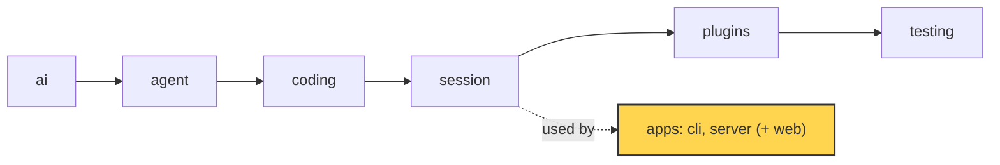

# 21 Part 5 · Transport

**Goal:** Stream events to clients and take commands back.

**Builds on:** [20 The server run](20-server-run.md) · **Next:** [22 Store and auth](22-store-auth.md)

## Where we are



*This chapter adds the transport of the `server` app (marked): how events go out and commands come in.*

Big picture of Part 5: [part-5-system](19-0-part-5-system.md).

Code in this chapter (commit `2fc2776`):

- `apps/server/src/simp_server/server.py` — `Run.subscribe`, `Run._send`, `Run.durable`, `Run.append`, `Run.on_event`, `Run.command`, `Run.approve`, `create_app` (the SSE and POST routes)
- `apps/server/src/simp_server/fake.py` — `sse`
- `apps/server/src/simp_server/protocol.py` — `Snapshot`, `InFlight`, `PendingApproval`, `Approve`
- `apps/server/tests/test_server.py` — the reconnect, approval and slow-client tests

## Problem

Go back to Ana from [20](20-server-run.md#problem). She types "write `fizzbuzz.py`" in a browser tab. In chapter 20 we built the `Run` that does the work on the server, but the run lives in Python and Ana's screen lives in a browser. Nothing yet connects them. This chapter builds that connection: the **transport**, the road that carries events out to the browser and commands back in.

The road out must carry every event (text pieces, tool results, an approval question) to every open tab, live. The road in must carry what Ana sends: a prompt, "stop", "allow this bash call". That part is easy. The hard part is that the network is not kind. Ana's Wi-Fi drops for ten seconds in the middle of the run, and when the tab comes back it must get what it missed, with no gaps and no duplicates. Her colleague opens the same session on a slow laptop, and that slow tab must never slow down the agent. Ana closes her laptop, and the run must keep going and still be saved. And when the agent asks "may I run `bash`?" ([08](08-hooks-approval.md)), the answer now comes over HTTP, maybe from a different tab than the one that saw the question.

## Naive version

The simplest idea: keep a list of queues, one per client, and put every event in each queue.

```python
import asyncio

class Run:
    def __init__(self):
        self.subs = []

    def subscribe(self) -> asyncio.Queue:
        q = asyncio.Queue()          # no limit
        self.subs.append(q)
        return q

    def send(self, ev: dict) -> None:
        for q in self.subs:
            q.put_nowait(ev)

async def main():
    run = Run()
    tab = run.subscribe()
    run.send({"type": "user_message", "text": "write fizzbuzz.py"})
    run.subs.remove(tab)             # the network drops
    run.send({"type": "tool_result", "content": "wrote fizzbuzz.py"})
    tab = run.subscribe()            # the tab reconnects
    run.send({"type": "run_state", "state": "idle"})
    print([(await tab.get())["type"] for _ in range(tab.qsize())])

asyncio.run(main())
# ['run_state']  -- the tool_result is lost
```

It works while the network is perfect. It breaks when:

1. **A tab reconnects.** Events sent while it was away are gone. The tab never learns that `fizzbuzz.py` was written.
2. **A tab is slow.** The queue has no limit. A tab that stops reading makes memory grow forever.
3. **A tab joins mid-message.** It gets the next text delta, but not the text before it. The answer on screen starts in the middle.
4. **There is no way back in.** Nothing here takes "abort" or "allow" from the client.

## Step by step: from naive to real

We fix the four breaks one by one.

**Step 1: number the events.** Chapter 20 already split server events into [durable events](glossary.md#durable-event) (saved, like a tool result or a run state) and [live events](glossary.md#live-event) (small streaming text pieces that are not saved, because the full text is saved later in the finished message). We give each durable event the next number, its [`seq`](glossary.md#seq), and keep them in a log.

```python
    def send(self, ev: dict) -> None:
        self.seq += 1
        ev = {**ev, "seq": self.seq}
        self.log.append(ev)
        ...
```

Why: now every event has a place in a line. A client can say "I saw up to N".

**Step 2: replay on subscribe.** Return the missed events with the queue.

```python
    def subscribe(self, after: int):
        q = asyncio.Queue()
        self.subs.add(q)
        return [e for e in self.log if e["seq"] > after], q
```

Why: a tab that comes back gets what it missed. To see why nothing comes twice, you need one rule of asyncio: it switches from one task to another **only at an `await`**. This function has no `await`, so it runs in one piece:

```text
agent task:      send(seq 4) ............................ send(seq 5)
subscribe task:            [copy log up to 4, add q]
                           no await = nothing runs in between
```

Seq 4 is in the copy and not in `q`; seq 5 is in `q` and not in the copy. No gaps, no duplicates.

**Step 3: add a snapshot.** Add the state right now (`last_seq`, `run_state`, `in_flight`, `pending_approval`) to the end of the replay.

Why: live deltas have no `seq` and are not saved. A tab that joins mid-message needs the text so far. The snapshot gives it.

**Step 4: bound the queue and drop slow tabs.**

```python
        q = asyncio.Queue(QUEUE_MAX)
        ...
            except asyncio.QueueFull:
                self.subs.discard(q)
```

Why: a tab that stops reading must not grow memory, and must never make the run wait. Dropping it is safe because of Step 2: when it reconnects, the replay gives it back every durable event it lost, exactly.

**Step 5: take commands in.** Add a `POST` route and a `Run.command` method. An approval waits on a future that an `Approve` command sets.

Why: the client needs a way to say "stop" or "allow".

These five steps are the whole idea. The rest of the chapter shows how the real code in `server.py` does each one, in the order an event travels: the two HTTP routes, the counter, the replay, the stream loop, the slow-tab rule, and then the road in (commands and approval).

## Real design

All code is in `apps/server/src/simp_server/server.py` unless said otherwise.

### SSE out, POST in

The server uses two plain HTTP routes:

```text
ON POST /api/sessions/{sid}/commands (logged-in user u):
    c = check the JSON body with the protocol Command parser
    IF it does not fit: FAIL with HTTP 422 and the errors
    get the Run for (u, sid), and run its command(c)
    RETURN {"ok": true}

ON GET /api/sessions/{sid}/events?after=N (logged-in user u):
    ...
    RETURN a long response of type text/event-stream, filled by gen()
```

Real code: [apps/server/src/simp_server/server.py](../../apps/server/src/simp_server/server.py), functions `post_command` and `events` inside `create_app`.

Events go out with **[SSE](glossary.md#sse)** (Server-Sent Events). SSE is one long HTTP response with `text/event-stream` type. The server writes small text blocks into it, one per event. The browser reads them with a small fetch-based reader (see [25](25-web-client.md#fetch-based-sse)).

Commands come in with a normal `POST`. The body is JSON, checked by the `Command` parser from [20](20-server-run.md#protocol-models). A bad body gets `422`.

Why not WebSocket? SSE is one-way, which is all we need out, since commands already have their own `POST`. Plain HTTP works through proxies, and when the stream ends our client reconnects by itself, with backoff ([25](25-web-client.md#fetch-based-sse)). That is how a dropped tab "learns" it was dropped: its stream simply ends. Both routes need auth ([22](22-store-auth.md)).

Each event is written by `sse` in `apps/server/src/simp_server/fake.py`:

```text
FUNCTION sse(ev):
    IF ev has a seq: start with the line "id: <seq>"
    then the line   "event: <type>"
    then the line   "data: <ev as JSON>"
    then one empty line                   // ends the event
```

Real code: [apps/server/src/simp_server/fake.py](../../apps/server/src/simp_server/fake.py), function `sse`.

Note the `id:` line. It is only there when the event has a `seq`. That is the key to replay.

### seq: one counter for everything

Only durable events get a `seq` (the two kinds are in Step 1 above). `seq` is a number that goes up by one for each saved row. `Run.durable` makes a durable event:

```text
FUNCTION durable(cls, fields):
    seq = seq + 1
    ev = build model cls(seq, fields) as a dict    // a wrong field fails here
    ADD ev to log
    _send(ev)                                      // to live tabs
    SAVE ev in the store as row (user, session, seq, type)
```

Real code: [apps/server/src/simp_server/server.py](../../apps/server/src/simp_server/server.py), method `Run.durable`.

It adds the event to the in-memory `log`, sends it to live tabs, and saves it.

The store also holds a second kind of row that tabs never see. To resume after a restart, the agent must save its own core messages (the list the model sees, [13](13-session.md)). The `Run` is the `SessionStore` of its `AgentSession`, so the session calls `Run.append` for each message, and that saves a row of type `"msg"` with the **same** counter:

```text
FUNCTION append(entry):
    seq = seq + 1
    SAVE entry in the store as row (user, session, seq, "msg")
```

Real code: [apps/server/src/simp_server/server.py](../../apps/server/src/simp_server/server.py), method `Run.append`.

Why one counter? So the store is one ordered stream: on resume, core messages and protocol events come back in the exact order they happened. The cost is that `log` (protocol events only) has **holes**: seq 1 might be a `run_state`, seq 2 and 3 `"msg"` rows, seq 4 the next event. That is fine, because a tab only ever asks "everything after N", never "event number N+1". The [`ponytail:` comment](glossary.md#ponytail-comment) (a marked shortcut, see [27](27-limits-choices-extend.md)) in `__init__` names the other cost: `# ponytail: whole log in memory`. After a restart that log is rebuilt from the store ([22](22-store-auth.md)).

### Replay: `after`, then snapshot, then live

When a tab connects, it says "I have seen up to seq N". `Run.subscribe(after)` builds the answer:

```text
FUNCTION subscribe(after):
    // missed durable events, then a snapshot, then live.
    // No await here, so nothing slips in between.
    q = a new queue that holds at most QUEUE_MAX events
    ADD q to subs
    snap = Snapshot(last_seq = seq, run_state, in_flight,
                    pending_approval, title, plan_mode)
    RETURN ( every e in log with e["seq"] > after, then snap ),  q
```

Real code: [apps/server/src/simp_server/server.py](../../apps/server/src/simp_server/server.py), method `Run.subscribe`.

The answer has three parts, in this order: the missed log events (`seq > after`), then a [snapshot](glossary.md#snapshot) of the state right now, then the queue `q` for everything after. `last_seq` is the counter right now, so it can be a `"msg"` row's number, bigger than the last event the tab saw; the tab uses it as its new "seen up to" mark.

**Example.** The log has durable events with seq 1, 2, 4 and 6 (3 and 5 are `"msg"` rows). The model is in the middle of a reply: "Hello " has streamed so far. A tab reconnects with `after=3`. It gets:

```text
first = [ event seq 4,
          event seq 6,
          snapshot(last_seq = 6, run_state = "running",
                   in_flight.text = "Hello ", pending_approval = none) ]
q     = a new queue; the next text delta arrives here
```

The tab already had 1 to 3, so nothing comes twice. It shows "Hello " from the snapshot and adds the next deltas after it.

The SSE route finds `after` and calls `subscribe`. The tab gives N with `?after=N`, or with the [`Last-Event-ID`](glossary.md#last-event-id) header that our client sends on every connect ([25](25-web-client.md#fetch-based-sse)):

```text
after = the ?after=N value, ELSE the Last-Event-ID header, ELSE 0
first, q = run.subscribe(after)
```

The docstring says "No await here": that is the rule from [Step 2](#step-by-step-from-naive-to-real).

The snapshot fixes problem 3 of the naive version. `in_flight` (`p.InFlight`) holds the text, thinking and tool output of the message that is still streaming. `Run.on_event` keeps it up to date while deltas arrive:

```text
IF the event is message_update with a text_delta or thinking_delta:
    kind  = "text" or "thinking"
    off   = length of the in-flight kind so far     // where this piece starts
    ADD delta to the in-flight kind
    _send live event TextDelta / ThinkingDelta(msg_id, offset = off, delta)
```

Real code: [apps/server/src/simp_server/server.py](../../apps/server/src/simp_server/server.py), method `Run.on_event`.

Each delta carries an [`offset`](glossary.md#offset): where it starts in the full text. A tab that joined late gets "Hello " in the snapshot, then a delta with `offset=6`. If the offset equals the length it already has, the piece fits; if not, the tab knows it is out of step ([25 · appendAt](25-web-client.md#appendat) shows what it does).

### The SSE loop

```text
FUNCTION gen():
    FOR EACH ev in first: SEND sse(ev)            // replay + snapshot
    WHILE q is still in subs, or q is not empty:  // dropped: send what we have, then end
        WAIT for the next event in q, at most HEARTBEAT seconds
        IF one came: SEND sse(it)
        ELSE (time is up):
            IF the client is gone, or its token is no longer valid: STOP
            SEND ": ping"                          // keeps proxies from closing it
    ALWAYS at the end: REMOVE q from subs
```

Real code: [apps/server/src/simp_server/server.py](../../apps/server/src/simp_server/server.py), function `gen` inside `events` in `create_app`.

It first sends the replay and the snapshot, then waits for live events. The odd loop test means: keep going while this tab is still subscribed, and if it was dropped, still send what is left in its queue before ending. If nothing comes for `HEARTBEAT` (15 seconds; see [Heartbeat](glossary.md#heartbeat)), it checks whether the client is gone or its token is no longer valid; if both are fine, it sends `": ping"`. A line that starts with `:` is a comment in SSE, so the browser ignores it, but proxies see traffic and do not close the idle connection. `finally` removes the queue, so a closed tab stops getting events.

### Slow clients are dropped, never waited for

```text
FUNCTION _send(ev):
    FOR EACH queue q in subs:
        put ev in q, but never wait
        IF q is full:                // never block the run
            REMOVE q from subs       // the slow tab reconnects and gets a snapshot
```

Real code: [apps/server/src/simp_server/server.py](../../apps/server/src/simp_server/server.py), method `Run._send`.

Each queue holds at most `QUEUE_MAX` (1000) events. `put_nowait` never waits. If a queue is full, the server removes it from `subs`. The SSE loop above then sends what is left and ends. The browser reconnects with `Last-Event-ID` and gets the missed durable events plus a fresh snapshot. The run never waits for a tab. This fixes problem 2.

Because the run only talks to queues, a run with **zero** tabs works the same. The fizzbuzz task keeps going after you close the browser, and every durable event is saved.

### The command queue

`Run.command` handles every command type. For text:

```text
IF c is Prompt, FollowUp or Steer:
    IF not busy:
        start a run with c.text
    ELSE IF steer queue + follow-up queue >= MAX_QUEUED:
        FAIL with HTTP 429 "messages already queued"
    ELSE IF c is Steer:
        session.steer(c.text)
    ELSE:
        session.follow_up(c.text)
```

Real code: [apps/server/src/simp_server/server.py](../../apps/server/src/simp_server/server.py), method `Run.command`.

"Busy" means the state is `running`, `waiting_approval` or `aborting`. If the run is idle, any text starts a new run. If it is busy, the text goes into the agent's steering or follow-up queue ([07](07-steering.md)), and a `Prompt` while busy becomes a follow-up. At most `MAX_QUEUED` (20) messages can wait; one more gets `429`, so a stuck button cannot fill memory.

`start` does not wait for the run. It sets state `running` and starts `_run` as an asyncio task. So the POST returns `{"ok": true}` at once, and the results come over SSE.

When a run ends, `_turn` starts the next one from any follow-up that came too late for the loop ([20 · Run state machine](20-server-run.md#run-state-machine)).

`Abort` sets state `aborting` and calls `session.abort()` ([06](06-events-abort.md)), but only if the run is busy and not already aborting, so a double click does nothing. `Compact` and `Continue` return `409` while busy.

### Approval over the wire

In [08](08-hooks-approval.md) the agent asks an `approve` callback before a risky tool call. On the server, `Run.approve` is that callback:

```text
FUNCTION approve(call):     // ask every tab, wait for a decision. Abort cancels this.
    answer  = a new empty future
    pending = PendingApproval(call_id, tool, args)
    TRY:                    // an abort can land at any wait here
        SEND durable event ApprovalRequest(call_id, tool, args)
        IF state is "running": set_state("waiting_approval")
        decision = WAIT for answer
    IF cancelled (abort):
        pending = none
        SEND durable event ApprovalResolved(call_id, decision = "aborted")
        stop here (pass the cancel on)
    ...
```

Real code: [apps/server/src/simp_server/server.py](../../apps/server/src/simp_server/server.py), method `Run.approve`.

It creates a **[future](glossary.md#future)**: an asyncio object that a task can wait on until someone else sets its value. It sends a durable `approval_request` to every tab and waits. The answer comes in as an `Approve` command:

```text
ELSE IF c is Approve:
    IF nothing is pending, OR the call_id does not match, OR answer is already set:
        FAIL with HTTP 409 "no pending approval with that call_id"
    set answer to c.decision            // approve() wakes up
```

Real code: [apps/server/src/simp_server/server.py](../../apps/server/src/simp_server/server.py), method `Run.command`.

The `call_id` must match the pending call. A second tab that clicks late gets `409`, so one call is never answered twice. Why an error and not a silent ignore? The late tab must learn its click did nothing; it then shows the `approval_resolved` event that is already on its way. The decision is `"allow"`, `"deny"` or `"always"` (`Decision` in `protocol.py`).

If the user aborts while waiting, the task is cancelled. The `except` branch saves `approval_resolved` with `"aborted"`, so every tab sees the question closed. A tab that connects during the wait gets the question from `pending_approval` in the snapshot.

## Test

`apps/server/tests/test_server.py::test_reconnect_with_last_event_id_no_gaps_or_dups`:

```python
async def test_reconnect_with_last_event_id_no_gaps_or_dups(env):
    _, _, _, _, run = await env(FakeProvider(reply("a"), reply("b")))
    first, q = run.subscribe(0)
    await run.command(p.Prompt(text="hi"))
    await wait_for(lambda: run.state == "idle")
    seen = [e for e in first + drain(q) if "seq" in e][:3]
    run.subs.discard(q)  # the tab closes after seeing part of the log
    await run.command(p.Prompt(text="again"))
    await wait_for(lambda: run.state == "idle" and run.task.done())
    again, _ = run.subscribe(seen[-1]["seq"])
    seqs = [e["seq"] for e in seen + again if "seq" in e]
    assert seqs == [e["seq"] for e in run.log]  # every durable event exactly once, in order
    assert again[-1]["type"] == "snapshot" and again[-1]["last_seq"] == run.seq
```

`env`, `drain` and `wait_for` are small helpers at the top of the test file: `env` builds a `Run` with a fresh store, `drain` empties a queue into a list, and `wait_for` waits until a condition is true. `FakeProvider` ([04](04-label-test.md)) gives two simple replies, so no real model is needed. A tab subscribes, sees only the first 3 durable events of the first run, then closes. A second run happens while it is away. The tab reconnects with the last `seq` it saw, and the old part plus the replay must equal the full `run.log`: each `seq` once, in order. The replay must end with a snapshot whose `last_seq` is the current counter.

This is the case the naive version failed. Other tests in the file: `test_mid_delta_reconnect_snapshot`, `test_approve_then_abort`, `test_slow_client_dropped_never_blocks`, `test_closed_tabs_run_finishes_and_is_persisted`.

Run it:

```sh
uv run pytest apps/server/tests/test_server.py::test_reconnect_with_last_event_id_no_gaps_or_dups -q
```

## Why this way

> **One numbered log, many cheap readers.** Every saved event gets the next `seq`, and the run only puts events into small, bounded queues. A client is just "a reader at position N". Reconnect = "give me everything after N, then the state now". This makes reconnects exact, keeps slow tabs from hurting the run, and lets the run go on with no tabs at all. Live deltas are not saved; the snapshot covers them instead. SSE + POST keeps it plain HTTP. The cost: the whole log is kept in memory per run, and a dropped tab must reconnect.

## Exercises

1. Run the naive version, then add Step 1 and Step 2. Does the reconnecting tab now see the `tool_result`?
2. In `subscribe`, change `e["seq"] > after` to `>=`. Which event comes twice? Run the reconnect test to see it fail.

## Recap

Events go out on one long SSE response and commands come in on plain `POST`s. Each durable event takes the next `seq` from one counter shared with the agent's `"msg"` rows, so the log has holes but one order. A tab that (re)connects says "after N" and gets the missed events, a snapshot (with the text still streaming and any open approval), then a live queue, all with no `await` in between. Queues are bounded, and a full one drops the tab, which reconnects and catches up. On the way in, a busy run queues text as steer or follow-up, and an approval is a future that the matching `Approve` command sets. [22](22-store-auth.md) next shows where these rows are saved and who may read them.

**Builds on:** [20 The server run](20-server-run.md) · **Next:** [22 Store and auth](22-store-auth.md)

