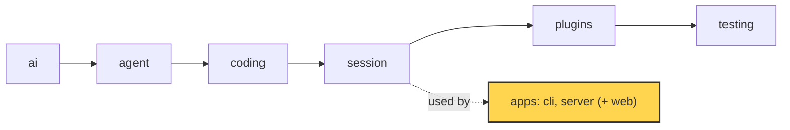

# 21 Part 5 · Transport

**Goal:** Stream events to clients and take commands back.

**Builds on:** [20 The server run](20-server-run.md) · **Next:** [22 Store and auth](22-store-auth.md)

## Where we are



*This chapter adds the transport of the `server` app (marked): how events go out and commands come in.*

Big picture of Part 5: [part-5-system](part-5-system.md).

Code in this chapter (commit `2fc2776`):

- `apps/server/src/simp_server/server.py` — `Run.subscribe`, `Run._send`, `Run.durable`, `Run.command`, `Run.approve`, `create_app` (the SSE and POST routes)
- `apps/server/src/simp_server/fake.py` — `sse`
- `apps/server/src/simp_server/protocol.py` — `Snapshot`, `InFlight`, `PendingApproval`, `Approve`
- `apps/server/tests/test_server.py` — the reconnect, approval and slow-client tests

## Problem

The `Run` from [20](20-server-run.md) runs the fizzbuzz task on the server, but a browser cannot see it yet. We still need two roads:

- **Out:** every event (text deltas, tool results, approval requests) must reach every open browser tab, live.
- **In:** the user must send commands: a prompt, "stop", "allow this bash call".

And the network is not kind:

- A tab can lose its connection in the middle of a run. When it comes back, it must get what it missed, with **no gaps and no duplicates**.
- A tab can be slow. A slow tab must never slow down the agent.
- A tab can close. The run must keep going and still be saved.
- The agent may wait for a human "allow" ([08](08-hooks-approval.md)). That answer now comes over HTTP, maybe from another tab.

## Naive version

The simplest idea: keep a list of queues, one per client, and put every event in each queue.

```python
import asyncio

class Run:
    def __init__(self):
        self.subs = []

    def subscribe(self) -> asyncio.Queue:
        q = asyncio.Queue()          # no limit
        self.subs.append(q)
        return q

    def send(self, ev: dict) -> None:
        for q in self.subs:
            q.put_nowait(ev)

async def main():
    run = Run()
    tab = run.subscribe()
    run.send({"type": "user_message", "text": "write fizzbuzz.py"})
    run.subs.remove(tab)             # the network drops
    run.send({"type": "tool_result", "content": "wrote fizzbuzz.py"})
    tab = run.subscribe()            # the tab reconnects
    run.send({"type": "run_state", "state": "idle"})
    print([(await tab.get())["type"] for _ in range(tab.qsize())])

asyncio.run(main())
# ['run_state']  -- the tool_result is lost
```

It works while the network is perfect. It breaks when:

1. **A tab reconnects.** Events sent while it was away are gone. The tab never learns that `fizzbuzz.py` was written.
2. **A tab is slow.** The queue has no limit. A tab that stops reading makes memory grow forever.
3. **A tab joins mid-message.** It gets the next text delta, but not the text before it. The answer on screen starts in the middle.
4. **There is no way back in.** Nothing here takes "abort" or "allow" from the client.

## Step by step: from naive to real

We fix the four breaks one by one.

**Step 1: number the events.** Give each saved event a [`seq`](glossary.md#seq), and keep a log.

```python
    def send(self, ev: dict) -> None:
        self.seq += 1
        ev = {**ev, "seq": self.seq}
        self.log.append(ev)
        ...
```

Why: now every event has a place in a line. A client can say "I saw up to N".

**Step 2: replay on subscribe.** Return the missed events with the queue.

```python
    def subscribe(self, after: int):
        q = asyncio.Queue()
        self.subs.add(q)
        return [e for e in self.log if e["seq"] > after], q
```

Why: a tab that comes back gets what it missed. There is no `await`, so no event can slip in between the copy and the `add`. No gaps, no duplicates.

**Step 3: add a snapshot.** Add the state right now (`last_seq`, `run_state`, `in_flight`, `pending_approval`) to the end of the replay.

Why: live deltas have no `seq` and are not saved. A tab that joins mid-message needs the text so far. The snapshot gives it.

**Step 4: bound the queue and drop slow tabs.**

```python
        q = asyncio.Queue(QUEUE_MAX)
        ...
            except asyncio.QueueFull:
                self.subs.discard(q)
```

Why: a tab that stops reading must not grow memory, and must never make the run wait. It reconnects and catches up with Step 2.

**Step 5: take commands in.** Add a `POST` route and a `Run.command` method. An approval waits on a future that an `Approve` command sets.

Why: the client needs a way to say "stop" or "allow". Now put it all together, in real code below.

## Real design

All code is in `apps/server/src/simp_server/server.py` unless said otherwise.

### SSE out, POST in

The server uses two plain HTTP routes:

```text
ON POST /api/sessions/{sid}/commands (logged-in user u):
    c = check the JSON body with the protocol Command parser
    IF it does not fit: FAIL with HTTP 422 and the errors
    get the Run for (u, sid), and run its command(c)
    RETURN {"ok": true}

ON GET /api/sessions/{sid}/events?after=N (logged-in user u):
    ...
    RETURN a long response of type text/event-stream, filled by gen()
```

Real code: [apps/server/src/simp_server/server.py](../../apps/server/src/simp_server/server.py), functions `post_command` and `events` inside `create_app`.

Events go out with **[SSE](glossary.md#sse)** (Server-Sent Events). SSE is one long HTTP response with `text/event-stream` type. The server writes small text blocks into it, one per event. The browser reads them with a small fetch-based reader (see [25](25-web-client.md#fetch-based-sse)).

Commands come in with a normal `POST`. The body is JSON, checked by the protocol models from [20](20-server-run.md) (`p.command`). A bad body gets `422`.

Why not WebSocket? SSE is one-way, which is all we need out. Plain HTTP works through proxies, and our client reconnects by itself, with backoff. Both routes need auth ([22](22-store-auth.md)).

Each event is written by `sse` in `apps/server/src/simp_server/fake.py`:

```text
FUNCTION sse(ev):
    IF ev has a seq: start with the line "id: <seq>"
    then the line   "event: <type>"
    then the line   "data: <ev as JSON>"
    then one empty line                   // ends the event
```

Real code: [apps/server/src/simp_server/fake.py](../../apps/server/src/simp_server/fake.py), function `sse`.

Note the `id:` line. It is only there when the event has a `seq`. That is the key to replay.

### seq: one counter for everything

Events are of two kinds:

- **[Durable events](glossary.md#durable-event)**: user message, assistant message, tool result, approval request and answer, run state, notices. They are saved and have a `seq`.
- **[Live events](glossary.md#live-event)**: `text_delta`, `thinking_delta`, `tool_output`. They are small pieces of an unfinished message. They are **not** saved and have no `seq`.

`seq` is a number that goes up by one for each saved row. `Run.durable` makes a durable event:

```text
FUNCTION durable(cls, fields):
    seq = seq + 1
    ev = build model cls(seq, fields) as a dict    // a wrong field fails here
    ADD ev to log
    _send(ev)                                      // to live tabs
    SAVE ev in the store as row (user, session, seq, type)
```

Real code: [apps/server/src/simp_server/server.py](../../apps/server/src/simp_server/server.py), method `Run.durable`.

It adds the event to the in-memory `log`, sends it to live clients, and saves it. The `Run` is also the `SessionStore` of its `AgentSession` ([13](13-session.md)). Its `append` uses the **same** counter:

```text
// SessionStore for AgentSession: core messages share the seq counter with protocol events
FUNCTION append(entry):
    seq = seq + 1
    SAVE entry in the store as row (user, session, seq, "msg")
```

Real code: [apps/server/src/simp_server/server.py](../../apps/server/src/simp_server/server.py), method `Run.append`.

So core messages (`"msg"` rows, used to resume the agent) and protocol events live in one ordered stream. `self.log` keeps only the protocol events (`e["type"] != "msg"`). The comment in `__init__` says it plainly: `# ponytail: whole log in memory`.

### Replay: `after`, then snapshot, then live

When a tab connects, it says "I have seen up to seq N". It can do this with `?after=N`, or with the [`Last-Event-ID`](glossary.md#last-event-id) header that our client sends on every connect ([25](25-web-client.md#fetch-based-sse)):

```text
after = the ?after=N value, ELSE the Last-Event-ID header, ELSE 0
first, q = run.subscribe(after)
```

`Run.subscribe` builds the answer:

```text
FUNCTION subscribe(after):
    // missed durable events, then a snapshot, then live.
    // No await here, so nothing slips in between.
    q = a new queue that holds at most QUEUE_MAX events
    ADD q to subs
    snap = Snapshot(last_seq = seq, run_state, in_flight,
                    pending_approval, title, plan_mode)
    RETURN ( every e in log with e["seq"] > after, then snap ),  q
```

Real code: [apps/server/src/simp_server/server.py](../../apps/server/src/simp_server/server.py), method `Run.subscribe`.

Three parts, in this order:

1. **Missed events:** every log event with `seq > after`. No gaps.
2. **A [snapshot](glossary.md#snapshot):** the state right now. `last_seq`, `run_state`, the pending approval, and `in_flight`.
3. **Live:** the queue `q`, for everything after.

The docstring says "No await here". That matters. asyncio only switches tasks at an `await`. With no `await`, no new event can be sent between "copy the log" and "add the queue". So nothing is missed and nothing comes twice.

The snapshot fixes problem 3 of the naive version. `in_flight` (`p.InFlight`) holds the text, thinking and tool output of the message that is still streaming. `Run.on_event` keeps it up to date while deltas arrive:

```text
IF the event is message_update with a text_delta or thinking_delta:
    kind  = "text" or "thinking"
    off   = length of the in-flight kind so far     // where this piece starts
    ADD delta to the in-flight kind
    _send live event TextDelta / ThinkingDelta(msg_id, offset = off, delta)
```

Real code: [apps/server/src/simp_server/server.py](../../apps/server/src/simp_server/server.py), method `Run.on_event`.

Each delta carries an [`offset`](glossary.md#offset): where it starts in the full text. A tab that joined late gets "Hello " in the snapshot, then a delta with `offset=6`. It can check that the pieces fit.

### The SSE loop

```text
FUNCTION gen():
    FOR EACH ev in first: SEND sse(ev)            // replay + snapshot
    WHILE q is still in subs, or q is not empty:  // dropped: send what we have, then end
        WAIT for the next event in q, at most HEARTBEAT seconds
        IF one came: SEND sse(it)
        ELSE (time is up):
            IF the client is gone, or its token is no longer valid: STOP
            SEND ": ping"                          // keeps proxies from closing it
    ALWAYS at the end: REMOVE q from subs
```

Real code: [apps/server/src/simp_server/server.py](../../apps/server/src/simp_server/server.py), function `gen` inside `events` in `create_app`.

- First it sends the replay and the snapshot.
- Then it waits for live events. If nothing comes for `HEARTBEAT` (15 seconds; see [Heartbeat](glossary.md#heartbeat)), it checks two things: is the client gone, and is its token still valid? If both are fine, it sends `": ping"`. A line that starts with `:` is a comment in SSE. It keeps proxies from closing the idle connection.
- `finally` removes the queue, so a closed tab stops getting events.

### Slow clients are dropped, never waited for

```text
FUNCTION _send(ev):
    FOR EACH queue q in subs:
        put ev in q, but never wait
        IF q is full:                // never block the run
            REMOVE q from subs       // the slow tab reconnects and gets a snapshot
```

Real code: [apps/server/src/simp_server/server.py](../../apps/server/src/simp_server/server.py), method `Run._send`.

Each queue holds at most `QUEUE_MAX` (1000) events. `put_nowait` never waits. If a queue is full, the server removes it from `subs`. The SSE loop above then sends what is left and ends. The browser reconnects with `Last-Event-ID` and gets the missed durable events plus a fresh snapshot. The run never waits for a tab. This fixes problem 2.

Because the run only talks to queues, a run with **zero** tabs works the same. The fizzbuzz task keeps going after you close the browser, and every durable event is saved.

### The command queue

`Run.command` handles every command type. For text:

```text
IF c is Prompt, FollowUp or Steer:
    IF not busy:
        start a run with c.text
    ELSE IF steer queue + follow-up queue >= MAX_QUEUED:
        FAIL with HTTP 429 "messages already queued"
    ELSE IF c is Steer:
        session.steer(c.text)
    ELSE:
        session.follow_up(c.text)
```

Real code: [apps/server/src/simp_server/server.py](../../apps/server/src/simp_server/server.py), method `Run.command`.

- If the run is idle, any text starts a new run.
- If the run is busy, the text goes into the agent's steering or follow-up queue ([07](07-steering.md)). A `Prompt` while busy becomes a follow-up.
- At most `MAX_QUEUED` (20) messages can wait. More gets `429`.

`start` does not wait for the run. It sets state `running` and starts `_run` as an asyncio task. So the POST returns `{"ok": true}` at once, and the results come over SSE.

When a run ends, `_turn` checks for follow-ups that came too late for the loop:

```text
IF the agent still has follow-ups:      // came in after the loop decided to stop
    TAKE the first one, and start a new run with its text
```

Real code: [apps/server/src/simp_server/server.py](../../apps/server/src/simp_server/server.py), method `Run._turn`.

`Abort` sets state `aborting` and calls `session.abort()` ([06](06-events-abort.md)). `Compact` and `Continue` return `409` while busy.

### Approval over the wire

In [08](08-hooks-approval.md) the agent asks an `approve` callback before a risky tool call. On the server, `Run.approve` is that callback:

```text
FUNCTION approve(call):     // ask every tab, wait for a decision. Abort cancels this.
    answer  = a new empty future
    pending = PendingApproval(call_id, tool, args)
    TRY:                    // an abort can land at any wait here
        SEND durable event ApprovalRequest(call_id, tool, args)
        IF state is "running": set_state("waiting_approval")
        decision = WAIT for answer
    IF cancelled (abort):
        pending = none
        SEND durable event ApprovalResolved(call_id, decision = "aborted")
        stop here (pass the cancel on)
    ...
```

Real code: [apps/server/src/simp_server/server.py](../../apps/server/src/simp_server/server.py), method `Run.approve`.

It creates a **[future](glossary.md#future)**: an asyncio object that a task can wait on until someone else sets its value. It sends a durable `approval_request` to every tab and waits. The answer comes in as an `Approve` command:

```text
ELSE IF c is Approve:
    IF nothing is pending, OR the call_id does not match, OR answer is already set:
        FAIL with HTTP 409 "no pending approval with that call_id"
    set answer to c.decision            // approve() wakes up
```

Real code: [apps/server/src/simp_server/server.py](../../apps/server/src/simp_server/server.py), method `Run.command`.

The `call_id` must match the pending call. A second tab that clicks late gets `409`, so one call is never answered twice. The decision is `"allow"`, `"deny"` or `"always"` (`Decision` in `protocol.py`).

If the user aborts while waiting, the task is cancelled. The `except` branch saves `approval_resolved` with `"aborted"`, so every tab sees the question closed. A tab that connects during the wait gets the question from `pending_approval` in the snapshot.

## Test

`apps/server/tests/test_server.py::test_reconnect_with_last_event_id_no_gaps_or_dups`:

```python
async def test_reconnect_with_last_event_id_no_gaps_or_dups(env):
    _, _, _, _, run = await env(FakeProvider(reply("a"), reply("b")))
    first, q = run.subscribe(0)
    await run.command(p.Prompt(text="hi"))
    await wait_for(lambda: run.state == "idle")
    seen = [e for e in first + drain(q) if "seq" in e][:3]
    run.subs.discard(q)  # the tab closes after seeing part of the log
    await run.command(p.Prompt(text="again"))
    await wait_for(lambda: run.state == "idle" and run.task.done())
    again, _ = run.subscribe(seen[-1]["seq"])
    seqs = [e["seq"] for e in seen + again if "seq" in e]
    assert seqs == [e["seq"] for e in run.log]  # every durable event exactly once, in order
    assert again[-1]["type"] == "snapshot" and again[-1]["last_seq"] == run.seq
```

What it checks:

- `FakeProvider` ([04](04-label-test.md)) gives two simple replies. No real model.
- A tab subscribes, sees part of the first run (only the first 3 durable events), then closes.
- A second run happens while the tab is away.
- The tab reconnects with the last `seq` it saw. Old part + replay = the full `run.log`, each `seq` **once**, **in order**.
- The replay ends with a snapshot whose `last_seq` is the current `seq`.

This is the case the naive version failed. Other tests in the file: `test_mid_delta_reconnect_snapshot`, `test_approve_then_abort`, `test_slow_client_dropped_never_blocks`, `test_closed_tabs_run_finishes_and_is_persisted`.

Run it:

```sh
uv run pytest apps/server/tests/test_server.py::test_reconnect_with_last_event_id_no_gaps_or_dups -q
```

## Why this way

> **One numbered log, many cheap readers.** Every saved event gets the next `seq`, and the run only puts events into small, bounded queues. A client is just "a reader at position N". Reconnect = "give me everything after N, then the state now". This makes reconnects exact, keeps slow tabs from hurting the run, and lets the run go on with no tabs at all. Live deltas are not saved; the snapshot covers them instead. SSE + POST keeps it plain HTTP. The cost: the whole log is kept in memory per run, and a dropped tab must reconnect.

## Exercises

1. Run the naive version, then add Step 1 and Step 2. Does the reconnecting tab now see the `tool_result`?
2. In `subscribe`, change `e["seq"] > after` to `>=`. Which event comes twice? Run the reconnect test to see it fail.

## Recap

- Events go out on SSE (`GET /events`); commands come in on `POST /commands`.
- Durable events get a `seq` from one counter, shared with core messages.
- `subscribe(after)` returns missed events, then a snapshot, then a live queue, with no `await` in between.
- The snapshot carries in-flight text, run state and any pending approval.
- Queues are bounded; a full queue drops the client, which reconnects with `Last-Event-ID`.
- Busy runs queue text as steer or follow-up, up to 20.
- Approval is a future, answered by an `Approve` command with the matching `call_id`.

**Builds on:** [20 The server run](20-server-run.md) · **Next:** [22 Store and auth](22-store-auth.md)

