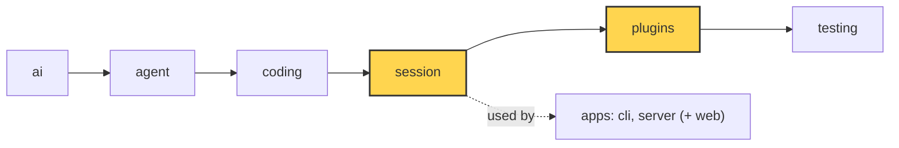

# 22 Part 4 · Profiles and built-in plugins

**Goal:** Pick models by profile and ship two real plugins.

**Builds on:** [21 Context overflow](21-overflow.md) · **Next:** [23 Part 5 big picture](23-part-5-system.md)

## Where we are



*This chapter adds `session/profile.py` and fills the `plugins` layer (both marked).*

Big picture of Part 4: [part-4-session](16-part-4-session.md).

Code in this chapter (commit `2fc2776`):

- `packages/simp_agent/src/simp_agent/session/profile.py` — `build_model`
- `packages/simp_agent/src/simp_agent/plugins/__init__.py` — `build_plugins`
- `packages/simp_agent/src/simp_agent/plugins/redact_secrets.py` — `RedactSecrets`
- `packages/simp_agent/src/simp_agent/plugins/plan_mode.py` — `PlanMode`
- `packages/simp_agent/tests/test_profile.py`, `apps/cli/tests/test_sockets.py` — the profile and plugin tests

## Problem

Part 4 built a session that saves, retries, compacts and runs plugins. But so far you choose the model and the plugins in Python code. Two needs are left:

- **Pick a model without code.** Someone wants the agent to use a small local model (`qwen`) on their own machine instead of Claude. They should only edit a settings file.
- **Ready-made plugins.** [18](18-plugins.md) built the plugin hooks, but no real plugin yet. Two are worth shipping: one keeps secrets (API keys) away from the screen and the model, and one makes the agent plan first without touching files.

This chapter does both. Part A turns a few lines of settings into a `Model`. Part B builds the two plugins.

## Part A: Profiles

### What a profile is

A **[profile](glossary.md#profile)** is one named block of model settings in a settings file:

```toml
[profiles.local]
api = "openai-completions"
model = "qwen"
base_url = "http://localhost:8000/v1"
api_key_env = "LOCAL_KEY"
context_window = 32000
```

The server and the evals ([15](15-evals.md#how-do-you-run-it-and-read-the-result)) read profiles from `settings.toml`. The CLI reads them from `~/.simp-agent/settings.json`. The format differs, but a profile has the same keys in both, and once loaded it is just a plain dict.

The session wants a `Model` ([02](02-pick-clean.md#in-model-and-context)), not a dict. So we need one function that turns a profile into a `Model`, the same way for every app (`build_model`).

### Why not pass the dict straight to `Model`?

The first idea is `Model(id=profile["model"], **the other keys)`. With a profile like `local` it can go wrong in four ways. Each line shows the problem, then what `build_model` does instead:

- **Unknown keys crash it.** A profile can hold app settings too, like a `plugins` list. `Model` has no such field, so Python raises `TypeError`. → It reads only the model keys it knows, so other keys stay for the app.
- **The provider is wrong.** The profile says `api = "openai-completions"` but has no `provider` key, so `Model` keeps its default, `"anthropic"`. The library asks for the key by provider name and labels every reply with it, so the label is wrong, and an app that picks keys by provider gets the wrong key. → It sets the provider from `api`: `openai-…` gives `"openai"`, anything else `"anthropic"`.
- **A missing key wipes a default.** If a profile has no `model`, the naive code passes `id=None`, and `Model`'s own default is lost. → It drops every missing (`None`) value, so `Model` keeps its defaults.
- **No token counts.** OpenAI-style servers send token usage while streaming only if you ask for it. Without it, the size check of [20](20-compaction.md#when-do-we-compact) can only guess. → For OpenAI-style APIs it asks for usage (`include_usage`), unless the profile turns it off.

`build_model` lives in the `session` layer, not in an app, so the CLI and the server get the same `Model` from the same profile. (The CLI first puts its command-line flags on top of the profile, [24](24-cli.md).)

Real code: [session/profile.py](../../packages/simp_agent/src/simp_agent/session/profile.py) — `build_model`

### Where is the API key?

Not in the profile. A profile holds only the **name** of an environment variable (`api_key_env = "LOCAL_KEY"`). The app looks up the key by that name: the CLI reads the environment variable when it calls the model ([24](24-cli.md)), and the server collects all keys once at start ([below](#from-settings-file-to-running-agent)). So a settings file can be shared or committed without leaking a key.

## Part B: Two built-in plugins

### Who uses them

- The **server** turns both plugins on for every session. Plan mode starts off; the user switches it on from the web page.
- The **CLI** uses no plugins.

A profile may also list plugins by name (`plugins = ["plan_mode"]`). The server turns names into plugin objects (`build_plugins`), and checks every profile's list when it starts, so a typo like `"plan_mod"` stops the server with a clear message instead of failing in the first chat. The server always turns both built-ins on, so listing them in a profile changes nothing. The list will only matter once a third plugin exists.

Each session gets **new** plugin objects, because a plugin keeps state (like plan mode's on/off) and two sessions must not share it.

Real code: [plugins/\_\_init\_\_.py](../../packages/simp_agent/src/simp_agent/plugins/__init__.py) — `build_plugins`

### RedactSecrets: keep keys out of sight

**The danger.** The agent runs `cat .env`, and an API key is in the output. Without a guard, the key goes to three places: the screen, the saved history, and the model provider. The user can also paste a key into their own message. **[RedactSecrets](glossary.md#redactsecrets)** replaces every secret it finds with `[REDACTED]`.

**How it finds a secret.** Two ways:

- **By shape.** Known key formats: `sk-…` (OpenAI and Anthropic keys), JWTs, AWS key ids, GitHub tokens.
- **By value.** At setup it collects the values of environment variables whose name has `KEY`, `TOKEN`, `SECRET` or `PASSWORD`, plus any secrets the app hands it. The server hands it the model keys directly: it removed them from the environment at start ([below](#from-settings-file-to-running-agent)), so the environment scan would not find them.

**Where it masks.** It uses three plugin hooks ([18](18-plugins.md)):

- tool output as it streams to the screen (`tool_update`),
- the finished tool result, before it is saved (`tool_result`),
- everything sent to the model (`context`).

Why mask what the model sees, and not only tool output? Because the user may paste a key into their own message. That message is saved as typed, but the copy sent to the model is masked. Example, with `API_KEY=sk-abc...` in the environment:

| | Saved in history | Sent to the model |
|---|---|---|
| tool result of `cat .env` | `API_KEY=[REDACTED]` | `API_KEY=[REDACTED]` |
| user message `my key is sk-abc...` | unchanged | `my key is [REDACTED]` |

Compaction sends old messages to the model to be summarized. That call also goes through the `context` hook, so the key never ends up in the summary ([20](20-compaction.md#what-goes-into-the-summary)).

Three small rules keep the masking safe:

- Values shorter than 8 characters are skipped. If an env var holds `"1"`, masking every `1` would ruin the output.
- Longer secrets are masked first. With `abcdefgh` and `abcdefgh123`, masking the short one first would leave `[REDACTED]123`.
- Provider fields such as message ids and signatures are never changed, or the next call to the provider would fail.

The limit: only known shapes and known values are caught. A secret with a new shape gets through.

Real code: [plugins/redact_secrets.py](../../packages/simp_agent/src/simp_agent/plugins/redact_secrets.py) — `RedactSecrets`

### PlanMode: plan first, change nothing

**The story.** The user wants to see a plan before the agent touches `fizzbuzz.py`. They turn **[plan mode](glossary.md#plan-mode)** on and ask "write fizzbuzz.py". The agent may `read` and `ls`, then answers "I will write `fizzbuzz.py` with ...". The user reads the plan, turns plan mode off, and the next prompt writes the file.

**Two layers.** A prompt alone is not enough, because a model can ignore it:

1. **Ask.** When plan mode is on, a section is added at the end of the system prompt ([17](17-session.md#prompt-sections)): "PLAN MODE is on: plan only. Read and explore, then describe the plan. …". This saves wasted turns.
2. **Enforce.** Before each tool runs (`tool_call` hook), `write`, `edit` and `bash` are blocked. The model gets a normal "blocked" result ([18](18-plugins.md#what-if-a-plugin-lacks-a-method-or-crashes)), so it knows why.

**It survives a restart.** Each switch on or off is saved in the history as a small entry that is never sent to the model (a custom entry, [18](18-plugins.md#how-does-a-plugin-change-the-session)). When the session is opened again, the plugin finds the last such entry and turns itself back on or off. No extra file is needed.

The app does the switching (`set_enabled`). In the server, the web page sends a "set plan mode" command, and the server calls the plan mode plugin of that session ([26](26-transport.md)).

Real code: [plugins/plan_mode.py](../../packages/simp_agent/src/simp_agent/plugins/plan_mode.py) — `PlanMode`

## From settings file to running agent

Here is the whole path for the `local` profile in the server:

1. **At start**, the server reads `settings.toml` and checks each profile's plugin names. Then it collects the model keys (every `api_key_env`, plus `OPENAI_API_KEY` and `ANTHROPIC_API_KEY`) from `.env` and the environment, and removes them from the environment, so a command the agent runs can never read them.
2. **New chat:** the web page asks for a session with profile `local`. The server saves the profile **name** with the session.
3. **Open the session:** the server turns the profile into a `Model` (`build_model`), makes new `RedactSecrets` and `PlanMode` objects, gives `RedactSecrets` the keys it holds, and builds the `AgentSession` ([17](17-session.md)).
4. **The user types "write fizzbuzz.py":** the model call goes to `http://localhost:8000/v1` with the `LOCAL_KEY` key and asks for token usage. Every tool result passes through `RedactSecrets`, and if plan mode is on, `write` is blocked.

The server code for these steps is in [25](25-server-run.md) and [27](27-store-auth.md).

Real code: [server.py](../../apps/server/src/simp_server/server.py) — `load_settings`, `take_keys`, `create_app`, `Run.__init__`

**Builds on:** [21 Context overflow](21-overflow.md) · **Next:** [23 Part 5 big picture](23-part-5-system.md)
