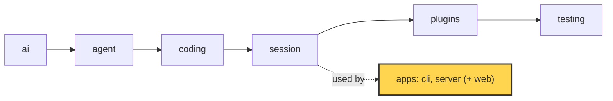

# 22 Part 5 · Store and auth

**Goal:** Save users, sessions and events durably.

**Builds on:** [21 Transport](21-transport.md) · **Next:** [23 Limits](23-limits.md)

## Where we are



*This chapter adds the `store` and `auth` of the `server` app (marked).*

Big picture of Part 5: [part-5-system](19-0-part-5-system.md).

Code in this chapter (commit `2fc2776`):

- `apps/server/src/simp_server/store.py` — `SqliteStore`, `sha`, `hash_password`, `check_password`
- `apps/server/src/simp_server/server.py` — `Store`, `Auth`, `StaticTokenAuth`, `DEFAULT_PLUGINS`, `Run.recover`
- `apps/server/tests/test_store.py`, `apps/server/tests/test_accounts.py` — the store and auth tests

## Problem

Go back to Ana from [21](21-transport.md#problem). Her tab now gets every event live, and it can catch up after a Wi-Fi drop. But where do the events live? So far, only in the memory of one Python process.

Now the admin restarts the server to install an update. Ana opens her tab the next morning, and her fizzbuzz chat is gone: every user, every session and every event lived in that process. Worse, the restart came while the agent was running `bash`. The last saved state still says "running", but no loop runs any more, so her tab waits forever.

There is a second problem. Bob, Ana's colleague, uses the same server. Nothing says who sends a request, so Bob (or anyone who can reach the port) can open Ana's session and read it.

So we need two things. A **[store](glossary.md#store)**: one place on disk for users, sessions, events and cost. And **[auth](glossary.md#auth)**: a way to check who sends each request.

## Naive version

The simplest idea: keep everything in Python dicts, and keep tokens as plain text.

Naive sketch (not in the repo):

```text
users    = empty map   // token -> name
sessions = empty map   // session id -> list of events

add_user(name):
    token = new random token
    users[token] = name          // plain token kept as-is
    RETURN token

user_by_token(token):
    RETURN users[token] or nothing

add_event(sid, event):
    ADD event to sessions[sid]   // not tied to any user

t = add_user("ana")
add_event("s1", {type: user_message, text: "write fizzbuzz.py"})
// prints: ana {s1: [...]}
```

It works for one happy demo. It breaks in four ways:

1. **The process stops.** All dicts are gone. Ana's token no longer works and her chat is lost.
2. **Someone reads the data.** If we dump `users` to a file, the file holds working tokens. Anyone who copies the file can log in as anyone.
3. **Two users share the server.** `sessions` is not tied to a user. If Bob guesses Ana's session id, he reads her chat.
4. **A run dies in the middle.** Nothing marks it as stopped. The tab waits forever, and the last tool call has no result.

## Real design

Each break has one fix, and each fix has one section below:

| Break | Fix | Section |
|---|---|---|
| 1. process stops | one SQLite file on disk | [SqliteStore](#sqlitestore-one-file-five-tables) |
| 2. data is read | keep only hashes of tokens and passwords | [Token hashes](#token-hashes), [scrypt passwords](#scrypt-passwords) |
| 3. users share the server | `user_id` in every session query | [SqliteStore](#sqlitestore-one-file-five-tables) |
| 4. a run dies | rebuild from rows, then close the dead run | [Loading a session](#loading-a-session), [recover](#recover) |

First, how the server finds its store and its auth. `server.py` defines two small interfaces, `Store` (it must have `open()`) and `Auth` (it must have `authenticate(request)`, which returns the user or nothing). The class for each is picked by name from `DEFAULT_PLUGINS`:

Real code: [server.py](../../apps/server/src/simp_server/server.py) — `DEFAULT_PLUGINS`

```python
DEFAULT_PLUGINS = {"sandbox": "simp_server.server:LocalSandbox", "store": "simp_server.store:SqliteStore",
                   "auth": "simp_server.server:StaticTokenAuth"}
```

We call these three names **[server slots](glossary.md#server-slot)**. They are not the agent plugins of [14](14-plugins.md): a slot is one class the server needs, and you swap it by naming another class. This chapter fills the `store` and `auth` slots; [24](24-docker-sandbox.md) fills `sandbox`.

### SqliteStore: one file, five tables

`SqliteStore` lives in `apps/server/src/simp_server/store.py`. It uses SQLite through `aiosqlite`, a small package that wraps the standard `sqlite3` so that calls are `async` and do not block the server. The whole database is one file, `<data_dir>/simp.db`. `data_dir` comes from `settings.toml`; by default it is `~/.simp-server`. A file stays after the process stops (break 1).

`open()` creates the folder, connects, turns on WAL and creates the tables if they are missing:

Real code: [store.py](../../apps/server/src/simp_server/store.py) — `SqliteStore.open`

```text
db = CONNECT to <data_dir>/simp.db
SET journal_mode = WAL
RUN SCHEMA          // CREATE TABLE IF NOT EXISTS ... for the five tables
```

**[WAL](glossary.md#wal)** (write-ahead log) is a SQLite mode. Readers do not wait for a writer, and a crash does not leave a half-written database. After that, `open()` updates old files. The server was built in stages, and a `simp.db` from an earlier stage has no `cost`, `password` or `disabled` column. So `open()` adds them with `ALTER TABLE`, and marks old users with no token as disabled. This way an admin can update the code and keep the same file.

The five tables, and what each is for (all columns: [ref-objects · Server store tables](ref-objects.md#server-store-tables)):

| Table | One row is | Used in |
|---|---|---|
| `users` | a user: name, static token hash, password hash, `disabled` | [Token hashes](#token-hashes), [scrypt passwords](#scrypt-passwords) |
| `tokens` | one per-device login token hash | [Token hashes](#token-hashes) |
| `sessions` | a session: owner, title, profile, sandbox | [Loading a session](#loading-a-session) |
| `entries` | one saved message or event, with its `seq` | [Loading a session](#loading-a-session), [Saving events](#saving-events) |
| `usage` | one model call: tokens and cost | [23 Limits](23-limits.md) |

Every table except `users` has a `user_id` column, and every read of a session, its entries or its usage has `user_id` in its `WHERE`. This is the fix for break 3:

Real code: [store.py](../../apps/server/src/simp_server/store.py) — `SqliteStore.get_session`

```text
get_session(user_id, sid):
    rows = SELECT sessions WHERE id = sid AND user_id = user_id
    RETURN first row, or nothing
```

Example: Ana owns session `s1`. Bob sends a request for `s1`. The query runs with Bob's id, finds no row, and the server answers 404. There is no special "is this yours?" check to forget; it is in the SQL. (The few queries that look up a user, like `user_by_token` and `login` below, have no user yet, so they search by token or name.)

Why SQLite and not Postgres? The server runs on one machine ([26](26-system-tests-deploy.md)). SQLite needs no extra server process, and a backup is a copy of one file. The cost is that only one write runs at a time. For one team on one machine, writes are small and fast, so this is fine.

### Token hashes

**IN:** an HTTP request with a header. **OUT:** the user `{id, name}`, or nothing (then HTTP 401).

A **[token](glossary.md#token-auth)** is a long random string. The client sends it as `Authorization: Bearer <token>`. The server never stores the token itself. It stores only its SHA-256 hash.

There are two kinds of token. A **[static token](glossary.md#static-token)** is one long-lived token per user, kept in `users.token_sha256`. The admin makes it on the command line with `simp-server seed --name ana`, which prints it once; `simp-server rotate --name ana` replaces it. A **[per-device token](glossary.md#per-device-token)** is made by each password login and kept as one row in the `tokens` table, so `logout` can delete just that device.

```sql
users(id, name, token_sha256, password, disabled)
tokens(token_sha256, user_id, created)
```

Real code: [store.py](../../apps/server/src/simp_server/store.py) — `sha`, `SqliteStore.add_user`

```text
sha(token):
    RETURN SHA-256 hex of token

add_user(name, password = none, token = yes):
    // returns the static token (shown once); only its sha256 is stored
    // a taken name raises IntegrityError
    t = new random token IF token wanted, ELSE none
    INSERT user (new id, name, sha(t), hash_password(password) in a thread)
    RETURN t
```

This fixes break 2. If someone copies `simp.db`, they get hashes, not tokens, and a hash cannot be sent back as a token. Why a fast hash like SHA-256 is enough here: a token is 32 random bytes, so nobody can guess it. A password can be guessed, so it gets a slow hash ([below](#scrypt-passwords)).

One query checks both kinds of token:

Real code: [store.py](../../apps/server/src/simp_server/store.py) — `SqliteStore.user_by_token`

```text
user_by_token(token):
    h = sha(token)
    rows = SELECT id, name FROM users
           WHERE disabled = 0
             AND (token_sha256 = h  OR  id has a row in tokens with token_sha256 = h)
    RETURN first row, or nothing
```

Note `disabled = 0`. The admin command `revoke` sets `disabled = 1`, clears the static token and deletes all device tokens. `rotate` deletes device tokens, sets a new static token and turns the user back on. In both cases every old token stops working at once.

`StaticTokenAuth`, the default class in the `auth` slot, is the bridge from HTTP to this query:

Real code: [server.py](../../apps/server/src/simp_server/server.py) — `StaticTokenAuth.authenticate`

```text
authenticate(request):
    h = request header "authorization"
    IF h starts with "Bearer ":
        RETURN store.user_by_token(rest of h)
    RETURN nothing
```

### scrypt passwords

**IN:** a name and a password. **OUT:** a new per-device token, or nothing.

A person cannot remember a 32-byte token, so the web client ([25](25-web-client.md)) asks for a name and a password. Passwords use **[scrypt](glossary.md#scrypt)**, a slow hash from Python's `hashlib`. Each password gets a **[salt](glossary.md#salt)**: random bytes mixed into the hash, so two users with the same password get different hashes. The result goes into `users.password`:

Real code: [store.py](../../apps/server/src/simp_server/store.py) — `_scrypt`, `hash_password`, `check_password`

```text
_scrypt(password, salt):
    RETURN scrypt(password, salt, n=2**14, r=8, p=1)    // common safe cost values

hash_password(password):
    salt = 16 random bytes
    RETURN "scrypt$<salt hex>$<_scrypt(password, salt) hex>"

check_password(password, stored):
    IF no stored hash:
        _scrypt(password, dummy salt)   // same time whether or not the user exists
        RETURN false
    split stored into salt and h
    RETURN constant-time compare(_scrypt(password, salt), h)
```

Two choices here are about time. If the user does not exist, we still run scrypt once, so an attacker cannot learn which names exist by timing the answer. And `hmac.compare_digest` compares in constant time, so the time does not show how many bytes matched.

scrypt is slow on purpose, and slow code would block the event loop. So the store calls it with `asyncio.to_thread(...)`. `login` checks the password, then makes a new per-device token:

Real code: [store.py](../../apps/server/src/simp_server/store.py) — `SqliteStore.login`

```text
login(name, password):
    rows = SELECT id, password FROM users WHERE name = name AND disabled = 0
    IF NOT check_password(password, stored hash or none)   // run in a thread
        RETURN nothing
    token = new random token
    INSERT into tokens (sha(token), user id, now)
    RETURN token
```

The routes are in `server.py`: `/api/signup`, `/api/login`, `/api/logout`. Sign-up is closed unless `signup_code` is set in settings, so a stranger who finds the port cannot make an account. The code is checked with `hmac.compare_digest`. The name must match `[a-z0-9_-]{2,32}` and the password needs at least `MIN_PASSWORD = 8` characters.

### Loading a session

**IN:** the user and a session id. **OUT:** a `Run` in memory, with the same history as before the restart.

Every saved message and event is one row in `entries`:

```sql
entries(session_id, user_id, seq, type, json)   -- one row per message or event
```

A row is one of two kinds, and both share **one** `seq` counter per session ([21 · seq](21-transport.md#seq-one-counter-for-everything)). Core messages (`type = "msg"`) are what the model sees. Durable protocol events ([20](20-server-run.md)), with `type` set to the event type like `run_state`, are what clients see.

`SessionManager.get` finds the session row (scoped by user), reads its entries and builds a `Run` ([20](20-server-run.md)). It waits for `recover()` before it returns, so no client ever sees a dead "running" run:

Real code: [server.py](../../apps/server/src/simp_server/server.py) — `SessionManager.get`

```text
row = store.get_session(user id, sid)      // none -> HTTP 404
IF sid not in runs:
    runs[sid] = new Run(row, env, store.entries(user id, sid))   // env: from the sandbox slot
    WAIT for runs[sid].recover()
```

`Run.__init__` splits the rows back:

Real code: [server.py](../../apps/server/src/simp_server/server.py) — `Run.__init__`

```text
messages = [from_dict(e.data) FOR e in entries IF e.type is "msg"]   // history for AgentSession
log      = [e.data FOR e in entries IF e.type is not "msg"]          // the event log of 21
run_state = state of the last run_state event in log, or "idle"
seq       = seq of the last entry, or 0
```

Example. The saved rows of Ana's finished fizzbuzz session:

```text
seq 1  run_state  running                             -> log
seq 2  msg        user "write fizzbuzz.py"           -> messages
seq 3  user_message                                   -> log
seq 4  msg        assistant (text "Done.")            -> messages
seq 5  assistant_message                              -> log
seq 6  run_state  idle                                -> log
```

After loading: 2 messages, a log of 4 events, `run_state = "idle"`, `seq = 6`. The next row gets seq 7. (`from_dict` is the [JSON round trip](ref-objects.md#going-to-json-and-back).) The code keeps the whole log in memory; that is fine for one machine (see [Why this way](#why-this-way)).

### Saving events

**IN:** a message or an event during a run. **OUT:** one new row in `entries`, with the next `seq`.

[21](21-transport.md) showed `Run.append` (a core message) and `Run.durable` (an event clients must not lose). The part that matters here is their last line: both add 1 to `self.seq` and call `store.add_entry(user_id, sid, seq, type, data)`, with type `"msg"` for a message and the event type for an event. Because both write to one table with one counter, "read rows in `seq` order" gives the exact order things happened, for the history and the log alike.

### recover

**IN:** a loaded `Run` whose last saved state is busy. **OUT:** a settled run: state `error`, and a valid history.

Back to the restart from the [Problem](#problem). The last saved `run_state` says `running` (or `waiting_approval`), but no loop runs. And the last assistant message asks for a tool call that has no result. The model API returns an error for such a history, so even Continue would fail.

`recover()` fixes both. If the run is not busy, it does nothing. If it is busy, it closes the run in three steps. First, every `approval_request` with no `approval_resolved` gets `ApprovalResolved(decision="aborted")`. Second, every tool call in the last assistant message with no result gets an error result, `"aborted: the server restarted before this tool finished"`; it is saved as a history message (`append`) and also sent as a `ToolResult` event. Third, the state becomes `error`, and a `Notice` says `"interrupted: the server restarted during this run"`.

Real code: [server.py](../../apps/server/src/simp_server/server.py) — `Run.recover`

```text
IF not busy: RETURN
FOR EACH approval_request with no approval_resolved:
    durable ApprovalResolved(call_id, decision = "aborted")
FOR EACH tool call in the last assistant message with no tool result:
    m = ToolResultMessage(call id, tool, "aborted: the server restarted before this tool finished", is_error = true)
    ADD m to session messages; append(m)
    durable ToolResult(call_id, tool, m.content, is_error = true)
run_state = "error"   // set directly, not with set_state
durable RunState(state = "error")
durable Notice(level = "warning", text = "interrupted: the server restarted during this run")
```

Example. Ana's run asked to run `bash` (call `c2`), the tool started, and the server died. All rows in `seq` order:

```text
seq 1  run_state          running
seq 2  msg                user "write fizzbuzz.py"
seq 3  user_message
seq 4  msg                assistant, asks bash c2
seq 5  assistant_message  (bash c2)
       -- server dies, no result for c2 --
seq 6  msg                tool result c2, is_error        <- added by recover
seq 7  tool_result        c2 "aborted: ...", is_error     <- added by recover
seq 8  run_state          error                           <- added by recover
seq 9  notice             warning "interrupted: ..."      <- added by recover
```

Why `run_state` is set directly: the normal path `set_state` checks the state table ([20 · Run state machine](20-server-run.md#run-state-machine)), and that table has no `waiting_approval -> error`. A crash is the one case where it is right. When Ana opens her tab, she sees a settled session with a red error, and she can press Continue.

## Test

`apps/server/tests/test_store.py::test_revoke_rotate_delete`:

```python
async def test_revoke_rotate_delete(tmp_path):
    s = await opened(tmp_path)
    try:
        old = await s.add_user("a")
        new = await s.rotate_token("a")
        assert new and new != old
        assert await s.user_by_token(old) is None and (await s.user_by_token(new))["name"] == "a"
        assert await s.rotate_token("nobody") is None
        assert await s.revoke("a") and await s.user_by_token(new) is None
        assert not await s.revoke("a")
        assert await s.count_users() == 0  # revoked: still listed (rows kept) but not counted as a user who can log in
        assert [u["name"] for u in await s.list_users()] == ["a"]

        await s.add_user("b")
        uid = next(u["id"] for u in await s.list_users() if u["name"] == "b")
        row = await s.add_session(uid, "p")
        await s.add_entry(uid, row["id"], 1, "notice", {"x": 1})
        await s.add_usage(uid, row["id"], "m", 1, 1, cost=0.1)
        assert not await s.delete_session("someone-else", row["id"])
        assert await s.delete_session(uid, row["id"])
        assert await s.get_session(uid, row["id"]) is None and await s.entries(uid, row["id"]) == []
        assert await s.spent(uid, -1) == 0.1  # money already spent stays counted for the day
    finally:
        await s.close()
```

It walks one user through the token life: after `rotate_token` the old token fails and the new one works; after `revoke` the token fails, a second `revoke` returns `False`, and the user is still listed but not counted. Then it checks the `user_id` scope for writes: `delete_session("someone-else", ...)` fails. Deleting a session removes its entries, but the money stays: `spent(uid, -1)` means "spent since time -1", so all of it, and it is still 0.1.

Run them:

```sh
uv run pytest apps/server/tests/test_store.py apps/server/tests/test_accounts.py -q
```

## Why this way

> **One SQLite file, hashes only, every session row scoped by user.** SQLite fits a one-machine server: no extra process, crash safe with WAL, backup is a file copy. Storing only hashes means a leaked database does not leak logins. Putting `user_id` in every session query makes "see only your own data" the default, not a check you might forget. Messages and events share one `seq` in one table, so replay ([21](21-transport.md)) and resume ([13](13-session.md)) read the same rows.
>
> The cost: one writer at a time, and the whole event log in memory for each open session. For many machines, you would put another class in the `store` slot.

## Exercises

1. Add a line to `test_revoke_rotate_delete`: after `revoke("a")`, check that `rotate_token("a")` gives a working token again. Run the test.
2. Use `sqlite3` on a test `simp.db`: run `SELECT token_sha256 FROM users;`. Can you use the value as a Bearer token? Why not?

## Recap

The server now keeps everything in one SQLite file, `<data_dir>/simp.db`, so a restart loses nothing. Tokens and passwords are stored only as hashes: SHA-256 for random tokens, salted scrypt for passwords, so a copied file gives no logins. Every session query carries `user_id`, so Bob cannot see Ana's work. Messages and events go into one `entries` table with one `seq`; on load, `Run.__init__` splits them back into history and log, and `Run.recover` closes a run that died while busy.

The server is now safe to restart and to share. But nothing stops one user from spending all the money on the model, or from leaving many sessions open. That is the next chapter.

**Builds on:** [21 Transport](21-transport.md) · **Next:** [23 Limits](23-limits.md)
