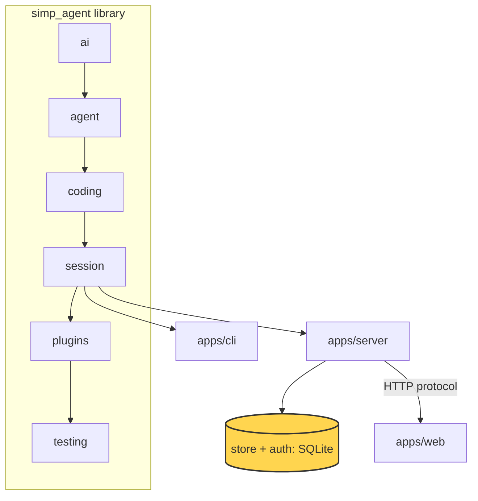

# 22 Part 5 · Store and auth

**Goal:** Save users, sessions and events durably.

**Builds on:** [21-transport](21-transport.md) · **Next:** [23-limits](23-limits.md)



*This chapter adds the server's `store` and `auth` (marked).*

## Problem

In [20](20-server-run.md) and [21](21-transport.md) the server runs a session and streams its events. But so far we did not say where things live. Without a real store:

- When the server restarts, every user, every session and every event is gone.
- A user cannot come back tomorrow and see the fizzbuzz chat again.
- Anyone who can reach the port can use the agent. There is no "who are you?".
- If the server dies **in the middle of a run**, the session stays "running" forever. The model's last tool call has no result, so the history is broken.

So we need two things. A **[store](glossary.md#store)**: one place on disk for users, sessions, events and cost. And **[auth](glossary.md#auth)**: a way to check who sends each request.

## Naive version

The simplest idea: keep everything in Python dicts, and keep tokens as plain text.

```python
import secrets

users = {}      # token -> name
sessions = {}   # session id -> list of events

def add_user(name: str) -> str:
    token = secrets.token_urlsafe(32)
    users[token] = name           # plain token kept as-is
    return token

def user_by_token(token: str):
    return users.get(token)

def add_event(sid: str, event: dict):
    sessions.setdefault(sid, []).append(event)

t = add_user("ann")
add_event("s1", {"type": "user_message", "text": "write fizzbuzz.py"})
print(user_by_token(t), sessions)   # ann {'s1': [...]}
```

It works for one happy demo. It breaks when:

1. **The process stops.** All dicts are gone. Ann's token no longer works and her fizzbuzz chat is lost.
2. **Someone reads the data.** If we dump `users` to a file, the file holds working tokens. Anyone who copies the file can log in as anyone.
3. **Two users share the server.** `sessions` is not tied to a user. If Bob guesses Ann's session id, he reads her chat.
4. **A run dies in the middle.** Nothing marks it as stopped. The client waits forever.

## Real design

### SqliteStore: one file, five tables

`apps/server/src/simp_server/store.py` holds `SqliteStore`. It uses SQLite through `aiosqlite`, so calls are `async` and do not block the server.

```python
SCHEMA = """
CREATE TABLE IF NOT EXISTS users(id TEXT PRIMARY KEY, name TEXT UNIQUE, token_sha256 TEXT UNIQUE, password TEXT,
    disabled INTEGER DEFAULT 0);
CREATE TABLE IF NOT EXISTS tokens(token_sha256 TEXT PRIMARY KEY, user_id TEXT, created REAL);
CREATE TABLE IF NOT EXISTS sessions(id TEXT PRIMARY KEY, user_id TEXT, title TEXT, profile TEXT, sandbox_ref TEXT,
    created REAL, updated REAL);
CREATE TABLE IF NOT EXISTS entries(session_id TEXT, user_id TEXT, seq INTEGER, type TEXT, json TEXT,
    PRIMARY KEY(session_id, seq));
CREATE TABLE IF NOT EXISTS usage(user_id TEXT, session_id TEXT, model TEXT, input INTEGER, output INTEGER, at REAL,
    cost REAL DEFAULT 0);
"""
```

The whole database is one file: `<data_dir>/simp.db`. Look at the first line of the file:

```python
"""SQLite store (aiosqlite). Every row has user_id; every read is scoped by it."""
```

This is the fix for problem 3. Every read has `user_id` in its `WHERE`:

```python
async def get_session(self, user_id: str, sid: str) -> dict | None:
    rows = await self._all("SELECT * FROM sessions WHERE id=? AND user_id=?", sid, user_id)
    return rows[0] if rows else None
```

If Bob asks for Ann's session id, the query finds nothing and the server answers 404. There is no special "is this yours?" check to forget. It is in the SQL.

`open()` creates the folder, connects, and turns on WAL:

```python
await self.db.execute("PRAGMA journal_mode=WAL")
await self.db.executescript(SCHEMA)
```

**[WAL](glossary.md#wal)** (write-ahead log) is a SQLite mode. Readers do not wait for a writer, and a crash does not leave a half-written database. After that, `open()` checks for old columns. A database from an older stage gets `cost`, `password` and `disabled` added with `ALTER TABLE`. So an old `simp.db` still opens. We do not need a migration tool for three columns.

Why SQLite and not Postgres? The server runs on one machine ([26](26-system-tests-deploy.md)). SQLite is in the Python standard library, needs no extra process, and backs up by copying one file. The server loads the store as a plugin, so you can swap it:

```python
DEFAULT_PLUGINS = {"sandbox": "simp_server.server:LocalSandbox", "store": "simp_server.store:SqliteStore",
                   "auth": "simp_server.server:StaticTokenAuth"}
```

(`apps/server/src/simp_server/server.py`.) The `Store` protocol in `server.py` only lists `open()` and says "see store.SqliteStore for the full method list".

### Token hashes

A **[token](glossary.md#token-auth)** is a long random string. The client sends it as `Authorization: Bearer <token>`. The server never stores the token itself. It stores only its SHA-256:

```python
def sha(token: str) -> str:
    return hashlib.sha256(token.encode()).hexdigest()

async def add_user(self, name: str, password: str | None = None, token: bool = True) -> str | None:
    """Returns the static token (shown once); only its sha256 is stored. Raises sqlite3.IntegrityError on a taken name."""
    t = secrets.token_urlsafe(32) if token else None
    await self._do("INSERT INTO users(id, name, token_sha256, password) VALUES(?,?,?,?)", uuid.uuid4().hex, name,
                   t and sha(t), password and await asyncio.to_thread(hash_password, password))
    return t
```

This fixes problem 2. If someone copies `simp.db`, they get hashes, not tokens. A hash cannot be sent back as a token. The token is shown **once** (the `seed` command prints it), then it lives only with the user.

Why plain SHA-256 here, and a slow hash for passwords (below)? A token is 32 random bytes. Nobody can guess it, so a fast hash is enough. A password is chosen by a human and can be guessed, so it needs a slow hash.

There are two kinds of token:

- A **static token** in `users.token_sha256`. The admin makes it with `seed` and changes it with `rotate`.
- A **per-device token** in the `tokens` table. Each password login makes a new one. `logout` deletes only that one row.

One query checks both:

```python
async def user_by_token(self, token: str) -> dict | None:
    rows = await self._all("SELECT id, name FROM users WHERE disabled=0 AND (token_sha256=? OR id IN "
                           "(SELECT user_id FROM tokens WHERE token_sha256=?))", sha(token), sha(token))
    return rows[0] if rows else None
```

Note `disabled=0`. A revoked user fails here, even with a token that is still in the table.

`StaticTokenAuth` in `server.py` is the default auth plugin. It is four lines: read the header, call `user_by_token`:

```python
async def authenticate(self, request: Request) -> dict | None:
    h = request.headers.get("authorization", "")
    return await self.store.user_by_token(h[7:]) if h.startswith("Bearer ") else None
```

Every API route depends on `user()`, which raises `HTTPException(401, "bad token")` when this returns `None`.

`revoke` sets `disabled=1`, clears the static token and deletes all device tokens. `rotate_token` deletes device tokens, sets a new static token and turns the user back on. In both cases every old token stops working at once.

### scrypt passwords

The web client ([25](25-web-client.md)) needs a name and a password, not a long token. Passwords use **[scrypt](glossary.md#scrypt)**, a slow hash from the standard library:

```python
def _scrypt(password: str, salt: bytes) -> bytes:
    return hashlib.scrypt(password.encode(), salt=salt, n=2**14, r=8, p=1)


def hash_password(password: str) -> str:
    salt = secrets.token_bytes(16)
    return f"scrypt${salt.hex()}${_scrypt(password, salt).hex()}"


def check_password(password: str, stored: str | None) -> bool:
    if not stored:
        _scrypt(password, b"0" * 16)  # same time whether or not the user exists
        return False
    _, salt, h = stored.split("$")
    return hmac.compare_digest(_scrypt(password, bytes.fromhex(salt)), bytes.fromhex(h))
```

Three small choices, each with a reason:

- **A random salt per user.** Two users with the same password get different hashes.
- **Same time for "no such user".** If the user does not exist, we still run scrypt once. So an attacker cannot learn which names exist by timing the answer.
- **`hmac.compare_digest`.** It compares in constant time, so the time does not leak how many bytes matched.

scrypt is slow on purpose, and slow code would block the event loop. So the store calls it with `asyncio.to_thread(...)`. `login` checks the password, then makes a new per-device token:

```python
async def login(self, name: str, password: str) -> str | None:
    rows = await self._all("SELECT id, password FROM users WHERE name=? AND disabled=0", name)
    if not await asyncio.to_thread(check_password, password, rows[0]["password"] if rows else None):
        return None
    token = secrets.token_urlsafe(32)
    await self._do("INSERT INTO tokens VALUES(?,?,?)", sha(token), rows[0]["id"], time.time())
    return token
```

The routes are in `server.py`: `/api/signup`, `/api/login`, `/api/logout`. Sign-up is closed unless `signup_code` is set in settings. The code is checked with `hmac.compare_digest`. The name must match `[a-z0-9_-]{2,32}` and the password needs at least `MIN_PASSWORD = 8` characters. The `Account` model also caps sizes (`max_length=64` for the name, `1024` for the password) "so scrypt and the db stay cheap whatever a client sends".

### Durable events

In [21](21-transport.md) each **durable** event got a `seq` so clients can replay after reconnect. Now we see where it goes. The `entries` table holds two kinds of rows, with **one** `seq` counter per session:

- protocol events (type = the event type, like `run_state`),
- core messages from the session (type = `"msg"`).

`Run` in `server.py` is the session's `SessionStore` ([13](13-session.md)). Its `append` writes a `msg` row:

```python
# SessionStore for AgentSession: core messages share the seq counter with protocol events
async def append(self, entry) -> None:
    self.seq += 1
    await self.mgr.store.add_entry(self.user_id, self.sid, self.seq, "msg", to_dict(entry))
```

And `durable` writes a protocol event, after sending it to clients:

```python
async def durable(self, cls, **kw) -> None:
    self.seq += 1
    ev = cls(seq=self.seq, **kw).model_dump()
    self.log.append(ev)
    self._send(ev)
    await self.mgr.store.add_entry(self.user_id, self.sid, ev["seq"], ev["type"], ev)
```

`add_entry` also updates `sessions.updated`, so the session list sorts by last activity.

When a session is loaded again, `Run.__init__` splits the rows back:

```python
self.log = [e["data"] for e in entries if e["type"] != "msg"]  # ponytail: whole log in memory
...
messages=[from_dict(e["data"]) for e in entries if e["type"] == "msg"],
```

The `msg` rows rebuild the `AgentSession` history (what the model sees). The other rows rebuild the protocol log (what clients see). The last `run_state` sets the state, and `self.seq` continues from the last row. Why one table and one counter? Because the order between "the model said X" and "the client saw Y" is then exact, and one `ORDER BY seq` read gives both.

### recover

Problem 4: the server dies while the fizzbuzz run is busy. On disk the last `run_state` says `running`. Maybe an approval request has no answer. Maybe the last assistant message asked to run `bash` and there is no tool result.

`SessionManager.get` loads a session and then calls `recover()`:

```python
self.runs[sid] = Run(self, row, env, await self.store.entries(user["id"], sid))
await self.runs[sid].recover()
```

`Run.recover` (in `server.py`) does nothing if the run is not busy. If it is busy, it closes the run in the log:

1. Every `approval_request` with no `approval_resolved` gets an `ApprovalResolved` with `decision="aborted"`.
2. Every tool call in the last assistant message with no result gets a `ToolResultMessage` with `"aborted: the server restarted before this tool finished"` and `is_error=True`. It is saved with `append` and also sent as a `ToolResult` event.
3. The state is set to `"error"`, then a `Notice`: `"interrupted: the server restarted during this run"`.

```python
self.info.run_state = "error"  # any busy state -> error, bypassing check_transition on purpose
await self.durable(p.RunState, state="error")
await self.durable(p.Notice, level="warning", text="interrupted: the server restarted during this run")
```

Step 2 matters for the model. Providers reject a history where a tool call has no result. After recover, the history is valid, so the user can press Continue.

## Test

`apps/server/tests/test_store.py::test_revoke_rotate_delete`:

```python
async def test_revoke_rotate_delete(tmp_path):
    s = await opened(tmp_path)
    try:
        old = await s.add_user("a")
        new = await s.rotate_token("a")
        assert new and new != old
        assert await s.user_by_token(old) is None and (await s.user_by_token(new))["name"] == "a"
        assert await s.rotate_token("nobody") is None
        assert await s.revoke("a") and await s.user_by_token(new) is None
        assert not await s.revoke("a")
        assert await s.count_users() == 0  # revoked: still listed (rows kept) but not counted as a user who can log in
        assert [u["name"] for u in await s.list_users()] == ["a"]

        await s.add_user("b")
        uid = next(u["id"] for u in await s.list_users() if u["name"] == "b")
        row = await s.add_session(uid, "p")
        await s.add_entry(uid, row["id"], 1, "notice", {"x": 1})
        await s.add_usage(uid, row["id"], "m", 1, 1, cost=0.1)
        assert not await s.delete_session("someone-else", row["id"])
        assert await s.delete_session(uid, row["id"])
        assert await s.get_session(uid, row["id"]) is None and await s.entries(uid, row["id"]) == []
        assert await s.spent(uid, -1) == 0.1  # money already spent stays counted for the day
    finally:
        await s.close()
```

What it checks:

- `opened(tmp_path)` makes a real `SqliteStore` in a temp folder. No mocks: it is a real SQLite file.
- After `rotate_token`, the old token fails and the new one works.
- After `revoke`, the token fails, a second `revoke` returns `False`, and the user is still listed but not counted.
- `delete_session("someone-else", ...)` fails: the `user_id` scope works for writes too.
- Deleting a session also deletes its entries, but usage (money spent) stays.

The HTTP side is tested in `apps/server/tests/test_accounts.py` (for example `test_login_logout_revoke_rotate`).

Run them:

```sh
uv run pytest apps/server/tests/test_store.py apps/server/tests/test_accounts.py -q
```

## Why this way

> **One SQLite file, hashes only, every row scoped by user.** SQLite fits a one-machine server: no extra process, crash safe with WAL, backup is a file copy. Storing only hashes means a leaked database does not leak logins. Putting `user_id` in every query makes "see only your own data" the default, not a check you might forget. Events and messages share one `seq` in one table, so replay ([21](21-transport.md)) and resume ([13](13-session.md)) read the same rows. The cost: one writer at a time and the whole event log in memory per open session (marked `ponytail:` in the code). For many machines you would swap the `store` plugin.

## Recap

- `SqliteStore` keeps users, tokens, sessions, entries and usage in `<data_dir>/simp.db`, with WAL on.
- Every row has `user_id`; every read and delete filters by it.
- Tokens are stored as SHA-256 only. Static tokens come from `seed`/`rotate`; each password login makes a per-device token.
- Passwords use salted scrypt, run in a thread, compared in constant time, with the same time for unknown users.
- `Run.append` (messages) and `Run.durable` (events) write to one `entries` table with one `seq`.
- `Run.recover` closes a run that died while busy: aborts open approvals, answers open tool calls, sets state `error`.

**Builds on:** [21-transport](21-transport.md) · **Next:** [23-limits](23-limits.md)

## Terms to add to glossary

- **store**: the server plugin that saves users, sessions, events and usage; by default `SqliteStore`.
- **auth**: the server plugin that finds the user for a request; by default `StaticTokenAuth`.
- **token (auth)**: a long random string sent as `Authorization: Bearer <token>`; only its SHA-256 is stored.
- **WAL**: SQLite write-ahead log mode; readers do not wait for the writer and crashes do not corrupt the file.
- **scrypt**: a slow, salted password hash from Python's `hashlib`; slow on purpose so guessing is expensive.
- **recover**: `Run.recover`, which closes a run that was busy when the server died and leaves a valid history.
