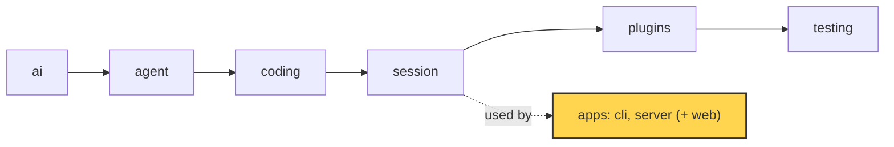

# 22 Part 5 · Store and auth

**Goal:** Save users, sessions and events durably.

**Builds on:** [21 Transport](21-transport.md) · **Next:** [23 Limits](23-limits.md)

## Where we are



*This chapter adds the `store` and `auth` of the `server` app (marked).*

Big picture of Part 5: [part-5-system](part-5-system.md).

Code in this chapter (commit `2fc2776`):

- `apps/server/src/simp_server/store.py` — `SqliteStore`, `sha`, `hash_password`, `check_password`
- `apps/server/src/simp_server/server.py` — `Store`, `Auth`, `StaticTokenAuth`, `Run.recover`
- `apps/server/tests/test_store.py`, `apps/server/tests/test_accounts.py` — the store and auth tests

## Problem

The server runs and streams sessions ([20](20-server-run.md), [21](21-transport.md)), but so far we did not say where things live. Without a real store:

- When the server restarts, every user, every session and every event is gone.
- A user cannot come back tomorrow and see the fizzbuzz chat again.
- Anyone who can reach the port can use the agent. There is no "who are you?".
- If the server dies **in the middle of a run**, the session stays "running" forever. The model's last tool call has no result, so the history is broken.

So we need two things. A **[store](glossary.md#store)**: one place on disk for users, sessions, events and cost. And **[auth](glossary.md#auth)**: a way to check who sends each request.

## Naive version

The simplest idea: keep everything in Python dicts, and keep tokens as plain text.

Naive sketch (not in the repo):

```text
users    = empty map   // token -> name
sessions = empty map   // session id -> list of events

add_user(name):
    token = new random token
    users[token] = name          // plain token kept as-is
    RETURN token

user_by_token(token):
    RETURN users[token] or nothing

add_event(sid, event):
    ADD event to sessions[sid]   // not tied to any user

t = add_user("ann")
add_event("s1", {type: user_message, text: "write fizzbuzz.py"})
// prints: ann {s1: [...]}
```

It works for one happy demo. It breaks when:

1. **The process stops.** All dicts are gone. Ann's token no longer works and her fizzbuzz chat is lost.
2. **Someone reads the data.** If we dump `users` to a file, the file holds working tokens. Anyone who copies the file can log in as anyone.
3. **Two users share the server.** `sessions` is not tied to a user. If Bob guesses Ann's session id, he reads her chat.
4. **A run dies in the middle.** Nothing marks it as stopped. The client waits forever.

## Real design

Each break of the naive version has one fix, and each fix has one section below. We follow the path of a request in [Part 5](part-5-system.md): first **Auth** (who are you?), then **Load** (find and rebuild your session), then **Events** (save what happens).

| Break | Fix | Section |
|---|---|---|
| 1. process stops | one SQLite file on disk | [SqliteStore](#sqlitestore-one-file-five-tables) |
| 2. data is read | keep only hashes of tokens and passwords | [Token hashes](#token-hashes), [scrypt passwords](#scrypt-passwords) |
| 3. users share the server | `user_id` in every query | [SqliteStore](#sqlitestore-one-file-five-tables) |
| 4. a run dies | rebuild from rows, then close the dead run | [Loading a session](#loading-a-session), [recover](#recover) |

### SqliteStore: one file, five tables

`apps/server/src/simp_server/store.py` holds `SqliteStore`. It uses SQLite through `aiosqlite`, so calls are `async` and do not block the server. The whole database is one file: `<data_dir>/simp.db`. A file stays after the process stops (break 1).

`open()` creates the folder, connects, turns on WAL and creates the tables if they are missing:

Real code: [store.py](../../apps/server/src/simp_server/store.py) — `SqliteStore.open`

```text
db = CONNECT to <data_dir>/simp.db
SET journal_mode = WAL
RUN SCHEMA          // CREATE TABLE IF NOT EXISTS ... for the five tables
```

**[WAL](glossary.md#wal)** (write-ahead log) is a SQLite mode. Readers do not wait for a writer, and a crash does not leave a half-written database. After that, `open()` checks for old columns: a database from an older stage gets `cost`, `password` and `disabled` added with `ALTER TABLE`.

The five tables, and what each is for (all columns: [ref-objects · Server store tables](ref-objects.md#server-store-tables)):

| Table | One row is | Used in |
|---|---|---|
| `users` | a user: name, static token hash, password hash, `disabled` | [Token hashes](#token-hashes), [scrypt passwords](#scrypt-passwords) |
| `tokens` | one per-device login token hash | [Token hashes](#token-hashes) |
| `sessions` | a session: owner, title, profile, sandbox | [Loading a session](#loading-a-session) |
| `entries` | one saved message or event, with its `seq` | [Loading a session](#loading-a-session), [Saving events](#saving-events) |
| `usage` | one model call: tokens and cost | [23 Limits](23-limits.md) |

Every table except `users` has a `user_id` column. Look at the first line of the file:

```python
"""SQLite store (aiosqlite). Every row has user_id; every read is scoped by it."""
```

This is the fix for break 3. Every read has `user_id` in its `WHERE`:

Real code: [store.py](../../apps/server/src/simp_server/store.py) — `SqliteStore.get_session`

```text
get_session(user_id, sid):
    rows = SELECT sessions WHERE id = sid AND user_id = user_id
    RETURN first row, or nothing
```

Example: Ann owns session `s1`. Bob sends a request for `s1`. The query runs with Bob's id, finds no row, and the server answers 404. There is no special "is this yours?" check to forget. It is in the SQL.

Why SQLite and not Postgres? The server runs on one machine ([26](26-system-tests-deploy.md)). SQLite is in the Python standard library, needs no extra process, and backs up by copying one file.

### Token hashes

**IN:** an HTTP request with a header. **OUT:** the user `{id, name}`, or nothing (then HTTP 401).

A **[token](glossary.md#token-auth)** is a long random string. The client sends it as `Authorization: Bearer <token>`. The server never stores the token itself. It stores only its SHA-256. Two tables hold token hashes:

```sql
users(id, name, token_sha256, password, disabled)
tokens(token_sha256, user_id, created)
```

Real code: [store.py](../../apps/server/src/simp_server/store.py) — `sha`, `SqliteStore.add_user`

```text
sha(token):
    RETURN SHA-256 hex of token

add_user(name, password = none, token = yes):
    // returns the static token (shown once); only its sha256 is stored
    // a taken name raises IntegrityError
    t = new random token IF token wanted, ELSE none
    INSERT user (new id, name, sha(t), hash_password(password) in a thread)
    RETURN t
```

This fixes break 2. If someone copies `simp.db`, they get hashes, not tokens. A hash cannot be sent back as a token. The token is shown **once** (the `seed` command prints it), then it lives only with the user.

Why a fast hash here? A token is 32 random bytes. Nobody can guess it. A password can be guessed, so it gets a slow hash ([below](#scrypt-passwords)).

There are two kinds of token:

- A **[static token](glossary.md#static-token)** in `users.token_sha256`. The admin makes it with `seed` and changes it with `rotate`.
- A **[per-device token](glossary.md#per-device-token)** in the `tokens` table. Each password login makes a new one. `logout` deletes only that one row.

One query checks both:

Real code: [store.py](../../apps/server/src/simp_server/store.py) — `SqliteStore.user_by_token`

```text
user_by_token(token):
    h = sha(token)
    rows = SELECT id, name FROM users
           WHERE disabled = 0
             AND (token_sha256 = h  OR  id has a row in tokens with token_sha256 = h)
    RETURN first row, or nothing
```

Note `disabled = 0`. A revoked user fails here, even with a token that is still in the table.

The server picks its store, auth and sandbox classes by name from `DEFAULT_PLUGINS` in `server.py`. These "server slots" are NOT the agent plugins of [14](14-plugins.md).

`StaticTokenAuth` in `server.py` is the default auth class (the `auth` slot). It reads the header and calls `user_by_token`:

Real code: [server.py](../../apps/server/src/simp_server/server.py) — `StaticTokenAuth.authenticate`

```text
authenticate(request):
    h = request header "authorization"
    IF h starts with "Bearer ":
        RETURN store.user_by_token(rest of h)
    RETURN nothing
```

`revoke` sets `disabled = 1`, clears the static token and deletes all device tokens. `rotate_token` deletes device tokens, sets a new static token and turns the user back on. In both cases every old token stops working at once.

### scrypt passwords

**IN:** a name and a password. **OUT:** a new per-device token, or nothing.

The web client ([25](25-web-client.md)) needs a name and a password, not a long token. Passwords use **[scrypt](glossary.md#scrypt)**, a slow hash from the standard library. The hash goes into `users.password`:

Real code: [store.py](../../apps/server/src/simp_server/store.py) — `_scrypt`, `hash_password`, `check_password`

```text
_scrypt(password, salt):
    RETURN scrypt(password, salt, n=2**14, r=8, p=1)

hash_password(password):
    salt = 16 random bytes
    RETURN "scrypt$<salt hex>$<_scrypt(password, salt) hex>"

check_password(password, stored):
    IF no stored hash:
        _scrypt(password, dummy salt)   // same time whether or not the user exists
        RETURN false
    split stored into salt and h
    RETURN constant-time compare(_scrypt(password, salt), h)
```

Three small choices, each with a reason:

- **A random salt per user.** Two users with the same password get different hashes.
- **Same time for "no such user".** If the user does not exist, we still run scrypt once. So an attacker cannot learn which names exist by timing the answer.
- **`hmac.compare_digest`.** It compares in constant time, so the time does not leak how many bytes matched.

scrypt is slow on purpose, and slow code would block the event loop. So the store calls it with `asyncio.to_thread(...)`. `login` checks the password, then makes a new per-device token:

Real code: [store.py](../../apps/server/src/simp_server/store.py) — `SqliteStore.login`

```text
login(name, password):
    rows = SELECT id, password FROM users WHERE name = name AND disabled = 0
    IF NOT check_password(password, stored hash or none)   // run in a thread
        RETURN nothing
    token = new random token
    INSERT into tokens (sha(token), user id, now)
    RETURN token
```

The routes are in `server.py`: `/api/signup`, `/api/login`, `/api/logout`. Sign-up is closed unless `signup_code` is set in settings. The code is checked with `hmac.compare_digest`. The name must match `[a-z0-9_-]{2,32}` and the password needs at least `MIN_PASSWORD = 8` characters.

### Loading a session

**IN:** the user and a session id. **OUT:** a `Run` in memory, with the same history as before the restart.

Every saved message and event is one row in `entries`:

```sql
entries(session_id, user_id, seq, type, json)   -- one row per message or event
```

There are two kinds of rows, with **one** `seq` counter per session:

- core messages from the session (`type = "msg"`): what the model sees,
- protocol events (`type` = the event type, like `run_state`): what clients see.

`SessionManager.get` finds the session row (scoped by user), reads its entries and builds a `Run` ([20](20-server-run.md)):

Real code: [server.py](../../apps/server/src/simp_server/server.py) — `SessionManager.get`

```text
row = store.get_session(user id, sid)      // none -> HTTP 404
IF sid not in runs:
    runs[sid] = new Run(row, env, store.entries(user id, sid))
    WAIT for runs[sid].recover()
```

`Run.__init__` splits the rows back:

Real code: [server.py](../../apps/server/src/simp_server/server.py) — `Run.__init__`

```text
messages = [from_dict(e.data) FOR e in entries IF e.type is "msg"]   // history for AgentSession
log      = [e.data FOR e in entries IF e.type is not "msg"]          // protocol log for clients
run_state = state of the last run_state event in log, or "idle"
seq       = seq of the last entry, or 0
```

Example. The saved rows of Ann's fizzbuzz session:

```text
seq 1  run_state  running                             -> log
seq 2  msg        user "write fizzbuzz.py"           -> messages
seq 3  user_message                                   -> log
seq 4  msg        assistant (text "Done.")            -> messages
seq 5  assistant_message                              -> log
seq 6  run_state  idle                                -> log
```

After loading: 2 messages, a log of 4 events, `run_state = "idle"`, `seq = 6`. The next row gets seq 7. (`from_dict` is the [JSON round trip](ref-objects.md#going-to-json-and-back).) The code keeps the whole log in memory; that is fine for one machine (see [Why this way](#why-this-way)).

### Saving events

**IN:** a message or an event during a run. **OUT:** one new row in `entries`, with the next `seq`.

Two methods write rows, and both use the same `self.seq`:

Real code: [server.py](../../apps/server/src/simp_server/server.py) — `Run.append`, `Run.durable`

```text
append(message):            // the session saves a core message
    seq = seq + 1
    store.add_entry(user_id, sid, seq, "msg", message as dict)

durable(event):             // a protocol event clients must not lose
    seq = seq + 1
    ADD event to log, SEND to clients
    store.add_entry(user_id, sid, seq, event type, event)
```

Why one table and one counter? Because then "read rows in `seq` order" gives the exact order things happened, for both the history and the log. How clients use `seq` to catch up is in [21 · seq](21-transport.md#seq-one-counter-for-everything).

### recover

**IN:** a loaded `Run` whose last saved state is busy. **OUT:** a settled run: state `error`, and a valid history.

Problem: the server dies while a run is busy. On disk the last `run_state` says `running` (or `waiting_approval`), but no loop runs any more. The client would wait forever. And the last assistant message may ask for a tool call that has no result. Providers reject such a history, so even Continue would fail.

So `SessionManager.get` calls `recover()` right after building the `Run`. If the run is not busy, it does nothing. If it is busy, it closes the run:

1. Every `approval_request` with no `approval_resolved` gets `ApprovalResolved(decision="aborted")`.
2. Every tool call in the last assistant message with no result gets an error result: `"aborted: the server restarted before this tool finished"`. It is saved as a history message (`append`) and also sent as a `ToolResult` event.
3. The state becomes `error`, then a `Notice`: `"interrupted: the server restarted during this run"`.

Example. The fizzbuzz run asked to run `bash` (call `c2`), the tool started, and the server died:

```text
rows before (last ones):                     recover adds:
  seq 1  run_state running                     seq 6  msg  tool result c2, is_error   (history)
  seq 4  msg  assistant, asks bash c2          seq 7  tool_result c2 "aborted: ...", is_error
  seq 5  assistant_message (bash c2)           seq 8  run_state error
  -- server dies, no result for c2 --          seq 9  notice warning "interrupted: ..."
```

Each message gives two rows: the `msg` row (history) and the event row (for clients). If the run was `waiting_approval` instead, there is also an `approval_request c2` row, and recover first adds `approval_resolved c2 aborted`.

Real code: [server.py](../../apps/server/src/simp_server/server.py) — `Run.recover`

```text
IF not busy: RETURN
FOR EACH approval_request with no approval_resolved:
    durable ApprovalResolved(call_id, decision = "aborted")
FOR EACH tool call in the last assistant message with no tool result:
    m = ToolResultMessage(call id, tool, "aborted: the server restarted before this tool finished", is_error = true)
    ADD m to session messages; append(m)
    durable ToolResult(call_id, tool, m.content, is_error = true)
run_state = "error"   // set directly: busy -> error is legal only here, after a crash
durable RunState(state = "error")
durable Notice(level = "warning", text = "interrupted: the server restarted during this run")
```

Why `run_state` is set directly: the normal path `set_state` checks the state table ([20 · Run state machine](20-server-run.md#run-state-machine)), and `waiting_approval -> error` is not in it. It is only legal here. After recover, the client sees a settled session with a red error, and the user can press Continue.

## Test

`apps/server/tests/test_store.py::test_revoke_rotate_delete`:

```python
async def test_revoke_rotate_delete(tmp_path):
    s = await opened(tmp_path)
    try:
        old = await s.add_user("a")
        new = await s.rotate_token("a")
        assert new and new != old
        assert await s.user_by_token(old) is None and (await s.user_by_token(new))["name"] == "a"
        assert await s.rotate_token("nobody") is None
        assert await s.revoke("a") and await s.user_by_token(new) is None
        assert not await s.revoke("a")
        assert await s.count_users() == 0  # revoked: still listed (rows kept) but not counted as a user who can log in
        assert [u["name"] for u in await s.list_users()] == ["a"]

        await s.add_user("b")
        uid = next(u["id"] for u in await s.list_users() if u["name"] == "b")
        row = await s.add_session(uid, "p")
        await s.add_entry(uid, row["id"], 1, "notice", {"x": 1})
        await s.add_usage(uid, row["id"], "m", 1, 1, cost=0.1)
        assert not await s.delete_session("someone-else", row["id"])
        assert await s.delete_session(uid, row["id"])
        assert await s.get_session(uid, row["id"]) is None and await s.entries(uid, row["id"]) == []
        assert await s.spent(uid, -1) == 0.1  # money already spent stays counted for the day
    finally:
        await s.close()
```

What it checks:

- After `rotate_token`, the old token fails and the new one works.
- After `revoke`, the token fails, a second `revoke` returns `False`, and the user is still listed but not counted.
- `delete_session("someone-else", ...)` fails: the `user_id` scope works for writes too.
- Deleting a session also deletes its entries, but usage (money spent) stays.

Run them:

```sh
uv run pytest apps/server/tests/test_store.py apps/server/tests/test_accounts.py -q
```

## Why this way

> **One SQLite file, hashes only, every row scoped by user.** SQLite fits a one-machine server: no extra process, crash safe with WAL, backup is a file copy. Storing only hashes means a leaked database does not leak logins. Putting `user_id` in every query makes "see only your own data" the default, not a check you might forget. Events and messages share one `seq` in one table, so replay ([21](21-transport.md)) and resume ([13](13-session.md)) read the same rows. The cost: one writer at a time and the whole event log in memory per open session. For many machines you would swap the `store`: it is picked by name from `DEFAULT_PLUGINS` in `server.py` (a small name-to-class map in the server settings, not the library plugins of [14](14-plugins.md)).

## Exercises

1. Add a line to `test_revoke_rotate_delete`: after `revoke("a")`, check that `rotate_token("a")` gives a working token again. Run the test.
2. Use `sqlite3` on a test `simp.db`: run `SELECT token_sha256 FROM users;`. Can you use the value as a Bearer token? Why not?

## Recap

- `SqliteStore` keeps users, tokens, sessions, entries and usage in `<data_dir>/simp.db`, with WAL on.
- Every row has `user_id`; every read and delete filters by it.
- Tokens are stored as SHA-256 only. Static tokens come from `seed`/`rotate`; each password login makes a per-device token.
- Passwords use salted scrypt, run in a thread, compared in constant time, with the same time for unknown users.
- `Run.append` (messages) and `Run.durable` (events) write to one `entries` table with one `seq`.
- `Run.__init__` splits the rows back into history (`msg`) and log (events).
- `Run.recover` closes a run that died while busy: aborts open approvals, answers open tool calls, sets state `error`.

**Builds on:** [21 Transport](21-transport.md) · **Next:** [23 Limits](23-limits.md)
