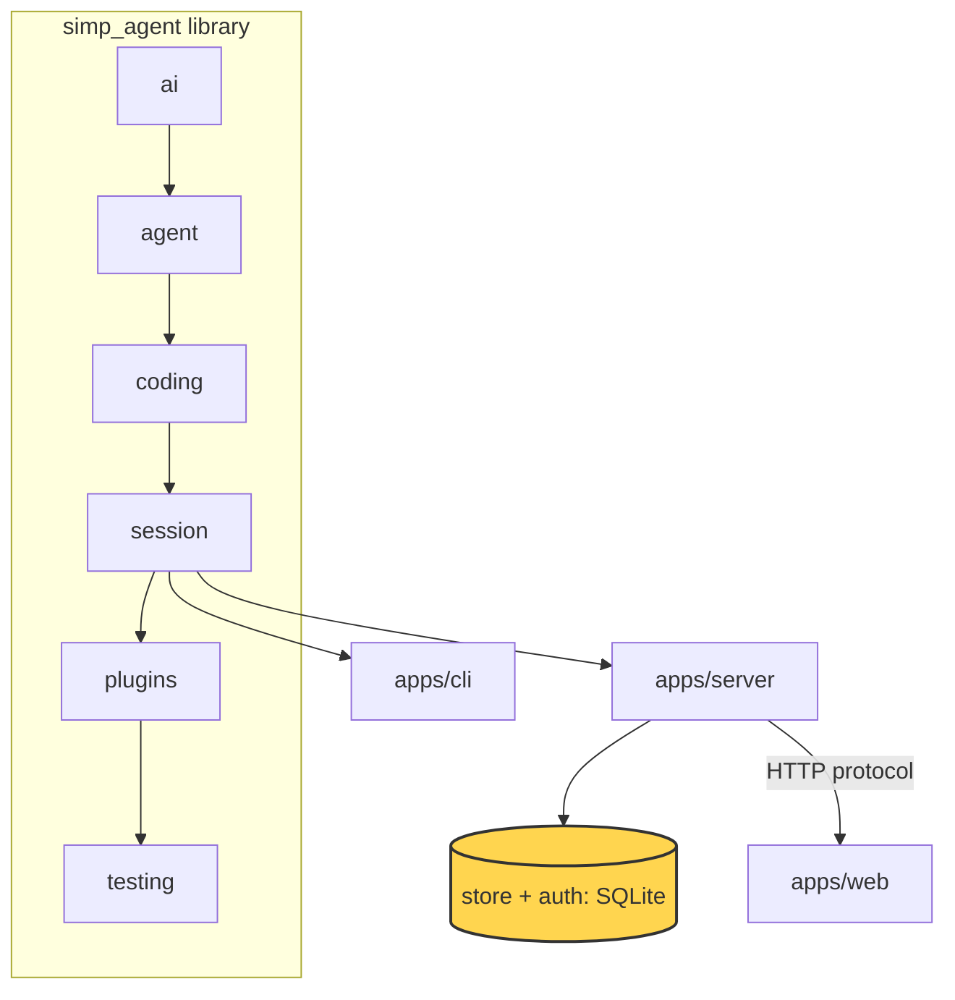

# 22 Part 5 · Store and auth

**Goal:** Save users, sessions and events durably.

**Builds on:** [21 Transport](21-transport.md) · **Next:** [23 Limits](23-limits.md)

## Where we are



*This chapter adds the server's `store` and `auth` (marked).*

Big picture of Part 5: [part-5-system](part-5-system.md).

Code in this chapter (commit `2fc2776`):

- `apps/server/src/simp_server/store.py` — `SqliteStore`, `sha`, `hash_password`, `check_password`
- `apps/server/src/simp_server/server.py` — `Store`, `Auth`, `StaticTokenAuth`, `Run.recover`
- `apps/server/tests/test_store.py`, `apps/server/tests/test_accounts.py` — the store and auth tests

## Problem

The server runs and streams sessions ([20](20-server-run.md), [21](21-transport.md)), but so far we did not say where things live. Without a real store:

- When the server restarts, every user, every session and every event is gone.
- A user cannot come back tomorrow and see the fizzbuzz chat again.
- Anyone who can reach the port can use the agent. There is no "who are you?".
- If the server dies **in the middle of a run**, the session stays "running" forever. The model's last tool call has no result, so the history is broken.

So we need two things. A **[store](glossary.md#store)**: one place on disk for users, sessions, events and cost. And **[auth](glossary.md#auth)**: a way to check who sends each request.

## Naive version

The simplest idea: keep everything in Python dicts, and keep tokens as plain text.

Naive sketch (not in the repo):

```text
users    = empty map   // token -> name
sessions = empty map   // session id -> list of events

add_user(name):
    token = new random token
    users[token] = name          // plain token kept as-is
    RETURN token

user_by_token(token):
    RETURN users[token] or nothing

add_event(sid, event):
    ADD event to sessions[sid]   // not tied to any user

t = add_user("ann")
add_event("s1", {type: user_message, text: "write fizzbuzz.py"})
// prints: ann {s1: [...]}
```

It works for one happy demo. It breaks when:

1. **The process stops.** All dicts are gone. Ann's token no longer works and her fizzbuzz chat is lost.
2. **Someone reads the data.** If we dump `users` to a file, the file holds working tokens. Anyone who copies the file can log in as anyone.
3. **Two users share the server.** `sessions` is not tied to a user. If Bob guesses Ann's session id, he reads her chat.
4. **A run dies in the middle.** Nothing marks it as stopped. The client waits forever.

## Step by step: from naive to real

**Step 1 — put it on disk (fix 1).** Use a SQLite file instead of dicts:

Real code: [store.py](../../apps/server/src/simp_server/store.py) — `SqliteStore.open`

```text
db = CONNECT to <data_dir>/simp.db
RUN SCHEMA on db   // create tables if missing
```

Why: a file stays after the process stops.

**Step 2 — store hashes, not tokens (fix 2).** Keep only the SHA-256 of a token:

Real code: [store.py](../../apps/server/src/simp_server/store.py) — `sha`

```text
sha(token):
    RETURN SHA-256 hex of token
```

Why: a copied database then holds nothing that can log in.

**Step 3 — scope every read by user (fix 3).** Put `user_id` in each `WHERE`:

```python
"SELECT * FROM sessions WHERE id=? AND user_id=?", sid, user_id
```

Why: Bob asking for Ann's session id finds no row.

**Step 4 — save events as they happen.** Write each message and event to one `entries` table, with one `seq` counter:

Real code: [server.py](../../apps/server/src/simp_server/server.py) — `Run.append`

```text
seq = seq + 1
SAVE row (user_id, sid, seq, type "msg", entry as dict) to entries
```

Why: after a restart we can read the rows back in exact order.

**Step 5 — close a dead run (fix 4).** On load, if the run was busy, answer open tool calls and set state `error`:

Real code: [server.py](../../apps/server/src/simp_server/server.py) — `Run.recover`

```text
run_state = "error"
SEND event RunState(state = "error")   // durable: saved and sent
```

Why: the history must be valid again. The next section shows the full code.

## Real design

Put the five steps together and you get the real store. Let us go through it part by part.

### SqliteStore: one file, five tables

`apps/server/src/simp_server/store.py` holds `SqliteStore`. It uses SQLite through `aiosqlite`, so calls are `async` and do not block the server.

```python
SCHEMA = """
CREATE TABLE IF NOT EXISTS users(id TEXT PRIMARY KEY, name TEXT UNIQUE, token_sha256 TEXT UNIQUE, password TEXT,
    disabled INTEGER DEFAULT 0);
CREATE TABLE IF NOT EXISTS tokens(token_sha256 TEXT PRIMARY KEY, user_id TEXT, created REAL);
CREATE TABLE IF NOT EXISTS sessions(id TEXT PRIMARY KEY, user_id TEXT, title TEXT, profile TEXT, sandbox_ref TEXT,
    created REAL, updated REAL);
CREATE TABLE IF NOT EXISTS entries(session_id TEXT, user_id TEXT, seq INTEGER, type TEXT, json TEXT,
    PRIMARY KEY(session_id, seq));
CREATE TABLE IF NOT EXISTS usage(user_id TEXT, session_id TEXT, model TEXT, input INTEGER, output INTEGER, at REAL,
    cost REAL DEFAULT 0);
"""
```

The whole database is one file: `<data_dir>/simp.db`. Look at the first line of the file:

```python
"""SQLite store (aiosqlite). Every row has user_id; every read is scoped by it."""
```

This is the fix for problem 3. Every read has `user_id` in its `WHERE`:

Real code: [store.py](../../apps/server/src/simp_server/store.py) — `SqliteStore.get_session`

```text
get_session(user_id, sid):
    rows = SELECT sessions WHERE id = sid AND user_id = user_id
    RETURN first row, or nothing
```

If Bob asks for Ann's session id, the query finds nothing and the server answers 404. There is no special "is this yours?" check to forget. It is in the SQL.

`open()` creates the folder, connects, and turns on WAL:

Real code: [store.py](../../apps/server/src/simp_server/store.py) — `SqliteStore.open`

```text
SET journal_mode = WAL
RUN SCHEMA
```

**[WAL](glossary.md#wal)** (write-ahead log) is a SQLite mode. Readers do not wait for a writer, and a crash does not leave a half-written database. After that, `open()` checks for old columns. A database from an older stage gets `cost`, `password` and `disabled` added with `ALTER TABLE`.

Why SQLite and not Postgres? The server runs on one machine ([26](26-system-tests-deploy.md)). SQLite is in the standard library, needs no extra process, and backs up by copying one file. The store is picked by name from `DEFAULT_PLUGINS` in `apps/server/src/simp_server/server.py` (a small name-to-class map in the server settings, not the library plugins of [14](14-plugins.md)), so you can swap it.

### Token hashes

A **[token](glossary.md#token-auth)** is a long random string. The client sends it as `Authorization: Bearer <token>`. The server never stores the token itself. It stores only its SHA-256:

Real code: [store.py](../../apps/server/src/simp_server/store.py) — `sha`, `SqliteStore.add_user`

```text
sha(token):
    RETURN SHA-256 hex of token

add_user(name, password = none, token = yes):
    // returns the static token (shown once); only its sha256 is stored
    // a taken name raises IntegrityError
    t = new random token IF token wanted, ELSE none
    INSERT user (new id, name, sha(t), hash_password(password) in a thread)
    RETURN t
```

This fixes problem 2. If someone copies `simp.db`, they get hashes, not tokens. A hash cannot be sent back as a token. The token is shown **once** (the `seed` command prints it), then it lives only with the user.

Why a fast hash here? A token is 32 random bytes. Nobody can guess it. A password can be guessed, so it gets a slow hash (below).

There are two kinds of token:

- A **[static token](glossary.md#static-token)** in `users.token_sha256`. The admin makes it with `seed` and changes it with `rotate`.
- A **[per-device token](glossary.md#per-device-token)** in the `tokens` table. Each password login makes a new one. `logout` deletes only that one row.

One query checks both:

Real code: [store.py](../../apps/server/src/simp_server/store.py) — `SqliteStore.user_by_token`

```text
user_by_token(token):
    h = sha(token)
    rows = SELECT id, name FROM users
           WHERE disabled = 0
             AND (token_sha256 = h  OR  id has a row in tokens with token_sha256 = h)
    RETURN first row, or nothing
```

Note `disabled=0`. A revoked user fails here, even with a token that is still in the table.

`StaticTokenAuth` in `server.py` is the default auth plugin. It is four lines: read the header, call `user_by_token`:

Real code: [server.py](../../apps/server/src/simp_server/server.py) — `StaticTokenAuth.authenticate`

```text
authenticate(request):
    h = request header "authorization"
    IF h starts with "Bearer ":
        RETURN store.user_by_token(rest of h)
    RETURN nothing
```

`revoke` sets `disabled=1`, clears the static token and deletes all device tokens. `rotate_token` deletes device tokens, sets a new static token and turns the user back on. In both cases every old token stops working at once.

### scrypt passwords

The web client ([25](25-web-client.md)) needs a name and a password, not a long token. Passwords use **[scrypt](glossary.md#scrypt)**, a slow hash from the standard library:

Real code: [store.py](../../apps/server/src/simp_server/store.py) — `_scrypt`, `hash_password`, `check_password`

```text
_scrypt(password, salt):
    RETURN scrypt(password, salt, n=2**14, r=8, p=1)

hash_password(password):
    salt = 16 random bytes
    RETURN "scrypt$<salt hex>$<_scrypt(password, salt) hex>"

check_password(password, stored):
    IF no stored hash:
        _scrypt(password, dummy salt)   // same time whether or not the user exists
        RETURN false
    split stored into salt and h
    RETURN constant-time compare(_scrypt(password, salt), h)
```

Three small choices, each with a reason:

- **A random salt per user.** Two users with the same password get different hashes.
- **Same time for "no such user".** If the user does not exist, we still run scrypt once. So an attacker cannot learn which names exist by timing the answer.
- **`hmac.compare_digest`.** It compares in constant time, so the time does not leak how many bytes matched.

scrypt is slow on purpose, and slow code would block the event loop. So the store calls it with `asyncio.to_thread(...)`. `login` checks the password, then makes a new per-device token:

Real code: [store.py](../../apps/server/src/simp_server/store.py) — `SqliteStore.login`

```text
login(name, password):
    rows = SELECT id, password FROM users WHERE name = name AND disabled = 0
    IF NOT check_password(password, stored hash or none)   // run in a thread
        RETURN nothing
    token = new random token
    INSERT into tokens (sha(token), user id, now)
    RETURN token
```

The routes are in `server.py`: `/api/signup`, `/api/login`, `/api/logout`. Sign-up is closed unless `signup_code` is set in settings. The code is checked with `hmac.compare_digest`. The name must match `[a-z0-9_-]{2,32}` and the password needs at least `MIN_PASSWORD = 8` characters.

### Durable events

How `seq` and replay work is in [21 · seq](21-transport.md#seq-one-counter-for-everything). Here we only see where the rows are stored. The `entries` table holds two kinds of rows, with **one** `seq` counter per session:

- protocol events (type = the event type, like `run_state`),
- core messages from the session (type = `"msg"`).

`Run.append` writes `msg` rows ([Step 4](#step-by-step-from-naive-to-real)) and `Run.durable` writes protocol events, with the same `self.seq` ([21](21-transport.md#seq-one-counter-for-everything)).

When a session is loaded again, `Run.__init__` splits the rows back:

Real code: [server.py](../../apps/server/src/simp_server/server.py) — `Run.__init__`

```text
FOR EACH entry in entries:
    IF type is "msg": ADD from_dict(data) to session messages   // what the model sees
    ELSE:             ADD data to log                           // what clients see
// ponytail: whole log in memory
```

The `msg` rows rebuild the `AgentSession` history (what the model sees; `from_dict` is the [JSON round trip](ref-objects.md#going-to-json-and-back)). The other rows rebuild the protocol log (what clients see). The last `run_state` sets the state, and `self.seq` continues from the last row.

### recover

Problem 4: the server dies while the fizzbuzz run is busy. On disk the last `run_state` says `running`. Maybe an approval request has no answer. Maybe the last assistant message asked to run `bash` and there is no tool result.

`SessionManager.get` loads a session and then calls `recover()`:

Real code: [server.py](../../apps/server/src/simp_server/server.py) — `SessionManager.get`

```text
runs[sid] = new Run(row, env, store.entries(user id, sid))
WAIT for runs[sid].recover()
```

`Run.recover` (in `server.py`) does nothing if the run is not busy. If it is busy, it closes the run in the log:

1. Every `approval_request` with no `approval_resolved` gets an `ApprovalResolved` with `decision="aborted"`.
2. Every tool call in the last assistant message with no result gets a `ToolResultMessage` with `"aborted: the server restarted before this tool finished"` and `is_error=True`. It is saved with `append` and also sent as a `ToolResult` event.
3. The state is set to `"error"`, then a `Notice`: `"interrupted: the server restarted during this run"`.

Real code: [server.py](../../apps/server/src/simp_server/server.py) — `Run.recover`

```text
run_state = "error"   // any busy state -> error, skip check_transition on purpose
SEND event RunState(state = "error")
SEND event Notice(level = "warning", text = "interrupted: the server restarted during this run")
```

Step 2 matters for the model. Providers reject a history where a tool call has no result. After recover, the history is valid, so the user can press Continue.

## Test

`apps/server/tests/test_store.py::test_revoke_rotate_delete`:

```python
async def test_revoke_rotate_delete(tmp_path):
    s = await opened(tmp_path)
    try:
        old = await s.add_user("a")
        new = await s.rotate_token("a")
        assert new and new != old
        assert await s.user_by_token(old) is None and (await s.user_by_token(new))["name"] == "a"
        assert await s.rotate_token("nobody") is None
        assert await s.revoke("a") and await s.user_by_token(new) is None
        assert not await s.revoke("a")
        assert await s.count_users() == 0  # revoked: still listed (rows kept) but not counted as a user who can log in
        assert [u["name"] for u in await s.list_users()] == ["a"]

        await s.add_user("b")
        uid = next(u["id"] for u in await s.list_users() if u["name"] == "b")
        row = await s.add_session(uid, "p")
        await s.add_entry(uid, row["id"], 1, "notice", {"x": 1})
        await s.add_usage(uid, row["id"], "m", 1, 1, cost=0.1)
        assert not await s.delete_session("someone-else", row["id"])
        assert await s.delete_session(uid, row["id"])
        assert await s.get_session(uid, row["id"]) is None and await s.entries(uid, row["id"]) == []
        assert await s.spent(uid, -1) == 0.1  # money already spent stays counted for the day
    finally:
        await s.close()
```

What it checks:

- After `rotate_token`, the old token fails and the new one works.
- After `revoke`, the token fails, a second `revoke` returns `False`, and the user is still listed but not counted.
- `delete_session("someone-else", ...)` fails: the `user_id` scope works for writes too.
- Deleting a session also deletes its entries, but usage (money spent) stays.

Run them:

```sh
uv run pytest apps/server/tests/test_store.py apps/server/tests/test_accounts.py -q
```

## Why this way

> **One SQLite file, hashes only, every row scoped by user.** SQLite fits a one-machine server: no extra process, crash safe with WAL, backup is a file copy. Storing only hashes means a leaked database does not leak logins. Putting `user_id` in every query makes "see only your own data" the default, not a check you might forget. Events and messages share one `seq` in one table, so replay ([21](21-transport.md)) and resume ([13](13-session.md)) read the same rows. The cost: one writer at a time and the whole event log in memory per open session (marked `ponytail:` in the code). For many machines you would swap the `store` plugin.

## Exercises

1. Add a line to `test_revoke_rotate_delete`: after `revoke("a")`, check that `rotate_token("a")` gives a working token again. Run the test.
2. Use `sqlite3` on a test `simp.db`: run `SELECT token_sha256 FROM users;`. Can you use the value as a Bearer token? Why not?

## Recap

- `SqliteStore` keeps users, tokens, sessions, entries and usage in `<data_dir>/simp.db`, with WAL on.
- Every row has `user_id`; every read and delete filters by it.
- Tokens are stored as SHA-256 only. Static tokens come from `seed`/`rotate`; each password login makes a per-device token.
- Passwords use salted scrypt, run in a thread, compared in constant time, with the same time for unknown users.
- `Run.append` (messages) and `Run.durable` (events) write to one `entries` table with one `seq`.
- `Run.recover` closes a run that died while busy: aborts open approvals, answers open tool calls, sets state `error`.

**Builds on:** [21 Transport](21-transport.md) · **Next:** [23 Limits](23-limits.md)
