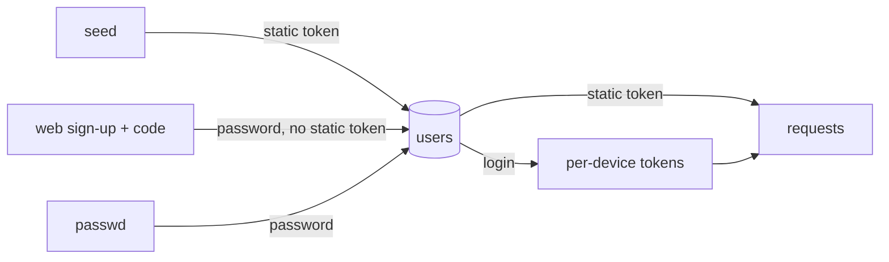

# 22 — Users and accounts

> **Who this is for:** an operator who adds, lists, locks out or re-enables users.
> **What you need first:** [20 Operator tutorial](20-operator-tutorial.md) (you made two users there) and [21 Configuration reference](21-configuration.md) (the `signup_code` key). Words: [access token](glossary.md#access-token), [session](glossary.md#session).
> **What you will learn:** the two ways a user signs in, every user command, and what `revoke` and `rotate` really do.
> **Code paths covered:** `apps/server/src/simp_server/store.py` (users, tokens, scrypt), `server.py` (`main`, `signup`, `login`, `over_budget`, the event stream).
> **Verified at commit:** `5b091ec` (read from code; not run).

**Back:** [21 Configuration reference](21-configuration.md) · **Next:** [23 Sandboxes](23-sandboxes.md)

## 1. Two kinds of credential

A user can have either, or both:

| | Static token | Password |
|---|---|---|
| Made by | `simp-server seed` or `rotate` | `seed --password`, `passwd`, or web sign-up |
| What the user holds | one long secret, shown **once** | a name and a password |
| Stored in the database as | its SHA-256 hash | an scrypt hash (salted) |
| Used for | web login box, API calls | web login form; each login makes a **new token** for that device |

An [access token](glossary.md#access-token) is the thing every request carries (`Authorization: Bearer <token>`). A password login only trades name + password for such a token. Because the database keeps only hashes, a lost token cannot be shown again. Use `rotate`.



## 2. Add a user: `seed`

```bash
simp-server seed --name alice                # prints a token once
simp-server seed --name alice --password     # also asks for a password
```

With `--password` the command asks twice and wants at least 8 characters. Save the token at once; it is printed one time. Names must be unique (a taken name shows a Python error, not a friendly message). The CLI does not check the name pattern; web sign-up does. There is no command to delete a user. When you add a second active user while the sandbox is `LocalSandbox`, `seed` prints a warning (the server will refuse to start next time). See 23 Sandboxes (not written yet) and [21](21-configuration.md#2-top-level-keys).

## 3. Self sign-up with one shared code

Set `signup_code = "some-long-word"` in `settings.toml` ([21](21-configuration.md#2-top-level-keys)). Then anyone who knows the code can make an account on the web sign-up page. Rules the server checks:

- Name (400 if bad): 2–32 characters of `a-z 0-9 _ -`.
- Password (400 if short): at least 8 characters.
- A name over 64 characters or a password over 1024 gets 422.
- With `LocalSandbox`, sign-up is refused (409) as soon as **one** active user exists, unless `allow_local_sandbox = true`.
- The name must be free (else 409).
- Order of checks: code (403), name (400), password (400), sandbox (409), taken name (409). A wrong code always wins.
- A wrong code, or no `signup_code` in the file (sign-up **closed**), gives the same 403 message: "sign-up is closed or the invite code is wrong".
- On success the user is signed in at once (the page gets a token).

There is **one** code for everybody. You cannot make a code per person or expire it. To stop new sign-ups, remove the key and restart. A web sign-up user has a password but no static token.

## 4. Change a password: `passwd`

```bash
simp-server passwd --name alice     # asks for the new password
```

On an unknown name it says "no user named …". It asks twice and wants at least 8 characters. It also adds a password to a user made by `seed` without one. It does **not** end devices that are already signed in, and it works on a revoked user too (they stay revoked).

## 5. List users: `users`

```bash
simp-server users
alice   active
bob     revoked
```

## 6. Revoke and rotate

| Command | What happens |
|---|---|
| `revoke --name bob` | Marks bob disabled, clears the static token, deletes all device tokens. Prints `revoked`. Fails if bob is not active. |
| `rotate --name bob` | Makes a **new** static token (printed once), deletes the device tokens, and **re-enables** the user if revoked. |

What a revoked user feels:

- Every request with an old token gets 401.
- Password login fails with 401 "Wrong username or password." (same as a wrong password). A pasted old token shows "That token was not accepted." in the web page ([11](11-web.md)). The user is not told they are revoked, so tell them.
- A run in progress stops at its next model call with `budget: user revoked` (see [24](24-money.md)). It is checked before each LLM call, so one call already running may finish.
- An open event stream ends at its next heartbeat check (every 15 seconds when idle).
- His sessions and files stay on disk. Nothing is deleted.

Unknown name gives "no active user named …" for `revoke` (also when already revoked) and "no user named …" for `rotate`.

`rotate` is both "the user lost the token" and "let them back in". After `rotate`, the password (if any) works again, because revoke does not erase it. `rotate` does not check the sandbox rule: re-enabling a user can take you above one active user on `LocalSandbox` with no warning (see [21](21-configuration.md#2-top-level-keys), `allow_local_sandbox`). To lock someone out for good, `revoke` and keep them revoked; to remove the password too, there is no command (a known gap).

## 7. Devices and sign-out

Each password login adds a device token. Nothing in the code expires them. **Sign out** in the web page deletes only that one token. `revoke` and `rotate` delete all of them for the user. A static token is never removed by Sign out.

## 8. Warning: no rate limit on login and sign-up

`/api/login` and `/api/signup` have **no rate limit**. Anyone who can reach the server can try passwords or codes as fast as the machine allows (scrypt makes each try slow, but it does not stop them). Before you put the server on the internet (for example through a tunnel), put a rate-limiting proxy in front, and use a long `signup_code` and long passwords. Full list of gaps: 26 Security model (not written yet).

## 9. Quick recipes

- **New person, you choose:** `seed --name x --password`; give them the name and password.
- **New person, they choose:** share the web address and the `signup_code`.
- **Token leaked:** `rotate --name x`, send the new token.
- **Person leaves:** `revoke --name x`.
- **Person returns:** `rotate --name x`.

---

**Built on by:** 23 Sandboxes, [24 Money and limits](24-money.md), 26 Security model, 27 Troubleshooting (all not written yet).
**Builds on:** [11 The web UI](11-web.md) (the login screen), [20 Operator tutorial](20-operator-tutorial.md), [21 Configuration reference](21-configuration.md).
