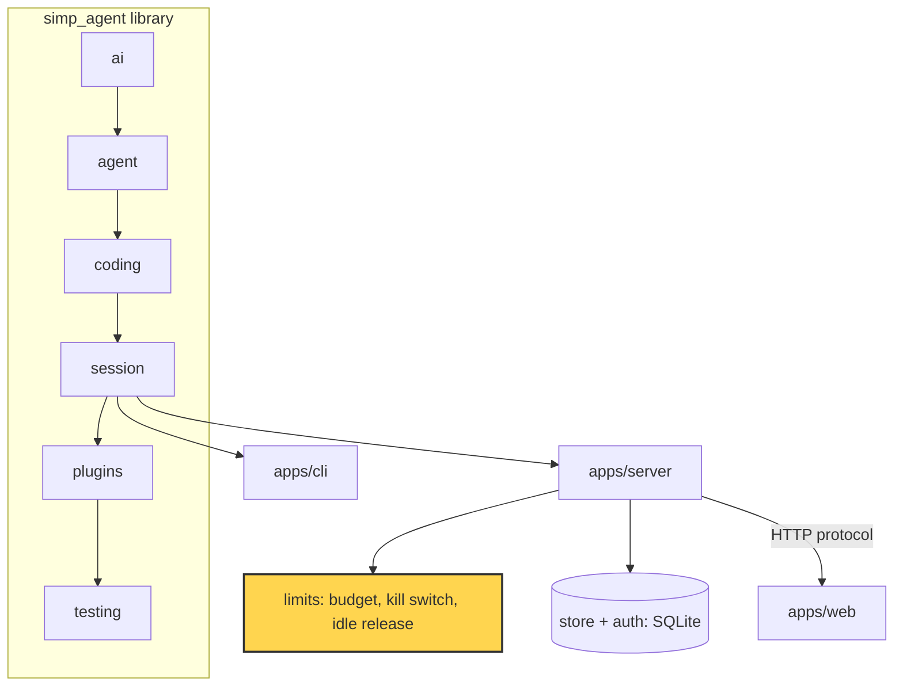

# 23 Part 5 · Limits

**Goal:** Stop runaway cost and free idle resources.

**Builds on:** [22 Store and auth](22-store-auth.md) · **Next:** [24 Docker sandbox](24-docker-sandbox.md)

## Where we are



*This chapter adds limits to the `server` app (marked): a money budget, a kill switch and idle release.*

Code in this chapter (commit `2fc2776`):

- `apps/server/src/simp_server/budget.py` — `Limits`, `limits`, `cost`, `day_start`, `guard`
- `apps/server/src/simp_server/server.py` — `Run.guarded_stream`, `Run.over_budget`, `SessionManager` (`paused`, `evict_idle`, `evict_loop`), the `pause` and `resume` commands
- `apps/server/tests/test_budget.py`, `apps/server/tests/test_lifecycle.py` — the limits tests

## Problem

After [22](22-store-auth.md) the server has users, sessions and a durable store. Many people can now run the agent at the same time. That brings two new risks.

**Money.** Every model call costs money. The agent loop ([05](05-agent-loop.md)) calls the model again and again until the model stops asking for tools. A confused model can loop for a long time. Say Ann asks for `fizzbuzz.py` and the tests keep failing: the model edits, runs, edits, runs. Fifty calls later the bill is real. Nobody is watching.

**Memory and containers.** Each open session on the server is a `Run` ([20](20-server-run.md)) in memory. Each `Run` also holds a sandbox: a folder now, a Docker container in [24](24-docker-sandbox.md). Users close the tab and go home. If the server keeps every `Run` forever, it fills RAM and leaves containers running.

So we need three things:

1. A **budget** ([daily](glossary.md#daily-budget) and per run): refuse a model call when a user or a run has spent too much.
2. A **kill switch**: the admin can stop *all* model calls at once.
3. **[Idle release](glossary.md#idle-release)**: close runs nobody uses, and load them back later.

## Naive version

The simplest idea: after each run ends, add up the cost and stop the user if it is too high.

Naive sketch (not in the repo):

```text
PRICE_IN = 3.0, PRICE_OUT = 15.0   // USD per 1M tokens
DAY_LIMIT = 2.0
spent = {u1: 0}

FUNCTION cost(usage):
    RETURN (usage.input * PRICE_IN + usage.output * PRICE_OUT) / 1,000,000

FUNCTION fake_model_call(i):
    RETURN {input: 200,000, output: 5,000}   // a long context: costs $0.675

FUNCTION run(user, max_calls = 50):
    IF spent[user] >= DAY_LIMIT:            // check once, at the start
        RETURN "refused"
    total = 0
    FOR EACH i in 0..max_calls:             // the agent loop: model wants more tools
        ADD cost(fake_model_call(i)) to total
    ADD total to spent[user]                // count only at the end
    RETURN "spent $total"

run("u1")   // spent $33.75   <- limit was $2
run("u1")   // refused        <- too late
```

Key idea: check once, count once. Limit: one run can spend far past the limit.

It breaks in three ways:

1. **The check is too early, the count is too late.** One run of 50 calls spends $33.75 although the limit is $2. The check only runs before the run starts.
2. **A crash loses the count.** `spent` is in memory and is added only at the end. If the process dies mid-run, the money is spent but not recorded.
3. **No way to stop it.** If something goes wrong for all users at once (a bug, a leaked key), the admin cannot stop every running loop without killing the server.

The fix for 1 and 2: record cost after **every** model call, in the store, and check **before every** model call.

## Step by step: from naive to real

**Step 1 — check before every call, not once.** Move the check inside the loop:

Naive sketch (not in the repo):

```text
FOR EACH i in 0..max_calls:
    IF spent[user] >= DAY_LIMIT:
        RETURN "refused"
    ADD cost(fake_model_call(i)) to spent[user]   // count after every call
```

Why: now the run stops soon after the limit. Fix for break 1.

**Step 2 — keep the count in the store.** Write one row per call, and sum rows to know the spend:

Real code: [store.py](../../apps/server/src/simp_server/store.py) — `add_usage, spent`

```text
WAIT for store.add_usage(user_id, sid, model_id, input, output, cost = c)
WAIT for store.spent(user_id, since)        // SUM(cost) since a time
```

Why: a dict in memory dies with the process. A database row survives a crash. Fix for break 2.

**Step 3 — put the check in one door.** Wrap `stream_fn` so no call can skip it:

Real code: [budget.py](../../apps/server/src/simp_server/budget.py) — `guard`

```text
stream_fn = budget.guard(stream_fn, check)   // check() returns nothing, or a reason
```

Why: the agent, retries and the title call all use `stream_fn`. One wrapper covers all. The refusal is a normal `error` message, so the loop needs no new code.

**Step 4 — add the kill switch to the check.** One more reason to refuse:

Real code: [server.py](../../apps/server/src/simp_server/server.py) — `Run.over_budget`

```text
IF manager.paused():                         // PAUSED file exists
    msg = "budget: server paused by the admin"
```

Why: the admin can stop every loop at its next model call. Fix for break 3.

**Step 5 — free idle runs.** Pop a run from memory and close its sandbox, but only if nobody uses it:

Real code: [server.py](../../apps/server/src/simp_server/server.py) — `SessionManager.evict_idle`

```text
IF run is evictable AND now - last_used[sid] >= idle_s:
    WAIT for evict(sid)
```

Why: the store can rebuild the run later, so freeing it loses nothing. Now the real code.

## Real design

### Cost from profile prices

Real code: [budget.py](../../apps/server/src/simp_server/budget.py) — `Limits, limits, cost`

```text
CLASS Limits:
    user_day_usd = 2.0
    run_usd = 0.5

FUNCTION limits(settings):
    RETURN Limits built from settings["budget"] (or defaults)

FUNCTION cost(profile, usage):
    // missing token count or price counts as 0
    RETURN (usage.input * profile.price_in + usage.output * profile.price_out) / 1,000,000
```

`user_day_usd` is the most one user may spend in a day. `run_usd` is the most one **[run](glossary.md#run-budget)** may spend. They come from the `[budget]` table in `settings.toml`. Defaults: $2 a day, $0.5 a run.

Prices live in each profile ([18](18-profiles-plugins.md)) as `price_in` and `price_out`, in USD per 1 million tokens. `cost` multiplies the token counts from the model's `usage` by these prices. A profile with no prices costs $0. That is a quiet hole, so the server warns at start:

Real code: [server.py](../../apps/server/src/simp_server/server.py) — `create_app.lifespan`

```text
FOR EACH profile (name, pr) in settings.profiles:
    IF pr has no price_in OR no price_out:
        LOG warning "profile <name> has no prices: its calls cost $0 and never hit a budget"
```

### Record cost after every call

In `apps/server/src/simp_server/server.py`, the `Run` writes a usage row each time an assistant message ends:

Real code: [server.py](../../apps/server/src/simp_server/server.py) — `Run.on_event`

```text
u = {input: m.usage.input or 0, output: m.usage.output or 0}
...
WAIT for store.add_usage(user_id, sid, model.id, u, cost = budget.cost(profile, u))
```

The row goes to the SQLite store from [22](22-store-auth.md), so the count survives a crash. The session title call records its usage the same way.

The store can sum it:

Real code: [store.py](../../apps/server/src/simp_server/store.py) — `SqliteStore.spent`

```text
FUNCTION spent(user_id, since, session_id = none):
    RETURN SUM(cost) of usage rows for user_id with time >= since   // 0 if no rows
    // (also filter by session_id when given)
```

`since` is a timestamp: `budget.day_start()` (local midnight) for the day limit, or the run start time plus the session id for the run limit.

### The budget guard: wrap the stream

Now the check. Where do we put it? The agent calls the model through one function, `stream_fn` ([04](04-providers.md)). If we wrap that one function, every model call passes the check. That wrapper is the **[budget guard](glossary.md#budget-guard)**:

Real code: [budget.py](../../apps/server/src/simp_server/budget.py) — `guard`

```text
FUNCTION guard(stream_fn, check):
    FUNCTION fn(model, ctx, ...):
        msg = WAIT for check()
        IF msg:
            SEND event {type: "error", message: AssistantMessage(stop_reason = "error", error = msg, error_kind = "budget")}
            RETURN                              // the real model is never called
        FOR EACH event ev from stream_fn(model, ctx, ...):
            SEND event ev
    RETURN fn
```

Key idea: one wrapper on the one model door, so every call is checked. Limit: it checks money already spent, not the next cost.

`check` is an async function. It returns `None` when all is fine, or a text when the call must be refused. If refused, the guard does **not** call the real model. It yields one `error` event with an `AssistantMessage` that has `stop_reason="error"`. For the agent this looks like a normal failed model call ([03](03-stream-parser.md)). So the loop stops in the normal way. No new code path in the agent.

Note `error_kind="budget"`. Retry ([15](15-retry.md)) never retries `"fatal" | "budget" | "policy"` errors (see `is_retryable`). A refused call would only be refused again.

The `Run` gives the guard to its session:

Real code: [server.py](../../apps/server/src/simp_server/server.py) — `Run.guarded_stream`

```text
PROPERTY guarded_stream:
    RETURN budget.guard(manager.stream_fn, over_budget)
```

It is passed as `stream_fn=self.guarded_stream` to `AgentSession` ([13](13-session.md)), and the title call uses `self.guarded_stream` too.

### The check itself

Real code: [server.py](../../apps/server/src/simp_server/server.py) — `Run.over_budget`

```text
FUNCTION over_budget():
    msg = nothing
    IF manager.paused():
        msg = "budget: server paused by the admin"
    ELSE IF NOT (WAIT for store.user_active(user_id)):
        msg = "budget: user revoked"
    ELSE IF (WAIT for store.spent(user_id, day_start())) >= limits.user_day_usd:
        msg = "budget: daily limit $<user_day_usd> reached"
    ELSE IF (WAIT for store.spent(user_id, run_start, sid)) >= limits.run_usd:
        msg = "budget: run limit $<run_usd> reached"
    IF msg:
        LOG warning "over budget: <msg>"
    RETURN msg
```

Four reasons to refuse, in order: the server is paused (kill switch, below); the user was revoked ([22](22-store-auth.md)); the user spent the day limit; this run spent the run limit since `run_start`.

The check is `>=` on money **already spent**. It does not guess the next cost. So one call can go a little over, and the *next* call is refused.

What is a "run" here? `run_start` is set in `Run.start`:

Real code: [server.py](../../apps/server/src/simp_server/server.py) — `Run.start`

```text
FUNCTION start(text, fresh = true):   // text: a prompt, or a coroutine factory (continue_, compact)
    IF fresh:                            // a queued follow-up stays inside the same run budget
        run_start = now
```

A new prompt starts a fresh run budget. A queued follow-up ([07](07-steering.md)) starts with `fresh=False`, so queueing cannot get around the run limit.

When the guard refuses, the run ends in state `"error"`. The client sees why from the error text.

### Kill switch: one file

A **[kill switch](glossary.md#kill-switch)** stops all model calls on the server at once. Here it is a file named `PAUSED` in the data directory:

Real code: [server.py](../../apps/server/src/simp_server/server.py) — `SessionManager.paused`

```text
FUNCTION paused():
    RETURN file "<data_dir>/PAUSED" exists
```

The admin uses the CLI:

Real code: [server.py](../../apps/server/src/simp_server/server.py) — `main`

```text
ADD CLI command "pause"  // kill switch: refuse every LLM call until resume
ADD CLI command "resume" // lift the kill switch
...
IF mode is "pause" or "resume":
    f = "<data_dir>/PAUSED"
    IF mode is "pause": create f
    ELSE: delete f (ok if missing)
```

`pause` creates the file. `resume` deletes it. Why a file and not an API call or a flag in memory?

- It works from a shell, even when the HTTP side is broken.
- It needs no running server, and it survives a restart.
- The guard checks it before every call.

Pause does not kill tools that are already running. It only refuses the next model call. Without the model, the loop cannot ask for more tools.

Users can see their state through `/api/usage`:

Real code: [server.py](../../apps/server/src/simp_server/server.py) — `create_app.usage`

```text
GET /api/usage (logged-in user u):
    RETURN {today_usd: store.spent(u.id, day_start()) rounded to 4 places,
            day_limit_usd: limits.user_day_usd,
            paused: manager.paused()}
```

### Idle release: evict runs nobody uses

Now memory and containers. The `SessionManager` keeps loaded runs in `self.runs`, and the last time each was used in `self.last_used`:

Real code: [server.py](../../apps/server/src/simp_server/server.py) — `SessionManager.__init__`

```text
idle_s = settings.idle_minutes (default 15) * 60
cap = settings.max_open_sessions (default 8)
```

To **[evict](glossary.md#eviction)** a run means: remove it from memory and close its sandbox. Its files and its event log stay in the store.

Real code: [server.py](../../apps/server/src/simp_server/server.py) — `SessionManager.evict`

```text
FUNCTION evict(sid):
    // free RAM and the container; files and log stay, the next get reloads from the store
    run = REMOVE runs[sid]
    REMOVE last_used[sid] (if there)
    WAIT for sandbox.close(run.ref)
```

But we must never evict a run that is in use:

Real code: [server.py](../../apps/server/src/simp_server/server.py) — `SessionManager.evictable`

```text
FUNCTION evictable(run):
    RETURN run is NOT busy
       AND run has no subscribers
       AND (run has no task OR task is done)
       AND (run has no title_task OR title_task is done)
```

A run is safe to evict only if it is not busy, no client is subscribed to its stream ([21](21-transport.md)), and its task and title task are done. An open tab counts as "in use".

`evict_idle` evicts every evictable run that was not used for `idle_s` seconds:

Real code: [server.py](../../apps/server/src/simp_server/server.py) — `SessionManager.evict_idle`

```text
FUNCTION evict_idle():
    WITH lock:
        now = monotonic clock
        FOR EACH (sid, run) in runs:
            IF evictable(run) AND now - last_used[sid] (default 0) >= idle_s:
                WAIT for evict(sid)
```

`now` comes from a [monotonic clock](glossary.md#monotonic-clock), a clock that only goes forward, so a change to the system time cannot evict runs early.

A background task, `mgr.evict_loop(...)`, calls it every `evict_every` seconds (default 60). It logs errors, so one failed eviction does not stop it.

There is also a hard cap. In `SessionManager.get`, if `max_open_sessions` runs are already loaded, the least recently used evictable run is evicted to make room. If none can be evicted, the server answers `503 "too many active sessions, try again later"`.

When the user comes back, `get` opens the sandbox again, builds a new `Run` from the stored entries, and calls `recover()` ([22](22-store-auth.md)). The user sees the same history and files.

## Test

`apps/server/tests/test_budget.py::test_run_budget_stops_tool_loop`:

```python
PROFILE = '[profiles.test]\napi = "fake"\nmodel = "m"\nprice_in = 1000000\nprice_out = 0\n'  # $1 per input token
...
async def test_run_budget_stops_tool_loop(tmp_path):
    # price_in = $1 per input token and each reply reports 1 input token -> every LLM call costs $1
    fp = FakeProvider(*[usage_reply("", [ToolCall(f"c{i}", "bash", {"command": "true"})]) for i in range(5)])
    app, mgr, user, _, run = await make(tmp_path, fp, "[budget]\nrun_usd = 1.5\nuser_day_usd = 100\n")
    await run.command(p.Prompt(text="go"))
    while run.busy:  # allow every bash call
        if run.pending and not run.answer.done():
            run.answer.set_result("allow")
        await asyncio.sleep(0.01)
    assert fp.calls == 2  # $1 + $1 > $1.5 -> third call refused before reaching the provider
    assert run.state == "error"
    assert any(e["type"] == "notice" and "budget" in e["text"] for e in run.log) or \
        any(e["type"] == "assistant_message" and e.get("error") and "budget" in e["error"] for e in run.log)
    assert await mgr.store.spent(user["id"], 0) == 2
    await mgr.store.close()
```

What it checks:

- The `FakeProvider` ([02](02-fake-provider.md)) has five replies, each asking for a `bash` call. This is the runaway loop.
- Each call costs $1. The run limit is $1.5.
- After call 2 the spend is $2, over the limit. Call 3 is refused **before** it reaches the provider, so `fp.calls == 2`.
- The run ends in state `"error"`, and the store holds exactly $2.

Run it:

```sh
uv run pytest apps/server/tests/test_budget.py::test_run_budget_stops_tool_loop -q
```

Other tests in the file cover the day limit (`test_day_budget_and_pause`), the kill switch (`test_pause_refuses_llm_calls`) and follow-ups (`test_run_budget_spans_follow_ups`). For idle release, see `apps/server/tests/test_lifecycle.py::test_idle_run_evicted_and_reloaded`. `test_busy_run_not_evicted` checks that a running loop is never evicted.

## Why this way

> **Guard the one door, count in the store.** Every model call goes through `stream_fn`, so one wrapper (`budget.guard`) covers the loop, retries and the title call. The library knows nothing about money; the server adds it from outside. Cost is written to the store after each call, so a crash cannot hide spending. The cost of this choice: the last call can go a little over the limit. The kill switch is a file because it must work when everything else is broken.

## Exercises

1. Call `budget.cost({"price_in": 3, "price_out": 15}, {"input": 200_000, "output": 5_000})`. What do you get? (Check with the naive version: $0.675.)
2. Write a `check` that always returns `"stop"`. Wrap a `FakeProvider` with `budget.guard`, call it once, and print the event. How many calls did the fake record?

## Recap

- `budget.cost` turns token usage into USD from profile prices. Each call's cost is saved with `store.add_usage`.
- `budget.guard` wraps `stream_fn`. Before each model call it runs `Run.over_budget`. If that returns a reason, the call is refused with `error_kind="budget"` and is never retried.
- Four reasons: server paused, user revoked, day limit, run limit. Follow-ups share the run budget.
- The kill switch is a `PAUSED` file in the data dir. `simp-server pause` / `resume` create and delete it.
- `SessionManager.evict_idle` frees runs that are idle, not busy and have no subscribers. A cap of `max_open_sessions` evicts the least recently used run or returns 503. Evicted runs load back from the store.

**Builds on:** [22 Store and auth](22-store-auth.md) · **Next:** [24 Docker sandbox](24-docker-sandbox.md)
