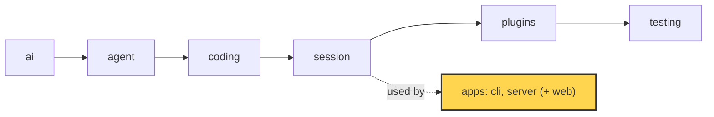

# 23 Part 5 · Limits

**Goal:** Stop runaway cost and free idle resources.

**Builds on:** [22 Store and auth](22-store-auth.md) · **Next:** [24 Docker sandbox](24-docker-sandbox.md)

## Where we are



*This chapter still works in the `server` app (marked). It adds limits around the model calls and the open runs. The library does not change.*

Big picture of Part 5: [part-5-system](19-0-part-5-system.md).

Code in this chapter (commit `2fc2776`):

- `apps/server/src/simp_server/budget.py` — `Limits`, `limits`, `cost`, `day_start`, `guard`
- `apps/server/src/simp_server/server.py` — `Run.guarded_stream`, `Run.over_budget`, `Run.start`, `SessionManager` (`paused`, `evict`, `evictable`, `evict_idle`, `evict_loop`), the `pause` and `resume` commands
- `apps/server/tests/test_budget.py`, `apps/server/tests/test_lifecycle.py` — the limits tests

## Problem

At the end of [22](22-store-auth.md), Ana and Bob share one server. Each has a login, and their sessions survive a restart. Now think about one bad afternoon.

Ana asks for `fizzbuzz.py`. The tests keep failing. The model edits the file, runs the tests, edits again. The agent loop ([05](05-agent-loop.md)) keeps calling the model as long as the model asks for tools, and every call costs money. Ana goes to a meeting. Fifty calls later the bill is real, and nobody was watching.

At the same time Bob opens three sessions, looks at them, and closes the tab. Each session is a server [`Run`](glossary.md#run) in memory ([20](20-server-run.md)): one `Run` wraps one `AgentSession`, and each prompt it handles is one agent [run](glossary.md#run-agent) of the loop. Each `Run` holds a sandbox: a folder today, a Docker container in [24](24-docker-sandbox.md). If the server keeps every `Run` forever, RAM fills up and containers keep running for nobody.

So this chapter adds three things:

1. A **budget**: refuse a model call when a user has spent too much today ([daily budget](glossary.md#daily-budget)) or one run has spent too much ([run budget](glossary.md#run-budget)).
2. A **kill switch**: the admin can stop *all* model calls at once, for example after a bug or a leaked API key.
3. **[Idle release](glossary.md#idle-release)**: close runs nobody uses, and load them back from the store when the user returns.

## Starting point: 22's Run, with no limits

At the end of [22](22-store-auth.md), each server `Run` wraps one `AgentSession` ([13](13-session.md)), and the `SessionManager` keeps loaded runs in memory and reloads them from the SQLite store. The model door is passed straight through:

```text
SessionManager(settings, store, sandbox, stream_fn)   // stream_fn = ai.stream
Run: session = AgentSession(model, store, env, stream_fn = manager.stream_fn)
```

This breaks in three ways for this chapter:

1. Nothing checks money. The agent loop ([05](05-agent-loop.md)) calls `stream_fn` again and again, so Ana's one run can spend far past any limit. A check only at the start of a run is too early, and a count only at the end is too late.
2. A count kept in memory dies with a crash or a restart. The spend must live in the store, one row per call.
3. Nothing can stop all loops at once without killing the server, and nothing frees runs nobody uses.

The fix grows this same code: wrap `stream_fn` once inside `Run` (every model call, retries and the [title call](glossary.md#title-call) pass through it), write a usage row after each call, add a kill switch as one more reason to refuse, and let the `SessionManager` evict idle runs.

## Real design

### Cost from profile prices

Real code: [budget.py](../../apps/server/src/simp_server/budget.py) — `Limits, limits, cost`

```text
CLASS Limits:
    user_day_usd = 2.0
    run_usd = 0.5

FUNCTION limits(settings):
    RETURN Limits built from settings["budget"] (or defaults)

FUNCTION cost(profile, usage):
    // missing token count or price counts as 0
    RETURN (usage.input * profile.price_in + usage.output * profile.price_out) / 1,000,000
```

`user_day_usd` is the most one user may spend in a day. `run_usd` is the most one **[run](glossary.md#run-budget)** may spend. They come from the `[budget]` table in `settings.toml`. Defaults: $2 a day, $0.5 a run.

Prices live in each profile ([18](18-profiles-plugins.md)) as `price_in` and `price_out`, in USD per 1 million tokens. `cost` multiplies the token counts from the model's `usage` by these prices. A profile with no prices costs $0. That is a quiet hole, so the server warns at start:

Real code: [server.py](../../apps/server/src/simp_server/server.py) — `create_app.lifespan`

```text
FOR EACH profile (name, pr) in settings.profiles:
    IF pr has no price_in OR no price_out:
        LOG warning "profile <name> has no prices: its calls cost $0 and never hit a budget"
```

### Record cost after every call

The `Run` writes a usage row each time an assistant message ends:

Real code: [server.py](../../apps/server/src/simp_server/server.py) — `Run.on_event`

```text
u = {input: m.usage.get("input", 0), output: m.usage.get("output", 0)}
...
WAIT for store.add_usage(user_id, sid, model.id, u.input, u.output, cost = budget.cost(profile, u))
```

The row goes to the SQLite store from [22](22-store-auth.md), so the count survives a crash. The session title call records its usage the same way.

The store can sum it:

Real code: [store.py](../../apps/server/src/simp_server/store.py) — `SqliteStore.spent`

```text
FUNCTION spent(user_id, since, session_id = none):
    RETURN SUM(cost) of usage rows for user_id with time >= since   // 0 if no rows
    // (also filter by session_id when given)
```

`since` is a timestamp. For the day limit it is `budget.day_start()`, midnight in the server's local time. For the run limit it is `run_start` (below) plus the session id. Why sum rows and not keep a counter on the `Run`? A counter dies when the run is evicted or the server restarts; the rows do not. One sum query serves both limits.

### The budget guard: wrap the stream

Now the check. Where do we put it? The agent calls the model through one function, `stream_fn` ([01](01-pick-clean.md#out-the-shape-of-a-model-call)). If we wrap that one function, every model call passes the check. That wrapper is the **[budget guard](glossary.md#budget-guard)**:

Real code: [budget.py](../../apps/server/src/simp_server/budget.py) — `guard`

```text
FUNCTION guard(stream_fn, check):
    FUNCTION fn(model, ctx, ...):
        msg = WAIT for check()
        IF msg:
            SEND event {type: "error", message: AssistantMessage(stop_reason = "error", error = msg, error_kind = "budget")}
            RETURN                              // the real model is never called
        FOR EACH event ev from stream_fn(model, ctx, ...):
            SEND event ev
    RETURN fn
```

Key idea: one wrapper on the one model door, so every call is checked. Limit: it checks money already spent, not the next cost.

`check` is an async function. It returns `None` when all is fine, or a text when the call must be refused. If refused, the guard does **not** call the real model. It yields one `error` event with an `AssistantMessage` that has `stop_reason="error"`. For the agent this looks like a normal failed model call ([03](03-parse.md)). So the loop stops in the normal way. No new code path in the agent.

Note `error_kind="budget"`. Retry ([15](15-retry.md)) never retries `"fatal" | "budget" | "policy"` errors (see `is_retryable`). A refused call would only be refused again.

The `Run` gives the guard to its session:

Real code: [server.py](../../apps/server/src/simp_server/server.py) — `Run.guarded_stream`

```text
PROPERTY guarded_stream:
    RETURN budget.guard(manager.stream_fn, over_budget)
```

`manager.stream_fn` is the real model door. `over_budget` is the check, shown next. The `Run` passes `stream_fn=self.guarded_stream` to `AgentSession` ([13](13-session.md)), and the title call uses `self.guarded_stream` too.

### The check itself

Real code: [server.py](../../apps/server/src/simp_server/server.py) — `Run.over_budget`

```text
FUNCTION over_budget():
    msg = nothing
    IF manager.paused():
        msg = "budget: server paused by the admin"
    ELSE IF NOT (WAIT for store.user_active(user_id)):
        msg = "budget: user revoked"
    ELSE IF (WAIT for store.spent(user_id, day_start())) >= limits.user_day_usd:
        msg = "budget: daily limit $<user_day_usd> reached"
    ELSE IF (WAIT for store.spent(user_id, run_start, sid)) >= limits.run_usd:
        msg = "budget: run limit $<run_usd> reached"
    IF msg:
        LOG warning "over budget: <msg>"
    RETURN msg
```

Four reasons to refuse, in order: the server is paused (kill switch, below); the user was revoked ([22](22-store-auth.md)); the user spent the day limit; this run spent the run limit since `run_start`. The revoke check is here because revoking in [22](22-store-auth.md) only blocks new logins and requests. A loop that is already running makes no new request, so it would keep going. Checking before each model call stops it too.

The check is `>=` on money **already spent**. It does not guess the next cost. So one call can go a little over, and the *next* call is refused.

What is a "run" here? `run_start` is set in `Run.start`:

Real code: [server.py](../../apps/server/src/simp_server/server.py) — `Run.start`

```text
FUNCTION start(text, fresh = true):   // text: a prompt, or a function to run (continue, compact)
    IF fresh:                            // a queued follow-up stays inside the same run budget
        run_start = now
```

A new prompt starts a fresh run budget. A queued follow-up ([07](07-steering.md)) starts with `fresh=False`, so queueing cannot get around the run limit.

| Time | What Ana does | `run_start` | Run spend counts from |
|---|---|---|---|
| 10:00 | sends a prompt | 10:00 | 10:00 |
| 10:02 | her queued follow-up starts | stays 10:00 | 10:00 (same run) |
| 10:10 | sends a new prompt | 10:10 | 10:10 (from zero) |

When the guard refuses, the run ends in state `"error"`. The client sees why from the error text.

### Kill switch: one file

A **[kill switch](glossary.md#kill-switch)** stops all model calls on the server at once. Here it is a file named `PAUSED` in the data directory:

Real code: [server.py](../../apps/server/src/simp_server/server.py) — `SessionManager.paused`

```text
FUNCTION paused():
    RETURN file "<data_dir>/PAUSED" exists
```

The admin uses the CLI:

Real code: [server.py](../../apps/server/src/simp_server/server.py) — `main`

```text
register subcommand "pause"  // kill switch: refuse every LLM call until resume
register subcommand "resume" // lift the kill switch
...
IF mode is "pause" or "resume":
    f = "<data_dir>/PAUSED"
    IF mode is "pause": create f
    ELSE: delete f (ok if missing)
```

`pause` creates the file. `resume` deletes it. Why a file and not an API call or a flag in memory? A file works from a shell even when the HTTP side is broken, it needs no running server, and it survives a restart. Checking it costs one tiny disk lookup per model call.

Pause does not kill tools that are already running. It only refuses the next model call. A tool call ends on its own (or by its timeout, [10](10-coding-tools.md)), and without the model the loop cannot ask for more tools. So the damage stops within one step.

A user can ask how much they spent today and whether the server is paused. The web client ([25](25-web-client.md)) shows this from `/api/usage`:

Real code: [server.py](../../apps/server/src/simp_server/server.py) — `create_app.usage`

```text
GET /api/usage (logged-in user u):
    RETURN {today_usd: store.spent(u.id, day_start()) rounded to 4 places,
            day_limit_usd: limits.user_day_usd,
            paused: manager.paused()}
```

### Idle release: evict runs nobody uses

Now memory and containers. The `SessionManager` keeps loaded runs in `self.runs`, and the last time each was used in `self.last_used`:

Real code: [server.py](../../apps/server/src/simp_server/server.py) — `SessionManager.__init__`

```text
idle_s = settings.idle_minutes (default 15) * 60
cap = settings.max_open_sessions (default 8)
```

To **[evict](glossary.md#eviction)** a run means: remove it from memory and close its sandbox. Its files and its event log stay in the store.

Real code: [server.py](../../apps/server/src/simp_server/server.py) — `SessionManager.evict`

```text
FUNCTION evict(sid):
    // free RAM and the container; files and log stay, the next get reloads from the store
    run = REMOVE runs[sid]
    REMOVE last_used[sid] (if there)
    WAIT for sandbox.close(run.ref)
```

But we must never evict a run that is in use:

Real code: [server.py](../../apps/server/src/simp_server/server.py) — `SessionManager.evictable`

```text
FUNCTION evictable(run):
    RETURN run is NOT busy
       AND run has no subscribers
       AND (run has no task OR task is done)
       AND (run has no title_task OR title_task is done)
```

A run is safe to evict only if it is not busy, no client is subscribed to its stream ([21](21-transport.md)), and its task and title task are done. An open tab counts as "in use".

`evict_idle` evicts every evictable run that was not used for `idle_s` seconds:

Real code: [server.py](../../apps/server/src/simp_server/server.py) — `SessionManager.evict_idle`

```text
FUNCTION evict_idle():
    WITH lock:
        now = monotonic clock
        FOR EACH (sid, run) in runs:
            IF evictable(run) AND now - last_used[sid] (default 0) >= idle_s:
                WAIT for evict(sid)
```

`now` comes from a [monotonic clock](glossary.md#monotonic-clock), a clock that only goes forward, so a change to the system time cannot evict runs early. A run with no `last_used` entry counts as used at time 0, so it is idle; in practice `get` always sets the entry.

Who calls `evict_idle`? At start, the server's `lifespan` starts a background task, `mgr.evict_loop(...)`, which calls it every `evict_every` seconds (default 60). It logs errors, so one failed eviction does not stop the loop.

Idle time alone is not enough: ten users could open sessions within one minute. So `SessionManager.get` also has a hard cap, `max_open_sessions` (default 8). When the cap is full, `get` evicts the evictable run with the oldest `last_used` to make room. If no run can be evicted, the server answers `503 "too many active sessions, try again later"`. The defaults (15 minutes, 8 runs) are small numbers for one machine; raise them in `settings.toml` on a bigger host.

When Bob comes back, `get` loads his run from the store the same way as after a restart ([22](22-store-auth.md)). He sees the same history and files.

## Test

`apps/server/tests/test_budget.py::test_run_budget_stops_tool_loop`:

```python
PROFILE = '[profiles.test]\napi = "fake"\nmodel = "m"\nprice_in = 1000000\nprice_out = 0\n'  # $1 per input token
...
async def test_run_budget_stops_tool_loop(tmp_path):
    # price_in = $1 per input token and each reply reports 1 input token -> every LLM call costs $1
    fp = FakeProvider(*[usage_reply("", [ToolCall(f"c{i}", "bash", {"command": "true"})]) for i in range(5)])
    app, mgr, user, _, run = await make(tmp_path, fp, "[budget]\nrun_usd = 1.5\nuser_day_usd = 100\n")
    await run.command(p.Prompt(text="go"))
    while run.busy:  # allow every bash call
        if run.pending and not run.answer.done():
            run.answer.set_result("allow")
        await asyncio.sleep(0.01)
    assert fp.calls == 2  # $1 + $1 > $1.5 -> third call refused before reaching the provider
    assert run.state == "error"
    assert any(e["type"] == "notice" and "budget" in e["text"] for e in run.log) or \
        any(e["type"] == "assistant_message" and e.get("error") and "budget" in e["error"] for e in run.log)
    assert await mgr.store.spent(user["id"], 0) == 2
    await mgr.store.close()
```

The `FakeProvider` ([04](04-label-test.md)) has five replies, each asking for a `bash` call: a runaway loop like Ana's. Each call costs $1 and the run limit is $1.5. After call 1 the spend is $1, under the limit, so call 2 runs. After call 2 it is $2, so call 3 is refused **before** it reaches the provider, and `fp.calls == 2`. The store holds $2: one call over, as the `>=` check allows. The test accepts the refusal text either in a `notice` event or in the error of an `assistant_message`, so it does not depend on which event the client gets.

Run it:

```sh
uv run pytest apps/server/tests/test_budget.py::test_run_budget_stops_tool_loop -q
```

Other tests in the file cover the day limit (`test_day_budget_and_pause`), the kill switch (`test_pause_refuses_llm_calls`) and follow-ups (`test_run_budget_spans_follow_ups`). For idle release, see `apps/server/tests/test_lifecycle.py::test_idle_run_evicted_and_reloaded`. `test_busy_run_not_evicted` checks that a running loop is never evicted.

## Why this way

> **Guard the one door, count in the store.** Every model call goes through `stream_fn`, so one wrapper (`budget.guard`) covers the loop, retries and the title call. The library knows nothing about money; the server adds it from outside. Cost is written to the store after each call, so a crash cannot hide spending. The cost of this choice: the last call can go a little over the limit. The kill switch is a file because it must work when everything else is broken.

## Exercises

1. Call `budget.cost({"price_in": 3, "price_out": 15}, {"input": 200_000, "output": 5_000})`. What do you get? (Expected: $0.675.)
2. Write a `check` that always returns `"stop"`. Wrap a `FakeProvider` with `budget.guard`, call it once, and print the event. How many calls did the fake record?

## Recap

Ana's runaway loop is now stopped. `budget.cost` turns each call's token usage into dollars from the profile prices, and `store.add_usage` saves it as a row. `budget.guard` wraps `stream_fn`, so before every model call `Run.over_budget` checks four things: kill switch, revoked user, day limit, run limit. A refusal is a normal model error with `error_kind="budget"`, never retried. Follow-ups share the run budget. The kill switch is a `PAUSED` file that `simp-server pause` and `resume` create and delete. Bob's forgotten runs are freed by `evict_idle` and the `max_open_sessions` cap, and they load back from the store. Next, [24](24-docker-sandbox.md) makes the sandbox a real container, which is why freeing it matters.

**Builds on:** [22 Store and auth](22-store-auth.md) · **Next:** [24 Docker sandbox](24-docker-sandbox.md)
