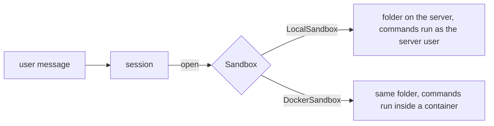

# 23 — Sandboxes

> **Who this is for:** an operator who must choose and tune the sandbox, and anyone who wants to know where a session's files live.
> **What you need first:** [21 Configuration reference](21-configuration.md) (the `[plugins]` and `[sandbox]` tables) and [22 Users and accounts](22-users.md). Words: [sandbox](glossary.md#sandbox), [session](glossary.md#session), [execution environment](glossary.md#execution-environment).
> **What you will learn:** what a sandbox is, the two kinds, why several users need Docker, every Docker option, where files go, and when a sandbox is closed.
> **Code paths covered:** `apps/server/src/simp_server/server.py` (`Sandbox`, `LocalSandbox`, `check_sandbox`, `SessionManager`), `sandboxes/docker.py`, `apps/server/sandboxes/Dockerfile`, `packages/simp_agent/src/simp_agent/agent/env.py` (`LocalEnv`).
> **Verified at commit:** `194c41e` (read from code; Docker not run).

**Back:** [22 Users and accounts](22-users.md) · **Next:** [24 Money and limits](24-money.md)

## 1. What a sandbox is

When the agent runs a tool such as `bash`, `read` or `write`, it needs a place to do it. The server gives each [session](glossary.md#session) its own place: an [execution environment](glossary.md#execution-environment). The **sandbox** is the server part that makes (`open`), closes (`close`) and deletes (`remove`) these places.

The sandbox is a [plugin](glossary.md#plugin) slot. You choose it in `[plugins] sandbox` (see [21](21-configuration.md#5-plugins-and-sandbox)). The CLI has no sandbox: its tools run on your own machine ([10](10-cli.md)).



## 2. Two kinds

| | `LocalSandbox` (default) | `DockerSandbox` |
|---|---|---|
| Files | folder per session | same kind of folder |
| Commands (`bash`) | run **on the server machine**, as the user who started the server | run **inside a Docker container**, one per session |
| Isolation | **none** | locked down (section 4) |
| Needs | nothing | Docker, and the image from `simp-server build-sandbox` |
| Good for | one person, on their own machine | several users |

Be clear about `LocalSandbox`: the folder is only the *starting* directory. A command like `cat ~/.ssh/id_rsa` or `rm -rf ~` is not blocked. The file tools (`read`, `write`, `edit`) refuse paths that leave the session folder, but `bash` has no such guard.

## 3. Why Docker for several users

With `LocalSandbox`, every user's agent runs commands as the same account on the same machine. One user could read another user's workspace, the database, `settings.toml`, or anything else the server user can reach. With Docker, each session can only touch its own folder (and, if you allow a network, the network).

So the server checks this rule (`check_sandbox`): **more than one active user and `LocalSandbox` is refused** (the check only looks for the name `LocalSandbox`; it does not test isolation), unless `allow_local_sandbox = true`.

| Where | What happens |
|---|---|
| `simp-server` start | exits with the message and does not start |
| web sign-up | refused (409) when it would make the second active user |
| `simp-server seed` | adds the user, prints a warning only; the server keeps running but will refuse to start next time |
| `rotate` | no check (see [22](22-users.md#6-revoke-and-rotate)) |

The message tells you the fix: run `simp-server build-sandbox`, then set `sandbox = "simp_server.sandboxes.docker:DockerSandbox"` (or the environment variable `SIMP_SANDBOX=docker`; a `[plugins]` entry wins over it). `allow_local_sandbox = true` turns the check off; use it for tests only.

## 4. How `DockerSandbox` works

One container per session, named `simp-<session_id>`, made with `docker run`. It stays alive (`sleep infinity`) and each command is sent in with `docker exec`.

The key idea is the files. The session folder on the host is mounted in the container at `/work`. File tools (`read`, `write`, `edit`) work on the **host** folder directly, with the same path-escape check as before. Only `bash` goes through `docker exec`, in `/work`. Both sides see the same files. The container user has id 1000; if the server runs as another user, `bash` may not be able to write in the folder (the code does not fix this).

Fixed settings (you cannot change them in `settings.toml`):

| Flag | Meaning |
|---|---|
| `--user 1000:1000` | not root |
| `--read-only` | the container's own disk cannot be changed; only `/work` and a small `/tmp` (64 MB) are writable |
| `--cap-drop ALL` | no special Linux rights |
| `--security-opt no-new-privileges` | a program cannot get more rights |

Options you can set in `[sandbox]` (they apply to `DockerSandbox` only; all optional):

| Key | Default | Effect |
|---|---|---|
| `image` | `simp-sandbox:latest` | the image to run |
| `network` | `"none"` | `none` = the container has no network. Set e.g. `"bridge"` to allow internet (then `pip install`, `git clone` work, and so can data leaks). |
| `memory` | `"1g"` | most RAM per container |
| `cpus` | `"1"` | most CPU per container |
| `pids_limit` | `256` | most processes per container (stops a runaway program that starts too many processes) |
| `workspaces_dir` | `<data_dir>/workspaces` | where session folders live |

Example:

```toml
[plugins]
sandbox = "simp_server.sandboxes.docker:DockerSandbox"

[sandbox]
network = "bridge"
memory = "2g"
```

The image comes from `apps/server/sandboxes/Dockerfile`: Python 3.13 slim plus `ripgrep`, `fd`, `git`, `coreutils`, `procps`, and a user with id 1000. Run `simp-server build-sandbox` once, and again if you change the Dockerfile ([20](20-operator-tutorial.md#4-build-the-sandbox-image-not-run)).

If a command times out or the user stops the run, the server kills the command's whole process group inside the container, not only the shell.

A Docker container does not get the server's environment, so provider keys are not in it. (With `LocalSandbox` the server removes the keys from its environment, but `<data_dir>/.env` is still a file the commands can read.)

## 5. Where the files are

Both kinds use `<data_dir>/workspaces/<session_id>` (or `workspaces_dir` for Docker). The folder is made when the session is first opened.

- Old servers used `<data_dir>/sandboxes/<session_id>`. On first open, such a folder is moved to the new place.
- The session id may only contain letters, digits, `_` and `-` (max 64) in Docker. This stops odd names from escaping the folder.
- Deleting a session in the UI closes its sandbox and **deletes its folder** (`remove`). This cannot be undone.
- Backups: `workspaces/` is inside the data dir (see [20](20-operator-tutorial.md)); the file contents are what the agent made, so they are worth saving.

## 6. When a sandbox is closed

A session is "open" (kept in server memory) while in use. The server closes its sandbox (the container is removed with `docker rm -f`; the **files stay**) when:

| Event | Detail |
|---|---|
| Idle for `idle_minutes` (15) | no run, no open page, no pending work; checked every `evict_every` seconds (60) |
| Limit reached | at `max_open_sessions` (8), the longest-idle session is closed for a new one; if all are busy, the new request gets **503** |
| Session deleted | container and files both removed |
| Server stops | all containers are removed |

The next message in an unloaded session opens the sandbox again: a fresh container on the same folder. So **files survive, but processes do not**: a background server started with `bash` is gone after an idle close. Files that the agent put outside `/work` (for example in `/tmp`) are gone too. Details of these keys: [21](21-configuration.md#6-capacity). If the server crashes, leftover containers are removed the next time that session opens.

## 7. If Docker is not ready

Test before users come (steps in [20](20-operator-tutorial.md)). If Docker is not running, or the image is missing, `docker run` fails and the session gets the error `docker run failed: ...`. The user who runs the server must be allowed to use Docker. To clean up, delete a folder in `workspaces/` only if its session no longer exists.

## 8. Limits to remember

- Docker is a good limit, not a perfect one. A kernel bug can break any container. Known gaps: 26 Security model (not written yet).
- `LocalSandbox` + `allow_local_sandbox = true` + several users means everyone can reach everything.
- With `network = "none"` the agent cannot install packages or call web APIs. Choose on purpose.
- Limits are per container, so total use is up to `max_open_sessions` × `memory`. Size your machine for that.

---

**Built on by:** [24 Money and limits](24-money.md), 26 Security model, 27 Troubleshooting (not written yet).
**Builds on:** [20 Operator tutorial](20-operator-tutorial.md), [21 Configuration reference](21-configuration.md), [22 Users and accounts](22-users.md).
