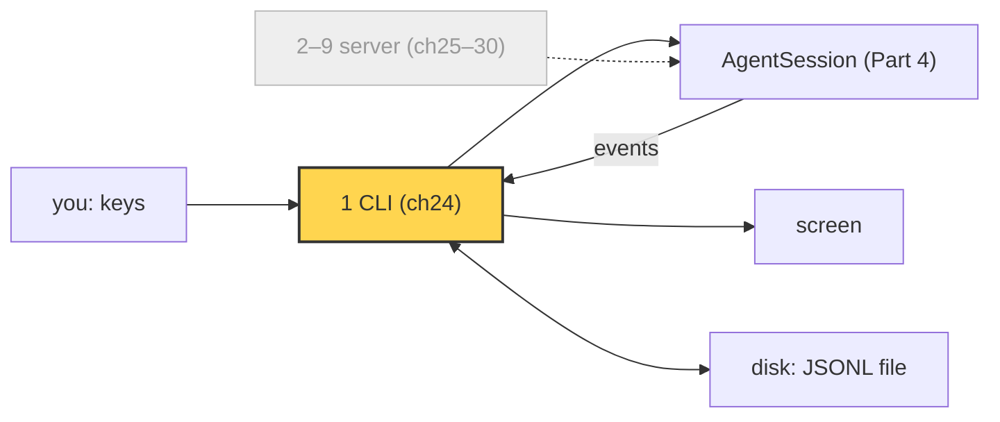
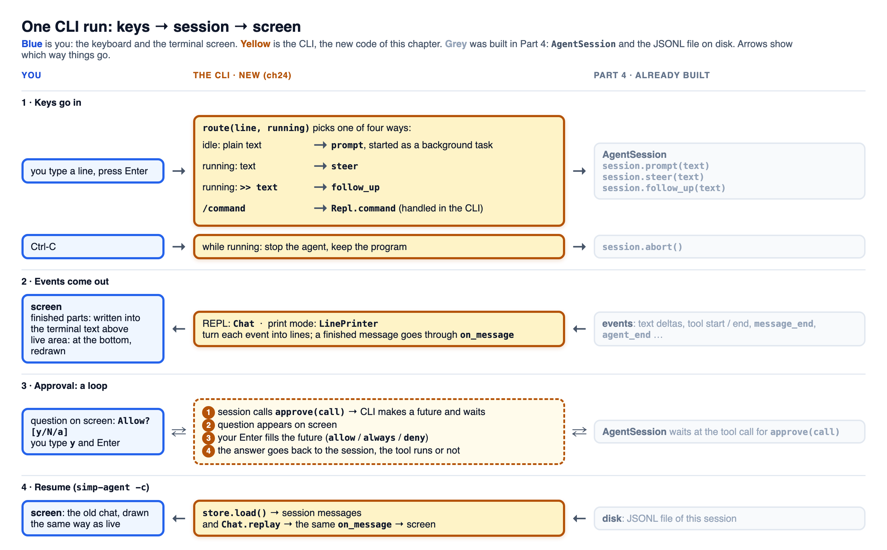

# 24 Part 5 · The CLI

**Goal:** Wrap the session in a terminal app.

**Builds on:** [23 Part 5 big picture](23-part-5-system.md) · **Next:** [25 The server run](25-server-run.md)

## A morning with the CLI

Picture a real morning. You open a terminal in your project folder and type `simp-agent "write fizzbuzz.py"`. You want five things. You want to see the answer appear word by word. Halfway through you see the agent pick the wrong file name, and you want to tell it so without waiting. Before it writes the file or runs `bash`, you want to say yes or no. If it goes wrong, you want Ctrl-C to stop the agent, not kill the program. And tomorrow you want to type `simp-agent -c` and go on from where you stopped.

At the end of Part 4 we have an `AgentSession` ([17](17-session.md)) with plugins, retry, compaction and profiles ([18](18-plugins.md)–[22](22-profiles-plugins.md)). It can already do all five things: it sends events ([08](08-events-abort.md)), has `steer` and `follow_up` ([09](09-steering.md)), calls an `approve` function ([10](10-hooks-approval.md)), has `abort()`, and saves to a store ([17](17-session.md#where-do-we-save)). But you can only use it from Python code.

The CLI (command-line interface: the program you run in a terminal) is the thin layer that connects keys, screen and disk to that session. It adds no agent behaviour of its own. Its code is in `apps/cli/src/simp_cli/`. In the map of [23](23-part-5-system.md) it is block 1, the first of two front doors to the same `AgentSession`; the server in [25](25-server-run.md) is the second.



*Yellow is this chapter. The grey server path is the second front door, built in [25](25-server-run.md)–[30](30-web-client.md).*

## Two modes: print mode and the REPL



*Read it top to bottom: your keys go right through `route` into the grey `AgentSession`, its events come back left through `Chat` or `LinePrinter` to your screen, approval goes there and back as a loop, and resume reads the old JSONL file and draws it through the same `on_message`.*

The CLI has two modes, and `main` picks one by asking "did you give a task?". With a task (`simp-agent "write fizzbuzz.py"`, or `-p "task"`) it runs **[print mode](glossary.md#print-mode)**: one task, then exit, with exit code 0 if it worked and 1 if it failed or was stopped, so scripts and pipes can use it. With no task it starts the **[REPL](glossary.md#repl)** (read–eval–print loop): a chat screen, built with the `prompt_toolkit` library, where you type many lines. `main` loads the REPL code only in that case, so print mode does not need `prompt_toolkit`.

Both modes build the session the same way. They give `AgentSession` the coding tools of [13](13-coding-tools.md), a `JsonlStore` for this folder, the messages already in that store, and an approve function. The model comes from a profile ([22](22-profiles-plugins.md#part-a-profiles)). The API key is read by the app, not by the provider ([02](02-pick-clean.md#1-pick-_providers-register_provider)): `env_api_key` reads it from an environment variable. The settings file can only name that variable (`api_key_env`), never hold the key itself, because a settings file is easy to share or commit by mistake.

```text
FUNCTION main():
    flags    = read the command line
    settings = read ~/.simp-agent/settings.json (empty if there is none)
    model    = build_model(the profile, with the flags on top)        // 22
    task     = the -p text, or the words after simp-agent
    IF there is a task:                       // print mode
        EXIT with run(task, model, flags)     // 0 = it worked, 1 = error or stopped
    ELSE:                                     // REPL
        load the REPL code (needs prompt_toolkit)
        EXIT with repl(model, flags)

FUNCTION make the session (both modes do this):
    id    = --resume ID, OR the newest session of this folder (-c), OR a new id
    store = JsonlStore(~/.simp-agent/sessions/<this folder>/<id>.jsonl)
    RETURN AgentSession(
        model,
        the coding tools,                                 // 13
        store,
        messages    = store.load(),                       // old messages, so we resume
        get_api_key = env_api_key(model),
        approve     = nothing IF -y ELSE ask "Allow? [y/N/a]")

FUNCTION run(task, model, flags):             // print mode
    session = make the session
    send its events to a LinePrinter
    Ctrl-C -> session.abort()
    WAIT for session.prompt(task)
    RETURN 1 IF the last message is an error or was stopped, ELSE 0

FUNCTION env_api_key(model):                  // the key comes from an env var, never the file
    IF the profile names a variable (api_key_env) and it is set: RETURN its value
    IF the api is OpenAI-style: RETURN OPENAI_API_KEY, or "dummy" (a local server needs no key)
    RETURN ANTHROPIC_API_KEY
```

Real code: [apps/cli/src/simp_cli/\_\_init\_\_.py](../../apps/cli/src/simp_cli/__init__.py), functions `main`, `run`, `resolve_config`, `env_api_key`.

The rest of the chapter takes your five wishes one at a time, and for each one says what print mode does and what the REPL does.

## How does the answer appear as it is written?

The CLI subscribes to the session's events ([08](08-events-abort.md)) and draws each one as it comes; the two modes only draw differently.

```python
# print mode (run): one listener that prints whole lines
session.subscribe(LinePrinter(args.thinking))

# REPL (Repl.new_session): one listener that updates the status bar, then draws in the chat
self.session.subscribe(self.on_event)   # on_event(e) ends with self.chat.on_event(e)
```

In print mode the output often goes to a file or a pipe, where single tokens make a mess. So a `LinePrinter` keeps the text pieces in a buffer and prints each line as soon as it is complete. Thinking is printed in lighter grey text, so you can tell it apart from the answer. Grey text needs hidden control characters (**[ANSI codes](glossary.md#ansi-codes)**) that only a terminal understands. In a file or a pipe they would show up as junk like `\033[2m`, so the CLI adds them only when the output is a real terminal. Each tool call prints one line starting with `> `, and a failed tool adds a line starting with `!`:

```text
I will write the file.
> write: fizzbuzz.py
> bash: python fizzbuzz.py
  ! python: command not found
```

In the REPL, the screen is built from small pieces, one for each part of the chat. Each piece is a **[component](glossary.md#component)**:

```text
> write fizzbuzz.py                  ← UserMsg: what you typed
I will write the file and run it.    ← AssistantMsg: the answer (thinking in grey above it)
> write: fizzbuzz.py                 ← ToolCall: one tool call and its output
> bash: python fizzbuzz.py           ← ToolCall
  1
  2
  Fizz
— earlier history compacted —        ← Notice: a short status line
```

A `Chat` takes the session's events and keeps one component for each part.

Each component knows how to draw itself, but it does not print. You give it the screen width, and it gives back the lines to show (`render(width)`). The REPL then prints those lines. For example, the second tool call above:

```python
c = ToolCall(call)              # the bash call: python fizzbuzz.py
c.output = "1\n2\nFizz\n"       # output so far
c.render(80)
# ['> bash: python fizzbuzz.py', '  1', '  2', '  Fizz']   (each line also has its colour codes)
```

Because `render` only returns text, a test can call `render(80)` and check the lines without a real terminal.

Parts that still change (the answer being streamed, a tool waiting for its result) stay in a live area at the bottom. When a part is finished, it is written once into the normal terminal text above, so you can scroll back and copy it. That is also why the REPL is not full screen. The streamed answer shows as plain text and becomes Markdown only when done, because half-done Markdown jumps around.

Real code: `LinePrinter` in [\_\_init\_\_.py](../../apps/cli/src/simp_cli/__init__.py); `Chat` and the components in [components.py](../../apps/cli/src/simp_cli/components.py).

## How can I type while the agent works?

**What you want.** You type `write fizzbuzz.py`, and the agent starts. Halfway, you decide the file should be called `fizz.py`. You want to type that **now**, not after the agent is done.

**Why the simple version cannot.** The simplest REPL is a loop:

```text
LOOP:
    line = input("> ")               // wait for you to type
    WAIT for session.prompt(line)    // wait for the agent to finish
```

While it waits for the agent, nothing reads the keyboard. Your `call it fizz.py` sits there until the agent has already written `fizzbuzz.py`.

**The fix: two changes.** Here is the simple loop next to one that works:

```text
simple (stuck)                          REPL (works)
LOOP:                                   LOOP:
    line = wait for a line                  line = wait for a line, WITHOUT stopping the agent
    WAIT for the agent to finish            IF new prompt: START the agent in the background, do not wait
                                            ELSE: give the line to the running agent (steer / follow-up)
```

First, waiting for your key must not stop the agent. Second, a new prompt starts the agent in the background and the loop goes straight back to the keyboard. While an agent is running, a new line does not start a second one; it is handed to the running agent. Every language can do this: with a second thread, a goroutine in Go, or `async`/`await` with an event loop as in Python and JavaScript.

**In Python.** The CLI uses `asyncio`. "Wait without stopping the agent" is `await`: it stops only the input loop, and while it waits for your key the [event loop](glossary.md#event-loop) runs the agent. "Start in the background" is `ensure_future`, which hands the agent's run to the event loop and returns at once:

```python
def start(self, coro) -> None:
    self.task = asyncio.ensure_future(coro)   # start it, do not wait
```

The two jobs, input loop and agent, take turns on one event loop; a turn ends at every `await`. The agent awaits a lot (each piece of the model's answer, each tool), so your keys are handled almost at once. The real REPL has no `LOOP` line of its own: prompt_toolkit runs it and calls `submit(line)` once per Enter.

Real code: [repl.py](../../apps/cli/src/simp_cli/repl.py), methods `Repl.start` and `Repl.submit`.

Our story, step by step:

```text
0 s  you: Enter on "write fizzbuzz.py" → idle → start the agent in the background
0 s  agent: sends the request, waits for the model
2 s  model text arrives → agent: "thinking…", waits again
3 s  you: Enter on "call it fizz.py" → agent is running → steer for this run
4 s  model text arrives → agent reads the steer before its next model call, writes fizz.py
```

**What your line means.** When you press Enter, the REPL looks at the line and at whether the agent is running (`route`):

| You type | Agent idle | Agent running |
|---|---|---|
| `call it fizz.py` | a new prompt: starts a run | a **steer**: the agent reads it before its next model call |
| `>> then add tests` | a new prompt | a **follow-up**: starts after the agent would stop |
| `/help`, `/history`, `/exit` | runs the command | runs the command |
| `/new`, `/sessions`, `/compact` | runs the command | refused: `busy: Ctrl-C to abort first` |

Steers and follow-ups go to the two queues of [09](09-steering.md#the-agent-side-two-lists-and-a-mode). Commands that change the session are refused during a run, so the session is not replaced or compacted while the agent is using it.

Real code: `route` in [\_\_init\_\_.py](../../apps/cli/src/simp_cli/__init__.py); `Repl.submit` and `Repl.command` in [repl.py](../../apps/cli/src/simp_cli/repl.py).

Print mode has no input during a run: you gave the task on the command line, and that is all.

## How does it ask before a risky tool?

The session already asks: before `bash`, `write` or `edit` it calls an `approve(call)` function and waits for `"allow"`, `"deny"` or `"always"` ([10](10-hooks-approval.md#approval-a-before_tool_call-that-asks-a-human)). The CLI only supplies that function, or none with `-y`. It shows a short question such as `write: fizzbuzz.py`, and turns your answer into a decision: `y` is allow, `a` is always (allow this tool for the rest of the session), and anything else is deny, so the safe answer is the default.

In print mode, `ask` can simply block on `input("Allow? [y/N/a] ")`. Nothing else has to run while a tool waits.

In the REPL, a blocking `input()` would stop the one event loop, and the screen would freeze. So `approve` waits on a **[future](glossary.md#future)**: an empty box that one side waits on and another side fills. `approve` makes the box, redraws the screen so the question shows, and waits:

```python
async def approve(self, call) -> str:
    self.pending = asyncio.get_running_loop().create_future()
    ...
    return await self.pending
```

Real code: [repl.py](../../apps/cli/src/simp_cli/repl.py), method `Repl.approve`.

Step by step, when the agent wants to write `fizzbuzz.py`:

1. The session calls `approve(call)` and waits for the answer.
2. `approve` makes the empty box and waits on it. The input line changes from `> ` to `Allow? [y/N/a] `.
3. The agent task is paused at that wait, but the event loop is not: the screen still draws and the input line still reads keys.
4. You type `y` and press Enter. `submit` sees the waiting box and puts `"allow"` in it (`self.pending.set_result(...)`).
5. `approve` wakes up with `"allow"`, and the agent writes the file.

## What does Ctrl-C do?

Ctrl-C stops the run, not the program: it calls `session.abort()` ([08](08-events-abort.md#abort-one-asyncioevent)), and the agent stops cleanly. What happens next depends on when you press it:

| When you press Ctrl-C | Print mode | REPL |
|---|---|---|
| the agent is running | stop the run, exit with code 1 | stop the run, back to the input line |
| it is asking `Allow?` | answer "deny", stop the run | answer "deny", stop the run |
| the agent is idle | (print mode is never idle) | first time: warns `Ctrl-C again to exit`; again within 2 seconds: exit |

In the REPL, Ctrl-D on an empty line also exits.

Real code: `run` and `interrupt_action` in [\_\_init\_\_.py](../../apps/cli/src/simp_cli/__init__.py); `Repl.ctrl_c` in [repl.py](../../apps/cli/src/simp_cli/repl.py).

## How do I continue tomorrow?

Every session is saved as a JSONL file ([17](17-session.md#where-do-we-save)), and each working folder has its own sessions: for `/Users/a/proj` they live in `~/.simp-agent/sessions/Users-a-proj/`, one `<id>.jsonl` per session (function `session_dir`). You choose which one to open when you start the CLI:

```sh
simp-agent -c                  # the newest session of this folder
simp-agent --resume 3f9a1c2e   # one session, by id
simp-agent -r                  # list the sessions of this folder and pick one
```

Opening means `messages=store.load()`: the session starts with yesterday's messages, and the next prompt goes on from there.

The REPL must also show yesterday's chat again. It does that by sending each saved message through the same `Chat.on_message` that live events use at each `message_end`. To keep the screen short it replays only the last 20 messages and says how to see the rest (`/history`):

```python
def replay(self, messages: list) -> None:
    for m in messages:
        self.on_message(m)
    self.live.clear()  # unanswered tool calls of an old run: nothing more will come
    self.tools.clear()
```

Real code: [components.py](../../apps/cli/src/simp_cli/components.py), methods `Chat.replay` and `Chat.on_message`.

One path for both means a resumed session looks the same as when it ran live: the same `UserMsg`, the same `AssistantMsg` as Markdown, the same `ToolCall` with its result. There is no second drawing code that could drift apart.

**Builds on:** [23 Part 5 big picture](23-part-5-system.md) · **Next:** [25 The server run](25-server-run.md)
